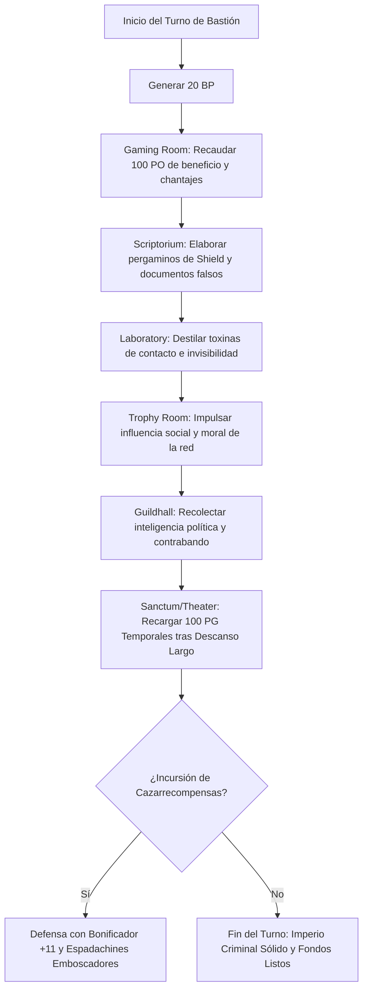

# 🏰 Bastión y Tiempo Muerto — Magical Mischief Murder Man

**Build:** Magical Mischief Murder Man  
**Sistema:** D&D 2024 / 5.5e DMG Bastion Rules  
**Nivel de Bastión:** 20  
**Nombre del Bastión:** *The Gilded Shadow & Grand Casino* (La Sombra Dorada y Gran Casino)  
**Documentos Relacionados:**
* [Guía de Personaje](file:///d:/repo-vault/Proyectos/Rol/DnDbuilds/builds/magical%20mischief%20murder%20man/character%20guide.md)
* [Guía 2024](file:///d:/repo-vault/Proyectos/Rol/DnDbuilds/builds/magical%20mischief%20murder%20man/character%20guide%202024.md)
* [Lista de Conjuros](file:///d:/repo-vault/Proyectos/Rol/DnDbuilds/builds/magical%20mischief%20murder%20man/spell%20list.md)
* [Objetos a Obtener](file:///d:/repo-vault/Proyectos/Rol/DnDbuilds/builds/magical%20mischief%20murder%20man/item%20list%20to%20obtain.md)
* [Hoja de Ruta](file:///d:/repo-vault/Proyectos/Rol/DnDbuilds/builds/magical%20mischief%20murder%20man/roadmap.md)
* [Inventario Equipado](file:///d:/repo-vault/Proyectos/Rol/DnDbuilds/builds/magical%20mischief%20murder%20man/actual%20inventory%20list.md)

---

## 🏛️ Estadísticas Defensivas del Bastión

* **Bonificador de Mando y Defensa:** $\mathbf{+11}$ ($\text{PB } +6 + \text{DEX } +5$).
* **Puntos de Bastión (BP):** 20 BP por Turno de Bastión (regeneración según nivel 20).
* **Guarnición Activa:**
  * 12 Espadachines de Capa y Espada (duelistas de choque ágiles).
  * 6 Espías e Informantes de la red de contrabando.
  * 1 Jefe de Mesa Arcano (control de trampas y apuestas mágicas).

---

## 🏗️ Instalaciones Básicas (Basic Facilities)

1. **Dormitorio de Lujo (Bedchambers):** Aposento barroco revestido de terciopelo escarlata, espejos dorados y una trampilla de escape hacia los túneles subterráneos.
2. **Salón de Banquetes (Dining Hall):** Candelabros de cristal y bodegas con los vinos más finos saqueados a la aristocracia local.
3. **Cámara de los Conspiradores (Common Room):** Club social exclusivo donde nobles corruptos e informantes del bajo mundo negocian favores.
4. **Cámara Acorazada Oculta (Storage):** Bóveda con triple cerradura mecánica y runas de alarma para salvaguardar el botín acumulado.

---

## 🧪 Instalaciones Especiales (Special Facilities: 4 Roomy + 2 Vast)

Conforme a las reglas del DMG 2024 a nivel 20, la fortaleza dispone exactamente de 6 Instalaciones Especiales (4 Roomy y 2 Vast):

### 1. [Roomy] Gaming Room (El Salón de la Fortuna Clandestina)
* **Función:** Mesas de ruleta, cartas trucadas y apuestas de alto nivel para la élite de la ciudad.
* **Orden de Bastión:** *Gamble / Harvest*. Genera $100\text{ PO}$ semanales de beneficio neto limpio y atrae información confidencial de jugadores endeudados.

### 2. [Roomy] Laboratory (Laboratorio de Solventes y Venenos)
* **Función:** Destilación de toxinas paralizantes, venenos sutiles y tintas invisibles para sabotajes.
* **Orden de Bastión:** *Research / Distill*. Elaboración de pociones de invisibilidad y venenos de contacto a mitad de coste.

### 3. [Roomy] Trophy Room (Galería de las Hazañas Imposibles)
* **Función:** Exposición privada de joyas robadas a reyes, coronas de cultistas y contratos de extorsión sellados.
* **Orden de Bastión:** *Maintain / Impress*. Concede una bonificación pasiva de $+2$ a tiradas de Carisma (Engaño, Persuasión, Intimidación) a todos los agentes del Bastión.

### 4. [Roomy] Scriptorium (Taller de Falsificación y Salvaguardas)
* **Función:** Creación de salvoconductos falsos, cartas de nobleza adulteradas y copiado de pergaminos arcanos (*Shield*, *Misty Step*).
* **Orden de Bastión:** *Scribe*. Elaboración de documentos oficiales indetectables con *Reliable Talent*.

### 5. [Vast] Guildhall (Sede Central del Sindicato de la Sombra)
* **Función:** Centro neurálgico de espionaje que controla las redes del hampa en múltiples provincias.
* **Orden de Bastión:** *Influence*. Otorga al personaje inmunidad legal informal en la región y acceso inmediato a cualquier secreto político o militar.

### 6. [Vast] Sanctum / Grand Theater (El Gran Teatro de la Máscara)
* **Función:** Auditorio suntuoso donde se celebran óperas y comedias satíricas que ridiculizan a los rivales del Swashbuckler.
* **Orden de Bastión:** *Sanctuary*. Otorga $100\text{ PG}$ temporales al personaje y a sus aliados tras un descanso largo, y ventaja en tiradas de iniciativa durante 7 días.

---

## 🔄 Flujograma de Turno de Bastión (Weekly Bastion Turn)

---

## ⏳ Actividades de Tiempo Muerto (Downtime Priorities)

### Prioridad 1: Crimen de Guante Blanco y Manipulación de Mercados
* **Mecánica:** Pruebas de Carisma y Destreza con *Reliable Talent*. El resultado en Engaño (+10) o Latrocinio (+17) no puede ser inferior a 20 / 27.
* **Objetivo:** Adquisición de secretos de estado y gemas preciosas sin derramar una sola gota de sangre.

### Prioridad 2: Elaboración de Pergaminos de Protección
* **Acción:** Copiar pergaminos de *Shield* en el *Scriptorium* a un coste de 25 PO la unidad para abastecer la defensa personal del duelista.
