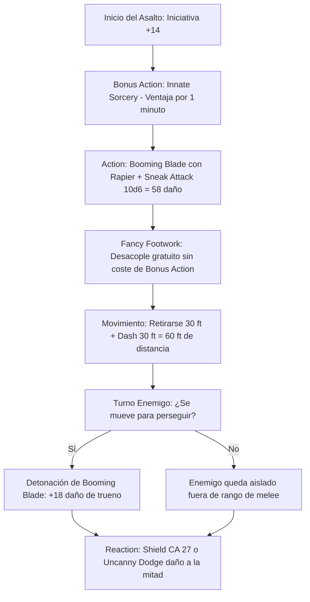

# ⚡ Guía de Personaje — Magical Mischief Murder Man (Edición 2024 / 5.5e)

**Arquetipo:** Mobile Skirmisher Nova & Duelist Striker  
**Clase:** Sorcerer (Wild Magic) 1 / Rogue (Swashbuckler) 19  
**Especie:** Human (Reglas 2024)  
**Trasfondo:** Wayfarer / Charlatan (Dote de Origen: *Alert*)  
**Sistema:** D&D 5th Edition (Reglas 2024 / 5.5e)  
**Documentos Relacionados:**
* [Guía Principal](file:///d:/repo-vault/Proyectos/Rol/DnDbuilds/builds/magical%20mischief%20murder%20man/character%20guide.md)
* [Bastión y Tiempo Muerto](file:///d:/repo-vault/Proyectos/Rol/DnDbuilds/builds/magical%20mischief%20murder%20man/bastion%20and%20downtime.md)
* [Lista de Conjuros](file:///d:/repo-vault/Proyectos/Rol/DnDbuilds/builds/magical%20mischief%20murder%20man/spell%20list.md)
* [Objetos a Obtener](file:///d:/repo-vault/Proyectos/Rol/DnDbuilds/builds/magical%20mischief%20murder%20man/item%20list%20to%20obtain.md)
* [Hoja de Ruta](file:///d:/repo-vault/Proyectos/Rol/DnDbuilds/builds/magical%20mischief%20murder%20man/roadmap.md)
* [Inventario Equipado](file:///d:/repo-vault/Proyectos/Rol/DnDbuilds/builds/magical%20mischief%20murder%20man/actual%20inventory%20list.md)

---

## 📊 Atributos y Estadísticas (Nivel 20)

| Atributo | Puntuación | Modificador | Salvación Base | Notas Defensivas |
| :--- | :---: | :---: | :---: | :--- |
| **Fuerza (STR)** | 8 | -1 | -1 | Atributo de descarte |
| **Destreza (DEX)** | 20 | +5 | +11 (Competente) | Ataques de estoque, iniciativa, CA y sigilo |
| **Constitución (CON)** | 14 | +2 | +8 (Competente) | Salvación base de Sorcerer |
| **Inteligencia (INT)** | 10 | 0 | 0 | Habilidades investigativas |
| **Sabiduría (WIS)** | 12 | +1 | +7 (Slippery Mind) | Competencia adquirida por *Slippery Mind* |
| **Carisma (CHA)** | 18 | +4 | +10 (Slippery Mind) | Iniciativa Swashbuckler, *Panache* y engaño |

* **Puntos de Golpe (PG):** 185 ($1\text{d}6 + 19\text{d}8 + 40 \text{ CON} + 40 \text{ Tough}$).
* **Clase de Armadura (CA):** 22 pasiva (Cuero Tachonado +3, Luck Blade +1, Cloak/Ring). CA 27 con reacción (*Shield*).
* **Iniciativa 2024:** $+5 (\text{DEX}) + 4 (\text{CHA}) + 5 (\text{Alert}) = \mathbf{+14}$.

---

## 🏷️ Matriz de Evaluación Táctica

| Categoría | Nivel | Justificación Mecánica |
| :--- | :---: | :--- |
| **Iniciativa y Duelo 1v1** | 🔵 S | $+14$ a la iniciativa plana; *Rakish Audacity* activa el Sneak Attack sin ventaja ni aliados en combate singular. |
| **Movilidad y Desacoplamiento** | 🔵 S | *Fancy Footwork* otorga *Disengage* gratuito contra cualquier objetivo atacado en cuerpo a cuerpo; permite aplicar *Booming Blade* y retirarse sin coste. |
| **Burst Damage (Nova)** | 🔵 S | $1\text{d}8 + 5$ (Estoque) $+ 3\text{d}8$ (Booming) $+ 10\text{d}6$ (Sneak Attack 19) $+ 4\text{d}8$ (detonación por movimiento) = $\mathbf{76.0 \text{ daño medio}}$. |
| **Dominio Social y Provocación** | 🔵 S | *Panache* con *Reliable Talent* garantiza tiradas mínimas de $\mathbf{26}$ en Persuasión; neutraliza enemigos fuera de combate y fuerza aggro en combate. |
| **Supervivencia / EHP** | 🟢 A | CA 22/27, *Elusive* (inmunidad a ventaja hostil), *Evasion*, *Uncanny Dodge* y 4 salvaciones competentes. |
| **Economía de Recursos** | 🔵 S | Ciclo infinito asalto tras asalto sin consumir ranuras altas; dependiente únicamente de cantrips y Sneak Attack. |

---

## 🧮 Motor Matemático (2024 Ruleset)

### 1. Sinergia Innate Sorcery 2024 + Booming Blade
En las reglas 2024, *Innate Sorcery* otorga **Ventaja** en todas las tiradas de ataque con conjuros de Hechicero durante 1 minuto como Bonus Action. Al lanzar *Booming Blade* (un conjuro de hechicero):
$$P(\text{Impacto base}) = 0.70 \implies P(\text{Ventaja}) = 1 - (1 - 0.70)^2 = 1 - 0.09 = \mathbf{91.0\%}$$
Probabilidad de Golpe Crítico con Ventaja:
$$P(\text{Crítico}) = 1 - (0.95)^2 = \mathbf{9.75\%}$$

### 2. Daño Total en Asalto de Duelo
$$\text{Impacto Directo} = 1\text{d}8 + 5 (\text{Estoque}) + 3\text{d}8 (\text{Booming}) + 10\text{d}6 (\text{Sneak}) = 9.5 + 13.5 + 35.0 = \mathbf{58.0 \text{ daño}}$$
Con detonación secundaria obligatoria por retirada con *Fancy Footwork*:
$$\text{Detonación Secundaria} = 4\text{d}8 = \mathbf{18.0 \text{ daño de trueno}}$$
$$\text{DPR con Ventaja y Movimiento Enemigo} = 0.91 \times 58.0 + 18.0 = 52.78 + 18.0 = \mathbf{70.78 \text{ DPR neto}}$$

### 3. Supervivencia Efectiva (EHP)
Frente a un enemigo con $+14$ al ataque contra CA 22 y Desventaja obligatoria (*Cloak of Displacement*):
Probabilidad base: $P = 0.65$.
Con Desventaja: $P_{\text{desv}} = (0.65)^2 = 0.4225 \quad (42.25\%)$.
Con *Uncanny Dodge* (daño a la mitad):
$$\text{EHP Pasivo} = \frac{185 + 100 (\text{Sanctum THP})}{0.4225 \times 0.50} = \frac{285}{0.2112} \approx \mathbf{1{,}349.4 \text{ EHP}}$$

---

## 🔄 Bucle Táctico de Combate (Action Loop)

---

## ⚔️ Integración de Weapon Masteries 2024

* **Rapier (Vex):** Al impactar con el estoque, concede **Ventaja** en tu siguiente tirada de ataque contra el mismo objetivo. Permite encadenar ventajas consecutivas sin depender exclusivamente de *Innate Sorcery*.
* **Dagger (Nick):** Al portar una daga ligera secundaria, permite ejecutar un ataque adicional dentro de la Acción de Ataque sin gastar la Bonus Action, liberando la Bonus Action para *Cunning Action* (*Dash* o *Hide*).
