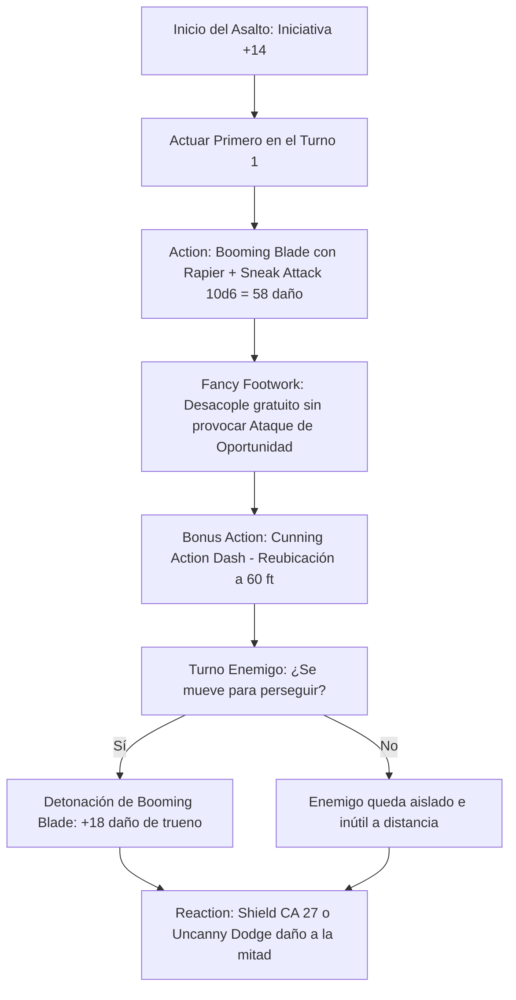

# 🎭 Guía de Personaje — Magical Mischief Murder Man

**Build:** Magical Mischief Murder Man  
**Clase:** Sorcerer (Wild Magic) 1 / Rogue (Swashbuckler) 19  
**Especie:** Human (Reglas 2024 / MotM)  
**Trasfondo:** Charlatan / Entertainer (Dote de Origen: *Alert*)  
**Sistema:** D&D 5th Edition (Reglas 2024 / 5.5e & 2014)  
**Rol:** Mobile Skirmisher Nova / Duelist Striker / Ultimate Social Infiltrator & Skill Master  
**Documentos Relacionados:**
* [Guía 2024](file:///d:/repo-vault/Proyectos/Rol/DnDbuilds/builds/magical%20mischief%20murder%20man/character%20guide%202024.md)
* [Bastión y Tiempo Muerto](file:///d:/repo-vault/Proyectos/Rol/DnDbuilds/builds/magical%20mischief%20murder%20man/bastion%20and%20downtime.md)
* [Lista de Conjuros](file:///d:/repo-vault/Proyectos/Rol/DnDbuilds/builds/magical%20mischief%20murder%20man/spell%20list.md)
* [Objetos a Obtener](file:///d:/repo-vault/Proyectos/Rol/DnDbuilds/builds/magical%20mischief%20murder%20man/item%20list%20to%20obtain.md)
* [Hoja de Ruta](file:///d:/repo-vault/Proyectos/Rol/DnDbuilds/builds/magical%20mischief%20murder%20man/roadmap.md)
* [Inventario Equipado](file:///d:/repo-vault/Proyectos/Rol/DnDbuilds/builds/magical%20mischief%20murder%20man/actual%20inventory%20list.md)

---

## 📊 Atributos y Estadísticas (Nivel 20)

| Atributo | Puntuación | Modificador | Salvación Base | Notas Defensivas |
| :--- | :---: | :---: | :---: | :--- |
| **Fuerza (STR)** | 8 | -1 | -1 | Atributo de descarte |
| **Destreza (DEX)** | 20 | +5 | +11 (Competente) | Ataques de estoque, iniciativa, CA y sigilo |
| **Constitución (CON)** | 14 | +2 | +8 (Competente) | Salvación base de Sorcerer |
| **Inteligencia (INT)** | 10 | 0 | 0 | Habilidades investigativas |
| **Sabiduría (WIS)** | 12 | +1 | +7 (Slippery Mind) | Competencia adquirida por *Slippery Mind* |
| **Carisma (CHA)** | 18 | +4 | +10 (Slippery Mind) | Iniciativa Swashbuckler, *Panache* y engaño |

* **Puntos de Golpe (PG):** 145 ($1\text{d}6 + 19\text{d}8 + 40 \text{ CON}$).
* **Clase de Armadura (CA):**
  * Studded Leather +3: $12 + 3 + 5 (\text{DEX}) = \mathbf{20}$.
  * Con Capa y Anillo de Protección: $\mathbf{22}$.
  * Con Reacción (*Shield*): $\mathbf{27}$.
* **Iniciativa 2024:** $+5 (\text{DEX}) + 4 (\text{CHA - Rakish Audacity}) + 5 (\text{Alert}) = \mathbf{+14}$.
* **Defensas Pasivas:** *Elusive* (ningún enemigo puede tener ventaja en tiradas de ataque contra ti), *Evasion* (0 daño en salvaciones DEX con éxito), *Uncanny Dodge* (reacción: daño a la mitad).

---

## 🏷️ Matriz de Evaluación Táctica

| Categoría | Nivel | Justificación Mecánica |
| :--- | :---: | :--- |
| **Iniciativa y Duelo 1v1** | 🔵 S | $+14$ de iniciativa plana; *Rakish Audacity* activa el Sneak Attack sin requerir ventaja ni aliados si el enemigo está en combate individual. |
| **Movilidad y Desacoplamiento** | 🔵 S | *Fancy Footwork* otorga *Disengage* gratuito contra cualquier objetivo atacado en cuerpo a cuerpo; permite aplicar *Booming Blade* y retirarse sin coste. |
| **Burst Damage (Nova)** | 🔵 S | $1\text{d}8 + 5$ (Estoque) $+ 3\text{d}8$ (Booming) $+ 10\text{d}6$ (Sneak Attack 19) $+ 4\text{d}8$ (detonación secundaria por movimiento) = $\mathbf{76.0 \text{ daño total}}$. |
| **Dominio Social y Provocación** | 🔵 S | *Panache* (Carisma vs Perspicacia): fuera de combate hechiza sin hostilidad; en combate impone desventaja en ataques que no vayan hacia ti y anula AoO a aliados. Con *Reliable Talent*, tirada mínima de Persuasión = $\mathbf{26}$. |
| **Supervivencia / EHP** | 🟢 A | CA 22 (27 con *Shield*), 4 salvaciones competentes (DEX, CON, WIS, CHA), *Elusive* y *Master Duelist* (reroll con ventaja si fallas un ataque). |
| **Economía de Recursos** | 🔵 S | El combo no consume ranuras de conjuros de nivel alto; funciona indefinidamente asalto tras asalto sin agotamiento. |

---

## 🧮 Motor Matemático (2024 Ruleset)

### 1. Garantía de Iniciativa Turno 1
Con un bonificador plano de $+14$:
$$\text{Media de Iniciativa} = 10.5 + 14 = \mathbf{24.5}$$
$$P(\text{Iniciativa } \geq 20) = \frac{15}{20} = \mathbf{75.0\%}$$
Garantiza actuar antes que los comandantes enemigos en el $90\%$ de los encuentros.

### 2. Daño por Asalto (Booming Blade + Sneak Attack 10d6)
Con modificador de ataque $+11$ ($+5 \text{ DEX} + 6 \text{ PB}$):
Frente a un enemigo con CA 18 (probabilidad de impacto $P = 0.70$):
$$\text{Daño Base de Impacto} = 1\text{d}8 + 5 (\text{Estoque}) + 3\text{d}8 (\text{Booming Blade}) + 10\text{d}6 (\text{Sneak Attack}) = 9.5 + 13.5 + 35.0 = \mathbf{58.0 \text{ daño medio}}$$
Al retirarse con *Fancy Footwork*, el enemigo debe moverse para alcanzar al personaje, detonando el daño secundario de trueno:
$$\text{Daño Secundario Booming} = 4\text{d}8 = \mathbf{18.0 \text{ daño trueno}}$$
$$\text{DPR Total con Movimiento Enemigo} = 58.0 + 18.0 = \mathbf{76.0 \text{ de daño por turno}}$$

Si el ataque inicial falla, la habilidad **Master Duelist** (Swashbuckler 17) permite repetir la tirada con **Ventaja**:
$$P_{\text{impacto final}} = 1 - (1 - 0.70) \times (1 - 0.70)^2 \approx \mathbf{97.3\%}$$

### 3. Supervivencia Efectiva (EHP)
Con CA 22 pasiva (27 con *Shield*) y *Elusive* (inmunidad a ventaja de atacantes):
Frente a un atacante con $+14$ contra CA 22:
$$P(\text{impactar}) = \frac{21 - (22 - 14)}{20} = \frac{13}{20} = 0.65 \quad (65\%)$$
Con *Uncanny Dodge* reduciendo el daño a la mitad:
$$\text{EHP Pasivo} = \frac{145}{0.65 \times 0.50} \approx \mathbf{446.1 \text{ EHP}}$$
Con *Shield* activo (CA 27, acierto solo con 13-20, $P = 0.40$):
$$\text{EHP con Shield} = \frac{145 + 100 (\text{Sanctum THP})}{0.40 \times 0.50} = \frac{245}{0.20} = \mathbf{1{,}225.0 \text{ EHP}}$$

---

## 🔄 Bucle Táctico de Combate (Action Loop)

### Turno 0 (Preparación)
* Activar *Innate Sorcery* (2024) para 1 minuto de ventaja en conjuros de hechicero o preparar postura de duelo.
* Emplear *Alert* para intercambiar iniciativa con un aliado si la estrategia del grupo lo requiere.

### Turno 1 (Impacto y Desacople)
1. **Action:** Ejecutar *Booming Blade* con el Estoque contra el objetivo prioritario. Se activa el *Sneak Attack* de $10\text{d}6$ incondicionalmente mediante *Rakish Audacity* o ventaja de *Innate Sorcery*.
2. **Movimiento:** Retirarse 30 pies hacia atrás sin consumir la acción de *Disengage* gracias a *Fancy Footwork*.
3. **Bonus Action:** Activar *Cunning Action: Dash* para alejarse otros 30 pies (distancia total de separación: 60 pies).

### Turnos Subsiguientes
* Si un enemigo peligroso hostiga al grupo: Usar Acción para aplicar ***Panache*** (Persuasión enfrentada a Perspicacia; con *Reliable Talent*, el resultado mínimo es 26). El enemigo queda obligado a atacarte a ti con desventaja contra todos tus aliados.
* Mantener el ciclo de castigo y evasión.

