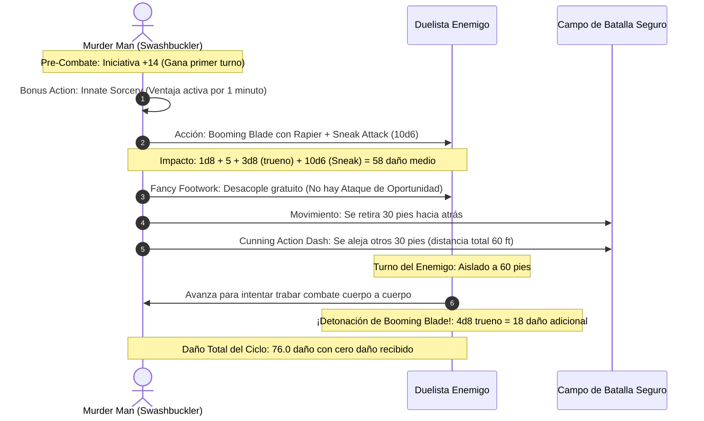

# 📜 Lista de Conjuros y Trucos — Magical Mischief Murder Man

**Build:** Magical Mischief Murder Man  
**Clase:** Sorcerer (Wild Magic) 1 / Rogue (Swashbuckler) 19  
**Nivel de Lanzador:** Hechicero Nivel 1 (2 ranuras de Nivel 1 por descanso largo)  
**Atributo de Conjuración:** Carisma (CD $8 + 6 \text{ PB} + 4 \text{ CHA} = \mathbf{18}$)  
**Documentos Relacionados:**
* [Guía de Personaje](file:///d:/repo-vault/Proyectos/Rol/DnDbuilds/builds/magical%20mischief%20murder%20man/character%20guide.md)
* [Guía 2024](file:///d:/repo-vault/Proyectos/Rol/DnDbuilds/builds/magical%20mischief%20murder%20man/character%20guide%202024.md)
* [Bastión y Tiempo Muerto](file:///d:/repo-vault/Proyectos/Rol/DnDbuilds/builds/magical%20mischief%20murder%20man/bastion%20and%20downtime.md)
* [Objetos a Obtener](file:///d:/repo-vault/Proyectos/Rol/DnDbuilds/builds/magical%20mischief%20murder%20man/item%20list%20to%20obtain.md)
* [Hoja de Ruta](file:///d:/repo-vault/Proyectos/Rol/DnDbuilds/builds/magical%20mischief%20murder%20man/roadmap.md)
* [Inventario Equipado](file:///d:/repo-vault/Proyectos/Rol/DnDbuilds/builds/magical%20mischief%20murder%20man/actual%20inventory%20list.md)

---

## ⚡ Efectos Activos y Buffs Previos (Turn 0)

| Efecto / Habilidad | Duración | Coste de Recurso | Beneficio Mecánico |
| :--- | :---: | :---: | :--- |
| **Innate Sorcery (2024)** | 1 minuto | Bonus Action (2/día) | Ventaja permanente en tiradas de ataque con conjuros de hechicero (*Booming Blade*). |
| **Alert (Dote)** | Permanente | Pasivo | $+5$ a la iniciativa, inmunidad a ser sorprendido y capacidad de intercambiar orden de turno. |
| **Tides of Chaos** | Instantáneo | 1/descanso (recarga con Wild Surge) | Concede ventaja en una tirada de ataque, salvación o característica a demanda. |
| **Studded Leather +3** | Permanente | No | CA base 20 sin penalización de sigilo ni peso restrictivo. |

---

## 📊 Matriz de Conjuros de Hechicero (Sorcerer 1)

### Trucos (Cantrips)
* **Booming Blade:** 🔵 S. El catalizador nuclear del build. Infunde el estoque con energía de trueno ($3\text{d}8$ extra al impacto y $4\text{d}8$ si el enemigo se mueve).
* **Minor Illusion:** 🔵 S. Genera sonidos distractores o coberturas visuales para habilitar tiradas de *Hide* en mitad de un salón.
* **Prestidigitation:** 🟢 A. Herramienta clásica de engaño: limpiar manchas de sangre, encender velas o enfriar copas para aristócratas.
* **Friends / Mage Hand:** 🟢 A. Manipulación mental rápida o manipulación de llaves a distancia sin tocar cerraduras.

### Nivel 1 (2 Ranuras de Conjuración)
* **Shield:** 🔵 S. Reacción fundamental. Eleva la CA a 27 ante un impacto inminente, desbaratando ataques de jefes.
* **Absorb Elements:** 🔵 S. Mitiga a la mitad el daño de alientos de dragón, fuego o relámpago, y añade daño de ese tipo al siguiente estoque.
* **Pergaminos de Nivel 1 (Vía Bastión):** Reserva de pergaminos de *Disguise Self*, *Charm Person* y *Silvery Barbs* elaborados en el *Scriptorium*.

---

## 🔄 Diagrama de Secuencia: Booming Skirmish & Fancy Footwork

---

## 💖 Curación en Segundo Plano (Background Healing)

Al ser una combinación de Pícaro y Hechicero sin ranuras de magia divina dedicadas, el build optimiza la curación pasiva mediante recursos logísticos del Bastión:
1. **Reserva de Pociones de Curación:** Suministro constante de 8x *Potion of Superior Healing* ($8\text{d}4 + 8$ PG) elaboradas en el *Laboratory* del Bastión.
2. **Sanctum Temp HP:** Descansar en el Gran Teatro del Bastión otorga **100 PG temporales** previos a cada expedición, funcionando como un colchón que previene la pérdida de vida real.
3. **Short Rest Optimization:** *Song of Rest* o Dados de Golpe maximizados mediante *Periapt of Wound Closure* para recuperar toda la vida en descansos de 1 hora.
