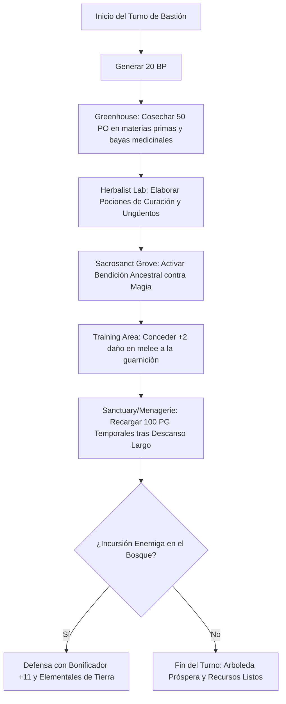

# 🏰 Bastión y Tiempo Muerto — Moon Guardian

**Build:** Moon Guardian (El Coloso Primigenio Inmortal)  
**Sistema:** D&D 2024 / 5.5e DMG Bastion Rules  
**Nivel de Bastión:** 20  
**Nombre del Bastión:** *The Primordial Grove & Ancestral Megalith* (La Arboleda Primigenia y Megalito Ancestral)  
**Documentos Relacionados:**
* [Guía de Personaje](file:///d:/repo-vault/Proyectos/Rol/DnDbuilds/builds/moon%20guardian/character%20guide.md)
* [Guía 2024](file:///d:/repo-vault/Proyectos/Rol/DnDbuilds/builds/moon%20guardian/character%20guide%202024.md)
* [Lista de Conjuros](file:///d:/repo-vault/Proyectos/Rol/DnDbuilds/builds/moon%20guardian/spell%20list.md)
* [Objetos a Obtener](file:///d:/repo-vault/Proyectos/Rol/DnDbuilds/builds/moon%20guardian/item%20list%20to%20obtain.md)
* [Hoja de Ruta](file:///d:/repo-vault/Proyectos/Rol/DnDbuilds/builds/moon%20guardian/roadmap.md)
* [Inventario Equipado](file:///d:/repo-vault/Proyectos/Rol/DnDbuilds/builds/moon%20guardian/actual%20inventory%20list.md)

---

## 🏛️ Estadísticas Defensivas del Bastión

* **Bonificador de Mando y Defensa:** $\mathbf{+11}$ ($\text{PB } +6 + \text{CON } +5$).
* **Puntos de Bastión (BP):** 20 BP por Turno de Bastión (regeneración según nivel 20).
* **Guarnición Activa:**
  * 16 Guardianes del Bosque (exploradores y bárbaros cambiaformas).
  * 8 Druidas Jóvenes del Círculo Lunar.
  * 2 Elementales de Tierra Mayores vinculados como guardianes de las puertas pétreas.

---

## 🏗️ Instalaciones Básicas (Basic Facilities)

1. **Dormitorio de Raíces Huecas (Bedchambers):** Excavado en el interior de un roble milenario viviente; lecho de musgo esponjoso con piedras térmicas.
2. **Claro de los Festines (Dining Hall):** Anfiteatro natural techado con enredaderas donde se sirven frutos silvestres, setas gigantes y raciones de *Goodberry*.
3. **Círculo de los Megalitos (Common Room):** Anillo de menhires ancestrales donde la tribu medita y practica transformaciones animales.
4. **Cueva Sellada de Semillas y Reliquias (Storage):** Caverna subterránea con humedad controlada para almacenar reactivos botánicos y minerales.

---

## 🧪 Instalaciones Especiales (Special Facilities: 4 Roomy + 2 Vast)

Conforme a las reglas oficiales del DMG 2024 a nivel 20, la fortaleza dispone exactamente de 6 Instalaciones Especiales (4 Roomy y 2 Vast):

### 1. [Roomy] Sacrosanct Grove / Reliquary (Arboleda Sacrosanta de los Ancestros)
* **Función:** Conexión espiritual con los espíritus tutelares del bárbaro y las deidades de la naturaleza.
* **Orden de Bastión:** *Commune / Blessing*. Concede a los defensores ventaja en tiradas de salvación contra efectos mágicos durante 7 días y permite realizar el ritual de *Heroes' Feast* con un 50% de descuento en componentes de gemas.

### 2. [Roomy] Greenhouse (Invernadero Botánico Primigenio)
* **Función:** Cultivo de hierbas curativas raras, bayas luminiscentes y raíces energéticas.
* **Orden de Bastión:** *Harvest*. Genera 50 PO semanales en materias primas botánicas y produce 10 bayas medicinales que funcionan como pociones de curación menor.

### 3. [Roomy] Archive / Library (Archivo de Bestias y Mitos Tribales)
* **Función:** Bestiario vivo y colección de fósiles que amplían el repertorio de formas de *Wild Shape* conocidas por el personaje.
* **Orden de Bastión:** *Research*. Proporciona ventaja y un bonificador de $+5$ en tiradas de Naturaleza y Supervivencia sobre bestias y elementales.

### 4. [Roomy] Herbalist Lab / Scriptorium (Laboratorio de Ungüentos y Tinturas)
* **Función:** Destilación de bálsamos regenerativos y elaboración de pergaminos druídicos (*Revivify*, *Lesser Restoration*).
* **Orden de Bastión:** *Craft / Scribe*. Elaboración de pociones y pergaminos de sanación a mitad de tiempo y coste.

### 5. [Vast] Training Area (Patios de Entrenamiento Bestial)
* **Función:** Terreno escarpado con rocas pesadas y troncos para acondicionamiento físico de los guardianes.
* **Orden de Bastión:** *Train*. Otorga al personaje y a los defensores un bonificador de $+2$ a tiradas de daño cuerpo a cuerpo y $+10\text{ PG}$ temporales durante 7 días.

### 6. [Vast] Menagerie / Sanctuary (Santuario de Especies Protegidas)
* **Función:** Reserva natural protegida donde habitan criaturas mágicas y bestias de gran tamaño en perfecta armonía.
* **Orden de Bastión:** *Sanctuary*. Otorga $100\text{ PG}$ temporales al personaje tras completar un descanso largo en su interior y sirve como refugio inexpugnable ante cualquier invasor.

---

## 🔄 Flujograma de Turno de Bastión (Weekly Bastion Turn)

---

## ⏳ Actividades de Tiempo Muerto (Downtime Priorities)

### Prioridad 1: Comunión Ancestral y Preparación de Festines
* **Acción:** Realizar el ritual de *Heroes' Feast* en la Arboleda Sacrosanta previo a expediciones mayores.
* **Resultado:** Concede $+2\text{d}10$ PG máximos, inmunidad a veneno y miedo, y ventaja en tiradas de salvación de Sabiduría a todo el grupo por 24 horas.

### Prioridad 2: Elaboración de Pociones de Regeneración
* **Acción:** Utilizar el *Herbalist Lab* para producir lotes de *Potion of Superior Healing* ($8\text{d}4 + 8$ PG) a mitad de coste de oro.
