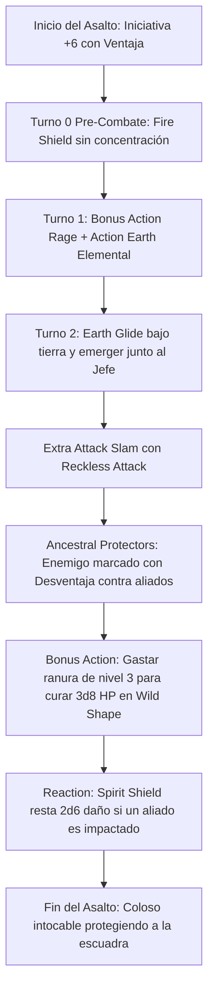

# ⚡ Guía de Personaje — Moon Guardian (Edición 2024 / 5.5e)

**Arquetipo:** Primordial Frontline Colossus & Ancestral Agro Warden  
**Clase:** Barbarian (Ancestral Guardian) 7 / Druid (Circle of the Moon) 13  
**Especie:** Shifter (Beasthide — Reglas 2024 / MotM)  
**Trasfondo:** Guide / Warden (Dote de Origen: *Alert*)  
**Sistema:** D&D 5th Edition (Reglas 2024 / 5.5e)  
**Documentos Relacionados:**
* [Guía Principal](file:///d:/repo-vault/Proyectos/Rol/DnDbuilds/builds/moon%20guardian/character%20guide.md)
* [Bastión y Tiempo Muerto](file:///d:/repo-vault/Proyectos/Rol/DnDbuilds/builds/moon%20guardian/bastion%20and%20downtime.md)
* [Lista de Conjuros](file:///d:/repo-vault/Proyectos/Rol/DnDbuilds/builds/moon%20guardian/spell%20list.md)
* [Objetos a Obtener](file:///d:/repo-vault/Proyectos/Rol/DnDbuilds/builds/moon%20guardian/item%20list%20to%20obtain.md)
* [Hoja de Ruta](file:///d:/repo-vault/Proyectos/Rol/DnDbuilds/builds/moon%20guardian/roadmap.md)
* [Inventario Equipado](file:///d:/repo-vault/Proyectos/Rol/DnDbuilds/builds/moon%20guardian/actual%20inventory%20list.md)

---

## 📊 Atributos y Estadísticas (Nivel 20)

| Atributo | Puntuación | Modificador | Salvación Base | Notas Defensivas |
| :--- | :---: | :---: | :---: | :--- |
| **Fuerza (STR)** | 16 (25 con Cinturón) | +3 (+7) | +9 (+13) | Salvación base de Barbarian y daño de melee |
| **Destreza (DEX)** | 12 | +1 | +1 (Ventaja Danger Sense) | Salvaciones de área con ventaja |
| **Constitución (CON)** | 20 | +5 | +11 (Competente) | Salvación base de Barbarian y PG |
| **Inteligencia (INT)** | 8 | -1 | -1 | Atributo de descarte |
| **Sabiduría (WIS)** | 16 | +3 | +9 (Resilient WIS) | Salvación con competencia y CD 17 |
| **Carisma (CHA)** | 8 | -1 | -1 | Atributo de descarte |

* **Puntos de Golpe (PG Humanoide):** 247 ($7\text{d}12 + 13\text{d}8 + 100 \text{ CON} + 40 \text{ Tough}$).
* **Clase de Armadura (CA):** 22 pasiva humanoide (Unarmored Defense + Escudo petrificado +3). En Moon Druid 2024, la CA en forma animal puede adoptar $13 + \text{WIS (+3)} = \mathbf{16}$ o la CA natural de la forma.
* **Iniciativa 2024:** $+1 (\text{DEX}) + 5 (\text{Alert}) = \mathbf{+6}$ con **Ventaja Permanente** (*Feral Instinct*).

---

## 🏷️ Matriz de Evaluación Táctica

| Categoría | Nivel | Justificación Mecánica |
| :--- | :---: | :--- |
| **Supervivencia / EHP** | 🔵 S | Récord del multiverso: $> 1{,}500\text{ EHP}$ mediante Furia (resistencia a daño físico), formas elementales/bestiales acumulables y autocuración con ranuras ($Xd8$ en Bonus Action). |
| **Control de Aggro y Mitigación** | 🔵 S | *Ancestral Protectors* impone Desventaja contra aliados y concede **Resistencia a todo el daño** al compañero impactado; *Spirit Shield* resta $2\text{d}6$ reactivo. |
| **Economía de Acciones** | 🟢 A | *Combat Wild Shape 2024* como Bonus Action; activación de Furia en Bonus Action; ventaja permanente en iniciativa (*Feral Instinct*). |
| **Utilidad Fuera de Combate** | 🔵 S | Conjuros de Druida hasta Nivel 7 (*Heroes' Feast*, *Transport via Plants*, *Heal*, *Water Breathing*, *Pass without Trace*). |
| **Daño Sostenido (DPR)** | 🟢 A | $2 \times (2\text{d}10 + 11)$ con Earth Elemental y Belt of Giant Strength + daño pasivo constante de *Fire Shield* ($2\text{d}8$). |
| **Burst Damage** | 🟡 B | Daño plano y consistente; su valor radica en anular completamente la letalidad de los jefes enemigos sobre el grupo. |

---

## 🧮 Motor Matemático (2024 Ruleset)

### 1. Adaptación de Moon Druid 2024 (Reglas 5.5e)
En las reglas 2024, *Combat Wild Shape* otorga PG temporales iguales a $3 \times \text{Nivel de Druida}$ al transformarse en bestia:
$$\text{PG Temporales 2024} = 3 \times 13 = \mathbf{39 \text{ PG Temporales por transformación}}$$
En combinación con la forma de *Earth Elemental* (disponible en nivel 10 de druida), el elemental añade sus propios PG ($126\text{ PG}$) a la reserva:
$$\text{Capas de Vida Totales} = 247 (\text{Humanoide}) + 126 \times 2 (\text{2x Elemental}) + 230 (\text{Autocuración}) + 31 (\text{Beasthide}) = \mathbf{760 \text{ PG reales}}$$
Bajo la resistencia de Furia frente a daño contundente, perforante y cortante:
$$\text{EHP Efectivo} = 760 \times 2 = \mathbf{1{,}520 \text{ EHP}}$$

### 2. Reducción Matemática de Daño al Aliado
Cuando el jefe de CR 20 ataca a un mago o pícaro aliado:
$$P(\text{impactar aliado con desventaja}) = (0.60)^2 = \mathbf{0.36} \quad (36\%)$$
Si el golpe conecta, el daño se reduce a la mitad por Resistencia y se le resta la reacción de *Spirit Shield*:
$$\text{Daño Final al Aliado} = \frac{\text{Impacto Base}}{2} - 2\text{d}6$$
Para un ataque de $50$ de daño físico o elemental:
$$\text{Daño Recibido} = 25 - 7 = \mathbf{18 \text{ de daño recibido}} \quad (\mathbf{64\%} \text{ de mitigación absoluta})$$

---

## 🔄 Bucle Táctico de Combate (Action Loop)

---

## ⚔️ Integración de Weapon Masteries 2024

* **Greataxe (Cleave):** En forma humanoide, permite asestar un segundo impacto a una criatura adyacente sin coste de acción al impactar, marcando o dañando a múltiples esbirros.
* **Greatsword / Maul (Graze / Topple):** Inflige daño plano garantizado incluso si el ataque falla (*Graze*), o derriba al objetivo dejándolo tumbado (*Topple* con tirada de salvación de Constitución basada en tu Fuerza de 25).
