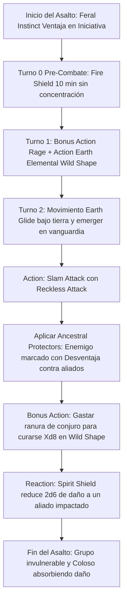

# 🐻 Guía de Personaje — Moon Guardian

**Build:** Moon Guardian (El Coloso Primigenio Inmortal)  
**Clase:** Barbarian (Ancestral Guardian) 7 / Druid (Circle of the Moon) 13  
**Especie:** Shifter (Beasthide — MotM / 2024)  
**Trasfondo:** Outlander / Hermit (Dote de Origen: *Alert*)  
**Sistema:** D&D 5th Edition (Reglas 2024 / 5.5e & 2014)  
**Rol:** Ultimate Frontline Sponge Tank / Agro Controller / Battlefield Warden / Off-Healer  
**Documentos Relacionados:**
* [Guía 2024](file:///d:/repo-vault/Proyectos/Rol/DnDbuilds/builds/moon%20guardian/character%20guide%202024.md)
* [Bastión y Tiempo Muerto](file:///d:/repo-vault/Proyectos/Rol/DnDbuilds/builds/moon%20guardian/bastion%20and%20downtime.md)
* [Lista de Conjuros](file:///d:/repo-vault/Proyectos/Rol/DnDbuilds/builds/moon%20guardian/spell%20list.md)
* [Objetos a Obtener](file:///d:/repo-vault/Proyectos/Rol/DnDbuilds/builds/moon%20guardian/item%20list%20to%20obtain.md)
* [Hoja de Ruta](file:///d:/repo-vault/Proyectos/Rol/DnDbuilds/builds/moon%20guardian/roadmap.md)
* [Inventario Equipado](file:///d:/repo-vault/Proyectos/Rol/DnDbuilds/builds/moon%20guardian/actual%20inventory%20list.md)

---

## 📊 Atributos y Estadísticas (Nivel 20)

| Atributo | Puntuación | Modificador | Salvación Base | Notas Defensivas |
| :--- | :---: | :---: | :---: | :--- |
| **Fuerza (STR)** | 16 | +3 | +9 (Competente) | Salvación base de Bárbaro y ataques de melee |
| **Destreza (DEX)** | 12 | +1 | +1 | Unarmored Defense y salvaciones con ventaja |
| **Constitución (CON)** | 20 | +5 | +11 (Competente) | Salvación base de Bárbaro, PG máximos y CA |
| **Inteligencia (INT)** | 8 | -1 | -1 | Atributo de descarte |
| **Sabiduría (WIS)** | 16 | +3 | +9 (Resilient WIS) | Salvación con competencia vía dote y conjuros |
| **Carisma (CHA)** | 8 | -1 | -1 | Atributo de descarte |

* **Puntos de Golpe (Forma Humanoide):** 247 ($7\text{d}12 + 13\text{d}8 + 100 \text{ CON} + 40 \text{ Tough}$).
* **Puntos de Golpe (Earth Elemental):** 126 PG por transformación (2 usos por descanso corto = 252 PG).
* **Clase de Armadura (CA):**
  * Humanoide sin armadura: $10 + 1 (\text{DEX}) + 5 (\text{CON}) + 2 (\text{Escudo no metálico +3}) + 1 (\text{Beasthide}) = \mathbf{22}$.
  * Forma Earth Elemental: CA 17 (resistencia a daño físico en Furia).
* **Iniciativa 2024:** $+1 (\text{DEX}) + 5 (\text{Alert}) = \mathbf{+6}$ con **Ventaja Permanente** (*Feral Instinct*).
* **Inmunidad a Sorpresa:** Puede actuar normalmente en el turno de sorpresa si entra en Furia (*Feral Instinct*).

---

## 🏷️ Matriz de Evaluación Táctica

| Categoría | Nivel | Justificación Mecánica |
| :--- | :---: | :--- |
| **Supervivencia y Mitigación (EHP)** | 🔵 S | Récord de absorción de daño: $> 1{,}500\text{ EHP}$ mediante Furia (resistencia a daño físico), doble forma de Earth Elemental (252 PG) y auto-sanación con ranuras ($Xd8$ como Bonus Action en Furia). |
| **Control de Aggro y Protección** | 🔵 S | *Ancestral Protectors* impone Desventaja contra aliados y otorga a los aliados **Resistencia a todo el daño** del enemigo marcado; *Spirit Shield* reduce daño a aliados en $2\text{d}6$ por reacción. |
| **Economía de Acciones** | 🟢 A | *Combat Wild Shape* como Bonus Action o Acción; auto-sanación con ranuras en Bonus Action durante la Furia; ventaja en iniciativa con *Feral Instinct*. |
| **Utilidad Fuera de Combate** | 🔵 S | Acceso a conjuros de Druida hasta Nivel 7 (*Heroes' Feast*, *Transport via Plants*, *Heal*, *Water Breathing*, *Pass without Trace*). |
| **Daño Sostenido (DPR)** | 🟢 A | $2 \times (2\text{d}10 + 8)$ en forma de Elemental de Tierra con daño mágico (+Furia) + *Fire Shield* pasivo devolviendo $2\text{d}8$ de daño a cada atacante. |
| **Burst Damage** | 🟡 B | Daño directo sostenido y no explosivo; su objetivo táctico es absorber todo el daño del encuentro mientras sus aliados aniquilan sin peligro. |

---

## 🧮 Motor Matemático de Supervivencia Absoluta (EHP Engine)

### 1. Desglose de Capas de Vida (HP Pools)
1. **Forma Earth Elemental (Carga 1):** $126\text{ PG}$. Con resistencia de Furia:
   $$\text{EHP}_{\text{Elemental 1}} = 126 \times 2 = \mathbf{252 \text{ EHP}}$$
2. **Forma Earth Elemental (Carga 2):** $126\text{ PG}$. Con resistencia de Furia:
   $$\text{EHP}_{\text{Elemental 2}} = 126 \times 2 = \mathbf{252 \text{ EHP}}$$
3. **Autocuración con Ranuras en Wild Shape (Combat Wild Shape):**
   Gasto de ranuras de nivel 1 a 6 para sanar en combate (12 ranuras disponibles):
   $$\text{Sanación Promedio} = 4(1\text{d}8) + 3(2\text{d}8) + 3(3\text{d}8) + 3(4\text{d}8) + 2(5\text{d}8) + 1(6\text{d}8) = 51\text{d}8 \approx \mathbf{229.5 \text{ PG curados}}$$
   Con resistencia de Furia: $229.5 \times 2 = \mathbf{459 \text{ EHP}}$.
4. **Forma Humanoide Real:** $247\text{ PG}$. Con resistencia de Furia:
   $$\text{EHP}_{\text{Humanoide}} = 247 \times 2 = \mathbf{494 \text{ EHP}}$$
5. **Shifter Beasthide Temp HP:** $1\text{d}6 + 2 \times \text{PB} = 3.5 + 12 = 15.5\text{ PG} \times 2 = \mathbf{31 \text{ EHP}}$.

$$\text{EHP Potencial Total en un Encuentro} = 252 + 252 + 459 + 494 + 31 = \mathbf{1{,}488 \text{ EHP sin buffs}}$$
Con *Heroes' Feast* previo (+2d10 PG máximos = +22 PG x 2 = +44 EHP) y *Aid*:
$$\mathbf{\text{EHP Máximo Absoluto} > 1{,}600 \text{ puntos de daño absorbible}}$$

### 2. Mitigación de Daño al Grupo (Ancestral Protectors)
Cuando un enemigo marcado con *Ancestral Protectors* ataca a un aliado:
1. El ataque sufre **Desventaja**. Para una probabilidad base de impacto de $P = 0.60$:
   $$P_{\text{desventaja}} = (0.60)^2 = \mathbf{0.36} \quad (\text{Reducción del } 40\% \text{ en impactos})$$
2. Si el impacto acierta, el aliado recibe **Resistencia a todo el daño** (reducción del $50\%$).
3. Moon Guardian utiliza su Reacción (*Spirit Shield*) para reducir el daño restante en $2\text{d}6$ (7 PG).

$$\text{Daño Recibido por el Aliado} = \frac{\text{Daño Base} \times 0.50 - 7}{\text{Daño Base}}$$
Para un golpe de $40$ de daño de un dragón o coloso:
$$\text{Daño Aliado} = 40 \times 0.50 - 7 = \mathbf{13 \text{ de daño recibido}} \quad (\mathbf{67.5\%} \text{ de mitigación directa})$$

---

## 🔄 Bucle Táctico de Combate (Action Loop)

### Turno 0 (Preparación)
* Lanzar *Fire Shield* (Nivel 4, 10 min de duración, **no requiere concentración**). Cada vez que un enemigo te golpee cuerpo a cuerpo recibe $2\text{d}8$ de daño automático.
* Lanzar *Longstrider* (+10 ft de velocidad sin concentración).

### Turno 1 (Despliegue del Coloso)
1. **Bonus Action:** Entrar en **Furia (Rage)**. Obtienes resistencia inmediata a daño contundente, perforante y cortante.
2. **Action:** Activar **Wild Shape** para asumir la forma de **Earth Elemental** (126 PG, CA 17, Earth Glide).
3. **Movement:** Desplazarse hacia el enemigo principal.

### Turnos Subsiguientes
* Atacar con *Slam* usando *Reckless Attack*. Al impactar, activas *Ancestral Protectors*: el objetivo más peligroso tiene desventaja contra tus aliados y tus aliados tienen resistencia a todos sus ataques.
* Si el Elemental sufre daño: Bonus Action para gastar una ranura de conjuro y curarte $Xd8$ PG sin perder la Furia.
* **Reaction:** Usar *Spirit Shield* para restar $2\text{d}6$ de daño a cualquier aliado que sea impactado a 30 pies.
