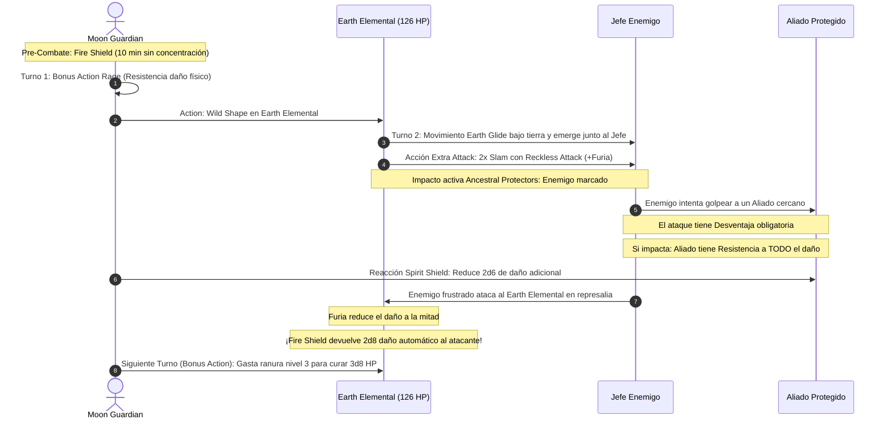

# 📜 Lista de Conjuros y Formas Salvajes — Moon Guardian

**Build:** Moon Guardian (El Coloso Primigenio Inmortal)  
**Clase:** Barbarian (Ancestral Guardian) 7 / Druid (Circle of the Moon) 13  
**Nivel de Lanzador:** Druida Nivel 13  
**Ranuras Disponibles:** 4 de Nivel 1, 3 de Nivel 2, 3 de Nivel 3, 3 de Nivel 4, 2 de Nivel 5, 1 de Nivel 6, 1 de Nivel 7  
**CD de Salvación de Druida:** $8 + 6 (\text{PB}) + 3 (\text{WIS}) = \mathbf{17}$  
**Documentos Relacionados:**
* [Guía de Personaje](file:///d:/repo-vault/Proyectos/Rol/DnDbuilds/builds/moon%20guardian/character%20guide.md)
* [Guía 2024](file:///d:/repo-vault/Proyectos/Rol/DnDbuilds/builds/moon%20guardian/character%20guide%202024.md)
* [Bastión y Tiempo Muerto](file:///d:/repo-vault/Proyectos/Rol/DnDbuilds/builds/moon%20guardian/bastion%20and%20downtime.md)
* [Objetos a Obtener](file:///d:/repo-vault/Proyectos/Rol/DnDbuilds/builds/moon%20guardian/item%20list%20to%20obtain.md)
* [Hoja de Ruta](file:///d:/repo-vault/Proyectos/Rol/DnDbuilds/builds/moon%20guardian/roadmap.md)
* [Inventario Equipado](file:///d:/repo-vault/Proyectos/Rol/DnDbuilds/builds/moon%20guardian/actual%20inventory%20list.md)

---

## ⚡ Efectos Activos y Buffs Previos a la Furia (Turn 0)

> [!IMPORTANT]
> Mientras se está en **Furia (Rage)** no se pueden lanzar conjuros ni mantener concentración. Por tanto, todos los conjuros de combate deben ser **sin concentración** y lanzarse antes de entrar en Furia:

| Efecto / Conjuro | Duración | Concentración | Beneficio Mecánico |
| :--- | :---: | :---: | :--- |
| **Fire Shield (Nivel 4)** | 10 minutos | **No** | Cada criatura que te golpee cuerpo a cuerpo recibe $2\text{d}8$ daño de fuego o frío; concede resistencia a fuego o frío. |
| **Freedom of Movement (Nivel 4)** | 1 hora | **No** | Inmunidad a terreno difícil, parálisis e impedimentos de movimiento. |
| **Longstrider (Nivel 1)** | 1 hora | **No** | $+10\text{ pies}$ a la velocidad de movimiento base (incluye formas animales y elementales). |
| **Heroes' Feast (Nivel 6)** | 24 horas | **No** | $+2\text{d}10\text{ PG}$ máximos, inmunidad a veneno y miedo, ventaja en tiradas de salvación de Sabiduría. |
| **Water Breathing (Nivel 3)** | 24 horas | **No (Ritual)** | Respiración bajo el agua para todo el grupo sin gastar ranuras. |
| **Beasthide Shifter (Racial)** | 1 minuto | No | $+1\text{ CA}$ y $1\text{d}6 + 2 \times \text{PB} = \mathbf{15.5 \text{ PG temporales}}$. |

---

## 📊 Matriz de Conjuros Preparados (Druida 13)

### Trucos (Cantrips)
* **Guidance:** 🔵 S. $+1\text{d}4$ a cualquier prueba fuera de combate.
* **Primal Savagery:** 🟢 A. Ataque ácido en forma humanoide si estás desarmado.
* **Mending:** 🟢 A. Reparación de equipo y estructuras del Bastión.
* **Druidcraft:** 🟡 B. Predicción meteorológica y efectos botánicos menores.

### Niveles 1 y 2
* **Goodberry:** 🔵 S. Genera 10 bayas que duran 24 horas; estabilizan aliados caídos a 0 PG sin coste.
* **Absorb Elements:** 🔵 S. Reacción pre-furia para absorber daño elemental masivo.
* **Pass without Trace:** 🔵 S. $+10$ al sigilo de todo el grupo para emboscadas tácticas (utilizado fuera de furia).
* **Lesser Restoration:** 🟢 A. Cura enfermedades, ceguera, sordera, parálisis o venenos.

### Niveles 3 y 4
* **Plant Growth:** 🔵 S. Reduce el movimiento enemigo a un cuarto sin requerir concentración (terreno difícil extremo).
* **Dispel Magic:** 🟢 A. Elimina barreras mágicas hostiles.
* **Fire Shield:** 🔵 S. **Esencial**. El motor de daño pasivo mientras estás en forma elemental y furia.
* **Freedom of Movement:** 🔵 S. Garantiza que el tanque jamás quede paralizado o retenido.

### Niveles 5, 6 y 7
* **Greater Restoration:** 🟢 A. Elimina niveles de agotamiento, petrificación o reducciones de atributos.
* **Heal (Nivel 6):** 🔵 S. Cura 70 PG directos instantáneamente y elimina ceguera y sordera.
* **Heroes' Feast (Nivel 6):** 🔵 S. Preparación previa indispensable para todo el grupo.
* **Transport via Plants (Nivel 6):** 🟢 A. Teletransporte planar/mundial instantáneo para todo el grupo.
* **Regenerate (Nivel 7):** 🟢 A. Restaura $4\text{d}8 + 15$ PG y 1 PG al inicio de cada turno durante 1 hora.

---

## 🐻 Formas de Wild Shape Recomendadas (Moon Druid 13)

| Forma Salvaje | CR | CA | PG | Ataques y Daño | Rasgos Especiales |
| :--- | :---: | :---: | :---: | :--- | :--- |
| **Earth Elemental** | 5 | 17 | 126 | 2x *Slam* ($+8$ a golpear, $2\text{d}10 + 5$) | *Earth Glide* (atraviesa roca sin perturbarla), Inmunidad a veneno/parálisis. |
| **Fire Elemental** | 5 | 13 | 102 | 2x *Touch* ($+6$ a golpear, $2\text{d}6 + 3$ fuego) | *Fire Form* ($1\text{d}10$ fuego al entrar en su espacio), Ilumina 30 pies. |
| **Water Elemental** | 5 | 14 | 114 | 2x *Slam* ($+7$ a golpear, $2\text{d}8 + 4$) | *Whelm* (ahoga y retiene hasta 2 criaturas grandes). |
| **Giant Subterranean Lizard** | 4 | 14 | 66 | *Bite* ($3\text{d}10 + 4$) + *Tail* ($3\text{d}8 + 4$) | Apresa automáticamente al morder a criaturas medianas o menores. |

---

## 🔄 Diagrama de Secuencia: Despliegue del Coloso y Absorción de Daño

---

## 💖 Curación en Segundo Plano (Background Healing)

1. **Combat Wild Shape Healing:** Mientras estás en Wild Shape y Furia, puedes gastar una ranura de conjuro como Bonus Action para recuperar **$1\text{d}8$ PG por cada nivel de la ranura** sin lanzar un conjuro. Un slot de 5.º nivel restaura $5\text{d}8 = \mathbf{22.5 \text{ PG}}$ en plena Furia.
2. **Reserva de Goodberry:** Al final de cada día, gastar las ranuras restantes en *Goodberry*. Cada baya dura 24 horas y provee alimento y curación garantizada fuera de combate.
3. **Aura of Vitality Fuera de Combate:** Si no estás en Furia, 1 lanzamiento de *Aura of Vitality* restaura $20\text{d}6 = \mathbf{70 \text{ PG}}$ distribuidos entre los miembros del grupo durante 1 minuto.
