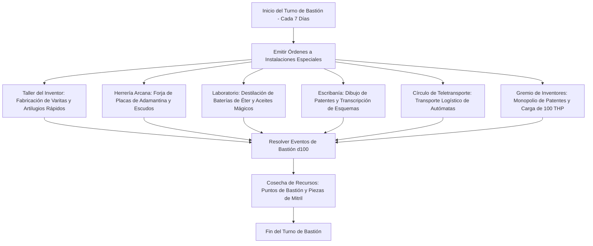

# 🏰 Bastión y Tiempo Muerto — Nick Nack Nabber

## 🏰 Sistema de Bastiones (Reglas Oficiales DMG 2024 / D&D 5.5e)

* **Nombre del Bastión:** La Torre del Engranaje (The Gearspire Citadel)
* **Nivel de Bastión:** 20 (Capacidad Máxima)
* **Puntos de Bastión (BP):** 130
* **Puntuación de Mando y Defensas (Defender Stats):**
  * STR 8 (-1), DEX 14 (+2), CON 14 (+2), INT 20 (+5), WIS 12 (+1), CHA 10 (+0)
  * **Bonificador de Defensa de Bastión:** $\mathbf{+11}$ (+6 Competencia + 5 Inteligencia)

---

## 🏛️ Registro de Instalaciones del Bastión (Nivel 20: 4 Roomy + 2 Vast)

### Instalaciones Básicas (Basic Facilities - Gratuitas e Ilimitadas)
1. **Dormitorio Automatizado (Bedchambers):** Alcoba con poleas mecánicas, iluminación controlada por interruptores de bronce y reloj despertador sonoro.
2. **Comedor Mecatrónico (Dining Hall):** Refectorio con raíles en el suelo donde sirvientes mecánicos transportan bandejas calientes y cerveza de cebada.
3. **Salón Común de Juegos y Prototipos (Common Room):** Espacio de reunión para artesanos gnomos lleno de tableros de ajedrez tridimensionales.
4. **Almacén Clasificado de Engranajes (Storage):** Cripta estanca con estanterías automáticas que archivan resortes, varillas de cobre y lingotes mágicos.

---

### Instalaciones Especiales (Special Facilities: Exactamente 6 al Nivel 20)

| Instalación | Tamaño (DMG 2024) | Nivel Mínimo | Estado | Orden Activa | Sinergia con el Build |
| :--- | :---: | :---: | :---: | :--- | :---: |
| **Taller del Inventor (Workshop)** | **Roomy** | Nivel 5 | Activa (Maintain) | *Craft:* Fabricación de varitas mágicas (*Wand of Magic Missiles*) y gadgets con un 50% de descuento. | 🔵 **Roto** |
| **Herrería Arcana (Smithy)** | **Roomy** | Nivel 5 | Activa (Maintain) | *Forge:* Forja armaduras pesadas de placas y escudos de mitril a mitad de tiempo. | 🟢 **Excelente** |
| **Laboratorio de Baterías (Laboratory)** | **Roomy** | Nivel 9 | Activa (Maintain) | *Research:* Destilación de elixires alquímicos y fluidos conductores de energía mágica. | 🟢 **Excelente** |
| **Escribanía de Patentes (Scriptorium)** | **Roomy** | Nivel 9 | Activa (Maintain) | *Scribe:* Copiado de diagramas mecánicos y pergaminos de *Shield*, *Web* y *Vortex Warp*. | 🟢 **Excelente** |
| **Círculo de Teletransporte (Teleportation Circle)** | **Vast** | Nivel 13 | Activa (Maintain) | *Travel:* Permite transportar al Armorer con todo su equipo pesado a cualquier taller del reino. | 🔵 **Roto** |
| **Gran Gremio de Inventores (Guildhall)** | **Vast** | Nivel 17 | Activa (Maintain) | *Trade:* Monopolio comercial de patentes; genera oro continuo y suministra **100 THP de reposo prolongado**. | 🔵 **Roto** |

---

## 👥 Guarnición y Personal de Mando (Staff & Garrison)

* **Mayordomo Mayor (Major Domo):** Mayordomo Cog (Constructo mecánico autómata con protocolo de bienvenida y contabilidad impecable).
* **Guarnición Activa:**
  * 16 Soldados Gnomos armados con ballestas pesadas y escudos de engranajes.
  * 6 Autómatas Defensores de hierro fundido patrullando las entradas de la torre.
* **Personal Especialista:**
  * 1 Maestro Fundidor de Aleaciones de Mitril y Adamantina.
  * 1 Alquimista Especialista en reactivos volátiles.
  * 2 Relojeros Mayores encargados de calibrar el engranaje central.

---

## ⏳ Actividades de Tiempo Muerto (Downtime Priorities)

### Prioridad 1: Fabricación de Varitas y Objetos de Disparo Rápido
* **Objetivo:** Disponer de una colección de varitas (*Wand of Magic Missiles*, *Wand of Web*) listas para activar con *Fast Hands*.
* **Mecánica:** Mediante el *Taller del Inventor* y la dote *Crafter*, fabricar objetos mágicos consumibles con un 20% de descuento de materiales.
* **Ventaja Táctica:** Provee al personaje de opciones ilimitadas para su Acción Adicional sin tocar sus ranuras de Artífice.

### Prioridad 2: Calibración del Spell-Storing Item
* **Objetivo:** Recargar y alternar el conjuro almacenado en el objeto mágico (10 usos de *Web* para control o 10 usos de *Cure Wounds* para rescate).
* **Mecánica:** Sesiones de sintonización en el *Laboratorio de Baterías*.

### Prioridad 3: Gestión de Patentes y Comercio de Inventos
* **Objetivo:** Maximizar los ingresos comerciales mediante la venta de licencias de engranajes automáticos.
* **Mecánica:** Negociaciones coordinadas mediante el *Gran Gremio de Inventores*.