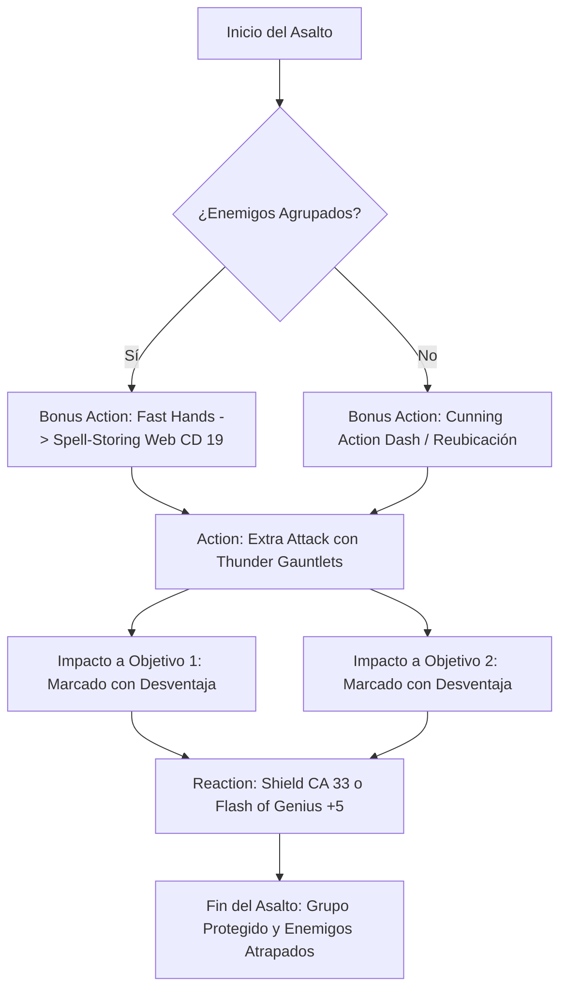

# ⚡ Guía de Personaje — Nick Nack Nabber (Edición 2024 / 5.5e)

**Arquetipo:** Frontline Disruptor & Fast Hands Magic Controller  
**Clase:** Artificer (Armorer) 17 / Rogue (Thief) 3  
**Especie:** Rock Gnome (Gnomo de las Rocas)  
**Trasfondo:** Artisan (Dote de Origen: *Crafter*)  
**Sistema:** D&D 5th Edition (Reglas 2024 / 5.5e)  
**Documentos Relacionados:**
* [Guía Principal](file:///d:/repo-vault/Proyectos/Rol/DnDbuilds/builds/nick%20nack%20nabber/character%20guide.md)
* [Bastión y Tiempo Muerto](file:///d:/repo-vault/Proyectos/Rol/DnDbuilds/builds/nick%20nack%20nabber/bastion%20and%20downtime.md)
* [Lista de Conjuros](file:///d:/repo-vault/Proyectos/Rol/DnDbuilds/builds/nick%20nack%20nabber/spell%20list.md)
* [Objetos a Obtener](file:///d:/repo-vault/Proyectos/Rol/DnDbuilds/builds/nick%20nack%20nabber/item%20list%20to%20obtain.md)
* [Hoja de Ruta](file:///d:/repo-vault/Proyectos/Rol/DnDbuilds/builds/nick%20nack%20nabber/roadmap.md)
* [Inventario Equipado](file:///d:/repo-vault/Proyectos/Rol/DnDbuilds/builds/nick%20nack%20nabber/actual%20inventory%20list.md)

---

## 📊 Atributos y Estadísticas (Nivel 20)

| Atributo | Puntuación | Modificador | Salvación Base | Con Flash of Genius (+5) |
| :--- | :---: | :---: | :---: | :---: |
| **Fuerza (STR)** | 8 | -1 | -1 | +4 |
| **Destreza (DEX)** | 16 | +3 | +3 | +8 |
| **Constitución (CON)** | 14 | +2 | +8 (Competente) | +13 (Ventaja War Caster) |
| **Inteligencia (INT)** | 20 | +5 | +11 (Competente) | +16 |
| **Sabiduría (WIS)** | 10 | 0 | 0 (Ventaja Gnomo) | +5 |
| **Carisma (CHA)** | 8 | -1 | -1 (Ventaja Gnomo) | +4 |

* **Puntos de Golpe (PG):** 173 ($10 + 16 \times 5 + 3 \times 5 + 40 \text{ Tough} + 40 \text{ CON}$).
* **Defensive Field:** 17 PG temporales x 6 usos = 102 PG temporales por descanso largo.
* **Clase de Armadura (CA):** 28 pasiva (Placas +3, Escudo +3, Cloak +1, Ring +1). CA 33 con reacción de *Shield*.
* **Velocidad:** 30 pies (sin penalización por armadura pesada).

---

## 🏷️ Matriz de Evaluación Táctica

| Categoría | Nivel | Justificación Mecánica |
| :--- | :---: | :--- |
| **Control de Campo** | 🔵 S | Doble impacto con *Thunder Gauntlets* (Desventaja contra todo el grupo) + *Web* en Bonus Action sin espacios vía Spell-Storing Item (CD 19). |
| **Supervivencia / EHP** | 🔵 S | CA 28 pasiva (33 con *Shield*), 275 PG efectivos base, *Flash of Genius* (+5 a salvaciones) y ventaja contra magia mental (Rock Gnome). |
| **Economía de Acciones** | 🔵 S | *Fast Hands 2024* rompe la economía permitiendo ejecutar acciones mágicas y usar objetos mágicos como Bonus Action en cada asalto. |
| **Utilidad y Logística** | 🟢 A | 5 ranuras de sintonización (*Magic Item Savant*), pericia en 5 herramientas (+17), Bastión de nivel 20 autosuficiente y forja acelerada. |
| **Daño Sostenido (DPR)** | 🟡 B | $13.30$ DPR con Guanteletes; el objetivo no es matar por daño directo sino anular el daño enemigo y encerrar la vanguardia. |
| **Burst Damage** | 🔴 C | Daño directo limitado; su impacto destructivo proviene de *Wall of Force*, *Animate Objects* o *Heat Metal*. |

---

## 🧮 Motor Matemático (2024 Ruleset)

### 1. Desviación de Impacto Enemigo (Disadvantage Gauntlets)
Cuando el enemigo tiene una probabilidad base de impacto del $50\%$ ($P = 0.50$):
$$P_{\text{desventaja}} = P^2 = (0.50)^2 = 0.25$$
La probabilidad de acierto del enemigo se reduce a la mitad. Para ataques dirigidos a aliados con CA 18:
$$P(\text{impactar aliado}) = 0.35 \implies P_{\text{desventaja}}(\text{impactar aliado}) = (0.35)^2 = 0.1225 \quad (12.25\%)$$
Esto genera una reducción de daño entrante al equipo del $\mathbf{65\%}$.

### 2. Supervivencia Efectiva (EHP)
$$\text{EHP}_{\text{Nivel 20}} = \frac{\text{HP Base (173)} + \text{Defensive Field (102)}}{1 - \text{Probabilidad de Acierto Enemigo}}$$
Frente a un monstruo de CR 20 con $+14$ al ataque contra CA 28 (necesita un 14 natural para impactar, $P = 0.35$):
$$\text{EHP} = \frac{275}{0.35} \approx \mathbf{785.7 \text{ EHP pasivo}}$$
Con reacción de *Shield* activa (CA 33, solo acierta con 19-20 natural, $P = 0.10$):
$$\text{EHP}_{\text{Shield}} = \frac{275}{0.10} = \mathbf{2{,}750.0 \text{ EHP}}$$

---

## 🔄 Bucle Táctico de Combate (Action Loop)

### Turno 0 (Preparación)
* Activar *Defensive Field* (+17 PG temporales).
* Concentración en *Fly*, *Fire Shield* o *Aura of Vitality* (si se pre-lanza curación en segundo plano).

### Turno 1 (Enganche y Control)
1. **Bonus Action (*Fast Hands 2024*):** Activar el *Spell-Storing Item* para lanzar ***Web*** (área de 20 pies, CD 19). Todos los enemigos que fallen quedan apresados (Restrained), concediendo Ventaja a todos los ataques aliados y Desventaja a los suyos.
2. **Action (*Extra Attack*):** Golpear con los *Thunder Gauntlets* a los dos enemigos más peligrosos que hayan sobrevivido o no estén apresados. Ambos reciben desventaja obligatoria contra cualquier ataque a tus aliados.
3. **Movement:** Posicionarse bloqueando la línea de visión directa a los aliados frágiles.

### Turnos Subsiguientes
* Mantener la presión con Guanteletes.
* Si un aliado cae o sufre daño severo: Bonus Action *Fast Hands* para activar el *Spell-Storing Item* con ***Cure Wounds*** ($2\text{d}8 + 5$ PG curados) mientras continúas atacando con tu Acción.
* **Reaction:** Activar *Shield* (+5 CA) para alcanzar CA 33, o *Flash of Genius* (+5 a la salvación de un aliado).

---

## ⚔️ Integración de Weapon Masteries 2024

Aunque la armadura de guardián utiliza los *Thunder Gauntlets* como armas principales, el acceso a competencias marciales permite portar armas secundarias:
* **Dagger (Nick):** Permite ejecutar un ataque de arma secundaria como parte de la Acción de Ataque sin gastar la Bonus Action, liberando el 100% de la Bonus Action para *Fast Hands*.
* **Warhammer / Mace (Push / Sap):** Empuja a criaturas 10 pies hacia atrás (empujándolas dentro de la zona de *Web*) o impone desventaja directa en su próximo ataque.
