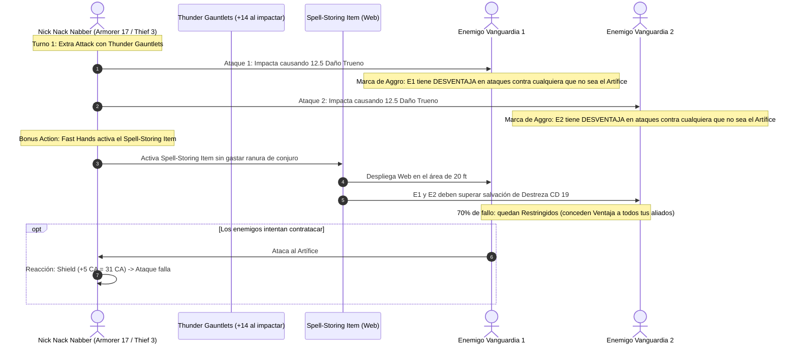

# 🌟 Lista de Conjuros Optimizada — Nick Nack Nabber (Artificer 17 / Rogue 3)

**Especialización:** Armero (*Armorer*) & Ladrón (*Thief*)  
**CD de Salvación de Conjuros:** $8 + 6 \text{ (Prof)} + 5 \text{ (INT)} = \mathbf{19}$  
**Modificador de Ataque de Conjuro y Melee:** $+11$ (Base) / $\mathbf{+14}$ (Con Guanteletes del Trueno $+3$)  
**Recurso Angular:** *Spell-Storing Item* con **10 lanzamientos gratuitos diarios** utilizables como Acción Adicional (*Fast Hands*).

---

## 🔮 Trucos (Cantrips de Artífice — 4 Conocidos)

1. **Mending 🔵 [Pilar de Reparación]:** Repara piezas de la armadura arcana, escudos y dispositivos mecánicos a voluntad.
2. **Guidance 🔵 [Pilar de Apoyo]:** $+1\text{d}4$ a cualquier prueba de habilidad o iniciativa.
3. **Booming Blade 🟢 [Ataque Alternativo]:** Ataque melee que inflige $3\text{d}8$ trueno extra y $+4\text{d}8$ si el objetivo se mueve.
4. **Shocking Grasp 🟢 [Defensivo]:** Cancela reacciones enemigas en caso de apuro.

---

## 🎒 Objeto de Almacenamiento Mágico (Spell-Storing Item — 10 Usos Diarios)

*El Artífice almacena un conjuro de 1.ᵉʳ o 2.º nivel en un objeto al final de un descanso largo. Puede activarse hasta $2 \times \text{INT} = \mathbf{10 \text{ veces}}$ al día. Gracias a **Fast Hands**, se activa como una **Acción Adicional**.*

### Opciones Tácticas de Carga:
* **Configuración A: Web (Control de Masas Supremo) 🔵:** Lanza *Web* (CD 19) como Acción Adicional en plena melé para atrapar a los enemigos recién golpeados por los *Thunder Gauntlets*.
* **Configuración B: Cure Wounds (Rescate Médico Infinito) 🔵:** Cura $2\text{d}8 + 5 = \mathbf{14.0 \text{ HP}}$ como Acción Adicional a un aliado o a ti mismo (total: **140 HP restaurados** al día sin tocar ranuras).
* **Configuración C: Vortex Warp (Teletransporte Táctico) 🟢:** Teletransporta a un aliado a 90 pies fuera del alcance enemigo o reposiciona a un jefe hostil.

---

## 🎒 Matriz de Conjuros de Artífice Preparados (13 Diarios)

### 5.º Nivel (2 Ranuras)
* **Wall of Force 🔵 [Control Absoluto — Armorer Spell]:** Confinamiento indestructible sin tirada de salvación ni riesgo de rotura.
* **Greater Restoration 🟢 [Limpieza Vital]:** Elimina petrificaciones, agotamiento y reducciones de atributos.

### 4.º Nivel (3 Ranuras)
* **Fire Shield 🔵 [Defensa Pasiva — Armorer Spell]:** Otorga resistencia al fuego o al frío y devuelve $2\text{d}8$ de daño automático a cada enemigo que te golpee cuerpo a cuerpo sin requerir concentración.
* **Otiluke's Resilient Sphere 🟢 [Burbuja de Seguridad]:** Encierra a una criatura o a ti mismo en una esfera impenetrable.

### 3.ᵉʳ Nivel (3 Ranuras)
* **Hypnotic Pattern 🔵 [Incapacitación — Armorer Spell]:** Incapacita a grupos enteros de enemigos en un cubo de 30 pies.
* **Lightning Bolt 🟢 [Artillería Eléctrica — Armorer Spell]:** $8\text{d}6$ daño de rayo en línea de 100 pies.
* **Dispel Magic 🟢 [Purificación]:** Disipa efectos mágicos persistentes o barreras hostiles.
* **Revivify 🔵 [Resurrección Rápida]:** Devuelve a la vida a un compañero caído en el último minuto.

### 2.º Nivel (3 Ranuras)
* **Mirror Image 🔵 [Burlador de Ataques — Armorer Spell]:** Crea 3 duplicados ilusorios que absorben impactos sin requerir concentración.
* **Shatter 🟢 [Daño de Trueno — Armorer Spell]:** $3\text{d}8$ de daño en radio de 10 pies.
* **Aid 🔵 [Buffer de Salud]:** Incrementa los HP máximos de 3 aliados por 8 horas.
* **Lesser Restoration 🟢 [Curación Menor]:** Neutraliza venenos y parálisis.

### 1.ᵉʳ Nivel (4 Ranuras)
* **Magic Missile 🔵 [Acierto Garantizado — Armorer Spell]:** 3 dardos de fuerza sin tirada de salvación para romper concentraciones enemigas.
* **Thunderwave 🟢 [Repulsión — Armorer Spell]:** $2\text{d}8$ daño trueno y empuja 10 pies a enemigos adyacentes.
* **Shield 🔵 [Defensa Suprema]:** Reacción inmediata que otorga $+5$ a la CA (alcanzando **31 CA reactiva**).
* **Absorb Elements 🔵 [Defensa Elemental]:** Reacción para ganar resistencia a daño elemental.

---

## ⚡ Diagrama de Secuencia del Turno de Manos Rápidas (Fast-Handed Artificer)

---

## 🩺 Curación en Segundo Plano y Mitigación de Aggro (Background Healing)

El Armorer gestiona la supervivencia del grupo mediante un blindaje pasivo impenetrable:

1. **Inyección Médica Continua (*Spell-Storing Cure Wounds*):**
   * Al cargar el *Spell-Storing Item* con *Cure Wounds*, dispone de **10 usos gratuitos diarios** que se ejecutan como **Acción Adicional** (*Fast Hands*), restaurando $2\text{d}8 + 5 = 14 \text{ HP}$ en combate sin frenar su capacidad ofensiva.
2. **Campo Defensivo de Absorción (*Defensive Field*):**
   * Como Acción Adicional, recarga un escudo de fuerza que otorga **17 Puntos de Golpe Temporales (THP)**. Puede utilizarse 6 veces por Descanso Largo, suministrando $\mathbf{102 \text{ THP de absorción}}$ personal en combate.
3. **Destello de Genio (*Flash of Genius*):**
   * Suma **+5** a cualquier tirada de salvación crítica propia o de un compañero a 30 pies (5 veces/día), garantizando que nadie falle tiradas contra muerte o parálisis.
4. **Afilador Mental (*Mind Sharpener*):**
   * Infusión activa en la armadura con 4 cargas diarias. Permite convertir automáticamente una salvación de concentración fallida en un **éxito garantizado**.
5. **Mitigación Pasiva por Aggro:**
   * Al golpear con los *Thunder Gauntlets*, los dos enemigos principales sufren Desventaja contra todos tus aliados, reduciendo el daño entrante al resto del grupo en más de un **40% de forma constante**.