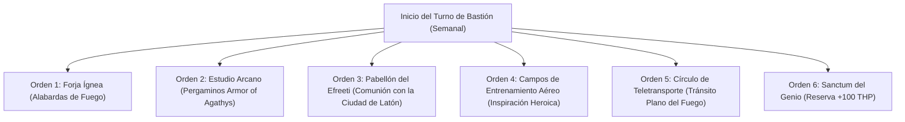

# 🏰 Bastión y Tiempo Muerto — Non-Hexblade Fire Genie

## 🏰 Sistema de Bastiones (Reglas Oficiales DMG 2024 / 5.5e)

* **Nombre del Bastión:** El Pabellón de Latón y Viento (*The Pavilion of Brass and Wind*)
* **Ubicación:** Una ciudadela flotante de basalto y latón suspendida sobre una caldera volcánica, con corrientes térmicas ascendentes.
* **Nivel de Bastión (Bastion Level):** Nivel 20
* **Puntos de Bastión (Bastion Points - BP):** 490 BP acumulados
* **Bonificador de Defensa de Bastión:** **+11** ($5_{\text{STR}} + 6_{\text{PB}}$)

---

### 🏛️ Instalaciones Básicas (Basic Facilities)

1. **Aposentos de la Lámpara Real (Bedchambers):** Cámara opulenta decorada con cojines de seda, quemadores de incienso y alfombras tejidas con hilos de fuego.
2. **Salón de Banquetes de la Ciudad de Latón (Dining Hall):** Mesa comunal donde se sirven manjares especiados y néctares del Plano Elemental del Fuego.
3. **Plaza de Danza Aérea (Common Room):** Terraza abierta sobre la caldera volcánica donde los guerreros practican maniobras de vuelo y combate con alabarda.
4. **Almacén de Especias y Latón (Storage):** Reserva de lingotes de latón elemental, azufre y telas ignífugas.

---

### 🔮 Instalaciones Especiales (Special Facilities — 6 Slots Nivel 20: 4 Roomy + 2 Vast)

1. **Gran Forja Ígnea del Efreeti (Smithy — Roomy, Nivel 5):**
   * *Orden de Bastión:* **Craft / Maintain.**
   * *Efecto Mecánico:* Forja y templado de armas de asta con aleación de latón elemental. Otorga bonificador de +1 a impacto a los 20 defensores de la guarnición.
2. **Estudio Arcano (Arcane Study — Roomy, Nivel 5):**
   * *Orden de Bastión:* **Craft.**
   * *Efecto Mecánico:* Transcripción de pergaminos de pacto (*Armor of Agathys* de 5.º nivel, *Fire Shield*, *Fireball*) a mitad de coste y tiempo.
3. **Pabellón del Efreeti / Relicario del Genio (Reliquary — Roomy, Nivel 9):**
   * *Orden de Bastión:* **Empower.**
   * *Efecto Mecánico:* Comunión directa con los nobles efreeti de la Ciudad de Latón. Sincroniza la vasija del genio (*Sanctuary Vessel*), permitiendo al grupo realizar un descanso corto en solo 10 minutos.
4. **Campos de Entrenamiento Aéreo (Training Grounds — Roomy, Nivel 9):**
   * *Orden de Bastión:* **Train.**
   * *Efecto Mecánico:* Concede Inspiración Heroica automática al Berserker al salir del bastión y entrena a los guardias en intercepción táctica aérea.
5. **Círculo de Teletransporte Permanente (Vast — Nivel 13):**
   * *Orden de Bastión:* **Maintain.**
   * *Efecto Mecánico:* Enlace planar directo entre el Pabellón de Latón y la Gran Mezquita de Latón en el Plano Elemental del Fuego.
6. **Sanctum Real del Genio / Demioplano Ígneo (Sanctum — Vast, Nivel 17):**
   * *Orden de Bastión:* **Empower.**
   * *Efecto Mecánico:* Tras completar un descanso largo en el Sanctum, el Berserker absorbe una barrera de brasas que le otorga **+100 Puntos de Golpe Temporales** y resistencia total al daño de Fuego y Frío.

---

## ⏳ Actividades de Tiempo Muerto (Downtime Activities)

### Prioridad 1: Confección de Pergaminos de Armor of Agathys y Fire Shield

* **Mecánica Base:** DMG 2024 / Xanathar's Guide to Everything.
* **Tiradas y Recursos:** Herramientas de Calígrafo (+8 con Carisma). Coste: 250 po y 3 días por pergamino de 5.º nivel.
* **Objetivo de Optimización:** Disponer de una reserva de pergaminos para activar *Armor of Agathys* sin gastar las ranuras de pacto de combate.

### Prioridad 2: Forja de Alabardas de Latón Elemental

* Forja de hojas pesadas imbuidas con *Genie's Wrath*.

---

## 🏃‍♂️ Modos de Movimiento, Logística y Viaje

### Velocidades de Movimiento Base

* **Caminar (Walk):** **40 ft/turno** (30 ft Base + 10 ft *Fast Movement* de Bárbaro).
* **Trepar (Climb):** 30 ft/turno.
* **Nadar (Swim):** 30 ft/turno.
* **Volar (Fly):** **30 ft/turno (flotación)** durante 10 minutos con *Elemental Gift* (6 usos al día sin concentración, activo en Furia).

### Modificadores y Sentidos de Exploración

* **Visión en la Oscuridad:** 120 ft (*Devil's Sight* — ve en oscuridad mágica y natural).
* **Percepción Pasiva:** 9 (10 - 1 WIS).
* **Resistencias Nativas:** Resistencia pasiva al daño de Fuego (*Elemental Gift*) y resistencia al daño físico cortante, perforante y contundente por Furia.
