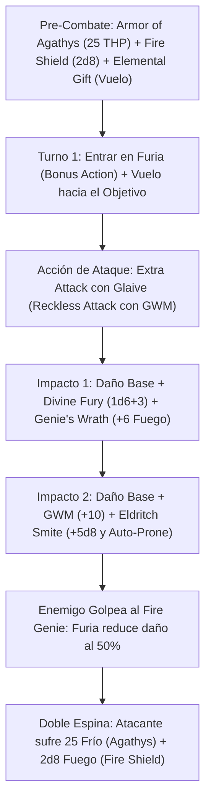

# Resumen General del Personaje: Non-Hexblade Fire Genie

## Datos Generales

* **System Standard:** D&D 5th Edition (2014 Ruleset / 2024 Compatible)
* **Character Level:** 20 (Total)
* **Class Split:** Barbarian (Zealot) 6 / Warlock (Genie - Efreeti) 14
* **Species:** Custom Lineage o Goliath (Dote Nivel 1: *Polearm Master* o *Great Weapon Master*)
* **Stats (Point Buy + Dotes + ASIs):**
  * **FUER (STR):** 20 (+5) *(15 Base + 2 Racial + 1 GWM + 2 ASI Nivel 10)*
  * **DES (DEX):** 14 (+2) *(CA máxima con Armadura Media)*
  * **CON:** 14 (+2) *(Reserva de vida duplicada en efectividad por Furia)*
  * **INT:** 8 (-1)
  * **SAB (WIS):** 8 (-1)
  * **CAR (CHA):** 14 (+2) *(Requisito de Multiclaseo y CD de conjuros de Brujo)*

* **Enlaces de Documentación:**
  * [Bastión y Tiempo Muerto](file:///d:/repo-vault/Proyectos/Rol/DnDbuilds/builds/non%20hexblade%20fire%20genie/bastion%20and%20downtime.md)
  * [Lista de Conjuros y Recursos](file:///d:/repo-vault/Proyectos/Rol/DnDbuilds/builds/non%20hexblade%20fire%20genie/spell%20list.md)
  * [Objetos a Obtener](file:///d:/repo-vault/Proyectos/Rol/DnDbuilds/builds/non%20hexblade%20fire%20genie/item%20list%20to%20obtain.md)
  * [Hoja de Ruta 1-20](file:///d:/repo-vault/Proyectos/Rol/DnDbuilds/builds/non%20hexblade%20fire%20genie/roadmap.md)
  * [Inventario Actual](file:///d:/repo-vault/Proyectos/Rol/DnDbuilds/builds/non%20hexblade%20fire%20genie/actual%20inventory%20list.md)

---

## Combat Role: Offensive Fire Striker / Flying Berserker / Double-Thorns Tank

El **Non-Hexblade Fire Genie** rompe el monopolio del patrón Hexblade demostrando la superioridad táctica del **Genio Efreeti**: otorga vuelo sin concentración con *Elemental Gift*, daño de fuego garantizado sin coste de acción con *Genie's Wrath* (+6 fuego plano), y acceso nativo al conjuro *Fire Shield*. Al combinarse con la Furia salvaje del Bárbaro Zealot y *Armor of Agathys*, crea el **Motor de Doble Espina (Double Thorns)**: cualquier enemigo que golpee al personaje cuerpo a cuerpo sufre simultáneamente **25 de daño de frío plano** y **$2\text{d}8$ de daño de fuego** ($34\text{ de daño reflejado sin salvación}$), mientras el personaje vuela a 40 ft cayendo sobre los objetivos prioritarios con ataques devastadores de alabarda.

---

## 1. Gestión de Recursos y Reglas de Inventario

* **Genie's Wrath (Efreeti):** Una vez por turno al impactar con un ataque de arma, infliges daño de fuego plano igual a tu bonificador por competencia (**+6 de daño a nivel 20**). No consume acción, ni espacio, ni concentración; funciona al 100% dentro de la Furia.
* **Elemental Gift (Vuelo sin Concentración):** Obtienes resistencia pasiva al daño de fuego y puedes activar una **Velocidad de Vuelo de 30 ft (flotación)** durante 10 minutos como Acción Adicional (6 usos al día). **No requiere concentración y opera durante la Furia**.
* **Sanctuary Vessel (Descanso Corto de 10 Minutos):** Al nivel 10 de Brujo, tú y hasta 5 aliados pueden entrar en la lámpara/vasija del genio para completar un descanso corto completo en **solo 10 minutos**, recargando tus 3 espacios de nivel 5 y habilidades de descanso corto a velocidad vertiginosa.
* **Limited Wish (Deseo Menor - Genie 14):** Como Acción, solicitas a tu patrón el efecto de **cualquier conjuro de nivel 6 o inferior** de cualquier lista del juego con tiempo de lanzamiento de 1 acción, sin consumir espacios ni componentes de coste.

---

## 2. Action Economy & Combat Loop

* **Pre-Combate (Turno 0):** Lanzar *Armor of Agathys* (Nivel 5: 25 THP), *Fire Shield* (10 min sin concentración) y activar *Elemental Gift* (vuelo 30 ft).
* **Turno 1 — Carga Aérea en Furia:**
  * **Bonus Action:** Entrar en Furia (resistencia a daño físico cortante, perforante y contundente).
  * **Action:** 2 Ataques con Glaive usando Fuerza (+5) mediante *Reckless Attack* (Ventaja permanente) y *Great Weapon Master* (+10 daño).
  * **Impacto 1:** Añade *Divine Fury* ($1\text{d}6 + 3$) y *Genie's Wrath* (+6 fuego plano).
  * **Opcional:** Gasta ranura de nivel 5 en *Eldritch Smite* ($+5\text{d}8$ fuerza y derriba al objetivo).
* **Turnos Subsiguientes — Bombardeo Cinético:**
  * **Action:** 2 Ataques con Glaive con Ventaja temeraria.
  * **Bonus Action:** Ataque con el extremo del asta (*Polearm Master*): $1\text{d}4 + 5 + 2_{\text{Furia}} + 10_{\text{GWM}}$.
  * **Reaction:** Ataque de oportunidad cuando una criatura entre en tu alcance de 10 pies.

---

## 3. Mathematical Engine (D&D 5e / 2014 & 2024 Compatible)

### 🧮 Daño por Asalto Sostenido (DPR a Nivel 20)

Con Fuerza 20 (+5), *Ascendant Dragon's Wrath Glaive +3*, GWM (+10 daño), Furia (+2), y *Reckless Attack*:

$$\text{Probabilidad de Impacto con Ventaja } P(\text{Hit}) = 1 - (1 - 0.65)^2 = 0.8775 \quad (87.75\%)$$

$$\text{Probabilidad de Crítico con Ventaja } P(\text{Crit}) = 1 - (1 - 0.05)^2 = 0.0975 \quad (9.75\%)$$

* **Ataque 1 (Glaive + Divine Fury + Genie's Wrath):**
  $$\text{Dmg}_1 = 1\text{d}10 + 5 + 3 + 2 + 10 + 1\text{d}6 + 3_{\text{Zealot}} + 6_{\text{Genie}} = 5.5 + 20 + 3.5 + 3 + 6 = \mathbf{38.0 \text{ Daño}}$$
* **Ataque 2 (Glaive):**
  $$\text{Dmg}_2 = 1\text{d}10 + 5 + 3 + 2 + 10 = 5.5 + 20 = \mathbf{25.5 \text{ Daño}}$$
* **Ataque 3 (PAM Bonus Action):**
  $$\text{Dmg}_3 = 1\text{d}4 + 5 + 3 + 2 + 10 = 2.5 + 20 = \mathbf{22.5 \text{ Daño}}$$

$$\text{DPR Golpes} = 0.8775 \times (38.0 + 25.5 + 22.5) + 0.0975 \times (5.5 + 3.5 + 5.5 + 2.5) = 75.46 + 1.66 = \mathbf{77.12 \text{ DPR Sostenido}}$$

$$\text{Daño de Doble Espina Reflejado} = 2 \text{ impactos recibidos} \times (25_{\text{Frío}} + 2\text{d}8_{\text{Fuego}} \approx 34.0) = \mathbf{68.0 \text{ Daño Pasivo sin Salvación}}$$

$$\text{DPR Efectivo Total} = 77.12 + 68.0 = \mathbf{145.12 \text{ DPR Combinado}}$$

### 🛡️ Motor de Doble Espina y EHP

$$\text{EHP Físico} = \frac{\text{HP Real } (185) + \text{Armor of Agathys } (25) + \text{Sanctum Ward } (100)}{1 - 0.50_{\text{Furia}}} = \frac{310}{0.50} = \mathbf{620 \text{ EHP Físico}}$$

* Los 25 THP de *Armor of Agathys* absorben **50 de daño físico**. Mientras se consumen, cualquier enemigo que ose atacar al Berserker volador en melé sufre **34 de daño de fuego y frío garantizado** por cada impacto conectado.

---

## 4. Tabla de Rendimiento Táctico

| Criterio | Valoración | Justificación Mecánica |
| :--- | :---: | :--- |
| **Daño Monobjetivo** | 🔵 | 145+ DPR combinando 3 ataques con GWM, *Genie's Wrath* (+6 fuego plano), *Divine Fury* ($1\text{d}6+3$), y el motor de doble espina de 34 daño reflejado por golpe. |
| **Control de Masas (CC)** | 🟢 | Derribo automático (*Prone*) mediante *Eldritch Smite*, amenaza de 10 ft con PAM y acceso a *Limited Wish* (lanzar cualquier conjuro de control de nivel 1 a 6 a voluntad). |
| **Supervivencia (EHP)** | 🔵 | Resistencia física al 50% por Furia, resistencia pasiva al fuego por *Elemental Gift*, reroll de salvación con *Fanatical Focus*, y 620 EHP efectivo. |
| **Economía de Acciones** | 🔵 | Vuelo de 10 minutos sin concentración en Acción Adicional, entrada en Furia, ataque PAM continuo, y *Sanctuary Vessel* para descansos de 10 minutos. |
| **Sustentabilidad** | 🔵 | Resurrección con 0 po de diamantes (*Warrior of the Gods*). Ranuras de 5.º nivel recuperables en solo 10 minutos de descanso corto en la vasija del genio. |

---

## 5. Home Rules (Reglas de la Mesa)

1. **Eldritch Smite y Genie's Wrath en Furia:** Se confirma el funcionamiento de *Eldritch Smite* y *Genie's Wrath* bajo Furia, ya que son rasgos de clase activos no mágicos.
2. **Foco Universal Único:** El anillo o relicario que actúa como vasija del genio sirve como foco de lanzamiento unificado para conjuros de Brujo.
