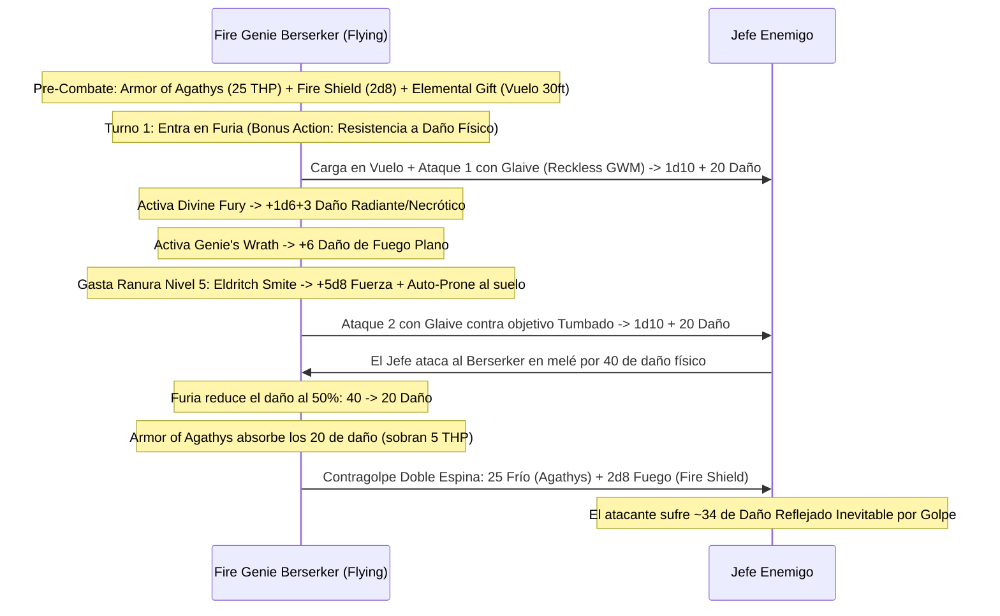

# 🌟 Lista de Conjuros y Recursos — Non-Hexblade Fire Genie

Esta lista detalla la selección de conjuros y recursos para el **Non-Hexblade Fire Genie** (Barbarian Zealot 6 / Warlock Genie - Efreeti 14), optimizada bajo reglas de D&D 5e (2014 & 2024).

> **Aviso Táctico Fundamental:** No puedes lanzar conjuros ni mantener concentración durante la Furia (*Rage*). Por ello, tu repertorio se apoya en los dos conjuros de represalia más brutales del juego sin concentración: **Fire Shield** (daño de fuego/frío a quien te golpee) y **Armor of Agathys** (daño de frío a quien te golpee), junto con el vuelo de **Elemental Gift**.

---

## ⚡ Conjuros Activos y Pre-Buffs (Turno 0 / Fuera de Combate)

| Conjuro / Recurso | Duración | Concentración | Efecto Táctico Clave |
| :--- | :---: | :---: | :--- |
| **Armor of Agathys (Nivel 5)** | 1 hora | No | Otorga **25 THP**. Cualquier enemigo que te golpee en cuerpo a cuerpo sufre **25 de daño de frío plano** por cada golpe recibido. |
| **Fire Shield (Nivel 4)** | 10 minutos | No | Resistencia a daño de frío o fuego y devuelve $+2\text{d}8$ de daño de fuego/frío a quien te golpee cuerpo a cuerpo. |
| **Elemental Gift (Genie 6)** | 10 minutos | No | **Velocidad de Vuelo de 30 ft (flotación)** sin concentración. Funciona al 100% durante la Furia (6 usos diarios). |
| **Sanctum Ward (Bastión)** | 24 horas | No | Reserva de **+100 Puntos de Golpe Temporales** obtenida en el Sanctum del Genio. |

---

## 🔮 Trucos (Cantrips — Warlock)

1. **Green-Flame Blade 🔵 [Ofensivo Pre-Furia]:** Golpe cuerpo a cuerpo con alabarda que salta fuego ($3\text{d}8 + 2$) a un segundo enemigo. Usar en combates donde no se active Furia.
2. **Fire Bolt 🟢 [Daño a Distancia]:** $4\text{d}10$ de fuego a 120 ft para hostigar enemigos lejanos fuera de Furia.
3. **Minor Illusion 🟢 [Utilidad]:** Distracciones visuales o acústicas tácticas.
4. **Mage Hand 🟡 [Utilidad]:** Manipulación remota de objetos a 30 ft.

---

## 🎒 Conjuros de Pact Magic (3 Ranuras de Nivel 5 — Recarga en 10 Minutos)

*CD de Salvación de Conjuros:* $8 + 6_{\text{PB}} + 2_{\text{CAR}} = \mathbf{16}$. Modificador de Ataque: $\mathbf{+10}$.

### 5.º Nivel

1. **Armor of Agathys 🔵 [Roto / Núcleo del Build]:** 25 HP temporales que infligen 25 de daño de frío automático al atacante. Combinado con la Furia (resistencia al daño físico), absorbe 50 de daño efectivo.
2. **Flame Strike (Efreeti) 🟢 [Columna de Fuego]:** $8\text{d}6$ de daño combinado de fuego y radiante en cilindro de 40 ft antes de entrar en melé.
3. **Synaptic Static 🔵 [Detonación sin Concentración]:** $8\text{d}6$ psíquico en 20 ft y debuff de -1d6 a tiradas enemigas por 1 minuto sin concentración.
4. **Hold Monster 🟢 [Control Absoluto]:** Paraliza a una criatura para garantizar impactos críticos en melé fuera de Furia.

### 4.º Nivel

5. **Fire Shield (Efreeti) 🔵 [Pilar de Doble Espina]:** 10 minutos sin concentración. Devuelve $2\text{d}8$ de fuego/frío por cada golpe recibido en melé. **Se acumula con *Armor of Agathys* en Furia**.
6. **Dimension Door 🟢 [Movilidad]:** Teletransporte de 500 pies para ti y un aliado.

### 3.ᵉʳ Nivel

7. **Fireball (Efreeti) 🔵 [Daño Masivo de Área]:** $8\text{d}6$ de fuego en 20 ft de radio a 150 ft antes de trabarte en combate cuerpo a cuerpo.
8. **Counterspell 🟢 [Interrupción]:** Anula magia enemiga crítica en el primer asalto.

### 2.º Nivel

9. **Scorching Ray (Efreeti) 🟢 [Ráfaga de Fuego]:** 3 rayos de fuego ($2\text{d}6$ cada uno) a distancia.
10. **Misty Step 🟢 [Movilidad]:** Teletransporte de 30 ft como Acción Adicional.

### 1.ᵉʳ Nivel

11. **Burning Hands (Efreeti) 🟡 [Cono de Fuego]:** $3\text{d}6$ de fuego en cono de 15 ft.
12. **Hellish Rebuke 🟢 [Reacción]:** $5\text{d}10$ de fuego al atacante al recibir daño (utilizable fuera de Furia).

---

## 🔮 Arcanos Místicos y Deseo Menor (Mystic Arcanum & Limited Wish)

* **6.º Nivel: Scatter 🔵 [Control Táctico]:** Teletransporta a hasta 5 criaturas en 120 ft para reagrupar enemigos o salvar aliados.
* **7.º Nivel: Forcecage 🔵 [Encierro Absoluto]:** Jaula indestructible sin tirada de salvación durante 1 hora.
* **Limited Wish (Deseo Menor - Genie 14):** Acción para solicitar a tu patrón el efecto de **cualquier conjuro de nivel 6 o inferior** de cualquier lista sin coste de ranura ni componentes. Recarga en $1\text{d}4$ descansos largos.

---

## 💥 Secuencia Táctica de la Doble Espina Ígnea (The Hellfire Inferno Loop)

---

## 💚 Curación en Segundo Plano y Sostenibilidad

* **Sanctuary Vessel (Descanso Corto en 10 Minutos):** Al nivel 10 de Brujo, todo el grupo entra en la vasija del genio para realizar un descanso corto en solo 10 minutos, recargando las 3 ranuras de nivel 5 y *Fanatical Focus*.
* **Warrior of the Gods (Zealot):** Cualquier conjuro de resurrección lanzado sobre el personaje no consume componentes materiales (0 po en diamantes).
* **Pociones en Acción Adicional:** Consumo rápido de *Potion of Supreme Healing* ($10\text{d}4 + 20 \approx 45\text{ PG}$) bajo reglas oficiales 2024.
