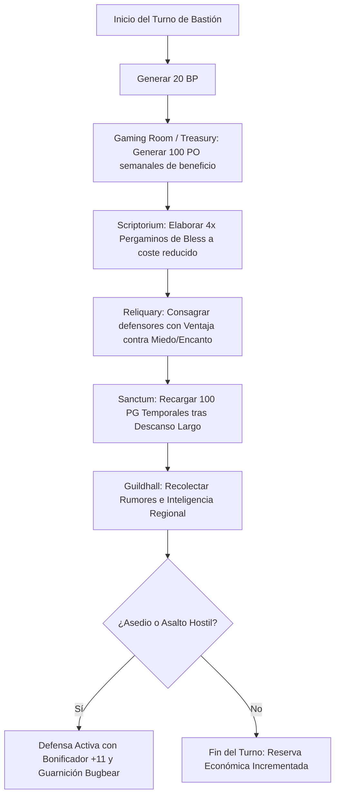

# 🏰 Bastión y Tiempo Muerto — Penny Pinchin' Preacher

**Build:** Penny Pinchin' Preacher  
**Sistema:** D&D 2024 / 5.5e DMG Bastion Rules  
**Nivel de Bastión:** 20  
**Nombre del Bastión:** *The Miser's Sanctuary* (El Santuario del Avaro Crepuscular)  
**Documentos Relacionados:**
* [Guía de Personaje](file:///d:/repo-vault/Proyectos/Rol/DnDbuilds/builds/penny%20pinchin%20preacher/character%20guide.md)
* [Guía 2024](file:///d:/repo-vault/Proyectos/Rol/DnDbuilds/builds/penny%20pinchin%20preacher/character%20guide%202024.md)
* [Lista de Conjuros](file:///d:/repo-vault/Proyectos/Rol/DnDbuilds/builds/penny%20pinchin%20preacher/spell%20list.md)
* [Objetos a Obtener](file:///d:/repo-vault/Proyectos/Rol/DnDbuilds/builds/penny%20pinchin%20preacher/item%20list%20to%20obtain.md)
* [Hoja de Ruta](file:///d:/repo-vault/Proyectos/Rol/DnDbuilds/builds/penny%20pinchin%20preacher/roadmap.md)
* [Inventario Equipado](file:///d:/repo-vault/Proyectos/Rol/DnDbuilds/builds/penny%20pinchin%20preacher/actual%20inventory%20list.md)

---

## 🏛️ Estadísticas Defensivas del Bastión

* **Bonificador de Mando y Defensa:** $\mathbf{+11}$ ($\text{PB } +6 + \text{DEX } +5$).
* **Puntos de Bastión (BP):** 20 BP por Turno de Bastión (regeneración según nivel 20).
* **Guarnición Activa:**
  * 10 Acólitos del Crepúsculo (especialistas en primeros auxilios y cantos de bendición).
  * 6 Exploradores Bugbear de Emboscada (equipados con armadura ligera y escudos).
  * 1 Tesorero Arcano (encargado de contabilizar cada moneda de cobre).

---

## 🏗️ Instalaciones Básicas (Basic Facilities)

1. **Dormitorio Escondido (Bedchambers):** Celda espartana sin lujos innecesarios; una estera de paja y un cofre blindado con cerradura de combinación psíquica.
2. **Comedor Comunitario de la Caridad (Dining Hall):** Sirve potajes económicos a acólitos y refugiados, proyectando una imagen de austeridad religiosa impecable.
3. **Cámara de los Diezmos (Common Room):** Espacio donde los devotos entregan sus ofrendas antes de recibir sermones crepusculares.
4. **Cámara Acorazada Subterránea (Storage):** Bóveda sellada con trampas de alarma silenciosa donde se acumulan las riquezas del grupo.

---

## 🧪 Instalaciones Especiales (Special Facilities: 4 Roomy + 2 Vast)

Conforme a las reglas oficiales del DMG 2024 a nivel 20, la fortaleza dispone exactamente de 6 Instalaciones Especiales (4 Roomy y 2 Vast):

### 1. [Roomy] Reliquary (Relicario del Ocaso)
* **Función:** Custodia de fragmentos de reliquias sagradas consagradas a deidades de la noche y el reposo.
* **Orden de Bastión:** *Blessing*. Concede a los defensores y al personaje una bendición que otorga ventaja en tiradas de salvación contra miedo y encanto durante 7 días.

### 2. [Roomy] Scriptorium (Escribanía Sacra)
* **Función:** Producción sistemática y económica de pergaminos divinos.
* **Orden de Bastión:** *Scribe*. Permite elaborar pergaminos de *Bless*, *Healing Word* y *Sanctuary* al 50% del coste habitual en oro (12.5 PO por pergamino de nivel 1).

### 3. [Roomy] Library (Archivo de Herejías y Genealogías)
* **Función:** Depósito de tomos religiosos, registros financieros y secretos de cultos rivales.
* **Orden de Bastión:** *Research*. Proporciona ventaja y un bonificador de $+5$ en tiradas de Religión e Historia relativas a entidades sombrías.

### 4. [Roomy] Gaming Room / Treasury (Sala de Apuestas y Tesorería)
* **Función:** Sala clandestina de recaudación y juegos de dados psíquicos regentada por acólitos Bugbear.
* **Orden de Bastión:** *Gamble / Harvest*. Genera $100\text{ PO}$ de beneficio neto semanal, cubriendo todos los gastos de manutención de la fortaleza con creces.

### 5. [Vast] Sanctum (Gran Catedral Crepuscular)
* **Función:** Templo de techos abovedados en penumbra perpetua (*Eyes of Night*).
* **Orden de Bastión:** *Sanctuary*. Otorga al personaje y a sus aliados $100\text{ PG}$ temporales tras un descanso largo realizado en su nave central, además de la capacidad de conjurar *Commune* sin consumir componentes materiales una vez por semana.

### 6. [Vast] Guildhall (Gremio de Beneficencia y Espionaje)
* **Función:** Red de informantes callejeros y falsos mendigos que recolectan rumores en tres reinos colindantes.
* **Orden de Bastión:** *Influence*. Otorga información anticipada sobre cualquier incursión o amenaza militar antes de que llegue a las murallas.

---

## 🔄 Flujograma de Turno de Bastión (Weekly Bastion Turn)

---

## ⏳ Actividades de Tiempo Muerto (Downtime Priorities)

### Prioridad 1: Scribing Scrolls (Elaboración Masiva de Pergaminos de Nivel 1)
* **Coste:** 12.5 PO por pergamino en el Scriptorium.
* **Resultado:** Mantener una reserva de 20 pergaminos de *Bless* y 10 de *Healing Word* para abastecer al grupo sin gastar ranuras propias de clérigo.

### Prioridad 2: Auditoría Financiera y Acumulación de Oro
* **Acción:** Gestionar las cuentas de la congregación con *Reliable Talent* e Inteligencia/Sabiduría. Maximizar los fondos para la adquisición de equipo legendario.
