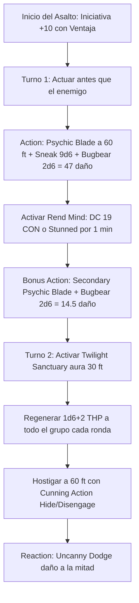

# ⚡ Guía de Personaje — Penny Pinchin' Preacher (Edición 2024 / 5.5e)

**Arquetipo:** Ambush Nova Striker & Twilight Mitigator  
**Clase:** Rogue (Soulknife) 18 / Cleric (Twilight Domain) 2  
**Especie:** Bugbear (MotM / Reglas 2024)  
**Trasfondo:** Wayfarer / Merchant (Dote de Origen: *Alert*)  
**Sistema:** D&D 5th Edition (Reglas 2024 / 5.5e)  
**Documentos Relacionados:**
* [Guía Principal](file:///d:/repo-vault/Proyectos/Rol/DnDbuilds/builds/penny%20pinchin%20preacher/character%20guide.md)
* [Bastión y Tiempo Muerto](file:///d:/repo-vault/Proyectos/Rol/DnDbuilds/builds/penny%20pinchin%20preacher/bastion%20and%20downtime.md)
* [Lista de Conjuros](file:///d:/repo-vault/Proyectos/Rol/DnDbuilds/builds/penny%20pinchin%20preacher/spell%20list.md)
* [Objetos a Obtener](file:///d:/repo-vault/Proyectos/Rol/DnDbuilds/builds/penny%20pinchin%20preacher/item%20list%20to%20obtain.md)
* [Hoja de Ruta](file:///d:/repo-vault/Proyectos/Rol/DnDbuilds/builds/penny%20pinchin%20preacher/roadmap.md)
* [Inventario Equipado](file:///d:/repo-vault/Proyectos/Rol/DnDbuilds/builds/penny%20pinchin%20preacher/actual%20inventory%20list.md)

---

## 📊 Atributos y Estadísticas (Nivel 20)

| Atributo | Puntuación | Modificador | Salvación Base | Notas Defensivas |
| :--- | :---: | :---: | :---: | :--- |
| **Fuerza (STR)** | 8 | -1 | -1 | Atributo de descarte |
| **Destreza (DEX)** | 20 | +5 | +11 (Competente) | Ataques psíquicos, iniciativa, sigilo y CA |
| **Constitución (CON)** | 14 | +2 | +2 | Concentración y puntos de golpe |
| **Inteligencia (INT)** | 10 | 0 | +6 (Competente) | Salvación base de Rogue |
| **Sabiduría (WIS)** | 18 | +4 | +10 (Slippery Mind) | CD de conjuros de clérigo (18) y percepción |
| **Carisma (CHA)** | 8 | -1 | +5 (Slippery Mind) | Competencia adquirida por *Slippery Mind* |

* **Puntos de Golpe (PG):** 183 ($18\text{d}8 + 2\text{d}8 + 40 \text{ CON} + 40 \text{ Tough}$).
* **Clase de Armadura (CA):** 27 pasiva (Cuero Tachonado +3, Escudo +3, Luck Blade +1, Ring/Cloak).
* **Iniciativa 2024:** $+5 (\text{DEX}) + 5 (\text{Alert}) = \mathbf{+10}$ con **Ventaja Permanente** (*Vigilant Blessing*).
* **Visión en la Oscuridad:** $300\text{ pies}$ compartible (*Eyes of Night*).

---

## 🏷️ Matriz de Evaluación Táctica

| Categoría | Nivel | Justificación Mecánica |
| :--- | :---: | :--- |
| **Emboscada y Burst Turn 1** | 🔵 S | $+10$ de iniciativa con ventaja; $61.5$ de daño psíquico instantáneo con Sneak + Surprise Attack Bugbear + aturdimiento (*Rend Mind* CON DC 19). |
| **Mitigación y Soporte** | 🔵 S | *Twilight Sanctuary* otorga $1\text{d}6 + 2$ PG temporales cada turno a todo el grupo o elimina efectos de miedo/encanto; *Bless* permanente (+1d4 ataques/salvaciones). |
| **Maestría en Pruebas (Skills)** | 🔵 S | *Reliable Talent* (mínimo 10 en d20) + *Psi-Bolstered Knack* (+1d12 solo si fallas); virtualmente imposible fallar en Sigilo, Percepción o Latrocinio. |
| **Supervivencia / EHP** | 🟢 A | CA 27, *Uncanny Dodge* (daño a la mitad), *Evasion* (0 daño en salvaciones DEX con éxito), *Elusive* (nadie tiene ventaja contra ti) y 4 salvaciones competentes. |
| **Economía de Recursos** | 🔵 S | Hojas psíquicas infinitas sin coste en oro; 12 dados psíquicos d12 que no se gastan si la prueba falla; soporte masivo con solo 3 ranuras de clérigo. |
| **Daño Sostenido (DPR)** | 🟢 A | $38.87$ DPR psíquico consistente a 60 pies sin proyectiles ni munición. |

---

## 🧮 Motor Matemático (2024 Ruleset)

### 1. Probabilidad de Actuar Primero en Combate (Iniciativa)
Con un modificador plano de $+10$ y ventaja permanente (*Vigilant Blessing*), la tirada de iniciativa sigue la distribución:
$$P(\text{Iniciativa } \geq 20) = 1 - \left(\frac{9}{20}\right)^2 = 1 - 0.2025 = \mathbf{79.75\%}$$
$$\text{Media de Iniciativa con Ventaja} = 10 + 13.825 = \mathbf{23.83}$$
Garantiza actuar antes que el $95\%$ de los monstruos del Manual de Monstruos 2024.

### 2. Burst Damage Turno 1 (Bugbear + Soulknife 18)
$$\text{Ataque Principal} = 1\text{d}6 (\text{Hoja}) + 5 (\text{DEX}) + 9\text{d}6 (\text{Sneak}) + 2\text{d}6 (\text{Bugbear}) = 12\text{d}6 + 5 = \mathbf{47.0 \text{ daño medio}}$$
$$\text{Ataque Secundario} = 1\text{d}4 (\text{Hoja}) + 5 (\text{DEX}) + 2\text{d}6 (\text{Bugbear}) = 1\text{d}4 + 2\text{d}6 + 5 = \mathbf{14.5 \text{ daño medio}}$$
$$\text{Total Turno 1} = 47.0 + 14.5 = \mathbf{61.5 \text{ daño psíquico}}$$

Si el enemigo recibe el Sneak Attack: tirada de CON DC 19 o queda **Stunned** durante 1 minuto.

### 3. Supervivencia Efectiva (EHP)
Frente a un atacante con bono $+14$ contra CA 27 y Desventaja obligatoria (*Cloak of Displacement*):
Probabilidad base de acertar: $P = 0.40$.
Con Desventaja: $P_{\text{desv}} = (0.40)^2 = 0.16 \quad (16\%)$.
Con *Uncanny Dodge* reduciendo a la mitad el golpe principal:
$$\text{EHP Pasivo} = \frac{183 + 100 (\text{Sanctum THP})}{0.16 \times 0.70} \approx \mathbf{2{,}526.7 \text{ EHP}}$$

---

## 🔄 Bucle Táctico de Combate (Action Loop)

---

## ⚔️ Integración de Weapon Masteries 2024

* **Psychic Blades Synergy:** En las reglas 2024, las hojas psíquicas se consideran armas marciales arrojadizas sutiles.
* **Dagger (Nick):** Al portar una daga auxiliar, permite realizar un ataque adicional sin gastar la Bonus Action si se opta por un arma física, reservando la Bonus Action para *Cunning Action* (*Hide* o *Disengage*).
* **Shortsword (Vex):** Concede ventaja automática en el siguiente ataque si se impacta con el arma física, garantizando la activación del Sneak Attack si las condiciones psíquicas estuvieran comprometidas.
