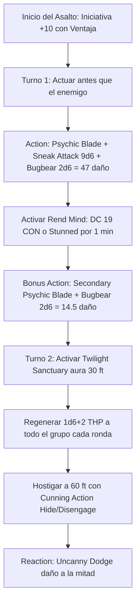

# 💰 Guía de Personaje — Penny Pinchin' Preacher

**Build:** Penny Pinchin' Preacher  
**Clase:** Rogue (Soulknife) 18 / Cleric (Twilight Domain) 2  
**Especie:** Bugbear (MotM / 2024)  
**Trasfondo:** Acolyte / Merchant (Dote de Origen: *Alert*)  
**Sistema:** D&D 5th Edition (Reglas 2024 / 5.5e & 2014)  
**Rol:** Ambush Nova Striker / Twilight Support / Psionic Infiltrator & Skill Master  
**Documentos Relacionados:**
* [Guía 2024](file:///d:/repo-vault/Proyectos/Rol/DnDbuilds/builds/penny%20pinchin%20preacher/character%20guide%202024.md)
* [Bastión y Tiempo Muerto](file:///d:/repo-vault/Proyectos/Rol/DnDbuilds/builds/penny%20pinchin%20preacher/bastion%20and%20downtime.md)
* [Lista de Conjuros](file:///d:/repo-vault/Proyectos/Rol/DnDbuilds/builds/penny%20pinchin%20preacher/spell%20list.md)
* [Objetos a Obtener](file:///d:/repo-vault/Proyectos/Rol/DnDbuilds/builds/penny%20pinchin%20preacher/item%20list%20to%20obtain.md)
* [Hoja de Ruta](file:///d:/repo-vault/Proyectos/Rol/DnDbuilds/builds/penny%20pinchin%20preacher/roadmap.md)
* [Inventario Equipado](file:///d:/repo-vault/Proyectos/Rol/DnDbuilds/builds/penny%20pinchin%20preacher/actual%20inventory%20list.md)

---

## 📊 Atributos y Estadísticas (Nivel 20)

| Atributo | Puntuación | Modificador | Salvación Base | Notas Defensivas |
| :--- | :---: | :---: | :---: | :--- |
| **Fuerza (STR)** | 8 | -1 | -1 | Atributo de descarte |
| **Destreza (DEX)** | 20 | +5 | +11 (Competente) | Ataques psíquicos, iniciativa, sigilo y CA |
| **Constitución (CON)** | 14 | +2 | +2 | Concentración y puntos de golpe |
| **Inteligencia (INT)** | 10 | 0 | +6 (Competente) | Salvación base de Rogue |
| **Sabiduría (WIS)** | 18 | +4 | +10 (Slippery Mind) | CD de conjuros de clérigo y percepción pasiva |
| **Carisma (CHA)** | 8 | -1 | +5 (Slippery Mind) | Competencia adquirida por *Slippery Mind* |

* **Puntos de Golpe (PG):** 143 ($18\text{d}8 + 2\text{d}8 + 40 \text{ CON}$).
* **Clase de Armadura (CA):**
  * Studded Leather +3: $12 + 3 + 5 (\text{DEX}) = 20$.
  * Shield +3: $+5$ a la CA.
  * Cloak / Ring of Protection: $+2$ a la CA.
  * **CA Pasiva Base:** $\mathbf{27}$.
* **Iniciativa:** $+5 (\text{DEX}) + 5 (\text{Alert}) = \mathbf{+10}$ con **Ventaja Permanente** (*Vigilant Blessing*).
* **Visión en la Oscuridad:** $300\text{ pies}$ (*Eyes of Night*).

---

## 🏷️ Matriz de Evaluación Táctica

| Categoría | Nivel | Justificación Mecánica |
| :--- | :---: | :--- |
| **Emboscada y Burst Turn 1** | 🔵 S | $+10$ de iniciativa con ventaja; $61.5$ de daño psíquico instantáneo con Sneak + Surprise Attack Bugbear + aturdimiento (*Rend Mind* DC 19). |
| **Soporte y Mitigación** | 🔵 S | *Twilight Sanctuary* otorga $1\text{d}6 + 2$ PG temporales cada turno a todo el grupo o limpia miedo/encanto; *Bless* permanente (+1d4 ataques/salvaciones). |
| **Maestría en Pruebas (Skills)** | 🔵 S | *Reliable Talent* (mínimo 10 en d20) + *Psi-Bolstered Knack* (+1d12 solo si fallas); virtualmente imposible fallar en Sigilo, Percepción o Latrocinio. |
| **Supervivencia / EHP** | 🟢 A | CA 27, *Uncanny Dodge* (daño a la mitad), *Evasion* (0 daño en salvaciones DEX con éxito), *Elusive* (nadie tiene ventaja contra ti) y 4 salvaciones competentes. |
| **Economía de Recursos** | 🔵 S | Hoja psíquica infinita sin coste en oro; 12 dados psíquicos d12 que no se gastan si la prueba falla; soporte masivo con solo 3 ranuras de clérigo. |
| **Daño Sostenido (DPR)** | 🟢 A | $41.5$ DPR psíquico consistente a 60 pies sin gastar proyectiles ni munición. |

---

## 🧮 Motor Matemático (2024 / 5.5e Ruleset)

### 1. Daño de Emboscada en Asalto 1 (Bugbear + Soulknife Nova)
Al actuar antes que el objetivo (garantizado con $+10$ de iniciativa y ventaja):
$$\text{Ataque Principal (Action)} = 1\text{d}6 (\text{Hoja}) + 5 (\text{DEX}) + 9\text{d}6 (\text{Sneak}) + 2\text{d}6 (\text{Bugbear}) = 12\text{d}6 + 5 = \mathbf{47.0 \text{ daño psíquico}}$$
$$\text{Ataque Secundario (Bonus Action)} = 1\text{d}4 (\text{Hoja}) + 5 (\text{DEX}) + 2\text{d}6 (\text{Bugbear}) = 1\text{d}4 + 2\text{d}6 + 5 = \mathbf{14.5 \text{ daño psíquico}}$$
$$\text{Nova Turno 1 Total} = 47.0 + 14.5 = \mathbf{61.5 \text{ daño psíquico}}$$

Si el objetivo recibe el Sneak Attack, debe superar una tirada de Constitución DC 19 ($8 + 6 \text{ PB} + 5 \text{ DEX}$) o queda **Stunned** (aturdido) durante 1 minuto (*Rend Mind*).

### 2. Daño Sostenido (Turno 2 en adelante)
$$\text{DPR}_{\text{Sostenido}} = [1\text{d}6 + 5 + 9\text{d}6] \times 0.85 + [1\text{d}4 + 5] \times 0.65 = 40.0 \times 0.85 + 7.5 \times 0.65 = \mathbf{38.87 \text{ DPR}}$$
*(Si un ataque falla, se añade $1\text{d}12$ mediante Soul Blades para forzar el impacto y no perder el Sneak Attack).*

### 3. Mitigación de Daño y Supervivencia (EHP)
Con CA 27 y *Elusive* (el enemigo jamás obtiene ventaja):
Contra un atacante de CR 20 con $+14$ al impacto:
$$P(\text{impacto}) = \frac{21 - (27 - 14)}{20} = \frac{8}{20} = 0.40 \quad (40\%)$$
Con *Uncanny Dodge* reduciendo el golpe más fuerte en un $50\%$:
$$\text{EHP Pasivo} = \frac{143}{0.40 \times 0.75} \approx \mathbf{476.6 \text{ EHP}}$$
Con *Twilight Sanctuary* regenerando $5.5$ PG temporales cada turno ($55\text{ THP}$ en 10 asaltos):
$$\text{EHP Extendido} = \frac{143 + 55}{0.30} \approx \mathbf{660.0 \text{ EHP}}$$

---

## 🔄 Bucle Táctico de Combate (Action Loop)

### Turno 0 (Preparación)
* Otorgarse a sí mismo *Vigilant Blessing* (Ventaja permanente en iniciativa).
* Compartir *Eyes of Night* (300 ft visión en oscuridad) con el grupo.
* Activar *Psychic Veil* (Invisibilidad psíquica por 1 hora sin componentes).

### Turno 1 (Emboscada Letal)
1. Atacar al líder enemigo desde las sombras a 60 pies con la Hoja Psíquica principal ($47.0$ daño psíquico).
2. Forzar salvación de CON DC 19 para aturdir al objetivo durante 1 minuto.
3. Atacar con la Hoja Psíquica secundaria ($14.5$ daño).

### Turnos Subsiguientes
* Si el equipo necesita refuerzo defensivo: Usar Acción para activar *Twilight Sanctuary* ($1\text{d}6+2$ PG temporales a todo el grupo y curación de estados).
* Mantener concentración en *Bless* (+1d4 a ataques y salvaciones de 3 aliados).
* Disparar hojas psíquicas a 60 pies y usar *Cunning Action: Hide* con un resultado garantizado de $\geq 27$ en Sigilo.
