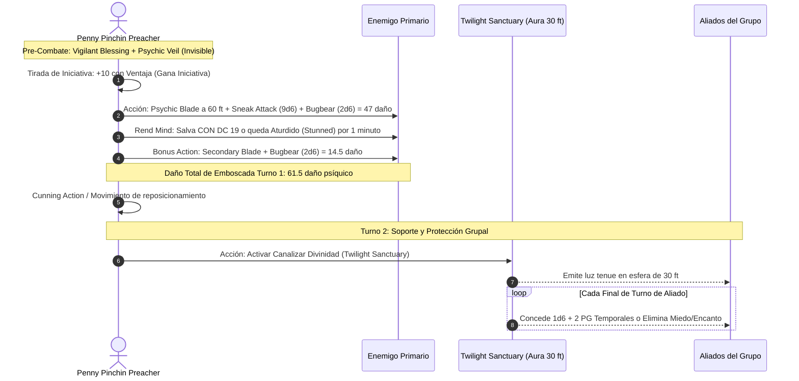

# 📜 Lista de Conjuros y Poderes Psíquicos — Penny Pinchin' Preacher

**Build:** Penny Pinchin' Preacher  
**Clase:** Rogue (Soulknife) 18 / Cleric (Twilight Domain) 2  
**Nivel de Lanzador:** Clérigo Nivel 2 (3 ranuras de Nivel 1)  
**Dados de Energía Psíquica:** $2 \times \text{PB} = 12$ dados d12 por descanso largo  
**CD de Salvación de Clérigo:** $8 + 6 (\text{PB}) + 4 (\text{WIS}) = \mathbf{18}$  
**CD de Habilidades Psíquicas:** $8 + 6 (\text{PB}) + 5 (\text{DEX}) = \mathbf{19}$  
**Documentos Relacionados:**
* [Guía de Personaje](file:///d:/repo-vault/Proyectos/Rol/DnDbuilds/builds/penny%20pinchin%20preacher/character%20guide.md)
* [Guía 2024](file:///d:/repo-vault/Proyectos/Rol/DnDbuilds/builds/penny%20pinchin%20preacher/character%20guide%202024.md)
* [Bastión y Tiempo Muerto](file:///d:/repo-vault/Proyectos/Rol/DnDbuilds/builds/penny%20pinchin%20preacher/bastion%20and%20downtime.md)
* [Objetos a Obtener](file:///d:/repo-vault/Proyectos/Rol/DnDbuilds/builds/penny%20pinchin%20preacher/item%20list%20to%20obtain.md)
* [Hoja de Ruta](file:///d:/repo-vault/Proyectos/Rol/DnDbuilds/builds/penny%20pinchin%20preacher/roadmap.md)
* [Inventario Equipado](file:///d:/repo-vault/Proyectos/Rol/DnDbuilds/builds/penny%20pinchin%20preacher/actual%20inventory%20list.md)

---

## ⚡ Efectos Activos y Buffs Previos (Turn 0)

| Efecto / Habilidad | Duración | Coste de Recurso | Beneficio Mecánico |
| :--- | :---: | :---: | :--- |
| **Vigilant Blessing** | Permanente | 0 | Ventaja obligatoria en la siguiente tirada de iniciativa (auto-renovable). |
| **Eyes of Night** | 1 hora | 0 (1/día gratis) | $300\text{ pies}$ de visión en la oscuridad compartible con hasta 4 aliados. |
| **Psychic Veil** | 1 hora | 1/día gratis (o 1 dado d12) | Invisibilidad absoluta; finaliza solo si impactas a una criatura o fuerzas una salvación. |
| **Aid (Vía Pergamino)** | 8 horas | 1 Pergamino | $+5\text{ a } +15\text{ PG}$ máximos al grupo. |
| **Guidance** | 1 minuto | Cantrip (Concentración) | $+1\text{d}4$ a cualquier prueba de sigilo previa al combate. |

---

## 📊 Matriz de Conjuros Preparados (Cleric)

### Trucos (Cantrips)
* **Guidance:** 🔵 S. Bonificador constante de $+1\text{d}4$ a cualquier prueba de habilidad fuera de combate.
* **Thaumaturgy:** 🟢 A. Crear efectos sensoriales y amplificar sermones religiosos desde las sombras.
* **Toll the Dead:** 🟢 A. Daño necrótico a distancia ($4\text{d}12$ a un enemigo herido) si no es viable lanzar la hoja psíquica.

### Nivel 1 (3 Ranuras por Descanso Largo)
* **Bless:** 🔵 S. El mejor uso de ranuras de nivel 1. Otorga $+1\text{d}4$ a las tiradas de ataque y salvación de 3 aliados. Con tu CA 27 y posicionamiento a distancia, la concentración está blindada.
* **Healing Word:** 🔵 S. Curación de emergencia a 60 pies con Bonus Action para levantar a aliados inconscientes.
* **Sanctuary:** 🟢 A. Protege a un aliado crítico o a ti mismo mientras mantienes el aura crepuscular sin atacar.
* **Faerie Fire (Conjuro de Dominio):** 🟢 A. Ventaja contra grupos de enemigos en un cubo de 20 pies si el sigilo no es viable.
* **Sleep (Conjuro de Dominio):** 🟡 B. Útil únicamente en niveles iniciales para neutralizar centinelas en silencio.

---

## 🧠 Matriz de Poderes Psíquicos (Soulknife 18)

* **Psychic Blades:** 🔵 S. Armas de energía psíquica pura ($1\text{d}6$ en acción, $1\text{d}4$ en acción adicional) con propiedad sutil (Finesse/Thrown 60 ft) que no dejan marcas físicas.
* **Psi-Bolstered Knack:** 🔵 S. Añade $1\text{d}12$ a una prueba de habilidad fallida. **Solo se gasta el dado si la prueba tiene éxito**. En combinación con *Reliable Talent*, fallar una prueba es estadísticamente imposible.
* **Soul Blades:** 🔵 S. Añade $1\text{d}12$ a una tirada de ataque fallida. **Solo se gasta si convierte el fallo en un impacto**. Garantiza no desperdiciar el Sneak Attack del asalto.
* **Psychic Whispers:** 🟢 A. Red de comunicación telepática para todo el grupo durante horas por 1 solo dado psíquico.
* **Rend Mind:** 🔵 S. Al impactar con Sneak Attack, el objetivo debe superar CON DC 19 o quedar **Stunned** durante 1 minuto.

---

## 🔄 Diagrama de Secuencia: Turno 1 Ambush & Twilight Aura

---

## 💖 Curación en Segundo Plano (Background Healing)

1. **Twilight Sanctuary (Regeneración de Amortiguación):** Proporciona $1\text{d}6 + 2$ PG temporales (media de $5.5$ PG) a cada criatura aliada que termine su turno dentro de los 30 pies. En un combate estándar de 4 asaltos con 4 aliados:
   $$\text{Mitigación Total} = 4 \text{ asaltos} \times 4 \text{ aliados} \times 5.5 = \mathbf{88.0 \text{ PG absorbidos}}$$
   Esto previene el desgaste de recursos de curación tradicionales de forma completamente gratuita.
2. **Reserva de Pergaminos del Bastión:** Gracias al *Scriptorium*, el Preacher dispone en su inventario de 10x pergaminos de *Healing Word* y 10x pociones elaboradas en tiempo muerto, administrables sin gastar ranuras de conjuros vitales.
