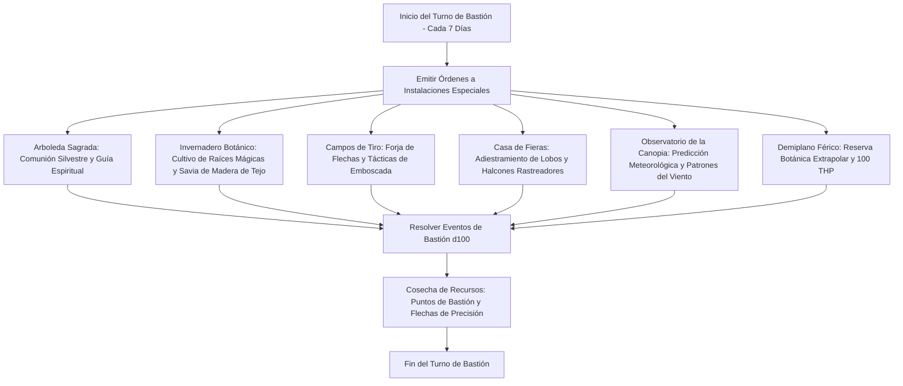

# 🏰 Bastión y Tiempo Muerto — Priest of the Wilds

## 🏰 Sistema de Bastiones (Reglas Oficiales DMG 2024 / D&D 5.5e)

* **Nombre del Bastión:** El Puesto de Tiro Silvestre (The Sylvan Outpost)
* **Nivel de Bastión:** 20 (Capacidad Máxima)
* **Puntos de Bastión (BP):** 112
* **Puntuación de Mando y Defensas (Defender Stats):**
  * STR 10 (+0), DEX 20 (+5), CON 14 (+2), INT 8 (-1), WIS 16 (+3), CHA 10 (+0)
  * **Bonificador de Defensa de Bastión:** $\mathbf{+11}$ (+6 Competencia + 5 Destreza)

---

## 🏛️ Registro de Instalaciones del Bastión (Nivel 20: 4 Roomy + 2 Vast)

### Instalaciones Básicas (Basic Facilities - Gratuitas e Ilimitadas)
1. **Dormitorio de la Canopia (Bedchambers):** Plataforma camuflada suspendida entre tres robles milenarios, protegida de la humedad y el viento.
2. **Refectorio de Caza (Dining Hall):** Mesa comunal al aire libre bajo pérgolas de madreselva donde los guardabosques comparten caza fresca.
3. **Pabellón de Meditación Silvestre (Common Room):** Espacio abierto con foso de fogata para intercambio de leyendas y cánticos antiguos.
4. **Almacén de Maderas y Flechas (Storage):** Cobertizo seco para estibar plumas de grifo, astiles de fresno y cuerdas de tripa tratada.

---

### Instalaciones Especiales (Special Facilities: Exactamente 6 al Nivel 20)

| Instalación | Tamaño (DMG 2024) | Nivel Mínimo | Estado | Orden Activa | Sinergia con el Build |
| :--- | :---: | :---: | :---: | :--- | :---: |
| **Arboleda Sagrada (Sanctuary)** | **Roomy** | Nivel 5 | Activa (Maintain) | *Commune:* Canaliza la gracia de la naturaleza; concede un dado $1\text{d}4$ de bendición diaria en salvaciones y tiradas de ataque. | 🔵 **Roto** |
| **Invernadero Botánico (Greenhouse)** | **Roomy** | Nivel 5 | Activa (Maintain) | *Harvest:* Cultivo de plantas venenosas y hierbas medicinales que abastecen *Goodberries* potenciadas y venenos. | 🟢 **Excelente** |
| **Campos de Tiro y Tácticas (Training Grounds)** | **Roomy** | Nivel 9 | Activa (Maintain) | *Practice:* Ejercicios de tiro a 600 pies; concede $+1$ adicional a la iniciativa en terrenos boscosos. | 🟢 **Excelente** |
| **Casa de Fieras (Menagerie)** | **Roomy** | Nivel 9 | Activa (Maintain) | *Breed:* Cría de halcones centinela y lobos de caza para patrullaje perimetral. | 🟢 **Excelente** |
| **Observatorio de la Canopia (Observatory)** | **Vast** | Nivel 13 | Activa (Maintain) | *Divination:* Escaneo de corrientes de aire y presagios astrológicos; otorga ventaja en tiradas de Supervivencia y Percepción. | 🟢 **Excelente** |
| **Demiplano Férico (Demiplane)** | **Vast** | Nivel 17 | Activa (Maintain) | *Sanctuary:* Retiro silvestre en un bosque atemporal; suministra ingredientes raros y concede **100 THP de reposo**. | 🔵 **Roto** |

---

## 👥 Guarnición y Personal de Mando (Staff & Garrison)

* **Mayordomo Mayor (Major Domo):** Capitán Bran Ojo de Halcón (Explorador elfo veterano de la guardia de la frontera).
* **Guarnición Activa:**
  * 12 Francotiradores Elfos con arcos largos y camuflaje de hojas.
  * 4 Lobos de la Niebla adiestrados para rastreo y presa.
* **Personal Especialista:**
  * 1 Maestro Arquero artesano de arcos compuestos y flechas pesadas.
  * 1 Boticaria Herborista encargada de destilados y ungüentos botánicos.
  * 1 Adiestrador de Rapaces para cetrería táctica.

---

## ⏳ Actividades de Tiempo Muerto (Downtime Priorities)

### Prioridad 1: Fabricación de Flechas Especiales (Plata y Hierro Frío)
* **Objetivo:** Disponer de 200 flechas mágicas de plata y hierro frío para penetrar resistencias de demonios y licántropos.
* **Mecánica:** Mediante los *Campos de Tiro* y herramientas de tallista de madera (Destreza $+11$), se forjan 20 flechas especiales por día a mitad de coste.
* **Ventaja Táctica:** Multiplica la eficacia del combo *Sharpshooter* contra criaturas con resistencia a armas no mágicas.

### Prioridad 2: Destilación de Filtros de Curación Silvestre (*Goodberry* y Ungüentos)
* **Objetivo:** Acumular ungüentos y frutos mágicos para amortiguar el desgaste de combate del escuadrón.
* **Mecánica:** En el *Invernadero Botánico*, destilar 4 Pociones de Curación Mayor semanales.

### Prioridad 3: Cartografía de Fronteras y Red de Alianzas Féricas
* **Objetivo:** Asegurar salvoconductos y rutas seguras a través de las tierras feéricas.
* **Mecánica:** Pruebas de Sabiduría (Supervivencia $+9$) combinadas con el carisma de *Otherworldly Glamour* para pactar con cortes féricas.