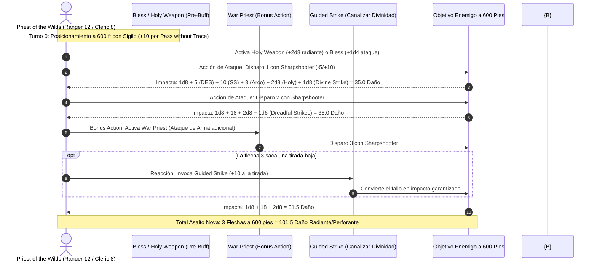

# 🌟 Lista de Conjuros Optimizada — Priest of the Wilds (Ranger 12 / Cleric 8)

**Arquetipo:** Trotador Férico (*Fey Wanderer*) & Dominio de la Guerra (*War Domain*)  
**Nivel de Lanzador Combinado:** Nivel 14 (Ranger 12 / 2 = 6 + Cleric 8 = 14)  
**Ranuras Disponibles:** Hasta ranuras de **7.º Nivel** para upcast táctico.  
**CD de Salvación de Conjuros:** $8 + 6 \text{ (Prof)} + 3 \text{ (SAB)} = \mathbf{17}$  
**Modificador de Ataque de Conjuro:** $+9$  

---

## 🔮 Trucos (Cantrips)

### ⛪ Clérigo (4 Preparados)
1. **Guidance 🔵 [Excelente]:** $+1\text{d}4$ a cualquier prueba de habilidad o iniciativa.
2. **Thaumaturgy 🟡 [Utilidad]:** Efectos de sonido y voz atronadora para emitir órdenes a 600 pies.
3. **Toll the Dead 🟢 [Ataque Alternativo]:** $4\text{d}12$ de daño necrótico en distancias cortas.
4. **Mending 🟢 [Utilidad]:** Reparación instantánea de astiles de flecha partidos y cuerdas de arco.

---

## 🏹 Matriz de Conjuros de Explorador (Fey Wanderer 12 — 7 Conocidos + Dominio Férico)

### Conjuros de Subclase Fey Wanderer (Siempre Preparados)
* **Charm Person (1.º Nivel):** Control sutil social.
* **Misty Step (2.º Nivel) 🔵 [Movilidad Instantánea]:** Teletransporte de 30 pies como acción adicional para romper presas o ganar posición de tiro elevada.
* **Dispel Magic (3.º Nivel) 🟢 [Utilidad]:** Neutralización de barreras mágicas enemigas.
* **Dimension Door (4.º Nivel) 🟢 [Evacuación]:** Teletransporte de 400 pies para posicionar al francotirador en torres o acantilados inexpugnables.

### Conjuros de Ranger Seleccionados
* **1.ᵉʳ Nivel:**
  * **Hunter's Mark 🔵 [Marcaje Balístico]:** $+1\text{d}6$ por flecha; ventaja en rastreo.
  * **Absorb Elements 🔵 [Defensa Reactiva]:** Reacción para ganar resistencia a daño elemental.
  * **Goodberry 🔵 [Buffer Médico]:** 10 bayas que curan 1 HP cada una y sustentan por 24 horas; colchón médico antes de dormir.
* **2.º Nivel:**
  * **Pass without Trace 🔵 [Sigilo Supremo]:** $+10$ a tiradas de Sigilo para todo el grupo; asegura rondas de sorpresa para emboscadas a 600 pies.
  * **Healing Spirit 🟢 [Curación Sostenida]:** Manantial de curación de $1\text{d}7$ por asalto para todo el pelotón.
* **3.ᵉʳ Nivel:**
  * **Conjure Animals 🔵 [Muro Táctico]:** Invoca 8 lobos o bestias para bloquear la línea de visión del enemigo mientras disparas por encima.
  * **Revivify 🔵 [Resurrección Rápida]:** Devuelve la vida a un compañero caído en el último minuto.

---

## ⛪ Matriz de Conjuros de Clérigo (War Domain 8 — Preparados Diarios)

### Conjuros de Dominio de Guerra (Siempre Preparados)
* **1.ᵉʳ Nivel:** *Divine Favor* (+1d4 radiante por impacto), *Shield of Faith* (+2 CA).
* **2.º Nivel:** *Magic Weapon*, *Spiritual Weapon*.
* **3.ᵉʳ Nivel:** *Crusader's Mantle*, *Spirit Guardians*.
* **4.º Nivel:** *Freedom of Movement*, *Stoneskin*.

### Conjuros de Clérigo Diarios Clave
* **4.º Nivel (3 Ranuras):**
  * **Death Ward 🔵 [Seguro de Vida]:** Previene la caída a 0 HP durante 8 horas sin concentración.
  * **Banishment 🟢 [Control Táctico]:** Expulsa amenazas a su plano nativo.
* **3.ᵉʳ Nivel (3 Ranuras):**
  * **Dispel Magic 🟢:** Disipación de trampas y bufos hostiles.
  * **Spirit Guardians 🟢 [Defensa Cercana]:** Ralentiza a la mitad a los enemigos que osen acercarse a 15 pies y les causa $3\text{d}8$ de daño radiante.
* **2.º Nivel (3 Ranuras):**
  * **Aid 🔵 [Buffer Colectivo]:** Upcast a nivel 6 o 7 para sumar **+25 a +30 HP máximos** a 3 aliados por 8 horas.
  * **Lesser Restoration 🟢 [Curación]:** Neutraliza venenos y parálisis.
* **1.ᵉʳ Nivel (4 Ranuras):**
  * **Bless 🔵 [Precisión Balística]:** $+1\text{d}4$ a tiradas de ataque de 3 aliados; anula el -5 de *Sharpshooter*.
  * **Healing Word 🔵 [Rescate Rápido]:** Acción adicional a 60 pies para levantar aliados caídos.

### 🌟 Upcast de Alto Nivel (Ranuras de Nivel 5, 6 y 7)
* **Holy Weapon (Upcast Nivel 5 de Clérigo):** Añade $+2\text{d}8$ de daño radiante a **cada impacto de flecha** durante 1 hora ($+9$ daño por flecha).
* **Aid (Upcast Nivel 7):** $+30$ HP máximos a 3 criaturas durante 8 horas sin requerir concentración.

---

## ⚡ Diagrama de Secuencia de la Salva de Francotirador (Nova Sniper Turn)

---

## 🩺 Curación en Segundo Plano y Regeneración Silvestre (Background Healing)

El Priest of the Wilds combina las mejores mecánicas de mantenimiento natural para mantener al grupo con vitalidad óptima:

1. **Batería de Frutos Mágicos (*Goodberry*):**
   * Antes de finalizar un descanso largo, se queman las ranuras restantes de nivel 1 para generar ramilletes de *Goodberries*. Cada baya cura 1 HP y nutre durante todo un día, permitiendo estabilizar aliados caídos o curar hasta **40-60 HP** fuera de combate sin coste de recursos activos.
2. **Espíritu Sanador (*Healing Spirit*):**
   * Invoca un espíritu férico en una casilla de 5 pies. Cada criatura aliada que entre en su espacio o inicie su turno allí recupera $1\text{d}7$ HP (hasta 4 veces el modificador de Sabiduría = 12 veces). Otorga una media de **42 HP de reposición** tras superar un combate.
3. **Buffer de Vida Máxima (*Aid* Upcast Nivel 6 u 7):**
   * Lanza *Aid* con ranuras de clérigo de nivel alto, otorgando un incremento permanente de **+25 a +30 Puntos de Vida máximos** a 3 aliados por 8 horas.
4. **Blindaje de Muerte (*Death Ward*):**
   * Coloca *Death Ward* sobre el tanque principal y sobre sí mismo antes de misiones de exploración profunda, garantizando que el primer impacto mortal los deje a 1 HP.