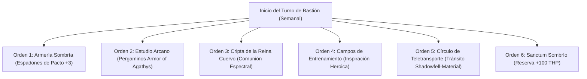

# 🏰 Bastión y Tiempo Muerto — Shadow Tank: The Umbral Juggernaut

## 🏰 Sistema de Bastiones (Reglas Oficiales DMG 2024 / 5.5e)

* **Nombre del Bastión:** La Fortificación Sombría (*The Umbral Fortress*)
* **Ubicación:** Un bastión de obsidiana y piedra lunar suspendido entre las brumas del Páramo Sombrío (*Shadowfell*) y una garganta montañosa del plano material.
* **Nivel de Bastión (Bastion Level):** Nivel 20
* **Puntos de Bastión (Bastion Points - BP):** 480 BP acumulados
* **Bonificador de Defensa de Bastión:** **+11** ($5_{\text{CAR}} + 6_{\text{PB}}$)

---

### 🏛️ Instalaciones Básicas (Basic Facilities)

1. **Aposentos de Obsidiana (Bedchambers):** Recámara excavada en roca negra con cortinajes umbrales y fuego fatuo azul.
2. **Refectorio de la Guardia Negra (Dining Hall):** Banquete comunal para los soldados de sombra y veteranos de la guarnición.
3. **Foso de Práctica Marcial (Common Room):** Sala de armas donde los guerreros entrenan el combate a ciegas y el choque de espadones.
4. **Cámara Acorazada Umbral (Storage):** Reserva de lingotes de hierro sombrío, pergaminos de piel de vampiro y gemas de pacto.

---

### 🔮 Instalaciones Especiales (Special Facilities — 6 Slots Nivel 20: 4 Roomy + 2 Vast)

1. **Armería Acero Sombrío (Armory — Roomy, Nivel 5):**
   * *Orden de Bastión:* **Craft / Maintain.**
   * *Efecto Mecánico:* Forja y mantenimiento de espadones pesados y medias armaduras de placas. Mantiene a los 16 defensores de élite con bonificador de +1 a impacto y daño.
2. **Estudio Arcano (Arcane Study — Roomy, Nivel 5):**
   * *Orden de Bastión:* **Craft.**
   * *Efecto Mecánico:* Transcribe pergaminos de conjuros del pacto (*Armor of Agathys* de 5.º nivel, *Shadow of Moil*, *Misty Step*) a mitad de coste y tiempo.
3. **Cripta de la Reina Cuervo (Crypt — Roomy, Nivel 9):**
   * *Orden de Bastión:* **Empower.**
   * *Efecto Mecánico:* Comunión directa con las entidades del Páramo Sombrío. Otorga un *Charm of the Shadowfell* que confiere Ventaja en salvaciones de Muerte y permite invocar 1 espectro guardián adicional.
4. **Campos de Entrenamiento de Resistencia (Training Grounds — Roomy, Nivel 9):**
   * *Orden de Bastión:* **Train.**
   * *Efecto Mecánico:* Concede Inspiración Heroica permanente al Shadow Tank al salir de su bastión y entrena a los defensores en contención de vanguardia pesada.
5. **Círculo de Teletransporte Permanente (Vast — Nivel 13):**
   * *Orden de Bastión:* **Maintain.**
   * *Efecto Mecánico:* Portal planar bidireccional que conecta la fortaleza en el Páramo Sombrío con las ciudades del Plano Material.
6. **Sanctum Sombrío y Sala de Guerra (War Room / Sanctum — Vast, Nivel 17):**
   * *Orden de Bastión:* **Empower / Mobilize.**
   * *Efecto Mecánico:* Tras completar un descanso largo en el Sanctum, el Shadow Tank absorbe un velo de energía necrótica que le otorga **+100 Puntos de Golpe Temporales** y resistencia total al daño Necrótico y Psíquico.

---

## ⏳ Actividades de Tiempo Muerto (Downtime Activities)

### Prioridad 1: Confección de Pergaminos de Armor of Agathys de 5.º Nivel

* **Mecánica Base:** DMG 2024 / Xanathar's Guide to Everything.
* **Tiradas y Recursos:** Herramientas de Calígrafo Arcano (+11 con Carisma). Coste: 250 po y 3 días por pergamino.
* **Objetivo de Optimización:** Acumular un arsenal de rollos para activar *Armor of Agathys* sin consumir los 4 espacios de pacto antes de misiones prolongadas.

### Prioridad 2: Forja de Espadones de Aleación Sombría

* Fabricación de hojas de dos manos templadas en éter oscuro.

---

## 🏃‍♂️ Modos de Movimiento, Logística y Viaje

### Velocidades de Movimiento Base

* **Caminar (Walk):** **40 ft/turno** (30 ft Base + 10 ft *Fast Movement* de Bárbaro).
* **Trepar (Climb):** 30 ft/turno.
* **Nadar (Swim):** 30 ft/turno.
* **Volar (Fly):** 60 ft/turno con montura espectral o *Fly*.

### Modificadores y Sentidos de Exploración

* **Visión en la Oscuridad:** 120 ft (*Devil's Sight* — visión perfecta en oscuridad natural y mágica).
* **Percepción Pasiva:** 10 (10 + 0 WIS).
* **Habilidades de Exploración:** *Danger Sense* (Ventaja pasiva en salvaciones de Destreza contra trampas y áreas).
