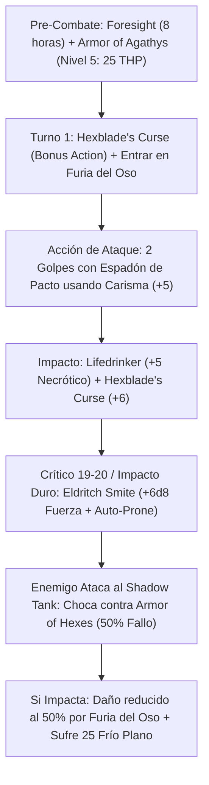

# Resumen General del Personaje: Shadow Tank (The Umbral Juggernaut)

## Datos Generales

* **System Standard:** D&D 5th Edition (2014 Ruleset / 2024 Compatible)
* **Character Level:** 20 (Total)
* **Class Split:** Warlock (Hexblade) 17 / Barbarian (Totem Warrior - Bear) 3
* **Species:** Half-Orc (*Relentless Endurance*, *Savage Attacks*, *Darkvision*)
* **Background:** Soldier / Outlander (Dote: *Alert* / *Fey Touched*)
* **Stats (Point Buy + Racial + ASIs):**
  * **FUER (STR):** 13 (+1) *(Requisito de Multiclaseo de Bárbaro)*
  * **DES (DEX):** 14 (+2) *(Máxima CA con Armadura Media)*
  * **CON:** 16 (+3) *(15 Base + 1 Racial — Reserva de vida multiplicada por Furia)*
  * **INT:** 8 (-1)
  * **SAB (WIS):** 10 (+0)
  * **CAR (CHA):** 20 (+5) *(14 Base + 2 Racial + 1 Fey Touched + 2 ASI + 1 ASI)*

* **Enlaces de Documentación:**
  * [Bastión y Tiempo Muerto](file:///d:/repo-vault/Proyectos/Rol/DnDbuilds/builds/shadow%20tank/bastion%20and%20downtime.md)
  * [Lista de Conjuros y Recursos](file:///d:/repo-vault/Proyectos/Rol/DnDbuilds/builds/shadow%20tank/spell%20list.md)
  * [Objetos a Obtener](file:///d:/repo-vault/Proyectos/Rol/DnDbuilds/builds/shadow%20tank/item%20list%20to%20obtain.md)
  * [Hoja de Ruta 1-20](file:///d:/repo-vault/Proyectos/Rol/DnDbuilds/builds/shadow%20tank/roadmap.md)
  * [Inventario Actual](file:///d:/repo-vault/Proyectos/Rol/DnDbuilds/builds/shadow%20tank/actual%20inventory%20list.md)

---

## Combat Role: Frontline Universal Resistor / Ice-Thorns Reflector / Nova Crit Crusher

El **Shadow Tank** es la personificación del blindaje absoluto ante cualquier tipo de daño en el multiverso. Combina la resistencia universal del **Tótem del Oso** (resistencia al 50% de todo el daño excepto psíquico) con el motor de espinas heladas de *Armor of Agathys* (Nivel 5 = 25 THP / 25 frío por golpe recibido) y la omnisciencia de combate de *Foresight* (Arcano de Nivel 9: dura 8 horas sin concentración y otorga Ventaja permanente a todo lo que hagas y Desventaja a todo lo que te ataque). Ofensivamente, blande un espadón de pacto invocable usando Carisma (+5) potenciado por *Lifedrinker* (+5 necrótico), *Hexblade's Curse* (críticos en 19-20 y +6 daño) y descargas demoledoras de *Eldritch Smite* ($+6\text{d}8$ de fuerza y derribo sin salvación).

---

## 1. Gestión de Recursos y Reglas de Inventario

* **Furia del Oso y Conjuros Sin Concentración:** Durante *Rage* no se pueden lanzar ni concentrar conjuros. Sin embargo, los dos conjuros definitorios del build:
  1. *Foresight* (Arcano de Nivel 9: 8 horas de duración, **sin concentración**).
  2. *Armor of Agathys* (Ranura de Pacto de Nivel 5: 1 hora de duración, **sin concentración**).
  Se activan antes del combate y operan al 100% de su capacidad mientras el personaje ruge en Furia del Oso.
* **Eldritch Smite en Furia:** El Castigo Eldritch es un rasgo de clase de Warlock, no un conjuro. Funciona con normalidad durante Furia, permitiendo gastar ranuras de pacto de nivel 5 para infligir $+6\text{d}8$ de fuerza y derribar al enemigo boca abajo (*Prone*) sin tirada de salvación.
* **Resiliencia de Semiorco (Relentless Endurance):** Cuando tus puntos de golpe bajan a 0, caes a 1 PG en su lugar una vez por descanso largo.

---

## 2. Action Economy & Combat Loop

* **Pre-Combate (Turno 0):** Activar *Foresight* (8 horas) y lanzar *Armor of Agathys* de nivel 5 (25 THP).
* **Turno 1 — Despliegue de Maldición y Furia:**
  * **Bonus Action:** Activar *Hexblade's Curse* sobre el enemigo principal (críticos en 19-20, +6 daño por golpe, cura 22 PG al morir).
  * **Action:** 2 Ataques con Espadón usando Carisma (+5). Con *Foresight*, ambos ataques tienen Ventaja automática.
  * **Impacto Clave:** Si impacta o anota un crítico (19-20 con Ventaja = 19% prob. de crítico), descarga *Eldritch Smite*: inflige $6\text{d}8$ (o $12\text{d}8$ en crítico) de fuerza y derriba al objetivo al suelo.
* **Turno 2+ — Aniquilación Sostenida:**
  * **Bonus Action:** Entrar en Furia del Oso (resistencia al 50% de todo daño salvo psíquico).
  * **Action:** 2 Ataques con Espadón contra el objetivo derribado con Ventaja.
  * **Defensas Pasivas Activas:**
    * *Foresight:* Todo ataque enemigo tiene Desventaja.
    * *Armor of Hexes (Warlock 10):* 50% de probabilidad fija (d6 roll de 4-6) de que el ataque del enemigo maldito falle automáticamente.
    * *Furia del Oso:* Todo daño recibido se reduce a la mitad.
    * *Armor of Agathys:* El enemigo sufre 25 de daño de frío plano por cada impacto en melé.

---

## 3. Mathematical Engine (D&D 5e / 2014 & 2024 Compatible)

### 🧮 Daño por Asalto Sostenido (DPR a Nivel 20)

Con Carisma 20 (+5), *Espadón de Pacto +3*, *Lifedrinker* (+5 necrótico), *Hexblade's Curse* (+6 daño), y Ventaja constante de *Foresight* contra CA 18:

$$\text{Probabilidad de Impacto con Ventaja } P(\text{Hit}) = 1 - (1 - 0.75)^2 = 0.9375 \quad (93.75\%)$$

$$\text{Probabilidad de Crítico (Rango 19-20 con Ventaja)} = 1 - (1 - 0.10)^2 = \mathbf{0.19 \quad (19.0\%)}$$

* **Daño por Impacto Normal:**
  $$\text{Dmg}_{\text{Hit}} = 2\text{d}6_{\text{Espadón}} + 5_{\text{CAR}} + 5_{\text{Lifedrinker}} + 6_{\text{Curse}} + 3_{\text{Item}} = 7.0 + 19 = \mathbf{26.0 \text{ Daño}}$$

* **Daño por Impacto Crítico (Semiorco Savage Attacks añade 1 dado extra de arma):**
  $$\text{Dmg}_{\text{Crit}} = 5\text{d}6_{\text{Espadón}} + 19 = 17.5 + 19 = \mathbf{36.5 \text{ Daño}}$$

$$\text{DPR Golpes Básicos (2 Ataques)} = 2 \times [0.9375 \times 26.0 + 0.19 \times 10.5] = 2 \times [24.375 + 1.995] = \mathbf{52.74 \text{ DPR}}$$

* **Descarga con Eldritch Smite (Nivel 5):**
  $$\text{Smite Normal} = 6\text{d}8 = \mathbf{27.0 \text{ Fuerza}} \quad \mid \quad \text{Smite Crítico} = 12\text{d}8 = \mathbf{54.0 \text{ Fuerza}}$$

$$\text{DPR Ráfaga en Turno de Smite} = 52.74 + 27.0 = \mathbf{79.74 \text{ Daño Ofensivo}} + 50\text{ Frío/Espinas Pasivo}$$

### 🛡️ Motor de Absorción Universal y EHP Extremo

$$\text{Resistencia Furia del Oso} = \text{Reduce el 50\% de todo daño entrante (fuego, frío, rayo, ácido, fuerza, etc.)}$$

$$\text{EHP Físico y Elemental} = \frac{\text{HP Real } (185) + \text{Armor of Agathys } (25) + \text{Sanctum Ward } (100)}{1 - 0.50} = \frac{310}{0.50} = \mathbf{620 \text{ EHP Efectivo}}$$

* **Durabilidad de los 25 THP de Agathys:** Como el daño se reduce a la mitad, se requieren **50 de daño real** para agotar el escudo.
* Si 3 atacantes impactan por 16 de daño cada uno (reducido a 8 cada uno = 24 total), el escudo sobrevive con 1 THP y los 3 atacantes han sufrido un total de **75 de daño de frío automático**.

---

## 4. Tabla de Rendimiento Táctico

| Criterio | Valoración | Justificación Mecánica |
| :--- | :---: | :--- |
| **Daño Monobjetivo** | 🔵 | Críticos en 19-20 con 19% de probabilidad bajo *Foresight*, espadón con Carisma + Lifedrinker (26 daño por golpe) y smites de $+6\text{d}8$ a $+12\text{d}8$. |
| **Control de Masas (CC)** | 🟢 | Derribo automático sin salvación (*Prone*) mediante *Eldritch Smite*, *Forcecage* de nivel 7, y *Mass Suggestion* de nivel 6. |
| **Supervivencia (EHP)** | 🔵 | 620 EHP con resistencia universal a todo el daño (Bear Totem), *Foresight* (desventaja en ataques enemigos), *Armor of Hexes* (50% miss), y *Relentless Endurance*. |
| **Economía de Acciones** | 🔵 | Pre-buffs de 8 horas y 1 hora sin concentración, maldición en Acción Adicional, Furia en Acción Adicional y Reacción de resistencia pasiva. |
| **Sustentabilidad** | 🔵 | Las 4 ranuras de 5.º nivel se recuperan en descanso corto. *Hexblade's Curse* cura 22 PG al morir el objetivo maldito y se traspasa a otro objetivo (*Master of Curses*). |

---

## 5. Home Rules (Reglas de la Mesa)

1. **Espadón Canalizador Único:** El espadón de pacto actúa como foco de lanzamiento unificado para todos los conjuros de Warlock.
2. **Invocaciones Activas en Furia:** Se confirma el uso de rasgos de Warlock no mágicos (*Eldritch Smite*, *Lifedrinker*, *Armor of Hexes*) mientras se está bajo los efectos de la Furia de Bárbaro.
