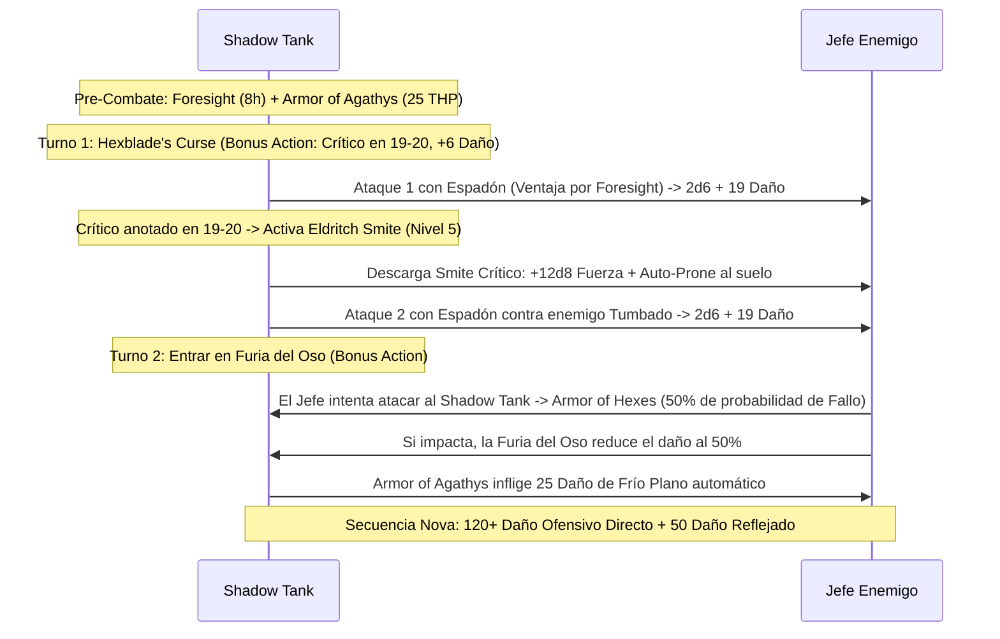

# 🌟 Lista de Conjuros y Recursos — Shadow Tank: The Umbral Juggernaut

Esta lista detalla la selección de conjuros y recursos para el **Shadow Tank** (Warlock Hexblade 17 / Barbarian Totem Warrior - Bear 3), optimizada bajo reglas de D&D 5e (2014 & 2024).

> **Aviso Táctico Fundamental:** No puedes lanzar ni concentrarte en conjuros mientras estás en *Furia (Rage)*. Por ello, el build opera alrededor de los dos conjuros sin concentración más potentes del juego: **Foresight** (8 horas de duración) y **Armor of Agathys** (1 hora de duración), ambos activos de forma simultánea mientras ruge la Furia del Oso.

---

## ⚡ Conjuros Activos y Pre-Buffs (Turno 0 / Fuera de Combate)

| Conjuro / Recurso | Duración | Concentración | Efecto Táctico Clave |
| :--- | :---: | :---: | :--- |
| **Foresight (Mystic Arcanum 9)** | 8 horas | No | **Ventaja en todas tus tiradas de ataque, salvación y pruebas**; **Desventaja a todos los ataques enemigos contra ti**. Funciona al 100% en Furia. |
| **Armor of Agathys (Nivel 5)** | 1 hora | No | Otorga **25 THP**. Cualquier enemigo que te golpee en cuerpo a cuerpo sufre **25 de daño de frío plano** por cada golpe recibido. |
| **Sanctum Ward (Bastión)** | 24 horas | No | Reserva de **+100 Puntos de Golpe Temporales** obtenida en el Sanctum Sombrío. |

---

## 🔮 Trucos (Cantrips — Warlock)

1. **Eldritch Blast 🔵 [Indispensable]:** 4 rayos de fuerza ($1\text{d}10 + 5$) a 120 ft usando Carisma. Ataque a distancia principal cuando no estés en Furia.
2. **Minor Illusion 🟢 [Utilidad]:** Creación de distracciones visuales o acústicas tácticas.
3. **Mage Hand 🟢 [Utilidad]:** Manipulación remota de objetos y trampas a 30 ft.
4. **Prestidigitation 🟡 [Utilidad]:** Efectos menores sensoriales y limpieza de sangre o suciedad del equipo.

---

## 🎒 Conjuros de Pact Magic (4 Ranuras de Nivel 5 — Recarga en Descanso Corto)

*CD de Salvación de Conjuros:* $8 + 6_{\text{PB}} + 5_{\text{CAR}} = \mathbf{19}$. Modificador de Ataque de Conjuro: $\mathbf{+11}$.

### 5.º Nivel

1. **Armor of Agathys 🔵 [Roto / Núcleo del Build]:** 25 HP temporales que infligen 25 de daño de frío automático al atacante. Combinado con la Furia del Oso (resistencia a todo daño salvo psíquico), absorbe 50 de daño universal efectivo.
2. **Shadow of Moil 🔵 [Defensa en Combate Sin Furia]:** Oscuridad pesada protectora. Todos los ataques enemigos sufren Desventaja, tus ataques tienen Ventaja y devuelves $2\text{d}8$ de daño necrótico al ser golpeado.
3. **Banishing Smite 🟢 [Nova / Destierro]:** Añade $+5\text{d}10$ de daño de fuerza al impacto; destierra al objetivo si queda con menos de 50 PG.
4. **Synaptic Static 🔵 [Control en Área sin Concentración]:** Detonación de $8\text{d}6$ psíquico en 20 ft de radio; resta $1\text{d}6$ a ataques y salvaciones enemigas durante 1 minuto sin concentración.
5. **Hypnotic Pattern 🔵 [Control Masivo]:** Incapacita a salas enteras de enemigos antes de activar la furia.
6. **Misty Step 🟢 [Movilidad]:** Teletransporte de 30 ft como Acción Adicional.
7. **Dimension Door 🟢 [Escape]:** Teletransporte de 500 pies para ti y un aliado.

---

## 🔮 Arcanos Místicos (Mystic Arcanum — 1 Uso Diario de Cada Uno)

* **9.º Nivel: Foresight 🔵 [Dios del Combate]:** 8 horas sin concentración. Confiere Ventaja universal propia y Desventaja a los atacantes. Transforma al Shadow Tank en una fortaleza intocable dentro de la Furia.
* **8.º Nivel: Demiplane 🟢 [Refugio Planar]:** Acceso inmediato a un demioplano privado para descanso seguro o almacenamiento de trofeos.
* **7.º Nivel: Forcecage 🔵 [Encierro Absoluto]:** Celda de fuerza indestructible de 20 pies sin salvación inicial para aislar jefes durante 1 hora.
* **6.º Nivel: Mass Suggestion 🔵 [Control Mental Masivo]:** Ordena a hasta 12 criaturas seguir una directiva durante 24 horas sin concentración.

---

## 💥 Secuencia de Daño Nova (The Umbral Cleaver)

---

## 💚 Curación en Segundo Plano y Sostenibilidad

* **Hexblade's Curse Healing:** Al morir el objetivo maldito, el Shadow Tank recupera de forma pasiva **22 Puntos de Golpe** ($17_{\text{Warlock}} + 5_{\text{CAR}}$). Gracias al rasgo *Master of Curses*, puede transferir la maldición a otro enemigo sin gastar usos.
* **Relentless Endurance (Semiorco):** Si un ataque letal reduce tus PG a 0, caes a 1 PG en su lugar una vez por descanso largo.
* **Pociones en Acción Adicional:** Consumo rápido de *Potion of Supreme Healing* ($10\text{d}4 + 20 \approx 45\text{ PG}$) bajo reglas oficiales 2024.
