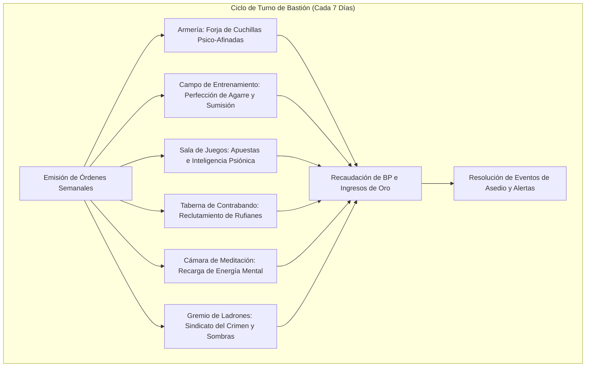

# 🏰 Bastión y Tiempo Muerto — Sneaky Smasher

## 🏰 Sistema de Bastiones (Reglas Oficiales DMG 2024 / D&D 5.5e)

*Estructura de gestión de la base de operaciones, economía de bastión y mecánicas de mando.*

* **Nombre del Bastión:** La Guarida de la Mente Silenciosa (Whispering Lair)
* **Nivel de Bastión (Bastion Level):** 20
* **Puntos de Bastión (Bastion Points - BP):** 110
* **Puntuación de Mando (Bastion Defender Stats):** +11 al ataque y salvaciones defensivas (STR 20 [+5], DEX 14 [+2], CON 14 [+2], INT 10 [+0], WIS 12 [+1], CHA 8 [-1]).

---

### Instalaciones Básicas (Basic Facilities)

1. **Dormitorio Subterráneo (Bedchambers):** Búnker excavado bajo raíces de robles milenarios, protegido con trampas mecánicas de alarma y un lecho de pieles de oso cavernario.
2. **Taberna Clandestina (Dining Hall):** Refugio abovedado con grandes barricas de licor enano donde la banda de rufianes comparte banquetes y coordina golpes.
3. **Salón Común de Juegos (Common Area):** Cámara de juego equipada con mesas de dados trucados y cartas donde los infiltradores descansan en anonimato.

---

### Instalaciones Especiales (Special Facilities — Exactamente 6: 4 Roomy + 2 Vast)

#### 1. Armería Clandestina (Armory — Roomy, Desbloqueo Nivel 5)
* **Estado:** Activa (Mantener)
* **Tamaño:** Roomy (Espaciosa)
* **Orden de Bastión:** *Equip & Maintain (Equipar a los Rufianes)*
* **Sinergia con el Build:** 🟢 **Excelente**. Almacena corazas medias y dagas pesadas para la banda de asaltantes. Concede +4 a la defensa base del bastión contra incursiones hostiles.

#### 2. Campo de Entrenamiento de Agarre (Training Area — Roomy, Desbloqueo Nivel 5)
* **Estado:** Activa (Mantener)
* **Tamaño:** Roomy (Espaciosa)
* **Orden de Bastión:** *Train (Acondicionamiento de Sumisión)*
* **Sinergia con el Build:** 🔵 **Indispensable**. Patio de arena gruesa diseñado para llaves de inmovilización y combate temerario. Concede ventaja en pruebas de iniciativa o en la primera tirada de atletismo tras abandonar el bastión.

#### 3. Sala de Juegos y Apuestas (Gaming Hall — Roomy, Desbloqueo Nivel 9)
* **Estado:** Activa (Mantener)
* **Tamaño:** Roomy (Espaciosa)
* **Orden de Bastión:** *Gamble (Juegos de Azar y Riqueza)*
* **Sinergia con el Build:** 🟢 **Excelente**. Centro de juego clandestino donde el uso sutil de dados psiónicos (*Psi-Bolstered Knack*) permite inclinar las probabilidades, generando $1\text{d}10 \times 20$ po limpios por semana.

#### 4. Taberna de Contrabando (Pub — Roomy, Desbloqueo Nivel 9)
* **Estado:** Activa (Mantener)
* **Tamaño:** Roomy (Espaciosa)
* **Orden de Bastión:** *Gather Intel (Red de Información Subterránea)*
* **Sinergia con el Build:** 🟢 **Excelente**. Punto de encuentro para contrabandistas y ladrones que provee rumores estratégicos y descubre la presencia de cazarrecompensas en la comarca.

#### 5. Cámara de Meditación Psiónica (Meditation Chamber — Vast, Desbloqueo Nivel 13)
* **Estado:** Activa (Mantener)
* **Tamaño:** Vast (Vasta)
* **Orden de Bastión:** *Focus (Enfoque de Energía Psiónica)*
* **Sinergia con el Build:** 🔵 **Indispensable**. Cámara silenciosa que regenera la reserva de dados psiónicos del personaje y otorga ventaja en tiradas de salvación de Sabiduría y Fuerza durante las primeras 24 horas.

#### 6. Gremio de Ladrones y Sombras (Guildhall — Vast, Desbloqueo Nivel 17)
* **Estado:** Activa (Mantener)
* **Tamaño:** Vast (Vasta)
* **Orden de Bastión:** *Command & Extort (Sindicato Criminal de Élite)*
* **Sinergia con el Build:** 🔵 **Indispensable**. Sede central que coordina una red internacional de extorsión y sabotaje. Permite desplegar brigadas de rufianes y bestias para defender el bastión con un bono marcial de mando de +11.

---

### Seguidores y Guarnición (Staff & Garrison)

* **Capataz General (Major Domo):** Contrabandista Jaxon (Un pícaro veterano de ojos afilados, frío y leal a la causa).
* **Guarnición Activa:**
  * 14 Rufianes Bugbear y mercenarios armados con garrotes y hojas ocultas.
  * 4 Lobos guardianes adiestrados para rastreo olfativo en los túneles.
  * 2 Croupiers y tasadores de gemas del mercado negro.

---

## ⏳ Actividades de Tiempo Muerto (Downtime Activities)

### Prioridad 1: Obtención de Inteligencia y Extorsión
* **Mecánica Oficial:** Xanathar's Guide to Everything / DMG 2024 (Carousing / Crime).
* **Bonificadores Aplicables:** Juegos de Dados (+11 con pericia), Sigilo (+17 mínimo 27 por *Reliable Talent*) y dados psiónicos (*Psi-Bolstered Knack* +1d12).
* **Objetivo:** Chantajear a magistrados y señores de la guerra locales para asegurar impunidad legal en todas las operaciones.

### Prioridad 2: Entrenamiento Físico de Sumisión
* **Mecánica Oficial:** DMG 2024 (Training).
* **Objetivo:** Perfeccionar técnicas de lucha libre y agarres anatómicos contra criaturas de tamaño Enorme o Gargantuesco.

---

## 🏃‍♂️ Modos de Movimiento, Logística y Viaje

* **Caminar (Walk):** 40 ft. (30 ft. base Bugbear + 10 ft. por Movimiento Rápido de Bárbaro).
* **Iniciativa en Viaje:** +7 (+2 DES + 5 Dote Alert) con ventaja pasiva por *Danger Sense*.
* **Sigilo Mástil:** Con *Boots of Elvenkind* (ventaja) y *Reliable Talent* (mínimo 10 en el d20), la tirada de sigilo jamás baja de **27**.
* **Visión en la Oscuridad:** 60 ft. nativa del Bugbear.

---

## 🎭 Reputación y Facciones

1. **La Cofradía de la Mente Rota:** Alto Ejecutor de la red clandestina de asesinos y psiónicos independientes.
2. **El Círculo de los Clanes Totémicos:** Respetado como hermano de sangre del Tótem del Oso por tribus salvajes del norte.