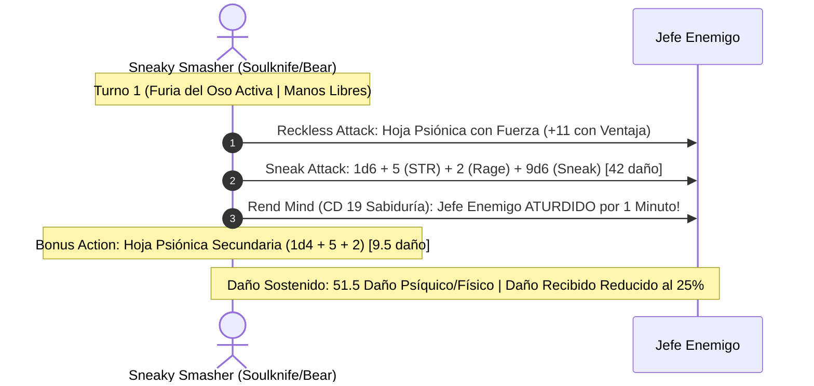

# Guía de Personaje — Sneaky Smasher (Edición 2024 / 5.5e Update)

## Datos Generales

* **System Standard:** D&D 5th Edition (2024 Ruleset - 5.5e Compatible)
* **Character Level:** 20 (Total)
* **Class Split:** Rogue (Soulknife) 17 / Barbarian (Path of the Totem Warrior - Bear) 3
* **Species:** Bugbear (2024 / MPMOT — Surprise Attack +2d6 por impacto en Turno 1, Long-Limbed 10 ft reach)
* **Background:** Criminal / Bouncer (Dote de Origen: *Alert 2024* o *Tavern Brawler 2024*)
* **Stats (Point Buy 2024 / Background):**
  * **FUER (STR):** 20 (+5) *(15 Base + 2 Trasfondo + 1 Dote Nivel 7 + 2 ASI Nivel 11)*
  * **DES (DEX):** 14 (+2)
  * **CON:** 14 (+2) *(13 Base + 1 Trasfondo)*
  * **INT:** 10 (+0)
  * **SAB (WIS):** 12 (+1)
  * **CAR (CHA):** 8 (-1)

* **Enlaces de Documentación:**
  * [Bastión y Tiempo Muerto](file:///d:/repo-vault/Proyectos/Rol/DnDbuilds/builds/sneaky%20smasher/bastion%20and%20downtime.md)
  * [Lista de Recursos y Habilidades](file:///d:/repo-vault/Proyectos/Rol/DnDbuilds/builds/sneaky%20smasher/spell%20list.md)
  * [Objetos a Obtener](file:///d:/repo-vault/Proyectos/Rol/DnDbuilds/builds/sneaky%20smasher/item%20list%20to%20obtain.md)
  * [Hoja de Ruta 1-20](file:///d:/repo-vault/Proyectos/Rol/DnDbuilds/builds/sneaky%20smasher/roadmap.md)
  * [Inventario Actual](file:///d:/repo-vault/Proyectos/Rol/DnDbuilds/builds/sneaky%20smasher/actual%20inventory%20list.md)

---

## Combat Role: Strength Finesse Striker, Bear Totem Tank & Grapple Controller

Bajo las reglas oficiales de **D&D 5.5e (2024)**:
1. **Finesse con Fuerza:** Atacar con armas sutiles utilizando Fuerza sigue siendo legal en 2024, activando *Reckless Attack* y *Sneak Attack* (9d6) simultáneamente.
2. **Unarmed Strike / Grapple 2024:** Permite apresar a criaturas enemigas imponiendo una CD de salvación basada en Fuerza y Bonificador de Competencia ($8 + \text{PB (6)} + \text{FUER (5)} = \mathbf{19}$).
3. **Cunning Strike 2024:** Permite sacrificar dados de *Sneak Attack* para aplicar efectos de derribo (*Trip*), veneno (*Poison*) o retirada (*Withdraw*) sin gastar acciones.
4. **Resistencia de Furia:** Mitiga el 50% de todo daño entrante, que se reduce al **25%** al aplicar la reacción de *Uncanny Dodge*.

---

## 1. Gestión de Recursos y Reglas de Inventario (Reglas 2024)

* **Manos 100% Libres:**
  * Las Hojas Psiónicas se manifiestan y desvanecen instantáneamente, permitiendo mantener ambas manos libres para el control de presa (*Grapple*).
* **Economía de Dados Psiónicos 2024:**
  * 12 dados d12 por descanso largo. *Psi-Bolstered Knack* solo gasta el dado si la tirada tiene éxito.

---

## 2. Action Economy & Combat Loop (2024)

* **Preparación (Pre-Combate):**
  * Establecer *Psychic Whispers* con el grupo y activar *Psychic Veil* (invisibilidad por 1 hora sin concentración).
* **Action:**
  * **Acción de Ataque:** Declarar *Reckless Attack* (ventaja). Impactar con Hoja Psiónica usando Fuerza (+11 hit).
  * Al impactar: Activa *Sneak Attack* (+9d6 psíquico), suma Fuerza (+5) y Furia (+2).
  * **Rend Mind:** Gasta 1 dado psiónico $\implies$ el objetivo debe superar salvación de Sabiduría (CD 19) o quedar **Aturdido (*Stunned*) durante 1 minuto**.
* **Bonus Action:**
  * Turno 1: Entrar en Furia del Oso.
  * Turnos 2+: Ataque secundario con hoja psiónica o *Psychic Teleportation* (salto de hasta 120 pies).
* **Reaction:**
  * *Uncanny Dodge* (daño entrante a la mitad; 25% de daño neto bajo Furia de Oso).

---

## 3. The META Combo 2024: Strength-Based Reckless Sneak Attack + Bear Resistance

### 🧮 Motor Matemático (2024 Ruleset)

$$\text{Daño Hoja Principal} = 1\text{d}6 + 5 (\text{STR}) + 2 (\text{Rage}) + 9\text{d}6 (\text{Sneak}) = 10\text{d}6 + 7 = \mathbf{42.0 \text{ daño}}$$

$$\text{Daño Hoja Secundaria} = 1\text{d}4 + 5 + 2 = 1\text{d}4 + 7 = \mathbf{9.5 \text{ daño}}$$

$$\text{DPR Sostenido en Cada Turno} = 42.0 + 9.5 = \mathbf{51.5 \text{ daño medio/turno}}$$

$$\text{P(Impactar con Ventaja Permanente de Reckless)} \approx 0.88 \implies \mathbf{45.3 \text{ DPR Efectivo Real}}$$