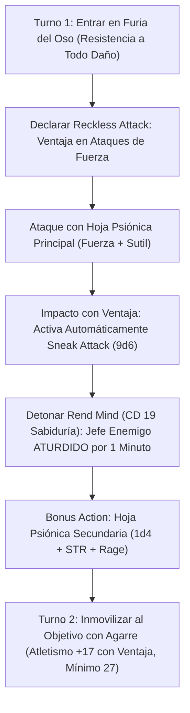

# Guía de Personaje — Sneaky Smasher (The Psionic Bear Brawler)

## Datos Generales

* **System Standard:** D&D 5th Edition (2024 / 5.5e Update & 2014 Compatibility)
* **Character Level:** 20 (Rogue [Soulknife] 17 / Barbarian [Path of the Totem Warrior - Bear] 3)
* **Species:** Bugbear (Ataque Sorpresa: +2d6 por impacto en el Turno 1; Extremidades Largas: alcance de 10 pies en melé)
* **Background:** Criminal / Bouncer (Atributos: Fuerza +2, Constitución +1)
* **Stats (Point Buy + Racial + ASIs):**
  * **FUER (STR):** 20 (+5) *(15 Base + 2 Racial + 1 Dote Nivel 7 + 2 ASI Nivel 11)*
  * **DES (DEX):** 14 (+2) *(14 Base — Maximiza la armadura media)*
  * **CON:** 14 (+2) *(13 Base + 1 Racial — Aguante y puntos de golpe)*
  * **INT:** 10 (+0) *(Standard Array)*
  * **SAB (WIS):** 12 (+1) *(12 Base — Salvaciones y percepción)*
  * **CAR (CHA):** 8 (-1) *(Standard Array)*

* **Enlaces de Documentación:**
  * [Bastión y Tiempo Muerto](file:///d:/repo-vault/Proyectos/Rol/DnDbuilds/builds/sneaky%20smasher/bastion%20and%20downtime.md)
  * [Lista de Recursos y Habilidades](file:///d:/repo-vault/Proyectos/Rol/DnDbuilds/builds/sneaky%20smasher/spell%20list.md)
  * [Objetos a Obtener](file:///d:/repo-vault/Proyectos/Rol/DnDbuilds/builds/sneaky%20smasher/item%20list%20to%20obtain.md)
  * [Hoja de Ruta 1-20](file:///d:/repo-vault/Proyectos/Rol/DnDbuilds/builds/sneaky%20smasher/roadmap.md)
  * [Inventario Actual](file:///d:/repo-vault/Proyectos/Rol/DnDbuilds/builds/sneaky%20smasher/actual%20inventory%20list.md)
  * [Guía de Personaje 2024](file:///d:/repo-vault/Proyectos/Rol/DnDbuilds/builds/sneaky%20smasher/character%20guide%202024.md)

---

## Combat Role: Frontline Grappler God, Reckless Sneak Attacker & Evasive Tank

El **Sneaky Smasher** explota una de las interacciones de reglas más contundentes y elegantes del juego: **utilizar Fuerza para atacar con un arma Sutil (*Finesse*)**.

Al atacar con Fuerza mediante las **Hojas Psiónicas (*Psychic Blades*)** del Soulknife, activa **Ataque Temerario (*Reckless Attack*)** para ganar ventaja obligatoria en todas las tiradas de ataque. Dado que el ataque se realiza con un arma sutil y con ventaja, activa automáticamente el **Ataque Furtivo (*Sneak Attack*) de 9d6** en cada turno sin requerir cobertura ni aliados cercanos, sumando además el daño plano de Fuerza (+5) y de Furia (+2).

Combina esta ofensiva implacable con la resistencia absoluta del **Tótem del Oso** (resistencia a todo daño excepto psíquico), **Esquiva Asombrosa (*Uncanny Dodge*)** para reducir el daño real al **25%**, y un modificador de Atletismo de **+17 con ventaja** y mínimo de 27 por *Reliable Talent* para inmovilizar a cualquier titán.

---

## 1. Gestión de Recursos y Reglas de Inventario

* **Economía de Manos y Hojas Psiónicas:**
  * Las **Hojas Psiónicas (*Psychic Blades*)** se materializan instantáneamente en la mano vacía en el momento de atacar y desaparecen tras el impacto. Esto significa que el personaje combate con **ambas manos completamente libres** en todo momento, permitiéndole apresar (*Grapple*) a dos criaturas simultáneamente sin penalizar su capacidad ofensiva.
* **Gestión de Recursos Psiónicos y de Furia:**
  * **12 Dados de Energía Psiónica (d12):** Utilizados para *Psi-Bolstered Knack* (sumar 1d12 a pruebas de habilidad fallidas sin consumir el dado si sigue fallando), *Psychic Teleportation* (salto de hasta 120 pies) y *Rend Mind* (aturdimiento psíquico).
  * **3 Usos de Furia por Descanso Largo:** Proporcionan resistencia al daño elemental y físico (Tótem del Oso), ventaja en chequeos de Atletismo y +2 de daño plano.

---

## 2. Action Economy & Combat Loop

* **Preparación (Pre-Combate / Turno 0):**
  * Establecer enlace telepático con el grupo mediante *Psychic Whispers* (duración de varias horas, rango 1 milla sin consumir dados si tiene éxito).
  * Activar *Psychic Veil* (Invisibilidad psiónica durante 1 hora sin concentración).
* **Action:**
  * **Turno 1 [Ataque Temerario Furtivo]:**
    * Declarar **Reckless Attack:** Obtiene ventaja en todas las tiradas de ataque con Fuerza durante el turno.
    * Invocar Hoja Psiónica Principal ($1\text{d}6$ daño psíquico).
    * Al atacar con Fuerza y ventaja usando un arma sutil: Activa **Sneak Attack (+9d6)** y suma Fuerza (+5) y Furia (+2).
    * **Rend Mind (Soulknife 17):** Gasta 1 dado psiónico al aplicar el furtivo; la criatura debe superar una salvación de Sabiduría (CD 19) o quedar **Aturdida (*Stunned*) durante 1 minuto completo**.
  * **Opción Táctica de Agarre (Grapple):**
    * Sustituye el ataque por un intento de agarre. Tirada de Atletismo: $+17$ con ventaja por Furia y resultado mínimo de **27** por *Reliable Talent*.
* **Bonus Action:**
  * **Turno 1:** Entrar en **Furia del Oso (*Bear Totem Rage*)**.
  * **Turnos 2+:** Ataque con **Hoja Psiónica Secundaria** ($1\text{d}4$ psíquico + Fuerza + Furia) o **Psychic Teleportation** (lanzar una hoja y teletransportarse hasta $10 \times 1\text{d}12$ pies).
* **Reaction:**
  * 🔵 **Uncanny Dodge:** Reduce a la mitad el daño de un ataque que le impacte. Al combinarse con la resistencia de Furia del Oso, **el daño neto recibido se reduce al 25%**.

---

## 3. The META Combo: La Llave Psiónica Temeraria

### 🧮 Motor Matemático (Mathematical Engine)

#### 1. Cálculo de Daño por Asalto (Apertura Turno 1 con Bugbear)

$$\text{Daño Hoja Principal} = 1\text{d}6 (3.5) + 5 (\text{STR}) + 2 (\text{Furia}) + 9\text{d}6 (31.5) + 2\text{d}6 (\text{Bugbear}) = 12\text{d}6 + 7 = \mathbf{49.0 \text{ daño psíquico/físico}}$$

$$\text{Daño Hoja Secundaria} = 1\text{d}4 (2.5) + 5 (\text{STR}) + 2 (\text{Furia}) + 2\text{d}6 (\text{Bugbear}) = 1\text{d}4 + 2\text{d}6 + 7 = \mathbf{16.5 \text{ daño psíquico}}$$

$$\text{DPR Nova de Apertura (Turno 1)} = 49.0 + 16.5 = \mathbf{65.5 \text{ daño medio}}$$

#### 2. Cálculo de Daño Sostenido (Turnos 2+)

$$\text{Daño Hoja Principal Turnos 2+} = 1\text{d}6 + 5 + 2 + 9\text{d}6 = 10\text{d}6 + 7 = \mathbf{42.0 \text{ daño}}$$

$$\text{Daño Hoja Secundaria Turnos 2+} = 1\text{d}4 + 5 + 2 = 1\text{d}4 + 7 = \mathbf{9.5 \text{ daño}}$$

$$\text{DPR Sostenido Permanente} = 42.0 + 9.5 = \mathbf{51.5 \text{ daño medio/turno}}$$

*Con ventaja permanente por Reckless Attack ($P(\text{impacto}) \approx 0.88$), el DPR efectivo esperado es $\mathbf{45.3 \text{ DPR sostenido}}$.*

#### 3. Reducción Cuádruple de Daño (EHP Absoluto)

$$\text{HP Máximos Base} = 12 + (2 \times 7) + (17 \times 5) + (20 \times 2) + 40 (\text{Tough}) = 191 \text{ HP}$$

Bajo resistencia del Tótem del Oso (50% de mitigación frente a daño contundente, cortante, perforante, fuego, frío, rayo, trueno, ácido, veneno, radiante, necrótico y fuerza):

$$\text{EHP Pasivo en Furia} = \frac{191}{0.5} = \mathbf{382 \text{ EHP}}$$

Al reaccionar con *Uncanny Dodge* frente a un impacto singular masivo:
$$\text{Mitigación Acumulada} = 191 \times 2 \times 2 = \mathbf{764 \text{ EHP Efectivo contra impactos individuales}}$$

---

## 4. Tabla de Clasificación Táctica de Habilidades

| Habilidad / Recurso | Tipo | Coste | Evaluación | Justificación Táctica |
| :--- | :---: | :---: | :---: | :--- |
| **Reckless Sneak Attack** | Ofensiva | 0 Recursos | 🔵 | Garantiza ventaja en cada asalto usando Fuerza para activar 9d6 de Sneak Attack sin depender de aliados. |
| **Bear Totem Resistance** | Defensiva | Furia | 🔵 | Resistencia a absolutamente todos los tipos de daño del juego excepto el psíquico. |
| **Rend Mind** | Control | 1 Dado Psiónico | 🔵 | Aturde al objetivo durante 1 minuto completo (salvación de Sabiduría CD 19). |
| **Reliable Talent** | Utilidad | Pasiva Rogue 11 | 🔵 | Cualquier tirada competente menor a 10 vale 10; fija el Atletismo mínimo en 27 y el Sigilo en 27. |
| **Psychic Teleportation** | Movilidad | Acción Adicional | 🟢 | Teletransporte de hasta $10 \times 1\text{d}12$ pies (hasta 120 ft) para franquear fosos o reposicionarse. |
| **Uncanny Dodge** | Defensiva | Reacción | 🟢 | Reduce a la mitad el daño entrante; apilado con la Furia, absorbe el 75% del impacto. |
| **Psychic Veil** | Infiltración | 1 Uso / 1 Dado | 🟢 | Invisibilidad total durante 1 hora sin requerir concentración. |

---

## 5. Reglas de la Casa (Home Rules)

1. **Ataque Sutil con Fuerza Plenamente Válido:** Se ratifica el uso de Fuerza con armas sutiles (Hojas Psiónicas) para satisfacer simultáneamente los requisitos de *Reckless Attack* y *Sneak Attack*.
2. **Dados Psiónicos Escalados por PB Total:** Los dados de energía psiónica de Soulknife escalan con el bonificador de competencia total del personaje (+6 $\implies$ dados d12 a nivel 20).