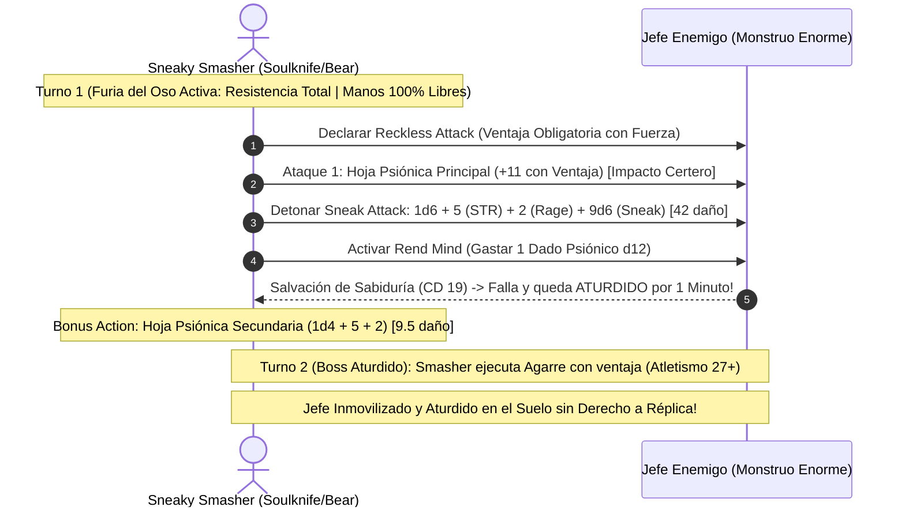

# 🌟 Lista de Recursos Tácticos y Poderes Psiónicos — Sneaky Smasher

Este personaje es un **Especialista Marcial Psiónico (Rogue Soulknife 17 / Barbarian Totem Warrior 3)** que prescinde del lanzamiento de conjuros convencionales para operar mediante una combinación demoledora de **Furia del Oso**, **Hojas Psiónicas** y **Ataque Furtivo con Fuerza**.

---

## 🔮 Matriz de Recursos y Habilidades Psiónicas

* **Dados de Energía Psiónica:** 12 dados d12 por Descanso Largo (escala por bonificador de competencia total PB +6).
* **Usos de Furia del Oso (*Bear Totem Rage*):** 3 usos por Descanso Largo (resistencia a **todos los daños** excepto el psíquico, ventaja en pruebas de Fuerza y +2 al daño plano).
* **Ataque Furtivo (*Sneak Attack*):** $+9\text{d}6$ de daño garantizado cada turno al atacar con ventaja vía *Reckless Attack* usando Fuerza.
* **CD de Salvación Psiónica:** $8 + \text{PB (6)} + \text{FUER (5)} = \mathbf{19}$.
* **Atletismo Mínimo Garantizado:** $10 (\text{Reliable Talent}) + 5 (\text{FUER}) + 12 (\text{Pericia PB x2}) = \mathbf{27}$ (con ventaja por Furia).
* **Sigilo Mínimo Garantizado:** $10 (\text{Reliable Talent}) + 2 (\text{DES}) + 12 (\text{Pericia PB x2}) = \mathbf{24}$ (con ventaja por *Boots of Elvenkind*).
* **Turno 0 Pre-Buffs:**
  * Enlace telepático de grupo activo mediante *Psychic Whispers* (duración de varias horas, radio de 1 milla sin gastar dados si tiene éxito).
  * Invisibilidad psiónica previa al asalto vía *Psychic Veil* (1 hora de duración sin concentración).

---

## 🌿 Rituales de la Naturaleza (Totem Warrior)

*Lanzables exclusivamente como rituales de 10 minutos sin consumir espacios:*

| Ritual | Escuela | Clasificación | Efecto y Justificación Táctica |
| :--- | :---: | :---: | :--- |
| **Speak with Animals** | Adivinación | 🟢 | Comunicación telepática y verbal con bestias para interrogar pájaros o roedores y trazar planos de infiltración. |
| **Beast Sense** | Adivinación | 🟡 | Sintoniza tus sentidos con los de una bestia aliada o un lobo del bastión para espiar a través de sus ojos y oídos. |

---

## 🧠 Poderes Psiónicos del Soulknife (12 Dados d12)

| Poder Psiónico | Coste | Clasificación | Efecto Mecánico y Justificación Táctica |
| :--- | :---: | :---: | :--- |
| **Psychic Blades** | 0 Dados | 🔵 | **Arma principal sutil:** Invoca hojas de energía psiónica ($1\text{d}6$ principal, $1\text{d}4$ secundaria) en manos libres. Daño psíquico puro que ignora resistencias físicas. Alcance arrojadizo de 60 pies. |
| **Psi-Bolstered Knack** | 1 Dado (solo si éxito) | 🔵 | Si fallas una prueba de habilidad en la que eres competente, sumas 1d12 al resultado. **Si aun así fallas, el dado NO se gasta.** |
| **Rend Mind** | 1 Dado Psiónico | 🔵 | **El estupefaciente nuclear:** Al dañar a una criatura con tu hoja psiónica y aplicar *Sneak Attack*, la fuerzas a realizar una salvación de Sabiduría (CD 19). Si falla, queda **Aturdida (*Stunned*) durante 1 minuto completo** (puede repetir la salvación al final de sus turnos). |
| **Psychic Teleportation** | 1 Dado Psiónico | 🟢 | Acción adicional: Lanzas una hoja psiónica a un punto visible y te teletransportas inmediatamente hasta una distancia igual al resultado del d12 multiplicado por 10 pies (hasta 120 pies). |
| **Psychic Veil** | 1 Uso / 1 Dado | 🟢 | Acción: Te vuelves completamente invisible a ti y a tu equipo durante 1 hora. Se disipa si atacas o fuerzas una salvación. |
| **Psychic Whispers** | 1 Dado (solo si éxito) | 🟢 | Enlace mental seguro para hasta 6 criaturas aliadas durante horas a 1 milla de distancia. |

---

## 🛡️ Habilidades Físicas y Defensivas

| Habilidad / Rasgo | Clase | Clasificación | Justificación Mecánica |
| :--- | :---: | :---: | :--- |
| **Reckless Attack** | Barbarian 2 | 🔵 | Otorga ventaja obligatoria en todas las tiradas de ataque con Fuerza, activando el *Sneak Attack* de 9d6 en cada asalto. |
| **Bear Totem Spirit** | Barbarian 3 | 🔵 | Resistencia a todos los tipos de daño del multiverso excepto el daño psíquico mientras dure la Furia. |
| **Uncanny Dodge** | Rogue 5 | 🟢 | Reacción: Reduce a la mitad el daño de un ataque entrante; combinado con la Furia de Oso, **solo recibes el 25% del impacto original**. |
| **Reliable Talent** | Rogue 11 | 🔵 | Cualquier tirada de habilidad competente con resultado inferior a 10 se convierte automáticamente en un 10. |
| **Evasion** | Rogue 7 | 🟢 | Cero daño en salvaciones de Destreza exitosas y mitad de daño en fallos. |
| **Slippery Mind** | Rogue 15 | 🟢 | Competencia en tiradas de salvación de Sabiduría, blindando la mente del bárbaro contra encantamientos. |

---

## 💥 Secuencia de Combate Nova (Reckless Sneak + Rend Mind Stun + Agarre Olímpico)

---

## 🩺 Curación en Segundo Plano y Mantenimiento Vital

1. **Mitigación Pasiva al 25% de Daño:**
   * La combinación de la resistencia universal del **Tótem del Oso** con la reacción de **Esquiva Asombrosa (*Uncanny Dodge*)** absorbe el 75% del daño recibido, convirtiendo cada punto de golpe del personaje en 4 puntos de golpe efectivos reales.
2. **Blindaje Mental con Slippery Mind y Evasion:**
   * Al ser competente en salvaciones de Fuerza, Constitución (Bárbaro) y Sabiduría (*Slippery Mind*), el personaje es inmune a las debilidades típicas del bárbaro (miedos, parálisis y dominaciones mentales).
3. **Suministros del Bastión:**
   * La Taberna de Contrabando provee 3 *Potions of Supreme Healing* ($10\text{d}4 + 20 \text{ PG}$) para restaurar el daño residual tras combates mayores.