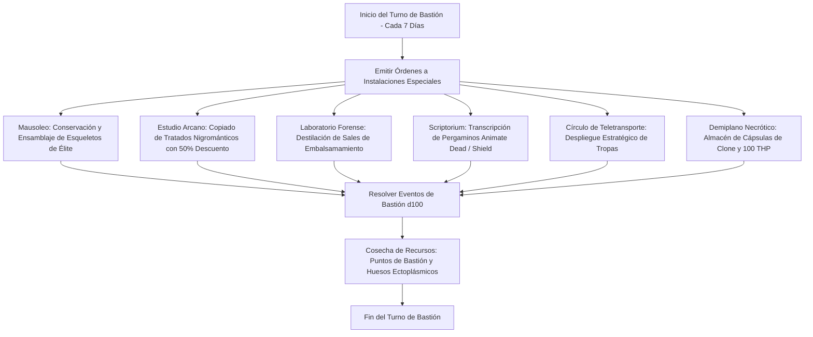

# 🏰 Bastión y Tiempo Muerto — Spirit Caller

## 🏰 Sistema de Bastiones (Reglas Oficiales DMG 2024 / D&D 5.5e)

* **Nombre del Bastión:** El Osario Susurrante (The Whispering Ossuary)
* **Nivel de Bastión:** 20 (Capacidad Máxima)
* **Puntos de Bastión (BP):** 100
* **Puntuación de Mando y Defensas (Defender Stats):**
  * STR 8 (-1), DEX 14 (+2), CON 16 (+3), INT 20 (+5), WIS 12 (+1), CHA 8 (-1)
  * **Bonificador de Defensa de Bastión:** $\mathbf{+11}$ (+6 Competencia + 5 Inteligencia)

---

## 🏛️ Registro de Instalaciones del Bastión (Nivel 20: 4 Roomy + 2 Vast)

### Instalaciones Básicas (Basic Facilities - Gratuitas e Ilimitadas)
1. **Dormitorio del Señor Cadavérico (Bedchambers):** Cripta subterránea aislada con un sarcófago de basalto sellado al vacío donde el Reborn medita.
2. **Comedor Fúnebre (Dining Hall):** Refectorio gélido con mesa de obsidiana utilizado por el personal vivo y artesanos del bastión.
3. **Sala de Disección Común (Common Room):** Anfiteatro anatómico donde se estudian patrones óseos para optimizar la resistencia de los esqueletos.
4. **Osario Subterráneo de Almacenamiento (Storage):** Depósito climatizado con salmuera y vendas para preservar restos biológicos y armas de proyectiles.

---

### Instalaciones Especiales (Special Facilities: Exactamente 6 al Nivel 20)

| Instalación | Tamaño (DMG 2024) | Nivel Mínimo | Estado | Orden Activa | Sinergia con el Build |
| :--- | :---: | :---: | :---: | :--- | :---: |
| **Cripta y Mausoleo (Mausoleum)** | **Roomy** | Nivel 5 | Activa (Maintain) | *Harvest:* Almacena y reconstituye hasta 32 esqueletos de élite; infunde resistencia a daño radiante en huesos. | 🔵 **Roto** |
| **Estudio Arcano (Arcane Study)** | **Roomy** | Nivel 5 | Activa (Maintain) | *Research:* Copiado de conjuros arcanos de Nigromancia al libro de conjuros con un 50% de descuento en tiempo y oro. | 🟢 **Excelente** |
| **Laboratorio Forense (Laboratory)** | **Roomy** | Nivel 5 | Activa (Maintain) | *Distill:* Destilación de unguentos alquímicos para preservar los 3 cuerpos del conjuro *Clone*. | 🔵 **Roto** |
| **Scriptorium Funerario (Scriptorium)** | **Roomy** | Nivel 9 | Activa (Maintain) | *Craft:* Transcribe pergaminos de *Animate Dead*, *Summon Undead* y *Counterspell* a velocidad duplicada. | 🟢 **Excelente** |
| **Círculo de Teletransporte (Teleportation Circle)** | **Vast** | Nivel 13 | Activa (Maintain) | *Mobilize:* Permite desplegar instantáneamente al ejército de 55 tropas no-muertas en cualquier rincón del multiverso. | 🔵 **Roto** |
| **Demiplano Necrótico (Demiplane)** | **Vast** | Nivel 17 | Activa (Maintain) | *Sanctuary:* Reserva extrapolar inexpugnable; custodia 3 cámaras de *Clone* y concede **100 THP de reposo prolongado**. | 🔵 **Roto** |

---

## 👥 Guarnición y Personal de Mando (Staff & Garrison)

* **Mayordomo Mayor (Major Domo):** Morten el Pálido (Necrófago aristócrata dotado de inteligencia y protocolo militar fúnebre).
* **Guarnición Activa:**
  * 16 Guerreros Esqueléticos con cotas de malla y alabardas pesadas custodiando las catacumbas.
  * 8 Tiradores Esqueleto en los adarves superiores con arcos largos.
* **Personal Especialista:**
  * 1 Maestro Embalsamador de las Tierras Sombrías.
  * 1 Calígrafo Funerario para grabado de runas en huesos.
  * 2 Forenses alquímicos para el mantenimiento de los frascos de clonación.

---

## ⏳ Actividades de Tiempo Muerto (Downtime Priorities)

### Prioridad 1: Mantenimiento de las Cámaras de Clonación (*Clone*)
* **Objetivo:** Asegurar la inmortalidad absoluta del Mago Comandante y su Simulacro.
* **Mecánica:** Mediante el *Laboratorio Forense* y el *Demiplano*, mantener 3 recipientes con salmuera y clones en crecimiento activo (coste: 3,000 po en diamantes y vasijas selladas).
* **Ventaja Táctica:** Anula de forma definitiva el riesgo de muerte en campaña: en caso de perecer, el alma se traslada instantáneamente a un nuevo cuerpo sano en el Bastión.

### Prioridad 2: Fabricación de Flechas Encantadas y Armamento Óseo
* **Objetivo:** Equipar a los 32 arqueros esqueleto con flechas de calidad y arcos reforzados.
* **Mecánica:** Utilizar los talleres del bastión para forjar puntas de flecha de hierro frío y plata.

### Prioridad 3: Investigación Arcana y Cartografía de Sepulcros Olvidados
* **Objetivo:** Localizar tumbas de antiguos reyes o criaturas legendarias para alzarlas mediante *Command Undead*.
* **Mecánica:** Investigación en el *Estudio Arcano* mediante tiradas de Inteligencia (Historia $+11$), desvelando coordenadas de ruinas antiguas.