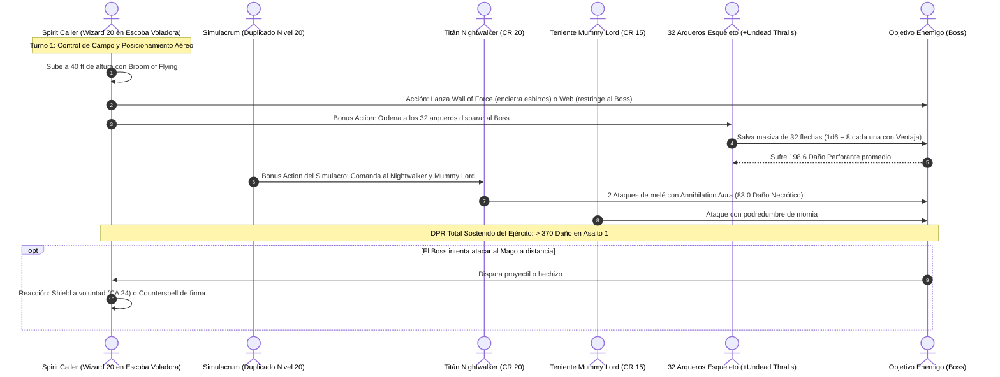

# 🌟 Lista de Conjuros Optimizada — Spirit Caller (Wizard 20)

**Escuela:** Nigromancia (*School of Necromancy*)  
**CD de Salvación de Conjuros:** $8 + 6 \text{ (Prof)} + 5 \text{ (INT)} = \mathbf{19}$ (Base) / $\mathbf{22}$ (Con *Staff of the Magi* y *Arcane Grimoire +3*)  
**Modificador de Ataque Mágico:** $+11$ (Base) / $\mathbf{+14}$ (Con foco legendario)  

---

## 🔮 Trucos (Cantrips)

1. **Toll the Dead 🔵 [Pilar Ofensivo]:** $4\text{d}12$ de daño necrótico a objetivos dañados (salvación de Sabiduría con CD 22).
2. **Chill Touch 🟢 [Anti-Curación]:** $4\text{d}8$ de daño necrótico que anula la regeneración del enemigo y da desventaja a los no-muertos hostiles.
3. **Mage Hand 🟢 [Utilidad]:** Manipulación remota de restos, llaves o trampas a 30 pies.
4. **Minor Illusion 🟢 [Control Táctico]:** Generación de sonidos de horda o pantallas visuales ilusorias.
5. **Prestidigitation 🟡 [Utilidad]:** Limpieza de manchas de sangre o conservación cosmética de tejidos.

---

## ⚡ Maestría de Conjuros y Conjuros de Firma (Spell Mastery & Signature Spells)

* **Maestría de Conjuros (Spell Mastery — Nivel 18 de Mago):**
  * **Shield (Nivel 1):** Lanzado **a voluntad sin consumir ranuras de conjuro** como reacción ($+5$ a la CA permanente en combate).
  * **Misty Step (Nivel 2):** Lanzado **a voluntad sin consumir ranuras de conjuro** como acción adicional (movilidad ilimitada).
* **Conjuros de Firma (Signature Spells — Nivel 20 de Mago):**
  * **Animate Dead (Nivel 3):** 1 lanzamiento gratuito a nivel 3 por Descanso Corto sin gastar ranura.
  * **Counterspell (Nivel 3):** 1 lanzamiento gratuito a nivel 3 por Descanso Corto sin gastar ranura.

---

## 🎒 Matriz de Conjuros de Grimorio Preparados (25 Conjuros Diarios)

### 9.º Nivel (1 Ranura)
* **Wish 🔵 [Omnipotencia Arcana]:** Duplica cualquier conjuro de nivel 1-8 existente (*Heroes' Feast*, *Simulacrum* instantáneo) sin consumir componentes materiales ni tiempo.
* **Shapechange 🟢 [Versatilidad Suprema]:** Transfórmate en Dragón Rojo Anciano o Marilith manteniendo tus capacidades mentales.

### 8.º Nivel (1 Ranura)
* **Create Undead 🔵 [Guardia Real Ghasts]:** Upcast a nivel 8 para controlar **10 Ghasts** con auras de hedor y ataques de parálisis.
* **Maze 🔵 [Destierro Indestructible]:** Encierra a un jefe en un laberinto extradimensional sin tirada de salvación inicial (requiere prueba de Inteligencia CD 22 para escapar).

### 7.º Nivel (2 Ranuras)
* **Simulacrum 🔵 [Clon de Combate — El Duplicador]:** Crea un duplicado perfecto de ti mismo que cuenta con su propio uso de *Command Undead* (para gobernar un segundo no-muerto colosal) y ranuras de conjuro completas.
* **Forcecage 🔵 [Prisión Inviolable]:** Celda o caja de fuerza indestructible de 20 pies sin salvación y sin concentración.

### 6.º Nivel (2 Ranuras)
* **Contingency 🔵 [Protocolo de Emergencia]:** Enlaza *Dimension Door* o *Otiluke's Resilient Sphere* para activarse automáticamente si tus HP caen por debajo de 50.
* **Summon Undead (Upcast Nivel 6) 🟢 [Artillería Necrótica]:** Invoca un Espíritu Putrefacto con 4 ataques y veneno paralizante.
* **Circle of Death 🟡 [Limpieza Masiva]:** Daño necrótico de $8\text{d}6$ en radio gigantesco de 60 pies.

### 5.º Nivel (3 Ranuras)
* **Wall of Force 🔵 [Control Absoluto]:** Muro invisible indestructible que segmenta encuentros complejos sin conceder tirada de salvación.
* **Synaptic Static 🟢 [Debuff Psíquico]:** $8\text{d}6$ de daño psíquico; resta $1\text{d}6$ a ataques y salvaciones enemigas durante 1 minuto sin concentración.
* **Danse Macabre 🟢 [Invocación Instantánea]:** Alza 5 esqueletos adicionales en plena batalla otorgándoles $+5$ de bonificador de ataque e impacto.

### 4.º Nivel (3 Ranuras)
* **Dimension Door 🟢 [Evacuación Táctica]:** Teletransporte de 400 pies con un siervo o aliado sin requerir visión directa.
* **Polymorph 🟢 [Soporte / Incapacitación]:** Convierte a un aliado herido en bestia de desafío masivo o anula un enemigo singular.
* **Blight 🟡 [Daño Necrótico]:** Daño monotarget de ejecución ($8\text{d}8$).

### 3.ᵉʳ Nivel (3 Ranuras + 2 Gratis por Descanso Corto)
* **Animate Dead 🔵 [Mantenimiento de la Horda]:** Mantén el control de hasta 32 arqueros esqueleto repartiendo ranuras de nivel 3 y 4 al final del día.
* **Counterspell 🔵 [Interrupción Arcana]:** Reacción inmediata para cancelar magia hostil en 60 pies.
* **Dispel Magic 🟢 [Purificación Mágica]:** Elimina efectos mágicos persistentes o barreras enemigas.
* **Slow 🟢 [Control de Masas]:** Reduce la CA, restringe reacciones e impone fallo a ataques múltiples de hasta 6 objetivos.

### 2.º Nivel (3 Ranuras + Misty Step a Voluntad)
* **Misty Step 🔵 [A Voluntad]:** Escape ilimitado como acción adicional gracias a *Spell Mastery*.
* **Web 🟢 [Control y Ventaja]:** Restringe áreas de 20 pies para conceder **Ventaja** a los 32 arqueros esqueleto.
* **Rime's Binding Ice 🟢 [Control Táctico]:** Reduce velocidad a 0 pies sin requerir concentración.

### 1.ᵉʳ Nivel (4 Ranuras + Shield a Voluntad)
* **Shield 🔵 [A Voluntad]:** Reacción ilimitada que añade $+5$ a la CA (CA 24) e inmuniza contra *Magic Missile*.
* **Absorb Elements 🔵 [Defensa Elemental]:** Reacción contra alientos de dragón o explosiones mágicas.
* **Silvery Barbs 🔵 [Manipulación]:** Obliga a relanzar éxitos enemigos y concede ventaja a un siervo o aliado.

---

## ⚡ Diagrama de Secuencia del Mando de la Horda (Army Control Sequence)

---

## 🩺 Curación en Segundo Plano e Inmortalidad (Background Healing)

El Nigromante no gasta turnos en curar aliados; su sistema fisiológico y de contingencias garantiza una autosuficiencia total:

1. **Cosecha Sombría (*Grim Harvest*):**
   * Cada vez que el Mago elimina a una criatura con un conjuro de Nigromancia, recupera instantáneamente un número de Puntos de Golpe igual a **3 veces el nivel del conjuro** (o 2 veces para otras escuelas). Al liquidar esbirros con *Toll the Dead*, *Blight* o *Circle of Death*, sana entre **12 y 24 HP** sin consumir acciones curativas.
2. **Cámaras de Clonación Extrapolar (*Clone*):**
   * En el *Demiplano* del Bastión descansan **3 clones** sellados en salmuera con equipo duplicado.
   * Si el Mago sufre daño letal, desintegración o muerte instantánea, su alma viaja de inmediato al recipiente inerte en el Bastión, despertando vivo, con salud completa y sin penalización de niveles.
3. **Pacto de Sangre (*Life Transference*):**
   * En emergencias donde un aliado crucial esté al borde de la muerte, el Mago puede lanzar *Life Transference*, sufriendo $4\text{d}8$ de daño para curar al aliado el doble del daño recibido (media de **36 a 72 HP restaurados** en un solo turno).
4. **Alimentación Fúnebre (*Heroes' Feast* vía *Wish*):**
   * Al término de cada jornada en el Bastión, el Mago replica *Heroes' Feast* mediante *Wish*, dotando a su pelotón de $+2\text{d}10$ de vida máxima, ventaja en salvaciones de Sabiduría e inmunidad a veneno y miedo por 24 horas.