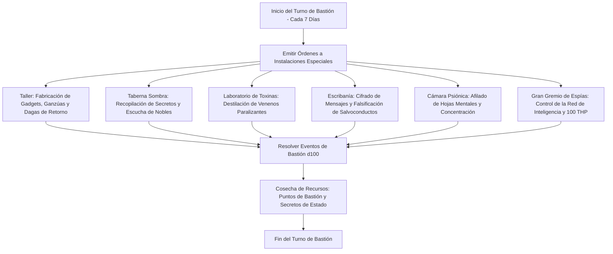

# 🏰 Bastión y Tiempo Muerto — Spymaster

## 🏰 Sistema de Bastiones (Reglas Oficiales DMG 2024 / D&D 5.5e)

* **Nombre del Bastión:** La Red Sombra (The Shadow Net Citadel)
* **Nivel de Bastión:** 20 (Capacidad Máxima)
* **Puntos de Bastión (BP):** 120
* **Puntuación de Mando y Defensas (Defender Stats):**
  * STR 8 (-1), DEX 20 (+5), CON 14 (+2), INT 14 (+2), WIS 12 (+1), CHA 10 (+0)
  * **Bonificador de Defensa de Bastión:** $\mathbf{+11}$ (+6 Competencia + 5 Destreza)

---

## 🏛️ Registro de Instalaciones del Bastión (Nivel 20: 4 Roomy + 2 Vast)

### Instalaciones Básicas (Basic Facilities - Gratuitas e Ilimitadas)
1. **Camarote del Maestro de Espías (Bedchambers):** Alcoba oculta tras una biblioteca secreta con pasadizos de escape directos a las cloacas de la ciudad.
2. **Sala de Conferencias Cifrada (Dining Hall):** Comedor con mesa de mapas tácticos donde los lugartenientes informan en clave jeroglífica.
3. **Plaza de Informantes Común (Common Room):** Centro de descanso camuflado como taberna vulgar para mendigos, pícaros y correos secretos.
4. **Almacén de Disfraces y Caches (Storage):** Depósito sellado con cerraduras mágicas de dificultad CD 30 para archivar pelucas, documentos comprometedores y gemas.

---

### Instalaciones Especiales (Special Facilities: Exactamente 6 al Nivel 20)

| Instalación | Tamaño (DMG 2024) | Nivel Mínimo | Estado | Orden Activa | Sinergia con el Build |
| :--- | :---: | :---: | :---: | :--- | :---: |
| **Taller de Criptografía (Workshop)** | **Roomy** | Nivel 5 | Activa (Maintain) | *Craft:* Fabricación de ganzúas de mitril, garruchas de sigilo y dagas con un 50% de descuento. | 🟢 **Excelente** |
| **Taberna de los Rumores Sombra (Pub)** | **Roomy** | Nivel 5 | Activa (Maintain) | *Gather Intel:* Atrae a mercaderes y nobles; genera 1d6 $\times$ 10 BP y desvela debilidades de enemigos. | 🔵 **Roto** |
| **Laboratorio de Toxinas (Laboratory)** | **Roomy** | Nivel 9 | Activa (Maintain) | *Craft:* Síntesis de venenos de contacto y vapores aturdidores para untar en las dagas. | 🟢 **Excelente** |
| **Escribanía y Falsificación (Scriptorium)** | **Roomy** | Nivel 9 | Activa (Maintain) | *Forge:* Elaboración de sellos reales falsificados y copiado de pergaminos de *Disguise Self* y *Invisibility*. | 🟢 **Excelente** |
| **Cámara de Meditación Psiónica (Meditation Chamber)** | **Vast** | Nivel 13 | Activa (Maintain) | *Focus:* Afina la energía de las Hojas Psíquicas; otorga ventaja en salvaciones mentales para la siguiente misión. | 🔵 **Roto** |
| **Gran Gremio de Espías del Reino (Guildhall)** | **Vast** | Nivel 17 | Activa (Maintain) | *Influence:* Monopolio del espionaje en todo el continente; concede **100 THP de reposo prolongado** al Spymaster. | 🔵 **Roto** |

---

## 👥 Guarnición y Personal de Mando (Staff & Garrison)

* **Mayordomo Mayor (Major Domo):** Agente Varis (Ex-maestro de espías de la corona con lealtad absoluta al gremio).
* **Guarnición Activa:**
  * 16 Infiltradores Sombra armados con ballestas de mano y hojas envenenadas.
  * 6 Mastines Silenciosos adiestrados para detección de intrusos invisibles.
* **Personal Especialista:**
  * 1 Maestro Alquimista Toxicólogo a cargo del laboratorio.
  * 1 Criptógrafo Mayor especializado en descifrado de códigos planares.
  * 2 Falsificadores Reales para duplicación de salvoconductos.

---

## ⏳ Actividades de Tiempo Muerto (Downtime Priorities)

### Prioridad 1: Síntesis de Venenos de Torpeza y Parálisis
* **Objetivo:** Disponer de 30 dosis de veneno de contacto para armas sutiles.
* **Mecánica:** Mediante el *Laboratorio de Toxinas* y herramientas de envenenador (Inteligencia $+8$), elaborar dosis a coste reducido.
* **Ventaja Táctica:** Añade daño y condiciones de desventaja adicionales a los impactos de *Booming Blade*.

### Prioridad 2: Falsificación de Identidades y Salvoconductos
* **Objetivo:** Crear dossiers de identidad completos para penetrar cortes nobles o fortalezas militares sin combate.
* **Mecánica:** Pruebas de herramientas de falsificación garantizadas con *Reliable Talent* (mínimo 27 en el dado).

### Prioridad 3: Cartografía de Redes de Contrabando
* **Objetivo:** Mantener refugios seguros (*safe houses*) en cada capital del mapa de campaña.
* **Mecánica:** Infiltración mediante el *Gran Gremio de Espías*.