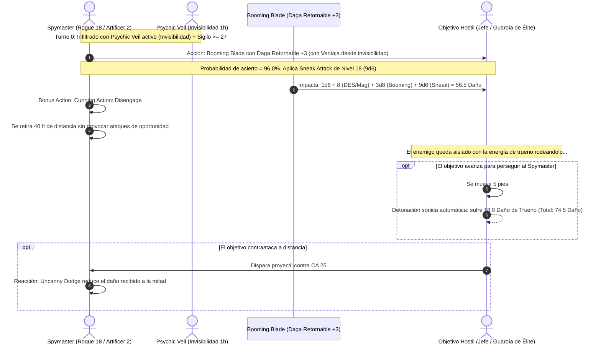

# 🌟 Lista de Conjuros y Poderes Psiónicos — Spymaster (Rogue 18 / Artificer 2)

**Arquetipo:** Hoja Psíquica (*Soulknife*) & Artífice (*Artificer*)  
**Dados de Energía Psiónica:** $2 \times \text{PB} = \mathbf{12 \text{ Dados d12}}$ por Descanso Largo (1 dado recuperable como acción adicional 1/descanso corto)  
**CD de Salvación de Habilidades y Conjuros:** $8 + 6 \text{ (Prof)} + 5 \text{ (DES)} = \mathbf{19}$ (Psiónica) / $8 + 6 + 2 \text{ (INT)} = \mathbf{16}$ (Artífice)  

---

## 🔮 Trucos (Cantrips de Artífice — 2 Conocidos)

1. **Booming Blade 🔵 [Pilar Ofensivo]:** Ataque de arma con Destreza; inflige daño del arma $+3\text{d}8$ de trueno y castiga con $+4\text{d}8$ adicionales si el enemigo se mueve.
2. **Guidance 🔵 [Pilar de Apoyo]:** $+1\text{d}4$ a cualquier prueba de habilidad propia o aliada.

---

## 🎒 Conjuros Preparados de Artífice (4 Ranuras de 1.ᵉʳ Nivel)

* **Absorb Elements 🔵 [Defensa Reactiva]:** Reacción que otorga resistencia a daño de fuego, frío, rayo o ácido, sumando $+1\text{d}6$ al siguiente golpe melee.
* **Disguise Self 🟢 [Infiltración Visual]:** Altera la apariencia física y vestimentas durante 1 hora para adoptar identidades ajenas.
* **Cure Wounds 🟡 [Rescate de Emergencia]:** Cura $1\text{d}8 + 2$ de vida al tocar a un compañero caído.
* **Faerie Fire 🟢 [Ventaja Grupal]:** Resalta a enemigos en un cubo de 20 pies para otorgar Ventaja constante a todos los ataques.

---

## 🧠 Matriz de Poderes y Talentos Psiónicos (Soulknife)

### 1. Hojas Psíquicas (*Psychic Blades* — A Voluntad)
* Manifiesta dagas de energía psíquica pura cada vez que atacas.
* **Ataque Principal:** $1\text{d}6$ de daño psíquico (sutil, arrojadiza a 60 pies).
* **Ataque Secundario (Bonus Action):** $1\text{d}4$ de daño psíquico.
* **Propiedad Invisible:** No dejan marcas físicas, sangre ni heridas visibles; el objetivo sufre daño puramente mental.

### 2. Destreza Psico-Reforzada (*Psi-Bolstered Knack*)
* Si fallas una tirada de habilidad en la que tengas competencia (Sigilo, Juegos de Manos, Percepción, etc.), puedes tirar **1d12** y sumarlo al total.
* **Ventaja del Archivero:** Si aun sumando el dado la tirada sigue fallando, **el dado de energía psiónica no se gasta**.

### 3. Susurros Psíquicos (*Psychic Whispers*)
* Establece un enlace mental telepático entre tú y un número de criaturas igual a tu bonificador de competencia (+6) a cualquier distancia (millas).
* Primer uso diario totalmente gratuito; duración de $1\text{d}12$ horas.

### 4. Hojas del Alma (*Soul Blades* — Nivel 9)
* **Teletransporte de Sombra:** Lanzas una hoja psíquica a un espacio desocupado y te teletransportas instantáneamente hasta ella (distancia igual a tirada de $1\text{d}12 \times 10$ pies = hasta 120 pies como acción adicional).
* **Golpe Certero Psíquico:** Si fallas un ataque con una hoja psíquica, sumas $1\text{d}12$ a la tirada para convertir el fallo en impacto.

### 5. Velo Psíquico (*Psychic Veil* — Nivel 13)
* Como Acción, te vuelves **Invisible durante 1 hora sin requerir concentración**.
* Termina prematuramente si infliges daño o fuerzas una tirada de salvación. Un uso gratis por descanso largo (recargable gastando un dado de energía psiónica).

### 6. Desgarrar la Mente (*Rend Mind* — Nivel 17)
* Cuando infliges *Sneak Attack* con una hoja psíquica, puedes forzar al objetivo a una salvación de Sabiduría (CD 19).
* Si falla, queda **Aturdido (Stunned) durante 1 minuto**, perdiendo todas sus acciones y reacciones mientras tus aliados le asestan golpes críticos automáticos.

---

## ⚡ Diagrama de Secuencia de Ataque y Fuga (Booming Hit & Run)

---

## 🩺 Curación en Segundo Plano y Supervivencia (Background Healing)

El Spymaster basa su sustentabilidad en la evasión total del daño y la mitigación quirúrgica:

1. **Esquiva Asombrosa (*Uncanny Dodge*):**
   * Cada vez que un atacante visible conecta un golpe, la Reacción reduce el daño total a la mitad de forma instantánea.
2. **Evasión Pura (*Evasion*):**
   * Las explosiones de área (alientos de dragón, bolas de fuego) se superan automáticamente con Destreza $+11$, sufriendo **0 daño**.
3. **Cura Táctica de Bolsillo (*Cure Wounds* / *Healing Potions*):**
   * Dispone de ranuras de nivel 1 de Artífice y pociones destiladas en el Bastión para estabilizarse a sí mismo o a aliados en pausas breves.
4. **Velo Protector (*Psychic Veil*):**
   * Al volverse invisible sin concentración durante 1 hora, puede escapar de cualquier escenario de emboscada sin consumir recursos de recuperación médica.