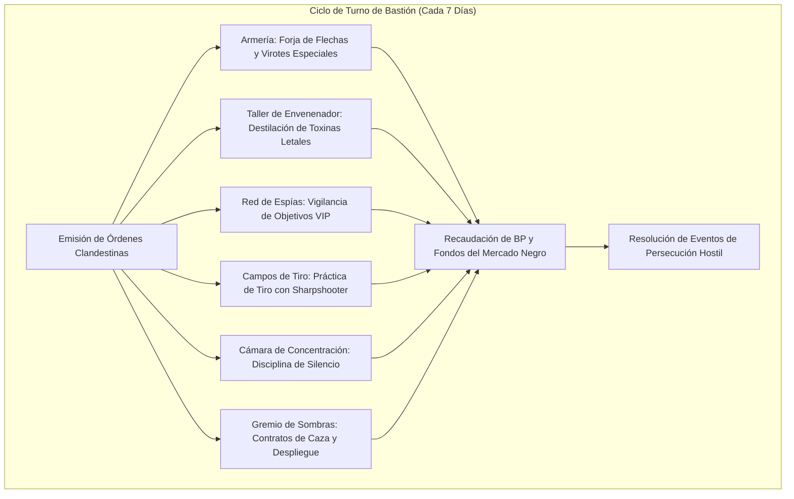

# 🏰 Bastión y Tiempo Muerto — Super Sneaker Life Deleter

## 🏰 Sistema de Bastiones (Reglas Oficiales DMG 2024 / D&D 5.5e)

*Estructura de gestión de la base de operaciones, economía de bastión y mecánicas de mando.*

* **Nombre del Bastión:** La Guarida de las Sombras (Shadow Guild Hideout)
* **Nivel de Bastión (Bastion Level):** 20
* **Puntos de Bastión (Bastion Points - BP):** 110
* **Puntuación de Mando (Bastion Defender Stats):** +11 al ataque y salvaciones defensivas (STR 10 [+0], DEX 20 [+5], CON 14 [+2], INT 10 [+0], WIS 12 [+1], CHA 10 [+0]).

---

### Instalaciones Básicas (Basic Facilities)

1. **Dormitorio Oculto (Bedchambers):** Búnker subterráneo camuflado tras muros falsos de mampostería, equipado con túnel de escape secreto de 1 milla de longitud.
2. **Comedor de Contrabandistas (Dining Hall):** Refugio abovedado con despensa reforzada donde operan reuniones clandestinas sin ventanas al exterior.
3. **Cámara de Vigilancia (Common Area):** Sala de mapas de alcantarillado y maquetas de la ciudad para planificar infiltraciones.

---

### Instalaciones Especiales (Special Facilities — Exactamente 6: 4 Roomy + 2 Vast)

#### 1. Armería de Precisión (Armory — Roomy, Desbloqueo Nivel 5)
* **Estado:** Activa (Mantener)
* **Tamaño:** Roomy (Espaciosa)
* **Orden de Bastión:** *Equip & Craft (Equipar Asesinos)*
* **Sinergia con el Build:** 🔵 **Indispensable**. Mantiene en stock permanente virotes perforantes, cuerdas de ballesta de tendón de dragón y arcos ligeros. Otorga +4 a la defensa estructural de la guarida.

#### 2. Taller de Envenenador y Laboratorio (Laboratory — Roomy, Desbloqueo Nivel 5)
* **Estado:** Activa (Mantener)
* **Tamaño:** Roomy (Espaciosa)
* **Orden de Bastión:** *Brew Toxins (Destilar Venenos)*
* **Sinergia con el Build:** 🔵 **Indispensable**. Destilación rutinaria de venenos de contacto y herida (*Wyvern Poison*, *Purple Worm Poison*). Provee 2 viales de veneno de alta letalidad por ciclo semanal.

#### 3. Red de Espías y Sala de Inteligencia (Gaming Hall — Roomy, Desbloqueo Nivel 9)
* **Estado:** Activa (Mantener)
* **Tamaño:** Roomy (Espaciosa)
* **Orden de Bastión:** *Gather Intel (Inteligencia de Blancos VIP)*
* **Sinergia con el Build:** 🟢 **Excelente**. Centro de escucha clandestino que intercepta correos diplomáticos y rutas de viaje de objetivos prioritarios, garantizando condiciones de sorpresa previas al combate.

#### 4. Campos de Tiro Furtivo (Training Grounds — Roomy, Desbloqueo Nivel 9)
* **Estado:** Activa (Mantener)
* **Tamaño:** Roomy (Espaciosa)
* **Orden de Bastión:** *Train (Entrenamiento de Emboscada)*
* **Sinergia con el Build:** 🟢 **Excelente**. Galería subterránea de tiro con siluetas móviles en penumbra. Otorga al personaje +1d4 a la iniciativa en su primera incursión tras salir del bastión.

#### 5. Cámara de Concentración Silente (Meditation Chamber — Vast, Desbloqueo Nivel 13)
* **Estado:** Activa (Mantener)
* **Tamaño:** Vast (Vasta)
* **Orden de Bastión:** *Focus (Enfoque Táctico)*
* **Sinergia con el Build:** 🟢 **Excelente**. Celda acústicamente sellada para entrenar la paciencia del cazador. Otorga inspiración heroica y ventaja en salvaciones contra encantamientos durante 24 horas.

#### 6. Gremio de Asesinos y Sombras (Guildhall — Vast, Desbloqueo Nivel 17)
* **Estado:** Activa (Mantener)
* **Tamaño:** Vast (Vasta)
* **Orden de Bastión:** *Recruit & Infiltrate (Red de Operaciones Negras)*
* **Sinergia con el Build:** 🔵 **Indispensable**. Sede mayor del sindicato de asesinos. Permite desplegar escuadras de asesinos Bugbear y sombras para proteger rutas de contrabando o defender la guarida con un bono marcial de +11.

---

### Seguidores y Guarnición (Staff & Garrison)

* **Capataz General (Major Domo):** Sombra Ciega (Un anciano elfo oscuro exiliado, maestro en codificación de mensajes y venenos).
* **Guarnición Activa:**
  * 14 Asesinos silenciosos armados con ballestas de mano y hojas envenenadas.
  * 6 Espías callejeros versados en disfraz y robo de correspondencia.
  * 2 Boticarios alquimistas especialistas en antídotos y ácidos corrosivos.

---

## ⏳ Actividades de Tiempo Muerto (Downtime Activities)

### Prioridad 1: Destilación de Venenos Mortales
* **Mecánica Oficial:** Xanathar's Guide to Everything / DMG 2024 (Poison Crafting).
* **Bonificadores Aplicables:** Kit de Envenenador (+11 con pericia), Destreza/Inteligencia y herramientas del Laboratorio.
* **Objetivo:** Acumular dosis de *Wyvern Poison* ($7\text{d}6$ daño) para bañar saetas de asesinato.

### Prioridad 2: Vigilancia y Seguimiento de Objetivos (Infiltration)
* **Mecánica Oficial:** XGE (Scouting).
* **Objetivo:** Infiltrar espías en el séquito de un objetivo para identificar sus horarios de descanso y forzar un asalto con sorpresa total.

---

## 🏃‍♂️ Modos de Movimiento, Logística y Viaje

* **Caminar (Walk):** 30 ft.
* **Iniciativa en Viaje:** Media de +14.5 (+5 DES + 5 Dote Alert + 1d8 de maniobra *Ambush*).
* **Sigilo Absoluto:** Con *Boots of Elvenkind* (ventaja) y *Reliable Talent* (mínimo 10 en el d20), la tirada mínima de sigilo es **27**, superando la percepción pasiva de casi cualquier criatura del juego.
* **Visión en la Oscuridad:** 60 ft. nativa del Bugbear.

---

## 🎭 Reputación y Facciones

1. **La Hermandad de la Daga de Medianoche:** Gran Maestro Ejecutor. Acceso total a contratos de la corona y casas nobles del bajo mundo.
2. **El Gremio de Ladrones de la Niebla:** Aliados comerciales en la distribución de contrabando y suministros de envenenamiento.