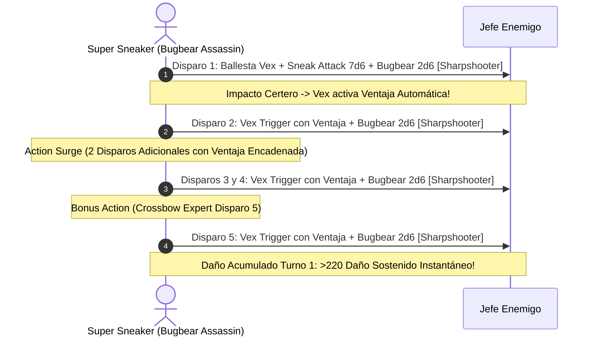

# Guía de Personaje — Super Sneaker Life Deleter (Edición 2024 / 5.5e Update)

## Datos Generales

* **System Standard:** D&D 5th Edition (2024 Ruleset - 5.5e Compatible)
* **Character Level:** 20 (Total)
* **Class Split:** Rogue (Assassin) 14 / Fighter (Battle Master) 6
* **Species:** Bugbear (2024 / MPMOT — Surprise Attack +2d6 por impacto en Turno 1, Long-Limbed 10 ft reach)
* **Background:** Criminal / Guide (Dote de Origen: *Alert 2024* — +6 a la Iniciativa e intercambio con aliados)
* **Stats (Point Buy 2024 / Background):**
  * **FUER (STR):** 10 (+0)
  * **DES (DEX):** 20 (+5) *(15 Base + 2 Trasfondo + 1 Dote Nivel 4 + 2 ASI Nivel 10)*
  * **CON:** 16 (+3) *(14 Base + 1 Trasfondo + 1 ASI Nivel 16)*
  * **INT:** 10 (+0)
  * **SAB (WIS):** 12 (+1)
  * **CAR (CHA):** 10 (+0)

* **Enlaces de Documentación:**
  * [Bastión y Tiempo Muerto](file:///d:/repo-vault/Proyectos/Rol/DnDbuilds/builds/super%20sneaker%20life%20deleter/bastion%20and%20downtime.md)
  * [Lista de Recursos y Habilidades](file:///d:/repo-vault/Proyectos/Rol/DnDbuilds/builds/super%20sneaker%20life%20deleter/spell%20list.md)
  * [Objetos a Obtener](file:///d:/repo-vault/Proyectos/Rol/DnDbuilds/builds/super%20sneaker%20life%20deleter/item%20list%20to%20obtain.md)
  * [Hoja de Ruta 1-20](file:///d:/repo-vault/Proyectos/Rol/DnDbuilds/builds/super%20sneaker%20life%20deleter/roadmap.md)
  * [Inventario Actual](file:///d:/repo-vault/Proyectos/Rol/DnDbuilds/builds/super%20sneaker%20life%20deleter/actual%20inventory%20list.md)

---

## Combat Role: First-Turn Ambush Eraser, Vex Ballistics & Cunning Executioner

Bajo las reglas oficiales de **D&D 5.5e (2024)**:
1. **Weapon Mastery (Vex en Ballesta de Mano):** Cada impacto exitoso otorga ventaja automáticamente en el siguiente tiro contra ese objetivo, creando una cadena continua e ininterrumpida de disparos con ventaja.
2. **Cunning Strike (Rogue Nivel 5+):** Permite sacrificar 1d6 o más de daño de *Sneak Attack* para aplicar condiciones debilitantes (*Poison*, *Trip*, *Withdraw*) sin consumir acciones.
3. **Assassinate (2024 Update):** Concede ventaja en todos los ataques contra criaturas que no hayan actuado y añade un bono de daño plano masivo adicional o críticos garantizados en condiciones de sorpresa.

---

## 1. Gestión de Recursos y Reglas de Inventario (Reglas 2024)

* **Maestría de Armas (Weapon Mastery 2024):**
  * **Hand Crossbow (Vex):** Encadena ventaja entre disparos sucesivos de *Action Surge*.
  * **Dagger (Nick):** Opción de combate cerrado a 10 pies para intercalar ataques sin gastar la Acción Adicional.
* **Economía de Manos Libres:**
  * Se mantiene la regla inmutable de dejar una mano desocupada para recargar la ballesta de mano con cada virote.

---

## 2. Action Economy & Combat Loop (2024)

* **Preparación (Pre-Combate):**
  * Posicionamiento en Sigilo mediante *Reliable Talent* (mínimo 27 en el d20).
  * Coordinación de iniciativa con la dote *Alert 2024* (+6 PB a la tirada e intercambio de orden con aliados para asegurar la primera posición).
* **Action:**
  * **Acción de Ataque:** 2 disparos de ballesta con Carisma/Destreza (+13 hit). El impacto 1 activa *Vex*, habilitando ventaja en los disparos siguientes.
  * **Action Surge:** 2 disparos adicionales con ventaja continua.
* **Bonus Action:**
  * 5.º disparo de ballesta de mano mediante *Crossbow Expert*.
* **Reaction:**
  * *Uncanny Dodge* (daño recibido a la mitad).

---

## 3. The META Combo 2024: Vex Chain Ambush + Surprise Attack (5 Disparos)

### 🧮 Motor Matemático (2024 Ruleset)

$$\text{Daño Base por Disparo Sharpshooter} = 1\text{d}6 + 5 (\text{DEX}) + 10 (\text{Sharpshooter}) + 2\text{d}6 (\text{Bugbear}) = \mathbf{25.5 \text{ daño/tiro}}$$

En condiciones de sorpresa con impacto crítico automático:

$$\text{Daño Crítico por Disparo} = 2\text{d}6 + 15 + 4\text{d}6 = \mathbf{36.0 \text{ daño/tiro}}$$

$$\text{DPR Nova Turno 1 (5 Impactos Críticos con Sneak Attack y Maniobra)} = (5 \times 36.0) + 14\text{d}6 (\text{Sneak}) + 2\text{d}8 (\text{Ambush}) = 180 + 49 + 9 = \mathbf{238.0 \text{ daño medio}}$$

Con *Ascendant Dragon's Wrath Hand Crossbow (+3 y +6d6 crítico elemental)*:

$$\text{DPR Nova Optimizado Endgame} = (5 \times 60.0) + 49 + 9 = \mathbf{358.0 \text{ daño instantáneo}}$$