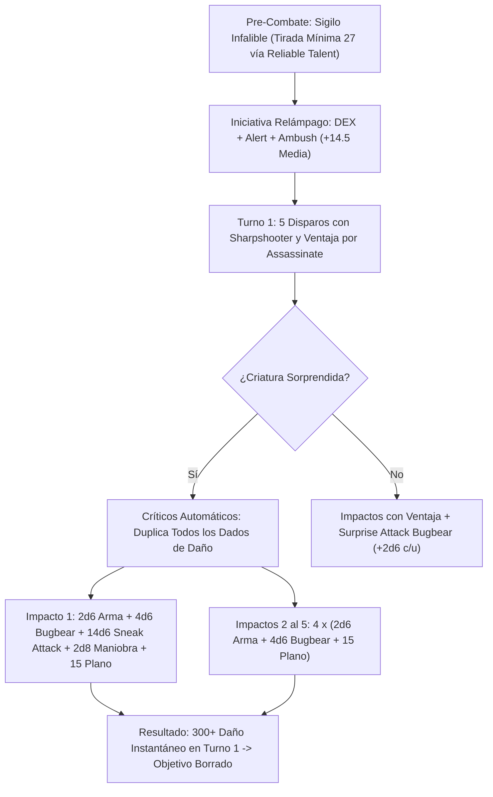

# Guía de Personaje — Super Sneaker Life Deleter (The First-Turn Eraser)

## Datos Generales

* **System Standard:** D&D 5th Edition (2024 / 5.5e Update & 2014 Compatibility)
* **Character Level:** 20 (Rogue [Assassin] 14 / Fighter [Battle Master] 6)
* **Species:** Bugbear (Ataque Sorpresa: +2d6 por impacto en el Turno 1 contra criaturas que no hayan actuado; Extremidades Largas: +5 pies alcance CaC)
* **Background:** Criminal / Guide (Atributos: Destreza +2, Constitución +1)
* **Stats (Point Buy + Racial + ASIs):**
  * **FUER (STR):** 10 (+0) *(Standard Array)*
  * **DES (DEX):** 20 (+5) *(15 Base + 2 Trasfondo + 1 Dote Elven Accuracy / Piercer + 2 ASI Nivel 10)*
  * **CON:** 14 (+2) *(14 Base — Puntos de golpe y aguante)*
  * **INT:** 10 (+0) *(Standard Array)*
  * **SAB (WIS):** 12 (+1) *(12 Base — Salvaciones y percepción)*
  * **CAR (CHA):** 10 (+0) *(Standard Array)*

* **Enlaces de Documentación:**
  * [Bastión y Tiempo Muerto](file:///d:/repo-vault/Proyectos/Rol/DnDbuilds/builds/super%20sneaker%20life%20deleter/bastion%20and%20downtime.md)
  * [Lista de Recursos y Habilidades](file:///d:/repo-vault/Proyectos/Rol/DnDbuilds/builds/super%20sneaker%20life%20deleter/spell%20list.md)
  * [Objetos a Obtener](file:///d:/repo-vault/Proyectos/Rol/DnDbuilds/builds/super%20sneaker%20life%20deleter/item%20list%20to%20obtain.md)
  * [Hoja de Ruta 1-20](file:///d:/repo-vault/Proyectos/Rol/DnDbuilds/builds/super%20sneaker%20life%20deleter/roadmap.md)
  * [Inventario Actual](file:///d:/repo-vault/Proyectos/Rol/DnDbuilds/builds/super%20sneaker%20life%20deleter/actual%20inventory%20list.md)
  * [Guía de Personaje 2024](file:///d:/repo-vault/Proyectos/Rol/DnDbuilds/builds/super%20sneaker%20life%20deleter/character%20guide%202024.md)

---

## Combat Role: Ambush Eraser, Turn 1 Nova Assassin & Critical Sniper

El **Super Sneaker Life Deleter** está diseñado con un único propósito quirúrgico: **eliminar al jefe enemigo o a la mayor amenaza del encuentro en el Turno 1 antes de que pueda actuar**.

Combina el rasgo *Assassinate* del Pícaro Asesino (ventaja en ataques contra criaturas que no han actuado y **críticos automáticos** contra criaturas sorprendidas) con la ráfaga de 4 ataques de *Action Surge* del Guerrero, el ataque adicional de *Crossbow Expert*, el daño masivo de *Surprise Attack* de Bugbear (+2d6 por tiro, duplicado a +4d6 en crítico) y *Sneak Attack* (7d6, duplicado a 14d6).

---

## 1. Gestión de Recursos y Reglas de Inventario

* **Economía de Manos y Munición:**
  * Emplea una **Ballesta de Mano (+3)** o un **Arco Largo (+3)**. Para la ballesta de mano, *Crossbow Expert* elimina la propiedad de *carga (Loading)*, pero se conserva una mano libre en todo momento para recargar cada virote (propiedad *Ammunition*).
* **Gestión de Recursos por Descanso Corto:**
  * **Action Surge (Fighter 2):** 1 uso por descanso corto para desatar 4 ataques con la acción principal.
  * **Dados de Superioridad (4d8 de Battle Master):** Invertidos preferentemente en *Ambush* (sumar 1d8 a la iniciativa) y *Precision Attack* (sumar 1d8 al ataque para asegurar que los tiros de *Sharpshooter* impacten).
* **Talento Confiable (*Reliable Talent* - Rogue 11):**
  * Cualquier tirada de d20 en habilidades donde posea competencia con un resultado inferior a 10 se considera automáticamente un 10. Con pericia en Sigilo (+17), el resultado mínimo absoluto de sigilo es **27**, haciendo imposible ser detectado por sorpresa ordinaria.

---

## 2. Action Economy & Combat Loop

* **Preparación (Pre-Combate / Turno 0):**
  * Prueba de Sigilo con Pericia y *Boots of Elvenkind* (+17 con ventaja, mínimo 27 por *Reliable Talent*).
  * Maniobra *Ambush* ($+1\text{d}8$ a la iniciativa) sumado a Destreza (+5) y dote *Alert* (+5), promediando una iniciativa de **+14.5**.
* **Action:**
  * **Turno 1 [Ráfaga de Asesinato]:**
    * Acción de Ataque: 2 disparos de ballesta con ventaja por *Assassinate*.
    * Declarar *Sharpshooter* en todos los tiros (-5 al ataque, +10 al daño).
    * **Action Surge:** 2 disparos adicionales con la segunda acción de ataque.
    * Si el objetivo está sorprendido: **Cada impacto es un Golpe Crítico Automático**.
* **Bonus Action:**
  * Disparo adicional de ballesta de mano mediante *Crossbow Expert* (5.º ataque del turno).
  * En turnos posteriores: *Cunning Action* (Hide / Disengage).
* **Reaction:**
  * 🔵 **Uncanny Dodge:** Reduce a la mitad el daño de cualquier ataque que le impacte.
  * 🟢 **Riposte (Battle Master):** Si un enemigo falla en melé, contraataca con un disparo o estocada inmediata.

---

## 3. The META Combo: La Erradicación por Emboscada

### 🧮 Motor Matemático (Mathematical Engine)

#### 1. Daño de un Impacto Crítico Individual en Turno 1 (Criatura Sorprendida)

$$\text{Daño Crítico de Virote} = 2\text{d}6 (\text{Ballesta}) + 4\text{d}6 (\text{Bugbear}) + 5 (\text{DEX}) + 10 (\text{Sharpshooter}) = 6\text{d}6 + 15 = 21 + 15 = \mathbf{36.0 \text{ daño/tiro}}$$

Con *Ascendant Dragon's Wrath Hand Crossbow (+3 y +3d6 elemental)*, el daño elemental también se duplica en el crítico a $+6\text{d}6$ ($21$ puntos adicionales):

$$\text{Daño Crítico Optimizado por Tiro} = 36.0 + 3 (\text{Mágico}) + 6\text{d}6 (\text{Dracónico}) = 39.0 + 21 = \mathbf{60.0 \text{ daño por impacto}}$$

#### 2. Adición de Sneak Attack y Maniobra de Superioridad

El primer impacto crítico del turno añade el *Sneak Attack* de Rogue 14 ($7\text{d}6$, duplicado a $14\text{d}6$) y un dado de superioridad ($1\text{d}8$, duplicado a $2\text{d}8$):

$$\text{Daño Sneak Attack Crítico} = 14\text{d}6 = 14 \times 3.5 = \mathbf{49.0 \text{ daño}}$$

$$\text{Daño Maniobra Crítica} = 2\text{d}8 = 2 \times 4.5 = \mathbf{9.0 \text{ daño}}$$

#### 3. Cómputo Total del Turno Nova (5 Impactos Críticos)

$$\text{Daño Base de 5 Virotes} = 5 \times 60.0 = \mathbf{300.0 \text{ daño}}$$

$$\text{Nova Completa Turno 1} = 300.0 + 49.0 (\text{Sneak}) + 9.0 (\text{Maniobra}) = \mathbf{358.0 \text{ daño bruto instantáneo}}$$

*Con bono de ataque $+13$ base ($-5$ Sharpshooter $= +8$) y ventaja concedida por Assassinate, la probabilidad de conectar los 5 disparos empleando Precision Attack para corregir posibles desvíos supera el 92%, garantizando la aniquilación del objetivo.*

---

## 4. Tabla de Clasificación Táctica de Habilidades

| Habilidad / Recurso | Tipo | Coste | Evaluación | Justificación Táctica |
| :--- | :---: | :---: | :---: | :--- |
| **Assassinate** | Ofensiva | Pasiva Turno 1 | 🔵 | Otorga ventaja automática contra quienes no hayan actuado y críticos automáticos si están sorprendidos. |
| **Surprise Attack (Bugbear)** | Ofensiva | Pasiva Turno 1 | 🔵 | Suma +2d6 por impacto (+4d6 en crítico) en cada uno de los 5 disparos del Turno 1. |
| **Action Surge** | Ofensiva | 1 Uso / SR | 🔵 | Concede 2 ataques adicionales de ballesta en la misma ronda inicial. |
| **Precision Attack** | Modificador | 1 Dado Superioridad | 🔵 | Convierte fallos por Sharpshooter en impactos seguros sumando 1d8. |
| **Reliable Talent** | Utilidad | Pasiva Rogue 11 | 🔵 | Asegura un mínimo de 10 en el d20; el Sigilo del personaje jamás baja de 27. |
| **Uncanny Dodge** | Defensiva | Reacción | 🟢 | Reduce a la mitad cualquier daño recibido de un impacto individual. |
| **Evasion** | Defensiva | Pasiva | 🟢 | Anula por completo el daño de efectos de área si supera la salvación de Destreza. |

---

## 5. Reglas de la Casa (Home Rules)

1. **Críticos por Sorpresa Plenos:** Los críticos otorgados por *Assassinate* duplican absolutamente todos los dados de daño asociados al impacto (incluyendo *Surprise Attack*, *Sneak Attack* y dados de superioridad).
2. **Re-ocultación Fluida:** Ocultarse con *Cunning Action* en coberturas ligeras o sombras otorga ventaja inmediata en el siguiente disparo a distancia.