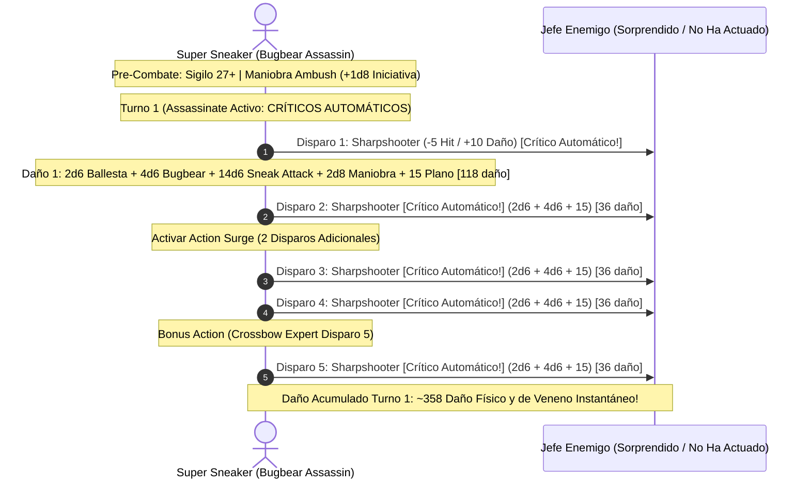

# 🌟 Lista de Recursos Tácticos y Maniobras — Super Sneaker Life Deleter

Este personaje es un **Especialista Marcial de Emboscada (Rogue Assassin 14 / Fighter Battle Master 6)** que prescinde del lanzamiento de conjuros tradicionales para operar mediante una combinación quirúrgica de maniobras balísticas, letalidad de pícaro y ataques sorpresa de Bugbear.

---

## 🔮 Matriz de Recursos y Habilidades Marciales

* **Dados de Superioridad (Battle Master):** 4d8 por Descanso Corto (CD de maniobras: $8 + \text{PB (6)} + \text{DEX (5)} = \mathbf{19}$).
* **Action Surge:** 1 uso por Descanso Corto (permite ejecutar una segunda acción de ataque con 2 disparos adicionales).
* **Second Wind:** 1 uso por Descanso Corto (recupera $1\text{d}10 + 6$ puntos de golpe como acción adicional).
* **Sneak Attack (Ataque Furtivo):** $+7\text{d}6$ de daño una vez por turno (duplicado a $+14\text{d}6$ en impacto crítico).
* **Iniciativa Promedio:** $+14.5$ (+5 DEX, +5 Dote Alert, +1d8 Maniobra *Ambush*).
* **Sigilo Mínimo Garantizado:** $10 (\text{Reliable Talent}) + 5 (\text{DEX}) + 12 (\text{Pericia PB x2}) = \mathbf{27}$ (con ventaja por *Boots of Elvenkind*).
* **Turno 0 Pre-Buffs:**
  * Ocultamiento previo en las sombras (prueba de sigilo $\ge 27$).
  * Impregnación de virotes con veneno de guiverno (*Wyvern Poison*).
  * Ballesta de mano mágicamente afinada cargada en mano principal y mano secundaria desocupada.

---

## 🎯 Maniobras de Battle Master (4d8 por Descanso Corto)

| Maniobra | Clasificación | Efecto Mecánico y Justificación Táctica |
| :--- | :---: | :--- |
| **Ambush (Emboscada)** | 🔵 | **Pilar Táctico:** Añade 1d8 a la tirada de iniciativa o a una prueba de sigilo. Garantiza actuar antes que los oponentes para activar la ventaja y críticos de *Assassinate*. |
| **Precision Attack** | 🔵 | **Garantía de Impacto:** Añade 1d8 al resultado de un ataque a distancia para compensar la penalización de -5 de *Sharpshooter*, asegurando que el daño no se pierda. |
| **Trip Attack** | 🟢 | Suma 1d8 al daño y fuerza al objetivo a realizar una salvación de Fuerza (CD 19) para no caer derribado (*Prone*). Se emplea en el último disparo del turno para facilitar el asalto de aliados cuerpo a cuerpo. |
| **Menacing Attack** | 🟢 | Suma 1d8 al daño y causa el estado Asustado (*Frightened*) al objetivo (CD 19 Sabiduría) durante 1 asalto completo, impidiéndole acercarse. |

---

## 🗡️ Habilidades de Pícaro y Asesino

| Habilidad / Rasgo | Nivel | Clasificación | Justificación Mecánica |
| :--- | :---: | :---: | :--- |
| **Assassinate** | Rogue 3 | 🔵 | **El multiplicador crítico:** Ventaja en ataques contra criaturas que no hayan actuado y **críticos automáticos** contra criaturas sorprendidas, duplicando todos los dados del ataque. |
| **Surprise Attack (Bugbear)** | Racial | 🔵 | Añade $+2\text{d}6$ de daño por cada ataque que golpee a una criatura que no haya actuado (al ser crítico por Assassinate, se convierte en $+4\text{d}6$ por cada uno de los 5 disparos). |
| **Reliable Talent** | Rogue 11 | 🔵 | Cualquier tirada de d20 en una habilidad competente con resultado menor a 10 se trata como un 10. Elimina la posibilidad de fallar tiradas de Sigilo, Percepción o Herramientas de Ladrón. |
| **Cunning Action** | Rogue 2 | 🟢 | Acción adicional: Ocultarse (*Hide*), Correr (*Dash*) o Desengancharse (*Disengage*) en cada turno sin coste de recursos. |
| **Uncanny Dodge** | Rogue 5 | 🟢 | Reacción: Reduce a la mitad el daño recibido de cualquier ataque hostil individual. |
| **Evasion** | Rogue 7 | 🟢 | No recibes daño al superar salvaciones de Destreza contra áreas (bolas de fuego, alientos de dragón) y solo la mitad si fallas. |
| **Infiltration Expertise & Impostor** | Rogue 9/13 | 🟡 | Creación de identidades falsas impecables e imitación perfecta de voces y conductas para infiltración previa al asalto. |

---

## 💥 Secuencia de Combate Nova (Turno 1: Ambush Eraser con 5 Críticos)

---

## 🩺 Curación en Segundo Plano y Mantenimiento Vital

1. **Second Wind (Guerrero):**
   * Acción adicional: Restaura instantáneamente $1\text{d}10 + 6$ puntos de golpe. Se recarga en cada descanso corto.
2. **Mitigación Pasiva con Uncanny Dodge y Evasion:**
   * En lugar de consumir recursos de curación activa, el personaje reduce el daño recibido mediante su reacción (*Uncanny Dodge* a la mitad) y anula el daño de área con *Evasion*.
3. **Suministros Farmacéuticos del Bastión:**
   * El Taller de Envenenador de la Guarida suministra 3 *Potions of Supreme Healing* ($10\text{d}4 + 20 \text{ PG}$) preparadas rutinariamente para solventar daños graves entre incursiones.