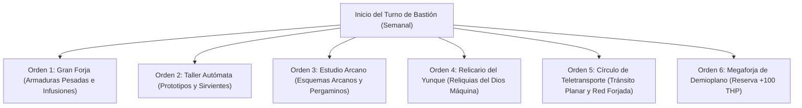

# 🏰 Bastión y Tiempo Muerto — Techpriest: The Machine Prophet

## 🏰 Sistema de Bastiones (Reglas Oficiales DMG 2024 / 5.5e)

* **Nombre del Bastión:** La Megaforja del Hierro Sagrado (*The Great Forge of Sacred Iron*)
* **Ubicación:** Una ciudadela subterránea excavada en el corazón de un volcán extinto, con tuberías de vapor y hornos de energía elemental.
* **Nivel de Bastión (Bastion Level):** Nivel 20
* **Puntos de Bastión (Bastion Points - BP):** 540 BP acumulados
* **Bonificador de Defensa de Bastión:** **+11** ($5_{\text{INT}} + 6_{\text{PB}}$)

---

### 🏛️ Instalaciones Básicas (Basic Facilities)

1. **Aposentos de Carga Rúnica (Bedchambers):** Alcoba metálica equipada con pedestales de inducción mágica para el cuerpo Forjado (*Warforged*).
2. **Refectorio de la Fraternidad (Dining Hall):** Cantina blindada donde los sirvientes y artesanos consumen raciones calientes mientras los autómatas realizan labores de mantenimiento.
3. **Foso de Calibración Hidráulica (Common Room):** Taller común con prensas de vapor, engranajes gigantescos y fosa de ensamblaje.
4. **Depósito de Adamantina (Storage):** Cámara acorazada con reservas de metales estelares, mitral y carbón alquímico.

---

### 🔮 Instalaciones Especiales (Special Facilities — 6 Slots Nivel 20: 4 Roomy + 2 Vast)

1. **Gran Forja Rúnica (Smithy — Roomy, Nivel 5):**
   * *Orden de Bastión:* **Craft / Maintain.**
   * *Efecto Mecánico:* Duplica la velocidad y reduce al 50% el coste de forjar armaduras de placas pesadas. Mantiene las placas de los 20 defensores autómatas con bonificador de +1 CA.
2. **Taller Autómata y de Infusiones (Workshop — Roomy, Nivel 5):**
   * *Orden de Bastión:* **Craft.**
   * *Efecto Mecánico:* Permite ensamblar constructos de apoyo (*Homunculus Servant*, *Iron Defenders*) y almacenar hasta 2 prototipos de infusión adicionales sin consumir las ranuras activas del personaje.
3. **Estudio Arcano y Scriptorium (Arcane Study — Roomy, Nivel 5):**
   * *Orden de Bastión:* **Research.**
   * *Efecto Mecánico:* Transcripción de planos tecnológicos y copia de pergaminos de conjuros defensivos (*Shield*, *Absorb Elements*, *Heat Metal*).
4. **Relicario del Yunque Sagrado (Reliquary — Roomy, Nivel 9):**
   * *Orden de Bastión:* **Harvest / Empower.**
   * *Efecto Mecánico:* Canaliza las plegarias de la orden hacia las deidades de la forja (Gond/Moradin). Concede un talismán sagrado que permite relanzar una tirada de concentración fallida una vez al día.
5. **Círculo de Teletransporte Permanente (Vast — Nivel 13):**
   * *Orden de Bastión:* **Maintain.**
   * *Efecto Mecánico:* Enlace planar que conecta la Megaforja con el Plano Elemental del Fuego (Ciudad de Latón) y las metrópolis forjadas del Plano Material.
6. **Megaforja de Demioplano / Sanctum Tecnológico (Vast — Nivel 17):**
   * *Orden de Bastión:* **Empower.**
   * *Efecto Mecánico:* Tras completar un descanso largo en el núcleo del demioplano, la armadura del Techpriest absorbe un revestimiento de adamantina mística que otorga **+100 Puntos de Golpe Temporales** y resistencia total al daño de Fuego y Rayo.

---

## ⏳ Actividades de Tiempo Muerto (Downtime Activities)

### Prioridad 1: Forja de Armaduras de Placas y Escudos Infundidos

* **Mecánica Base:** DMG 2024 / Xanathar's Guide to Everything.
* **Tiradas y Especialización:** Herramientas de Herrero (+17 con *Tool Expertise*), Herramientas de Hojalatero (+17).
* **Objetivo de Optimización:** Crear conjuntos completos de armaduras de placas para la guarnición y forjar anillos/capas de protección.

### Prioridad 2: Fabricación de Consumibles y Aceites Sagrados

* Elaboración de *Potions of Supreme Healing*, *Potions of Fire Resistance* y *Oil of Sharpness*.

---

## 🏃‍♂️ Modos de Movimiento, Logística y Viaje

### Velocidades de Movimiento Base

* **Caminar (Walk):** **30 ft/turno** (Armadura pesada de placas sin penalización por el rasgo *Arcane Armor* de Armorer).
* **Trepar (Climb):** 30 ft/turno.
* **Nadar (Swim):** 30 ft/turno.
* **Volar (Fly):** 30 ft/turno con *Winged Boots* (Infusión de Artífice).

### Modificadores y Sentidos de Exploración

* **Visión en la Oscuridad:** 60 ft (*Goggles of Night* o visor arcano).
* **Percepción Pasiva:** 12 (10 + 2 WIS).
* **Investigación Pasiva:** 21 (10 + 5 INT + 6 PB).
* **Inmunidades:** Inmune a enfermedades, veneno, sueño mágico y no necesita comer, beber ni respirar (*Warforged Constructed Resilience*).
