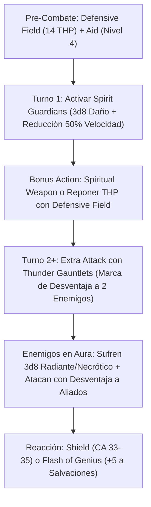

# Resumen General del Personaje: Techpriest (The Machine Prophet)

## Datos Generales

* **System Standard:** D&D 5th Edition (2014 Ruleset / 2024 Compatible)
* **Character Level:** 20 (Total)
* **Class Split:** Artificer (Armorer) 14 / Cleric (Forge Domain) 6
* **Species:** Warforged (+1 CA nativo, *Constructed Resilience*)
* **Stats (Point Buy + Racial + ASIs):**
  * **FUER (STR):** 8 (-1) *(Ignorada gracias a Arcane Armor que anula requisitos de fuerza de armaduras pesadas)*
  * **DES (DEX):** 10 (+0)
  * **CON:** 16 (+3) *(15 Base + 1 Racial)*
  * **INT:** 20 (+5) *(15 Base + 2 Racial + 1 Fey Touched + 2 ASI)*
  * **SAB (WIS):** 14 (+2) *(Requisito de Clérigo de la Forja)*
  * **CAR (CHA):** 8 (-1)

* **Enlaces de Documentación:**
  * [Bastión y Tiempo Muerto](file:///d:/repo-vault/Proyectos/Rol/DnDbuilds/builds/techpriest/bastion%20and%20downtime.md)
  * [Lista de Conjuros y Recursos](file:///d:/repo-vault/Proyectos/Rol/DnDbuilds/builds/techpriest/spell%20list.md)
  * [Objetos a Obtener](file:///d:/repo-vault/Proyectos/Rol/DnDbuilds/builds/techpriest/item%20list%20to%20obtain.md)
  * [Hoja de Ruta 1-20](file:///d:/repo-vault/Proyectos/Rol/DnDbuilds/builds/techpriest/roadmap.md)
  * [Inventario Actual](file:///d:/repo-vault/Proyectos/Rol/DnDbuilds/builds/techpriest/actual%20inventory%20list.md)

---

## Combat Role: Frontline Dread Tank / Master Craftsman / Aggro Controller

El **Techpriest** encarna la fusión definitiva entre la tecnología mística del Artífice y la teurgia devocional del Clérigo de la Forja. Es una fortaleza bípeda inalcanzable cuya **Clase de Armadura pasiva oscila entre 28 y 30 (elevándose a 33-35 con el conjuro *Shield*)**. Su función primaria es la contención y el control de amenazas: castiga a los enemigos mediante *Spirit Guardians* mientras los golpea con sus *Thunder Gauntlets*, forzándolos a atacar con Desventaja a cualquier criatura que no sea él. Al tener una CA tan descomunal, los enemigos quedan atrapados en un dilema irresoluble: fallar al intentar golpearlo o sufrir Desventaja al atacar a sus aliados.

---

## 1. Gestión de Recursos y Reglas de Inventario

* **Armor Modifications (Artífice 9):** La armadura arcana se divide en 4 piezas independientes (pecho, botas, casco y arma), permitiendo infundir cada componente por separado y otorgando **+2 ranuras de infusión adicionales** de uso exclusivo en la armadura.
* **Sintonización Masiva (Magic Item Savant):** Al nivel 14 de Artífice, sintoniza hasta **5 objetos mágicos simultáneamente** e ignora todos los requisitos de clase, raza, conjuro o nivel.
* **Inmunidad al Fuego y Resiliencia Forjada:** Gracias a *Soul of the Forge* (Forge 6) y *Constructed Resilience* (Warforged), posee resistencia pasiva al fuego (o inmunidad total si porta objetos de afinidad ígnea), inmunidad a enfermedades, veneno y sueño mágico.

---

## 2. Action Economy & Combat Loop

* **Pre-Combate (Turno 0):** Activar *Defensive Field* (14 THP temporales) y lanzar *Aid* con una ranura de 4.º nivel (+15 PG máximos a 3 aliados).
* **Turno 1 — Despliegue del Vórtice Divino:**
  * **Action:** Lanzar *Spirit Guardians* (Nivel 3). Crea una esfera de 15 ft de daño continuo ($3\text{d}8$ radiante o necrótico) que reduce la velocidad de todos los enemigos al 50%.
  * **Bonus Action:** Convocar *Spiritual Weapon* ($1\text{d}8 + 2$) o reponer 14 THP con *Defensive Field*.
* **Turno 2+ — Ciclo de Bloqueo Inexpugnable:**
  * **Action:** 2 Ataques con *Thunder Gauntlets* usando Inteligencia (+5). Cada impacto marca a un objetivo imponiéndole **Desventaja en ataques contra tus aliados**.
  * **Bonus Action:** Atacar con *Spiritual Weapon* o activar *Heat Metal* sobre la armadura del jefe enemigo.
  * **Reaction:**
    * *Shield:* Eleva la CA a **33-35**.
    * *Absorb Elements:* Resistencia a daño elemental de área.
    * *Flash of Genius:* Suma +5 a cualquier salvación de concentración o salvación aliada a 30 ft.

---

## 3. Mathematical Engine (D&D 5e / 2014 & 2024 Compatible)

### 🛡️ Cálculo de Clase de Armadura Pasiva Extrema

* **Configuración Estándar Infundida (Nivel 20 Base):**
  $$\text{CA} = 18_{\text{Placas}} + 2_{\text{Escudo}} + 1_{\text{Warforged}} + 1_{\text{Blessing of Forge}} + 1_{\text{Soul of Forge}} + 2_{\text{Enhanced Defense}} + 1_{\text{Repulsion}} + 1_{\text{Ring}} + 1_{\text{Cloak}} = \mathbf{28 \text{ CA Pasiva}}$$
  $$\text{CA con Reacción Shield} = 28 + 5_{\text{Shield}} = \mathbf{33 \text{ CA}}$$

* **Configuración con Equipo Legendario (+3 Placas / +3 Escudo):**
  $$\text{CA} = 21_{\text{Placas +3}} + 5_{\text{Escudo +3}} + 1_{\text{Warforged}} + 1_{\text{Soul of Forge}} + 2_{\text{Ring + Cloak}} = \mathbf{30 \text{ CA Pasiva}}$$
  $$\text{CA con Reacción Shield} = 30 + 5_{\text{Shield}} = \mathbf{35 \text{ CA}}$$

* **Probabilidad de Impacto de un Jefe Épico (Tiamat / Tarrasque con +19 al Ataque):**
  $$\text{Impacto contra CA 35} = P(\text{Tirada } \ge 16) = \frac{5}{20} = \mathbf{0.25 \quad (25\%)}$$
  Cualquier enemigo estándar con ataque de +10 a +14 solo puede impactarte con un **20 natural (5%)**.

### 🧮 Daño por Asalto Sostenido (DPR a Nivel 20)

Con 2 ataques de guanteletes ($1\text{d}8 + 5_{\text{INT}} + 2_{\text{Item}} = 11.5$ de media) + *Spirit Guardians* contra 2 objetivos ($3\text{d}8 = 13.5$ de media):

$$\text{DPR Guanteletes} = 2 \times [0.75 \times 11.5 + 0.05 \times 4.5] = 2 \times 8.85 = 17.7$$

$$\text{DPR Spirit Guardians (2 enemigos)} = 2 \times [0.65 \times 13.5 + 0.35 \times 6.75] = 2 \times [8.775 + 2.36] = 22.27$$

$$\text{DPR Total Sostenido} = 17.7 + 22.27 = \mathbf{39.97 \text{ DPR en Área}} \quad (\text{Más Spiritual Weapon = +7.5 DPR})$$

### 🩸 Supervivencia y EHP

$$\text{EHP Efectivo} = \frac{\text{HP Real } (173) + \text{Defensive Field } (14) + \text{Sanctum Ward } (100)}{1 - \text{Resistencia Inmunidad Fuego / Reducciones } (0.50)} = \frac{287}{0.50} = \mathbf{574 \text{ EHP}}$$

---

## 4. Tabla de Rendimiento Táctico

| Criterio | Valoración | Justificación Mecánica |
| :--- | :---: | :--- |
| **Daño Monobjetivo** | 🟢 | Daño continuo de guanteletes de trueno complementado por *Spiritual Weapon* y *Heat Metal* (daño inevitable sin salvación). |
| **Control de Masas (CC)** | 🔵 | *Spirit Guardians* reduce el movimiento al 50%, *Thunder Gauntlets* impone Desventaja doble de aggro, y *Repulsion Shield* empuja 15 ft. |
| **Supervivencia (EHP)** | 🔵 | CA pasiva 28-30 / CA 33-35 con *Shield*. Inmunidad pasiva a fuego/enfermedades/venenos y salvaciones apuntaladas con *Flash of Genius* (+5). |
| **Economía de Acciones** | 🔵 | Acción de ataque/control, Acción Adicional para *Defensive Field* o *Spiritual Weapon*, y Reacciones indispensables (*Shield*, *Absorb Elements*). |
| **Sustentabilidad** | 🔵 | No depende de Fuerza ni Destreza. 5 objetos sintonizados sin restricciones, y fabricación a gran velocidad en la Forja Sagrada del Bastión. |

---

## 5. Home Rules (Reglas de la Mesa)

1. **Foco Universal Único:** La armadura arcana forjada y el escudo sagrado sirven como foco unificado para conjuros de Artífice y Clérigo.
2. **Progresión Full Caster Integrada:** Los niveles de Artífice (mitad de lanzador redondeada hacia arriba) y Clérigo se combinan armónicamente en la tabla de espacios de conjuro multiclase.
