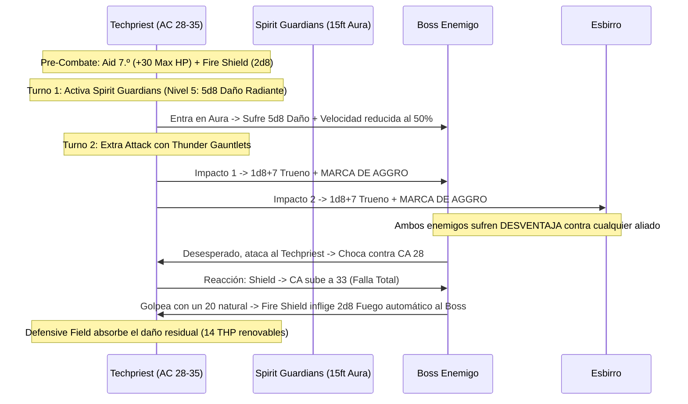

# 🌟 Lista de Conjuros y Recursos — Techpriest: The Machine Prophet

Esta lista detalla la selección de conjuros y recursos para el **Techpriest** (Artificer Armorer 14 / Cleric Forge 6), optimizada bajo reglas de D&D 5e (2014 & 2024).

> **Nivel de Lanzador Multiclase:** $14/2_{\text{Artificer}} + 6_{\text{Cleric}} = \mathbf{13.^{\circ} \text{ Nivel de Lanzador}}$.  
> Dispone de ranuras de conjuro de hasta **7.º Nivel**: 4 de 1.º, 3 de 2.º, 3 de 3.º, 3 de 4.º, 2 de 5.º, 1 de 6.º y 1 de 7.º nivel.

---

## ⚡ Conjuros Activos y Pre-Buffs (Turno 0 / Fuera de Combate)

| Conjuro / Recurso | Duración | Concentración | Efecto Táctico Clave |
| :--- | :---: | :---: | :--- |
| **Aid (Lanzado a Nivel 7)** | 8 horas | No | Incrementa los **Puntos de Golpe Máximos en +30 PG** a ti y a 2 aliados durante todo el día. |
| **Fire Shield (Nivel 4)** | 10 minutos | No | Resistencia a daño de frío o fuego y $+2\text{d}8$ de daño de espinas a quien te golpee cuerpo a cuerpo. |
| **Defensive Field (Armorer)** | Hasta agotarse | No | Concede **14 Puntos de Golpe Temporales** utilizables 6 veces al día como Acción Adicional. |
| **Sanctum Ward (Bastión)** | 24 horas | No | Reserva de **+100 Puntos de Golpe Temporales** obtenida en la Megaforja de Demioplano. |

---

## 🔮 Trucos (Cantrips)

### Artífice (4) + Clérigo (4)

1. **Guidance 🔵 [Indispensable]:** +1d4 a pruebas de habilidad propias o de aliados fuera de combate.
2. **Booming Blade 🔵 [Roto - Control Melé]:** Añade $3\text{d}8$ de daño de trueno si el enemigo intenta romper el contacto cuerpo a cuerpo.
3. **Fire Bolt 🟢 [Excelente]:** $4\text{d}10$ de daño de fuego a 120 ft usando Inteligencia (+5).
4. **Mending 🔵 [Utilidad Técnica]:** Reparación y mantenimiento rúnico de constructos y armaduras.
5. **Sacred Flame 🟢 [Ataque Sagrado]:** $4\text{d}8$ de daño radiante ignorando cobertura parcial.
6. **Toll the Dead 🟢 [Daño Necrótico]:** $4\text{d}12$ de daño si el objetivo ya está herido.
7. **Spare the Dying 🟡 [Soporte]:** Estabiliza aliados moribundos al instante.
8. **Light 🟡 [Utilidad]:** Iluminación táctica en mazmorras.

---

## 🎒 Conjuros Preparados de Artífice y Clérigo

*CD de Conjuros de Artífice (INT):* $8 + 6_{\text{PB}} + 5_{\text{INT}} = \mathbf{19}$ (o **21** con *Staff of Power*).  
*CD de Conjuros de Clérigo (WIS):* $8 + 6_{\text{PB}} + 2_{\text{WIS}} = \mathbf{16}$ (o **19** con *Amulet of the Devout +3*).

### 4.º Nivel (3 Ranuras)

1. **Fire Shield 🔵 [Espinas sin Concentración]:** Inflige $2\text{d}8$ de daño a atacantes en melé.
2. **Greater Invisibility 🟢 [Ofensivo / Defensivo]:** Ventaja en todos tus ataques e imposibilidad de ser seleccionado por conjuros que requieran línea de visión.
3. **Otiluke's Resilient Sphere 🟢 [Encierro]:** Esfera de protección absoluta para aislar un objetivo de alta amenaza.

### 3.ᵉʳ Nivel (3 Ranuras)

4. **Spirit Guardians 🔵 [Roto / Núcleo del Build]:** Esfera de 15 ft alrededor del Techpriest. Todos los enemigos sufren $3\text{d}8$ (o más al escalar ranura) de daño radiante/necrótico cada turno y su velocidad se reduce a la mitad.
5. **Hypnotic Pattern 🔵 [Control de Masas]:** Desactiva grupos enteros de esbirros con una salvación de Sabiduría.
6. **Lightning Bolt 🟢 [Daño de Línea]:** $8\text{d}6$ de daño de electricidad en línea de 100 ft.
7. **Dispel Magic 🟢 [Utilidad]:** Anula magia enemiga sumando $+5$ de Inteligencia o *Flash of Genius*.
8. **Revivify 🟢 [Seguridad]:** Reanima aliados en combate.

### 2.º Nivel (3 Ranuras)

9. **Heat Metal 🔵 [Castigo Inevitable de la Forja]:** Calienta la armadura o arma metálica de un enemigo. Inflige $2\text{d}8$ de daño de fuego como Acción Adicional cada turno sin salvación y le impone Desventaja en ataques.
10. **Spiritual Weapon 🟢 [Ataque en Acción Adicional]:** Arma flotante que ataca por $1\text{d}8 + 2$ de daño de fuerza.
11. **Mirror Image 🔵 [Defensa Ilusoria]:** 3 duplicados sin concentración para desviar golpes críticos.
12. **Shatter 🟡 [Daño de Área]:** $3\text{d}8$ de daño de trueno en 10 ft de radio.

### 1.ᵉʳ Nivel (4 Ranuras)

13. **Shield 🔵 [Indispensable - Reacción]:** +5 a la CA como Reacción, alcanzando **CA 33-35**.
14. **Absorb Elements 🔵 [Defensa Elemental]:** Resistencia como Reacción ante ataques de aliento o frío/rayo/fuego masivos.
15. **Healing Word 🟢 [Soporte]:** Reanima aliados a 60 ft como Acción Adicional.
16. **Cure Wounds 🟢 [Curación]:** Restaura salud cuerpo a cuerpo.
17. **Bless 🟢 [Buff de Grupo]:** +1d4 a tiradas de ataque y salvación a 3 aliados.

---

## 💥 Secuencia Táctica del Muro del Dios Máquina (The Iron Fortress Lockdown)

---

## 💚 Curación en Segundo Plano y Sostenibilidad

* **Aid Escalado a 7.º Nivel:** Otorga permanentemente **+30 Puntos de Golpe Máximos** a 3 miembros del grupo. No son temporales, por lo que apilan con *Defensive Field* y *Sanctum Ward*.
* **Defensive Field Ilimitado en Descansos:** 14 THP como Acción Adicional utilizables 6 veces al día.
* **Healing Word en Acción Adicional:** Levanta inmediatamente a aliados caídos a 60 ft sin interrumpir la acción de ataque con guanteletes.
* **Pociones en Acción Adicional:** Beber una *Potion of Supreme Healing* ($10\text{d}4 + 20 \approx 45\text{ PG}$) cuesta solo una Acción Adicional bajo reglas 2024.
