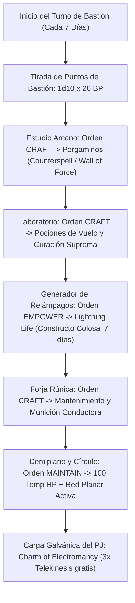

# 🏰 Bastión y Tiempo Muerto — Tempest Demiurge

## 🏰 Sistema de Bastiones (Reglas Oficiales 2024 / 5.5e DMG & RHW)

*Estructura de gestión de la base de operaciones, automatización de turnos de bastión y mecánicas de mando del personaje a Nivel 20.*

* **Nombre del Bastión:** El Observatorio de la Tormenta Escrita
* **Nivel de Bastión (Bastion Level):** 20 (Nivel Máximo)
* **Puntos de Bastión (Bastion Points - BP):** 450 BP acumulados
* **Puntuación de Mando (Bastion Defender Stats):** 
  * STR 8 (-1) | DEX 12 (+1) | CON 18 (+4) | **INT 22 (+6)** | WIS 14 (+2) | CHA 8 (-1)
  * Modificador de Mando Primario: **+6 (Inteligencia)**

---

### Instalaciones Básicas (Basic Facilities — Oficiales DMG 2024)

*Instalaciones comunes sin coste de ranura especial según la DMG 2024:*

1. **Dormitorio Principal (Bedchambers):** Aposentos personales en el vértice de la torre, rodeados de ventanales de cuarzo reforzado y pararrayos de cobre puro que canalizan la carga electrostática atmosférica hacia las baterías del generador.
2. **Comedor (Dining Hall):** Salón comunal de roble marino y bronce donde eruditos, escribas y navegantes del bastión planifican expediciones arcanas y vigilan los barómetros.
3. **Espacio Común (Common Room):** Ágora cartográfica con cartas meteorológicas encantadas, mapas planares y atriles de lectura elemental.
4. **Cocina y Almacén General (Kitchen & Storage):** Infraestructura de subsistencia para alimentar a la guarnición y almacenar víveres no perecederos por un período de hasta 6 meses de asedio continuado.

---

### Instalaciones Especiales Optimizadas (6 Especiales RAW: 4 Roomy + 2 Vast)

*El sistema oficial de la DMG 2024 otorga exactamente **6 Instalaciones Especiales** a Nivel 20 (2 a Nivel 5 [Espaciosas], 2 a Nivel 9 [Espaciosas], 1 a Nivel 13 [Extensa] y 1 a Nivel 17 [Extensa]). La configuración ha sido min-maxeada para maximizar la generación de consumibles sin concentración, potenciar el EHP pasivo y suministrar capacidades tácticas únicas:*

* **1. Estudio Arcano (Arcane Study) — [Oficial DMG 2024 — Nivel 5] [Espaciosa / Roomy]:**
  * *Estado:* Activa (Orden: **Craft**)
  * *Prerrequisito Oficial:* Rasgo *Spellcasting* o *Pact Magic*.
  * *Personal Asignado:* 1 Investigador Arcano y Aprendiz de Escriba.
  * *Beneficio Pasivo Oficial:* Concede un **Charm de Identificar** tras cada Descanso Largo en el bastión (lanzamiento gratuito de *Identify* sin consumir ranura ni componentes).
  * *Orden de Bastión Oficial:* **Craft (Pergaminos Mágicos y Focos Arcanos).**
  * *Sinergia con el Build:* 🔵 **Roto/Indispensable**. Permite fabricar pergaminos mágicos de niveles 1 a 5 (*Counterspell*, *Wall of Force*, *Chain Lightning*) para economizar ranuras de combate, producir libros de conjuros de repuesto y calibrar focos arcanos. Sinergia total con la pluma mágica *Wizardly Quill* del Mago Escribano.

* **2. Forja Rúnica Enana (Smithy) — [Oficial DMG 2024 — Nivel 5] [Espaciosa / Roomy]:**
  * *Estado:* Activa (Orden: **Craft**)
  * *Prerrequisito Oficial:* Ninguno.
  * *Personal Asignado:* 1 Maestro Herrero Enano.
  * *Orden de Bastión Oficial:* **Craft (Armas, Armaduras, Escudos y Conductores Metálicos).**
  * *Sinergia con el Build:* 🟢 **Excelente**. Afinidad absoluta con la especie Enano. El herrero forja placas de aleación conductora, pararrayos de cobre para la torre y mantiene las piezas de la *Plate Armor +3* y el *Escudo +3*. En asedios, fabrica munición reforzada para balistas de defensa.

* **3. Laboratorio Alquímico (Laboratory) — [Oficial DMG 2024 — Nivel 9] [Espaciosa / Roomy]:**
  * *Estado:* Activa (Orden: **Craft**)
  * *Prerrequisito Oficial:* Ninguno.
  * *Personal Asignado:* 1 Alquimista Maestro y Destilador.
  * *Orden de Bastión Oficial:* **Craft (Pociones Tácticas y Elixires).**
  * *Sinergia con el Build:* 🔵 **Roto/Indispensable**. Genera una reserva inagotable de consumibles de alta prioridad táctica:
    1. **Pociones de Vuelo (*Potion of Flying*):** Velocidad de vuelo de 60 pies durante 1 hora **sin requerir concentración**. Permite volar en tres dimensiones proyectando el aura destructiva de *Spirit Guardians* sin interferir con conjuros de concentración.
    2. **Pociones de Curación Suprema (*Potion of Supreme Healing*):** Restaura $10\text{d}4 + 20$ HP. En las reglas 2024 (5.5e), ingerir una poción propia se ejecuta como **Acción Adicional**, otorgando sanación masiva de emergencia sin sacrificar la Acción principal de combate.
    3. **Pociones de Resistencia:** Resistencia preventiva contra tipos de daño específicos antes de incursiones planares.

* **4. Círculo de Teletransporte (Teleportation Circle) — [Oficial DMG 2024 — Nivel 9] [Espaciosa / Roomy]:**
  * *Estado:* Activa (Orden: **Maintain**)
  * *Prerrequisito Oficial:* Rasgo *Spellcasting*.
  * *Personal Asignado:* 1 Operador Rúnico y Guardián del Portal.
  * *Orden de Bastión Oficial:* **Maintain (Enlace de Tránsito Planar).**
  * *Sinergia con el Build:* 🔵 **Roto/Indispensable**. Alberga un círculo permanente de teletransporte grabado en runas de obsidiana y cobre. Conecta el bastión a la red global del multiverso, permitiendo despliegues y extracciones inmediatas mediante *Teleport* (7.º nivel) o *Teleportation Circle* (5.º nivel).

* **5. Generador de Relámpagos (Lightning Generator) — [Oficial RHW — Nivel 13] [Extensa / Vast]:**
  * *Estado:* Activa (Orden: **Empower**)
  * *Fuente Oficial:* *Ravenloft: The Horrors Within (RHW)* — Instalación Especial de Nivel 13.
  * *Prerrequisito Oficial:* Ninguno.
  * *Personal Asignado:* 1 Ingeniero Electro-Arcano de Élite.
  * *Orden de Bastión Oficial:* **Empower (Potenciación Galvánica).**
  * *Beneficios y Mecánicas Oficiales (RAW - RHW):*
    1. **Talismán de Electromancia (*Charm of Electromancy*):** Al finalizar un Descanso Largo en el generador, el personaje sufre $8\text{d}6$ de daño de relámpago ineludible y obtiene un talismán de 7 días de duración con 3 cargas para lanzar ***Telekinesis* (5.º nivel)** sin consumir ranuras ni componentes.
    2. **Reanimación Galvánica (*Revivification Discount*):** Lanzar *Raise Dead* o *Resurrection* dentro del generador reduce el coste en diamantes del componente material en 1,000 po (hasta un mínimo de 0 po).
    3. **Vida Eléctrica (*Lightning Life*):** La orden *Empower* electrifica un objeto no mágico Grande o Enorme (metal o piedra), animándolo durante 7 días como constructo colosal (**sin requerir concentración**) con CA 15, 80 HP y dos ataques de melé (+8 al impacto, $2\text{d}10 + 2$).
    4. **Inmunidad a Tormentas de Bastión:** Conecta a tierra la torre, anulando de forma absoluta cualquier evento negativo o daño derivado de tormentas eléctricas o embrujos voltaicos.
  * *Sinergia con el Build:* 🔵 **Roto/Indispensable**. Maximiza el control de campo sin gastar ranuras, provee constructos defensores autónomos y abarata drásticamente la resurrección de tropas o aliados caídos.

* **6. Demiplano de Resguardo (Demiplane) — [Oficial DMG 2024 — Nivel 17] [Extensa / Vast]:**
  * *Estado:* Activa (Orden: **Maintain**)
  * *Prerrequisito Oficial:* Lanzador de Conjuros de Nivel 17+.
  * *Personal Asignado:* 1 Guardián del Vórtice Dimensional.
  * *Orden de Bastión Oficial:* **Maintain (Resguardo Planar y Santuario del Simulacro).**
  * *Sinergia con el Build:* 🔵 **Roto/Indispensable**. Bóveda extradimensional sellada contra adivinación y escudriñamiento (*Scrying*).
    1. **100 Puntos de Golpe Temporales Pasivos:** Tras completar un Descanso Largo en el interior del Demiplano, el personaje gana **100 Temp HP** de absorción inmediata.
    2. **Santuario Seguro para el Simulacro (*Simulacrum Vault*):** El duplicado gemelo del personaje reside y se recupera aquí, protegido de emboscadas y *Dispel Magic* fortuito.

---

## ⚡ Protocolo de Automatización del Turno de Bastión (Weekly Bastion Turn Routine)

En el sistema 2024, los turnos de bastión se ejecutan de manera periódica (cada 7 días in-game). El ciclo de órdenes programado para maximizar recursos es el siguiente:

### 1. Generación y Reserva de Puntos de Bastión (BP)
* **Ingreso por Turno:** $1\text{d}10 \times 20$ Puntos de Bastión (media: **110 BP semanales**).
* **Fondo de Reserva:** 450 BP disponibles.
* **Asignación Prioritaria de BP:**
  * Reanimación inmediata de especialistas o guardias caídos sin coste de diamantes.
  * Reparación instantánea de instalaciones dañadas durante eventos de asedio.
  * Compra de suministros y reactivos de alta pureza para acelerar la manufactura mágica.

### 2. Tabla de Producción Semanal de Consumibles Tácticos

| Instalación | Orden Asignada | Producto Semanal Obtenido | Utilidad Táctica META |
| :--- | :---: | :--- | :--- |
| **Estudio Arcano** | Craft | 1x Pergamino de 3.er o 4.º Nivel (*Counterspell* / *Dimension Door*) | Ranuras de combate ahorradas; reserva de emergencia. |
| **Laboratorio** | Craft | 1x *Potion of Flying* o *Potion of Supreme Healing* | Vuelo 60 ft sin concentración para *Spirit Guardians* o sanación de $10\text{d}4 + 20$ en Acción Adicional. |
| **Generador Relámpagos** | Empower | 1x Guardián Colosal Electrificado (*Lightning Life*) | Defensor colosal de 80 HP y CA 15 en la torre por 7 días sin consumir concentración. |
| **Generador Relámpagos** | Recarga PJ | 1x *Charm of Electromancy* (3 cargas de *Telekinesis*) | Control de campo masivo (5.º nivel) sin gastar ranuras de conjuro. |
| **Demiplano** | Descanso PJ | **100 Puntos de Golpe Temporales** | EHP colosal diario al despertar en la bóveda extradimensional. |

---

## 🛡️ Mecánicas de Defensa, Guarnición y Resolución de Asedios

### 1. Estadísticas de Defensa del Bastión
* **Puntuación de Mando (Defender Rating):**
  $$\text{Modificador de Mando} = \text{Bono de Competencia (+6)} + \text{Modificador de INT (+6)} = \mathbf{+12}$$
* **Guarnición Activa Permanente:**
  * **16 Defensores de Élite:** Infantería pesada enana equipada con ballestas pesadas conductoras, escudos reforzados y alabardas pararrayos.
  * **2 Constructos Colosales Electrificados (*Lightning Life*):** Estatuas de metal de tamaño Enorme animadas por el Generador de Relámpagos (80 HP, CA 15, $+8$ impacto, $2\text{d}10 + 2$ contundente/relámpago).
  * **Mente Espectral (*Manifest Mind*):** Actúa como sensor de vigilancia omnipresente a 300 pies de la torre central.

### 2. Red de Protección Arcana Permanente (Abjuration Wards)
1. **Santuario Privado Permanente (*Mordenkainen's Private Sanctum*):**
   * El Círculo de Teletransporte y los niveles superiores están protegidos por un *Private Sanctum* fijado de manera permanente tras 365 lanzamientos diarios.
   * *Efecto:* Impide que criaturas dentro sean objeto de adivinación o sensores mágicos; bloquea el teletransporte hostil no autorizado directo a la torre; impide que el sonido y la luz salgan de las salas de mando.
2. **Glifos de Custodia en Cadena (*Glyphs of Warding*):**
   * Grabados en el umbral del portal y accesos clave:
     * *Glifo 1 (Expulsión):* Activa *Banishment* (CD 22) si un intruso extraplanar cruza el portal sin el código rúnico.
     * *Glifo 2 (Disipación):* Activa *Dispel Magic* (lanzado a nivel 7) contra cualquier intruso con auras mágicas hostiles activas.
3. **Malla Conductora Voltaica:**
   * Red de pararrayos de cobre puro que desvía el 100% de impactos eléctricos directos a las baterías del Generador de Relámpagos, transformando asedios de daño eléctrico en energía para la orden *Empower*.

---

## ⏳ Actividades de Tiempo Muerto (Downtime Activities)

### Prioridad 1: Investigación Elemental y Creación de Pergaminos
* **Mecánica Base:** PHB 2024 / Mago Escribano (*Master Scrivener*) + *Estudio Arcano* [DMG 2024].
* **Bonificadores Aplicables:** Inteligencia (Arcana) $+12$ con Ventaja permanente (vía *One with the Word*); Útiles de Calígrafo $+12$.
* **Objetivo de Optimización:**
  1. Utilizar el *Estudio Arcano* para transcribir nuevos conjuros elementales, nutriendo la biblioteca de transmutación del *Awakened Spellbook*.
  2. Generar pergaminos sobrecargados diarios de 1.er o 2.º nivel que se lanzan a nivel superior sin consumir ranuras de conjuro (*Master Scrivener*).
  3. Fabricar pergaminos de reserva de *Chain Lightning*, *Wall of Force* o *Counterspell* para liberar espacios diarios de combate.

### Prioridad 2: Mantenimiento y Sincronización del Simulacro Gemelo (Simulacrum)
* **Mecánica Base:** Conjuro de 7.º nivel de Mago (12 horas de lanzamiento, 1,500 po en polvo de rubí).
* **Ubicación:** Demiplano de Resguardo del Bastión.
* **Resultado:** Un duplicado idéntico del personaje que dispone de su propia reserva completa de ranuras de nivel 1 a 9 y **3 usos de Canalizar Divinidad: Ira Destructiva**, permitiendo ejecutar un bombardeo doble coordinado de **480 de daño de relámpago combinado** en el mismo asalto. En tiempos muertos, el simulacro puede asumir la gestión técnica del bastión o ayudar en la transcripción de pergaminos.

### Prioridad 3: Destilación de Pociones Tácticas
* **Mecánica Base:** DMG 2024 (*Laboratorio Alquímico*) + PHB 2024 (Herramientas de Alquimista $+12$).
* **Objetivo:** Acumular un stock continuo de Pociones de Vuelo (para ganar 60 ft de vuelo sin concentración) y Pociones de Curación Suprema para todo el grupo de aventureros.

---

## 🏃‍♂️ Modos de Movimiento, Logística y Despliegue

### Velocidades de Movimiento Base
* **Caminar (Walk):** 30 pies (ft.) *(Especie Enano PHB 2024 — velocidad no reducida por armaduras pesadas)*
* **Trepar (Climb):** 15 ft.
* **Nadar (Swim):** 15 ft.
* **Volar (Fly):** 60 ft. *(Vía Staff of the Magi, conjuro Fly o Pociones de Vuelo del Laboratorio sin concentración)*

### Modificadores y Exploración
* **Ritmo de Viaje Preferido:** Normal
* **Visión en la Oscuridad (Darkvision):** 120 pies (nativo de Enano PHB 2024).
* **Sentido Sísmico (Stonecunning):** Tremorsense de 60 pies en contacto con superficies rocosas activable como Acción Adicional por 10 minutos.
* **Habilidades de Exploración:** Percepción Pasiva 18 / Tiradas de Percepción con Ventaja constante gracias a *Sentinel Shield*.

### Logística de Transporte y Monturas
* **Montura Activa:** Grifo de la Tempestad (Gryphon adiestrado para vuelo en picado y navegación entre tormentas).
* **Vehículos de Expedición:** Balandra costera ligera con mástiles recubiertos de cobre para navegar bajo tormentas eléctricas.
* **Capacidad de Carga:** 120 lbs en persona / Almacenamiento virtual ilimitado en *Bag of Holding*.

---

## 🧬 Modificadores Pasivos y Sinergias No-Combate

* **Percepción Pasiva:** 18 (Ventaja con *Sentinel Shield*)
* **Investigación Pasiva:** 22 (+6 INT + 6 Competencia)
* **Perspicacia Pasiva:** 18
* **Idiomas Conocidos:** Común, Enano, Celestial, Primordial.
* **Competencia con Herramientas:** Suministros de Alquimista (+12), Útiles de Calígrafo (+12).
* **Resiliencia Enana (PHB 2024):** Resistencia al daño de Veneno y Ventaja en salvaciones contra el estado Envenenado.
