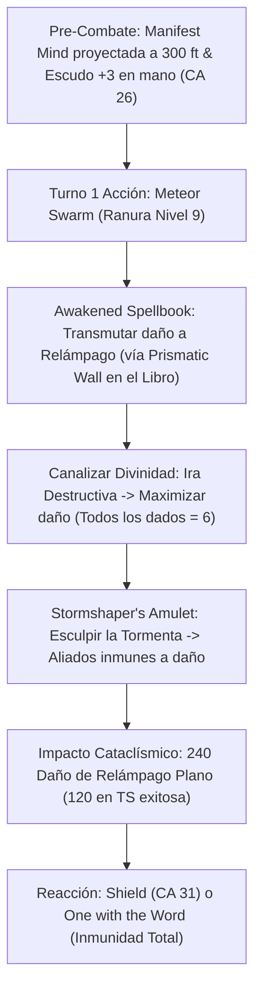

# Resumen General del Personaje: Tempest Demiurge

## Datos Generales

* **System Standard:** D&D 5th Edition (2024 / 5.5e Update)
* **Character Level:** 20 (Cleric [Tempest Domain] 4 / Wizard [Order of Scribes] 16)
* **Species:** Dwarf (2024 PHB — *Dwarven Toughness*, *Dwarven Resilience*, *Stonecunning*, 30 ft. Speed)
* **Background:** Sage (Origin Feat: *Tough* — +2 HP por nivel de personaje retroactivo y continuo)
* **Stats (Point Buy 2024 + Background + ASIs):**
  * **STR:** 8 (-1) *(Point Buy)*
  * **DEX:** 12 (+1) *(Point Buy)*
  * **CON:** 18 (+4) *(15 Base + 1 Background + 1 Resilient CON + 1 Epic Boon)*
  * **INT:** 22 (+6) *(15 Base + 2 Background + 1 War Caster + 2 ASI Nivel 12 + 2 Tome of Clear Thought)*
  * **WIS:** 14 (+2) *(13 Base + 1 ASI Nivel 16)*
  * **CHA:** 8 (-1) *(Point Buy)*

Bastión y Tiempo Muerto: ./bastion and downtime.md

### Actual Item List

Actual Item List: ./actual inventory list.md

1. **Staff of the Magi (+2 CD de conjuros, ventaja en salvaciones vs magia, absorción de conjuros, 50 cargas):** Canalizador y arma legendaria. Provee un arsenal gratuito de conjuros de alto nivel y recarga ranuras al absorber magia enemiga.
2. **Collar del Moldeador de Tormentas + Amulet of the Devout (+3) (Fusionados — 1 Ranura de Sintonización):** +3 a la CD y ataques de conjuros, 1 uso adicional de Canalizar Divinidad (*Ira Destructiva*) y el rasgo *Esculpir la Tormenta* para eximir aliados de daño en áreas de relámpago/trueno.
3. **Arcane Grimoire (+3):** +3 adicional a la CD y tiradas de ataque con conjuros de Mago, además de recuperar ranuras extras con *Arcane Recovery*.
4. **Plate Armor (+3) y Shield (+3) (Sin sintonización):** Armadura completa encantada que eleva la CA pasiva base a **26 CA** (alcanzando **31 CA** con la reacción de *Shield*).
5. **Tome of Clear Thought (Consumido):** Aumenta permanentemente la Inteligencia en +2 y eleva su límite máximo a 22 (+6 modificador).

---

## Combat Role: Frontline Gish Tank, Cataclysmic Lightning Blaster & AoE Tactical Controller

### 1. Gestión de Recursos y Reglas de Inventario

* **Foco Universal Único (Regla de Mesa):** El amuleto fusionado (*Amulet of the Devout* + *Stormshaper's Amulet*) canaliza indistintamente toda la magia divina de Clérigo y arcana de Mago. Ignora restricciones de manos libres y componentes somáticos o materiales sin coste en oro mientras se empuña el *Staff of the Magi* y el *Escudo +3*.
* **Progresión Full Caster Integrada (Regla de Oro):** Con 4 niveles de Clérigo y 16 de Mago, la suma de niveles de lanzador unificada es **20**. El personaje dispone del árbol completo de espacios de conjuro de nivel 1 a 9 y prepara conjuros de 9.º nivel tanto de la lista de Clérigo (*Mass Heal*) como de Mago (*Meteor Swarm*, *Wish*, *Prismatic Wall*).
* **Fusión de Sintonización:** El *Amulet of the Devout +3* y el *Stormshaper's Amulet* están amalgamados en un único objeto físico, consumiendo una sola ranura de sintonización y liberando las otras dos para el *Staff of the Magi* y el *Arcane Grimoire +3*.
* **Canalizar Divinidad Fijo:** Concede **2 usos** de Canalizar Divinidad por descanso corto o largo desde Clérigo 2 (elevados a 3 usos con el *Amulet of the Devout*).

### 2. Action Economy & Combat Loop

* **Pre-combat / Turno 0 Setup:**
  * **Lanzamiento:** *Foresight* (9.º Nivel) o *Aid* (8.º Nivel) para otorgar ventaja continua o +35 HP máximos a 3 aliados.
  * **Invocación:** Mente espectral de *Manifest Mind* desplegada a 300 pies para actuar como punto de origen de conjuros sin exponerse.
* **Turno 1 Setup (Cataclismo Inicial):**
  * **Action:** Lanzar *Meteor Swarm* (9.º Nivel) transmutado a daño de **Relámpago** mediante *Awakened Spellbook* (usando *Prismatic Wall* en el libro) y activar *Ira Destructiva* (Canalizar Divinidad) para infligir **240 de daño de relámpago plano** en un área cuádruple de 40 pies de radio. *Esculpir la Tormenta* protege a todos los aliados en el área sin daño residual.
  * **Bonus Action:** Desplazar la mente espectral de *Manifest Mind* hasta 30 pies o teletransportarse 30 pies con *Misty Step*.
  * **Reaction:** *Shield* (+5 CA instantáneo para alcanzar **31 CA**) o *Wrath of the Storm* (empujar 10 pies al atacante sin salvación con *Retribución Conductora*).
* **Turnos 2+ (Bucle de Control y Hostigamiento Gish):**
  * **Action:** *Chain Lightning* maximizado (**80 de daño plano** a 4 objetivos), *Wall of Force* / *Forcecage* para control absoluto, o en melé *True Strike* con el *Staff of the Magi* infligiendo daño radiante escalado por INT 22.
  * **Bonus Action:** *Healing Word* de emergencia para reanimar aliados o *Epic Boon of Dimensional Travel* tras lanzar conjuros.
  * **Reaction:** *Absorb Elements* (mitigar daño elemental), *Counterspell*, o *One with the Word* (inmunidad total a un ataque/conjuro sacrificando temporalmente páginas del libro de conjuros).

---

## 3. The META Combo: Cataclysmic Destructive Wrath & Awakened Transmutation

🧮 Mathematical Engine (D&D 5e (2024 / 5.5e)):

$$\text{Daño Plano Meteor Swarm Transmutado} = 40 \times 6 = \mathbf{240\text{ Daño de Relámpago Plano en Área}}$$

* Los objetivos que fallen la salvación de Destreza (CD 22) sufren **240 de daño de relámpago**.
* Los objetivos que superen la salvación sufren **120 de daño de relámpago**.
* *Esculpir la Tormenta* permite salvar a $1 + 9 = 10$ aliados visibles sin daño alguno.

$$\text{Daño Plano Chain Lightning (Nivel 6)} = 10 \times 8 = \mathbf{80\text{ Daño de Relámpago Plano a 4 Criaturas}}$$

$$\text{DPR Gish True Strike (Nivel 20)} = P(\text{Hit}) \times \left[ 1\text{d}8_{\text{Vara}} + 6_{\text{INT}} + 2_{\text{Item}} + 3\text{d}6_{\text{Radiante}} \right] + P(\text{Crit}) \times (1\text{d}8 + 3\text{d}6)$$

$$\text{Pool Total de EHP (Nivel 20)} = 87_{\text{Hit Dice Base}} + 80_{\text{CON +4}} + 20_{\text{Dwarf}} + 40_{\text{Tough}} = \mathbf{227\text{ HP Base}} \quad (\text{CA Pasiva } 26 \text{ / } 31 \text{ con } \textit{Shield})$$

---

## 4. Tabla de Rendimiento Táctico

| Criterio | Valoración | Justificación Mecánica |
| :--- | :---: | :--- |
| **Daño Monobjetivo** | 🟢 | *Chain Lightning* y *Chromatic Orb* maximizados contra jefes, combinados con ataques de *True Strike* basados en INT 22. |
| **Control de Masas (CC)** | 🔵 | Cataclismo de 240 de daño de relámpago en área, *Wall of Force*, *Forcecage*, *Sleet Storm* y empujón reactivo de 10 ft sin salvación. |
| **Supervivencia (EHP)** | 🔵 | 227 HP de base, CA pasiva 26 (31 con *Shield*), salvaciones de CON con +10 y Ventaja (*War Caster*), absorción del *Staff of the Magi* y *One with the Word*. |
| **Economía de Acciones** | 🔵 | Proyección remota con *Manifest Mind*, movilidad con *Misty Step* / *Dimensional Travel*, y triple capa reactiva (*Shield*, *Absorb Elements*, *Wrath of the Storm*). |
| **Sustentabilidad** | 🔵 | 3 usos de Canalizar Divinidad recuperables en descanso corto, 50 cargas del *Staff of the Magi*, pergaminos gratis diarios (*Master Scrivener*) y *Arcane Recovery*. |

---

## 5. Home Rules (Reglas de la Mesa)

1. **Foco Universal Único:** El amuleto fusionado canaliza la totalidad de conjuros de Clérigo y de Mago, eliminando restricciones de manos libres y componentes somáticos/materiales sin coste en oro al portar arma y escudo.
2. **Progresión Full Caster Integrada:** Nivel de lanzador total unificado de 20. Permite preparar y conocer conjuros de nivel 9 de ambas listas de clase (*Meteor Swarm*, *Wish*, *Prismatic Wall*, *Mass Heal*).
3. **Fusión de Sintonización:** El *Amulet of the Devout +3* y el *Stormshaper's Amulet* comparten una sola ranura de sintonización física.
4. **Canalizar Divinidad Fijo:** Concede 2 usos básicos de Canalizar Divinidad por descanso corto o largo desde Clérigo 2, incrementados a 3 gracias al *Amulet of the Devout*.
