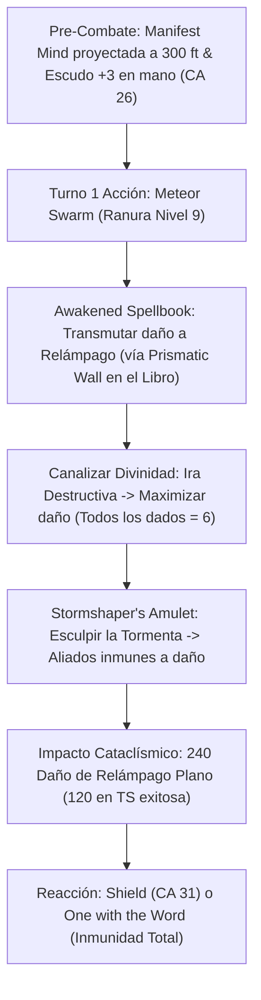

# Resumen General del Personaje: Tempest Demiurge

## 📊 Datos Generales

* **System Standard:** D&D 5th Edition (2024 / 5.5e Update)
* **Character Level:** 20 (Cleric [Tempest Domain] 4 / Wizard [Order of Scribes] 16)
* **Lanzador de Conjuros Unificado:** Nivel 20 (**Progresión Full Caster Integrada**)
* **Species:** Dwarf (2024 PHB — *Dwarven Toughness*, *Dwarven Resilience*, *Stonecunning*, 30 ft. Speed sin penalización de armadura)
* **Background:** Sage (Origin Feat: *Tough* — +2 HP por nivel de personaje retroactivo y continuo)
* **Stats Finales (Point Buy 2024 + Background + ASIs + Epic Boon + Tomo):**
  * **STR:** 8 (-1) *(Point Buy: 8)*
  * **DEX:** 12 (+1) *(Point Buy: 12)*
  * **CON:** 18 (+4) *(Point Buy: 15 + 1 Background + 1 Resilient CON + 1 ASI Nivel 16)*
  * **INT:** 22 (+6) *(Point Buy: 15 + 2 Background + 1 War Caster + 2 ASI Nivel 12 + 2 Tome of Clear Thought)*
  * **WIS:** 14 (+2) *(Point Buy: 13 + 1 ASI Nivel 16)*
  * **CHA:** 8 (-1) *(Point Buy: 8)*
  *(Epic Boon de Nivel 20 incrementa CON a 19 o INT a 23 según preferencia de mesa)*

---

### 📂 Enlaces Directos del Expediente
* 🏰 **Bastión y Tiempo Muerto:** [`bastion and downtime.md`](file:///d:/repo-vault/Proyectos/Rol/DnDbuilds/builds/tempest/bastion%20and%20downtime.md)
* ⚡ **Lista de Conjuros Optimizada:** [`spell list.md`](file:///d:/repo-vault/Proyectos/Rol/DnDbuilds/builds/tempest/spell%20list.md)
* 🎒 **Inventario Actual:** [`actual inventory list.md`](file:///d:/repo-vault/Proyectos/Rol/DnDbuilds/builds/tempest/actual%20inventory%20list.md)
* 🎯 **Objetos a Obtener por Tiers:** [`item list to obtain.md`](file:///d:/repo-vault/Proyectos/Rol/DnDbuilds/builds/tempest/item%20list%20to%20obtain.md)
* 🗺️ **Hoja de Ruta Nivel a Nivel (1-20):** [`roadmap.md`](file:///d:/repo-vault/Proyectos/Rol/DnDbuilds/builds/tempest/roadmap.md)

---

### 🛡️ Arsenal e Inventario Sintonizado (3/3 Ranuras Activas)

1. **Staff of the Magi (Legendario — Sintonizado 1/3) 🔵 [META]:**
   * $+2$ a tiradas de ataque de conjuro y a la CD de salvación.
   * Ventaja permanente en tiradas de salvación contra conjuros y efectos mágicos.
   * Absorción reactiva de conjuros enemigos dirigidos para recargar sus 50 cargas mágicas.
   * Arsenal gratuito de conjuros de alto nivel (*Fireball 7.º*, *Lightning Bolt 7.º*, *Plane Shift*, *Telekinesis*).
2. **Collar del Moldeador de Tormentas + Amulet of the Devout (+3) (Fusionados — Sintonizado 2/3) 🔵 [Indispensable]:**
   * $+3$ a la CD de salvación y tiradas de ataque de conjuros (divinos y arcanos vía Foco Universal).
   * $+1$ uso adicional de Canalizar Divinidad por descanso largo (total: **3 usos por descanso**).
   * **Esculpir la Tormenta:** Exime a $1 + \text{Nivel de Conjuro}$ aliados de recibir daño en áreas de Relámpago o Trueno.
   * **Retribución Conductora:** Empuja 10 pies al atacante sin salvación con *Wrath of the Storm*.
3. **Arcane Grimoire (+3) (Muy Raro — Sintonizado 3/3) 🔵 [META]:**
   * $+3$ adicional a la CD y tiradas de ataque con conjuros de Mago.
   * Añade espacios de conjuro suplementarios recuperables durante *Arcane Recovery*.
4. **Plate Armor (+3) y Shield (+3) (Sin Sintonización) 🔵 [Blindaje Pasivo]:**
   * Armadura pesada y escudo que fijan la CA pasiva base en **26 CA** (alcanzando **31 CA** con la reacción de *Shield*).
5. **Tome of Clear Thought (Consumido) 🔵:**
   * Aumenta permanentemente la Inteligencia en $+2$ y eleva su límite máximo a 22 (+6 modificador).
6. **Consumibles del Bastión en Reserva Activa:**
   * *Pociones de Vuelo* (60 ft vuelo por 1h sin concentración) y *Pociones de Curación Suprema* ($10\text{d}4 + 20$ HP en Acción Adicional).
   * *Talismán de Electromancia* (3 usos gratuitos de *Telekinesis* de nivel 5).

---

## ⚔️ Combat Role: Frontline Gish Tank, Cataclysmic Lightning Blaster & AoE Tactical Controller

### 1. Gestión de Recursos y Reglas de la Mesa

* **Foco Universal Único (Regla de Mesa):** El amuleto fusionado canaliza indistintamente toda la magia divina de Clérigo y arcana de Mago. Ignora restricciones de manos libres y componentes somáticos o materiales sin coste en oro mientras se empuña el *Staff of the Magi* y el *Escudo +3*.
* **Progresión Full Caster Integrada (Regla de Oro):** Con 4 niveles de Clérigo y 16 de Mago, la suma de niveles de lanzador unificada es **20**. El personaje dispone del árbol completo de espacios de conjuro de nivel 1 a 9 y prepara conjuros de 9.º nivel tanto de la lista de Clérigo (*Mass Heal*) como de Mago (*Meteor Swarm*, *Wish*, *Prismatic Wall*).
* **Fusión de Sintonización:** El *Amulet of the Devout +3* y el *Stormshaper's Amulet* están amalgamados en un único objeto físico, consumiendo una sola ranura de sintonización.
* **Canalizar Divinidad Fijo:** Concede **2 usos** de Canalizar Divinidad por descanso corto o largo desde Clérigo 2, elevados a **3 usos** gracias al *Amulet of the Devout*.

---

### 2. Action Economy & Combat Loop

* **Pre-combat / Turno 0 Setup (Blindaje Pasivo y EHP Extremo):**
  * **Lanzamientos Pasivos (Sin Concentración):** *Foresight* (9.º Nivel, 8h — Ventaja total en tiradas y desventaja en ataques enemigos hacia ti), *Aid* (8.º Nivel, 8h — +35 HP máximos a 3 criaturas), *Death Ward* (4.º Nivel, 8h — prevención contra 0 HP y muerte instantánea) y *Regenerate* (7.º Nivel, 1h — curación pasiva de 1 HP al inicio de cada turno para auto-reanimación continua).
  * **Resguardo del Demiplano:** +100 Puntos de Golpe Temporales generados tras descanso largo en el Bastión.
  * **Invocación:** Mente espectral de *Manifest Mind* desplegada a 300 pies para actuar como punto de origen de conjuros sin exponerse.
* **Turno 1 Setup (Cataclismo Inicial):**
  * **Action:** Lanzar *Meteor Swarm* (9.º Nivel) transmutado a daño de **Relámpago** mediante *Awakened Spellbook* (usando *Prismatic Wall* en el libro) y activar *Ira Destructiva* (Canalizar Divinidad) para infligir **240 de daño de relámpago plano** en un área cuádruple de 40 pies de radio. *Esculpir la Tormenta* exime a todos los aliados en el área de recibir daño.
  * **Bonus Action:** Desplazar la mente espectral de *Manifest Mind* hasta 30 pies o teletransportarse 30 pies con *Misty Step*.
  * **Reaction:** *Shield* (+5 CA instantáneo para alcanzar **31 CA**) o *Wrath of the Storm* (empujar 10 pies al atacante sin salvación con *Retribución Conductora*).
* **Turnos 2+ (Bucle de Control, Gish y Curación en Segundo Plano):**
  * **Action:** *Chain Lightning* maximizado (**80 de daño plano** a 4 objetivos), *Wall of Force* / *Forcecage* para control absoluto, o en melé *True Strike* con el *Staff of the Magi* infligiendo daño radiante escalado por INT 22.
  * **Bonus Action:** Beber *Potion of Supreme Healing* ($10\text{d}4 + 20$ HP — Acción Adicional en 2024), *Healing Word* de rescate a 60 ft, o *Epic Boon of Dimensional Travel* tras lanzar conjuros.
  * **Reaction:** *Absorb Elements* (mitigar daño elemental), *Counterspell*, o *One with the Word* (inmunidad total a un ataque/conjuro sacrificando temporalmente páginas del libro de conjuros).
* **Post-Combate / Entre Encuentros (Reset Exprés 2024):**
  * Lanzamiento de *Prayer of Healing* (2.º Nivel — 10 minutos) para otorgar los beneficios de un **Descanso Corto** a todo el grupo, gastar dados de golpe y recargar los **3 usos de Canalizar Divinidad: Ira Destructiva** y la *Recuperación Arcana*.

---

## 3. The META Combo: Cataclysmic Destructive Wrath & Awakened Transmutation

### 🧮 Mathematical Engine (D&D 5e 2024 / 5.5e)

$$\text{Daño Plano Meteor Swarm Transmutado} = 40 \times 6 = \mathbf{240\text{ Daño de Relámpago Plano en Área}}$$

* **Clase de Dificultad (CD) Definitiva:**
  $$\text{CD de Conjuros} = 8 + 6_{\text{PB}} + 6_{\text{INT}} + 3_{\text{Devout}} + 3_{\text{Grimoire}} = \mathbf{26} \quad (\mathbf{28} \text{ con Staff of the Magi})$$
* Los objetivos que fallen la salvación de Destreza (CD 26-28) sufren **240 de daño de relámpago**.
* Los objetivos que superen la salvación sufren **120 de daño de relámpago**.
* *Esculpir la Tormenta* permite salvar a $1 + 9 = 10$ aliados visibles sin daño alguno.

$$\text{Daño Plano Chain Lightning (Nivel 6)} = 10 \times 8 = \mathbf{80\text{ Daño de Relámpago Plano a 4 Criaturas}}$$

$$\text{DPR Gish True Strike (Nivel 20)} = P(\text{Hit}) \times \left[ 1\text{d}8_{\text{Vara}} + 6_{\text{INT}} + 2_{\text{Item}} + 3\text{d}6_{\text{Radiante}} \right] + P(\text{Crit}) \times (1\text{d}8 + 3\text{d}6)$$

$$\text{Pool Base de HP (Nivel 20)} = 87_{\text{Hit Dice Base}} + 80_{\text{CON +4}} + 20_{\text{Dwarf}} + 40_{\text{Tough}} = \mathbf{227\text{ HP Base}}$$

$$\text{EHP Efectivo Pre-Combate (Turno 0)} = 227_{\text{Base}} + 100_{\text{Demiplano}} + 35_{\text{Aid 8.º}} + 11_{\text{Heroes' Feast}} = \mathbf{373\text{ EHP Pasivo}}$$

* **Bombardeo Coordinado con Simulacro:** Al actuar de forma conjunta el personaje y su *Simulacrum* gemelo en la misma ronda:
  $$\text{Nova Combinado Dual} = 240 + 240 = \mathbf{480\text{ Daño de Relámpago Plano en Área}}$$

---

## 4. Tabla de Rendimiento Táctico

| Criterio | Valoración | Justificación Mecánica |
| :--- | :---: | :--- |
| **Daño Monobjetivo** | 🟢 | *Chain Lightning* y *Chromatic Orb* maximizados contra jefes, combinados con ataques de *True Strike* basados en INT 22. |
| **Control de Masas (CC)** | 🔵 | Cataclismo de 240 de daño de relámpago en área, *Wall of Force*, *Forcecage*, *Sleet Storm* y empujón reactivo de 10 ft sin salvación. |
| **Supervivencia (EHP)** | 🔵 | 227 HP base (373 EHP pasivo con Demiplano y Aid 8.º), auto-reanimación pasiva con *Regenerate*, CA pasiva 26 (31 con *Shield*), salvaciones de CON +10 con Ventaja (*War Caster*), absorción del *Staff of the Magi* y *One with the Word*. |
| **Economía de Acciones** | 🔵 | Proyección remota con *Manifest Mind*, movilidad con *Misty Step* / *Dimensional Travel*, y triple capa reactiva (*Shield*, *Absorb Elements*, *Wrath of the Storm*). |
| **Sustentabilidad** | 🔵 | 3 usos de Canalizar Divinidad recuperables en descanso corto (o en 10 min con *Prayer of Healing*), 50 cargas del *Staff of the Magi*, pergaminos gratis diarios (*Master Scrivener*) y *Arcane Recovery*. |

---

## 5. Home Rules (Reglas de la Mesa)

1. **Foco Universal Único:** El amuleto fusionado canaliza la totalidad de conjuros de Clérigo y de Mago, eliminando restricciones de manos libres y componentes somáticos/materiales sin coste en oro al portar arma y escudo.
2. **Progresión Full Caster Integrada:** Nivel de lanzador total unificado de 20. Permite preparar y conocer conjuros de nivel 9 de ambas listas de clase (*Meteor Swarm*, *Wish*, *Prismatic Wall*, *Mass Heal*).
3. **Fusión de Sintonización:** El *Amulet of the Devout +3* y el *Stormshaper's Amulet* comparten una sola ranura de sintonización física.
4. **Canalizar Divinidad Fijo:** Concede 2 usos básicos de Canalizar Divinidad por descanso corto o largo desde Clérigo 2, incrementados a 3 gracias al *Amulet of the Devout*.
