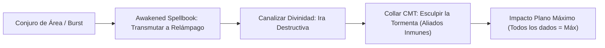

# ⚡ Lista de Hechizos Optimizada — Tempest Demiurge (Nivel 20)

Esta lista sigue estrictamente las reglas oficiales de **D&D 5e (2024 / 5.5e)** integradas con las reglas de mesa de **Progresión Full Caster Integrada** y el **Foco Universal Único**. 

A Nivel 20 (Clérigo 4 / Mago 16), el nivel de lanzador unificado es **20**. La preparación diaria por ranuras de conjuro según el PHB 2024 comprende exactamente: **4 de 1.er Nivel, 3 de 2.º, 3 de 3.º, 3 de 4.º, 3 de 5.º, 2 de 6.º, 2 de 7.º, 1 de 8.º y 1 de 9.º Nivel** (**22 conjuros preparados totales**), además de los conjuros de dominio de Clérigo de la Tormenta, trucos y rituales del libro de escribano.

> **Regla de Mesa — Foco Universal Único:** El amuleto fusionado (*Collar CMT + Amulet of the Devout +3*) canaliza indistintamente toda la magia divina y arcana, anulando requisitos de manos libres y componentes somáticos o materiales sin coste en oro mientras se empuña el *Staff of the Magi* y el *Escudo +3*.

---

## 🛡️ 1. Conjuros Activos (Buffs Pasivos, Duraciones Largas y Turno 0)

*Conjuros y beneficios de larga duración (1 a 24 horas) que se activan antes del combate o durante la preparación matutina en el Bastión. No consumen la economía de acciones en combate ni requieren concentración:*

| Conjuro / Beneficio | Nivel / Fuente | Duración | Concentración | Efecto Táctico Pasivo |
| :--- | :---: | :---: | :---: | :--- |
| **Foresight** | 9.º (Mago) | 8 horas | ❌ No | 🔵 **Roto**. Concede Ventaja en todas las tiradas de ataque, salvación y pruebas de habilidad. Todos los ataques enemigos en tu contra sufren Desventaja constante. |
| **Aid (Upcast Nivel 8)** | 8.º (Clérigo) | 8 horas | ❌ No | 🔵 **Roto**. Incrementa la vida máxima y actual en **+35 HP** a 3 criaturas (+105 HP totales en el equipo). |
| **Death Ward** | 4.º (Clérigo) | 8 horas | ❌ No | 🔵 **Indispensable**. Si tu vida cae a 0 HP, caes a 1 HP en su lugar. Inmunidad absoluta contra efectos de muerte instantánea (*Power Word Kill*, desintegración). |
| **Contingency** | 6.º (Mago) | 10 días | ❌ No | 🔵 **Roto**. Disparador: *"Si mi vida cae por debajo del 50% o si soy incapacitado"*. Efecto: Se activa instantáneamente *Otiluke's Resilient Sphere* (inmunidad total al daño) o *Dimension Door* (evacuación inmediata a 500 pies). |
| **Heroes' Feast** | 6.º (Clérigo / Wish) | 24 horas | ❌ No | 🔵 **Excelente**. Inmunidad total a veneno y miedo, Ventaja en salvaciones de Sabiduría y $+2\text{d}10$ (+11 promedio) a la vida máxima de todo el grupo. |
| **Mind Blank** | 8.º (Mago / Wish) | 24 horas | ❌ No | 🔵 **Excelente**. Inmunidad a daño psíquico, al estado Hechizado y a cualquier detección mental o adivinación hostil. |
| **Regenerate** | 7.º (Clérigo) | 1 hora | ❌ No | 🔵 **Roto (Curación Pasiva)**. Restaura $4\text{d}8 + 15$ HP de golpe y **1 HP al inicio de cada uno de tus turnos**. Si caes a 0 HP, al inicio de tu turno recuperas 1 HP y te levantas automáticamente sin realizar tiradas de muerte ni perder turnos. |
| **Simulacrum** | 7.º (Mago) | Permanente | ❌ No | 🔵 **Roto**. Duplicado exacto del personaje creado en el Bastión. Dispone de su propia reserva completa de ranuras y **3 usos propios de Canalizar Divinidad: Ira Destructiva**. |
| **Resguardo del Demiplano** | Bastión Nivel 17 | 24 horas | ❌ No | 🔵 **EHP Pasivo**. Otorga **100 Puntos de Golpe Temporales** diarios tras realizar un Descanso Largo en el Demiplano del bastión. |
| **Warding Bond** | 2.º (Clérigo) | 1 hora | ❌ No | 🟢 **Excelente**. Lanzado por el *Simulacrum* sobre el personaje principal: +1 CA, +1 a todas las salvaciones y resistencia a todo el daño. |
| **Water Breathing** | 3.º (Ritual Mago) | 24 horas | ❌ No | 🟢 **Utilidad**. 10 criaturas respiran bajo el agua indefinidamente. |
| **Rary's Telepathic Bond** | 5.º (Ritual Mago) | 1 hora | ❌ No | 🔵 **Táctico**. Enlace mental telepático a distancia infinita para hasta 8 aliados. |

> **Cálculo de EHP Pasivo Pre-Combate (Turno 0):**
> $$\text{EHP Turno 0} = 227_{\text{HP Base}} + 100_{\text{Temp HP Demiplano}} + 35_{\text{Aid (Nv 8)}} + 11_{\text{Heroes' Feast}} = \mathbf{373\text{ Puntos de Golpe Efectivos}}$$
> Todo esto antes de recibir el primer impacto, respaldado por **26 CA pasiva** (**31 CA** con *Shield*) y *Death Ward* activo.

---

## 🔮 2. Trucos (Cantrips — 9 Totales: 5 Mago + 4 Clérigo)

*No consumen ranuras de preparación ni espacios de conjuro.*

### 🧙‍♂️ Trucos de Mago (5)
1. **True Strike (2024) 🔵 [Roto - Gish Melé]:** Ataque de melé usando **Inteligencia** (+6) para impactar y dañar. Inflige el daño de la vara $+6$ (INT 22) $+2$ (Staff of the Magi) $+3\text{d}6$ de daño radiante adicional a nivel 17+.
2. **Shocking Grasp (2024) 🟢 [Excelente - Táctico]:** Daño de relámpago a melé ($4\text{d}8$). **Desactiva las reacciones** del enemigo, permitiendo retirarse sin provocar ataques de oportunidad.
3. **Mind Sliver 🟢 [Excelente - Debuff Mental]:** Daño psíquico ($4\text{d}6$). El objetivo debe superar salvación de Inteligencia o restar $1\text{d}4$ a su siguiente tirada de salvación, abriendo la puerta a tus cataclismos.
4. **Mage Hand (2024) 🟢 [Excelente - Utilidad]:** Manipulación de objetos y mecanismos a 30 pies de distancia.
5. **Minor Illusion 🟡 [Decente - Distracción]:** Generación de sonidos o imágenes estáticas para bloquear líneas de visión o distraer centinelas.

### ⛪ Trucos de Clérigo (4)
1. **Guidance (2024) 🔵 [Roto - Reacción]:** $+1\text{d}4$ a pruebas de característica utilizable como Reacción inmediata cuando un aliado falla.
2. **Sacred Flame (2024) 🟢 [Excelente - Daño Sagrado]:** $4\text{d}8$ de daño radiante a distancia ignorando cobertura parcial.
3. **Spare the Dying (2024) 🟢 [Excelente - Rescate]:** Estabiliza a un aliado caído a 120 pies de distancia.
4. **Thaumaturgy 🟡 [Decente - Ambientación]:** Retumbos de truenos, luces parpadeantes y amplificación de voz x3 para intimidación.

---

## 🌩️ 3. Conjuros de Dominio (Tempest Domain — Siempre Preparados)

*Concedidos de forma gratuita por los niveles de Clérigo de la Tormenta; no consumen espacios de la lista de preparados:*

* **Thunderwave (1.er Nivel) 🟢:** $2\text{d}8$ de daño de trueno en cubo de 15 pies y empujón de 10 pies.
* **Fog Cloud (1.er Nivel) 🟡:** Nube densa de 20 pies de radio para cegar líneas de visión enemigas.
* **Shatter (2.º Nivel) 🟢:** $3\text{d}8$ de daño de trueno en área; desintegra objetos inorgánicos y constructos.
* **Gust of Wind (2.º Nivel) 🟡:** Línea de viento huracanado de 60 pies que frena aproximaciones y dispersa gases.

---

## 🎒 4. Lista Oficial de Conjuros Preparados por Espacios (22 Conjuros)

*Distribución exacta de 22 conjuros unificados (PHB 2024) optimizados para combate gish, control absoluto y sinergia de mesa:*

### 9.º Nivel (1 Preparado / 1 Espacio)
1. **Wish (Mago) 🔵 [Roto - Versatilidad Absoluta]:** Permite duplicar instantáneamente cualquier conjuro de nivel 1 a 8 de **cualquier lista de clase** (Clérigo, Druida, Mago, Paladín) sin tiempo de lanzamiento ni coste material. *(Nota: Meteor Swarm reside en el Libro de Escribano para días de aniquilación masiva)*.

### 8.º Nivel (1 Preparado / 1 Espacio)
1. **Illusory Dragon (Mago) 🟢 [Excelente - Daño y Aterrorizar]:** Invoca un dragón ilusorio que asusta en área e inflige daño elemental masivo por asalto. Suministra tipo de daño **Relámpago** en el libro para transmutaciones de 8.º nivel.

### 7.º Nivel (2 Preparados / 2 Espacios)
1. **Forcecage (Mago) 🔵 [Roto - Bloqueo Ineludible]:** Encierra enemigos en una caja invisible e indestructible sin permitir tirada de salvación inicial.
2. **Regenerate (Clérigo) 🔵 [Roto - Curación Pasiva]:** 1 hora de duración sin concentración. Cura $4\text{d}8 + 15$ inicial y **1 HP al inicio de cada turno**, levantando al lanzador de 0 HP de forma pasiva en cada asalto.

### 6.º Nivel (2 Preparados / 2 Espacios)
1. **Chain Lightning (Mago) 🔵 [Roto - Ráfaga Eléctrica]:** Cuatro rayos a objetivos visibles. Maximizado con *Ira Destructiva*, inflige **80 de daño plano de Relámpago** a cada una de las 4 criaturas.
2. **Heal (Clérigo) 🔵 [Indispensable - Curación Masiva]:** Restaura **70 HP fijos** de forma instantánea y neutraliza cegueras, sorderas y cualquier enfermedad sin tirada de dados.

### 5.º Nivel (3 Preparados / 3 Espacios)
1. **Wall of Force (Mago) 🔵 [Roto - Control Absoluto]:** Muro impenetrable de fuerza que fragmenta el campo de batalla sin conceder salvación.
2. **Cone of Cold (Mago) 🟢 [Excelente - Ráfaga en Cono]:** Cono de 60 pies. Transmutado a Relámpago y maximizado con *Ira Destructiva* inflige **64 de daño plano**.
3. **Destructive Wave (Clérigo) 🟢 [Excelente - Vanguardia Gish]:** Explosión de 30 pies selectiva. Inflige **30 de daño plano de trueno** (maximizado) $+5\text{d}6$ de daño radiante y derriba (*Prone*) a los enemigos sin dañar a aliados.

### 4.º Nivel (3 Preparados / 3 Espacios)
1. **Death Ward (Clérigo) 🔵 [Indispensable - Prevención]:** 8 horas sin concentración. Salvaguarda pasiva que evita la muerte o el colapso a 0 HP.
2. **Dimension Door (Mago) 🟢 [Excelente - Movilidad Táctica]:** Teletransporte de hasta 500 pies para el lanzador y un compañero voluntario.
3. **Banishment (Clérigo/Mago) 🟢 [Excelente - Exilio]:** Neutraliza amenazas prioritarias enviándolas a un semiplano o su plano natal (salvación de Carisma).

### 3.er Nivel (3 Preparados / 3 Espacios)
1. **Spirit Guardians (Clérigo) 🔵 [Roto - Aura Gish]:** Emanación celestial de 15 pies que inflige daño continuo cada asalto ($3\text{d}8$ a $9\text{d}8$) y reduce la velocidad enemiga a la mitad.
2. **Fireball (Mago) 🔵 [Roto - Cataclismo de Rango Medio]:** Transmutada a Relámpago en el libro y maximizada con *Ira Destructiva* inflige **48 de daño plano** en esfera de 20 pies de radio.
3. **Counterspell (Mago) 🔵 [Roto - Interrupción Reactiva]:** Cancela conjuros enemigos en su momento de lanzamiento como Reacción.

### 2.º Nivel (3 Preparados / 3 Espacios)
1. **Aid (Clérigo) 🔵 [Roto - Buffer de Salud]:** $+5$ HP máximos a 3 criaturas por cada nivel de ranura usado durante 8 horas sin concentración.
2. **Prayer of Healing (Clérigo) 🔵 [Indispensable 2024 - Descanso Exprés]:** 10 minutos de lanzamiento. Otorga los beneficios de un **Descanso Corto** a hasta 5 criaturas, permitiendo gastar dados de golpe y recargar *Canalizar Divinidad* y *Arcane Recovery*.
3. **Misty Step (Mago) 🟢 [Excelente - Reposicionamiento]:** Teletransporte de 30 pies como Acción Adicional.

### 1.er Nivel (4 Preparados / 4 Espacios)
1. **Shield (Mago) 🔵 [Roto - Escudo Reactivo]:** $+5$ a la CA como Reacción, elevando tu CA pasiva de 26 a **31 CA**.
2. **Absorb Elements (Mago) 🔵 [Roto - Mitigación]:** Resistencia reactiva contra daño elemental y absorción de energía.
3. **Healing Word (Clérigo) 🔵 [Indispensable - Rescate]:** Acción Adicional a 60 pies para reanimar a un aliado caído mientras ejecutas tu Acción de ataque/conjuro.
4. **Guiding Bolt (Clérigo) 🟢 [Excelente - Daño Sagrado]:** $4\text{d}6$ de daño radiante a distancia que otorga Ventaja al siguiente ataque contra el objetivo.

---

## ⚡ 5. Conjuros Recomendados para Nova Damage (Daño Cataclísmico / Burst)

*El motor ofensivo de máxima letalidad combina tres mecánicas sinérgicas de mesa:*
1. **Awakened Spellbook (Mago Escribano):** Modifica el tipo de daño del conjuro a **Relámpago** (*Lightning*) o **Trueno** (*Thunder*) basándose en conjuros del mismo nivel en el libro.
2. **Canalizar Divinidad: Ira Destructiva (Clérigo de la Tempestad):** Maximiza de manera automática todos los dados de daño de relámpago o trueno lanzados.
3. **Collar del Moldeador de Tormentas (Esculpir la Tormenta):** Exime a $1 + \text{Nivel de Conjuro}$ aliados dentro del área de recibir daño alguno.

### Tabla de Opciones Nova por Rango de Ranura

| Ranura | Conjuro Utilizado | Transmutación Requerida | Fórmula de Dados | Daño Plano Maximizado | Alcance / Cobertura |
| :---: | :--- | :--- | :---: | :---: | :--- |
| **9.º** | **Meteor Swarm** | Sí (vía *Prismatic Wall*) | $40\text{d}6$ (Fuego/Contundente) | **240 de Relámpago Plano** | 4 esferas de 40 ft radio a 1 milla |
| **8.º** | **Sunburst** / **Abi-Dalzim** | Sí (vía *Illusory Dragon*) | $12\text{d}8$ (Radiante/Necrótico) | **96 de Relámpago Plano** | Esfera de 60 ft o cubo de 30 ft |
| **7.º** | **Delayed Blast Fireball** | Sí (vía *Prismatic Spray*) | $12\text{d}6$ a $22\text{d}6$ | **72 a 132 de Relámpago Plano** | Esfera de 20 ft radio |
| **6.º** | **Chain Lightning** | No (Relámpago Nativo) | $10\text{d}8$ (Relámpago) | **80 de Relámpago Plano** | 4 criaturas separadas a 30 ft |
| **5.º** | **Cone of Cold** | Sí (vía *Summon Draconic*) | $8\text{d}8$ (Frío) | **64 de Relámpago Plano** | Cono de 60 ft |
| **5.º** | **Destructive Wave** | No (Trueno Nativo) | $5\text{d}6$ trueno $+ 5\text{d}6$ radiante | **30 Plano Trueno $+ 5\text{d}6$ Radiante** | Esfera de 30 ft centrada en ti (Derriba) |
| **3.er** | **Fireball** / **Lightning Bolt** | Sí/No (vía *Lightning Bolt*) | $8\text{d}6$ (Fuego/Relámpago) | **48 de Relámpago Plano** | Esfera de 20 ft o línea de 100 ft |
| **1.er** | **Chromatic Orb** | No (Relámpago Nativo) | $3\text{d}8$ (Relámpago) | **24 de Relámpago Plano** | Monobjetivo a 90 ft (Rebote en 2024) |
| **1.er** | **Guiding Bolt** | Requiere Homebrew/Mesa | $4\text{d}6$ (Radiante -> Relámpago) | **24 de Relámpago Plano** | Monobjetivo a 120 ft (+Ventaja siguiente ataque) |

> 🔍 **Análisis Clínico de Nova Nivel 1: Chromatic Orb vs. Guiding Bolt**
> * **Empate a Nivel 1 Base:** Ambos conjuros infligen exactamente **24 de daño plano de relámpago** al maximizarse con *Ira Destructiva* ($3 \times 8 = 24$ vs $4 \times 6 = 24$).
> * **Escalado Superior (Upcasting):** *Chromatic Orb* escala con dados **d8** ($+8$ de daño plano por nivel de ranura), superando al escalado **d6** de *Guiding Bolt* ($+6$ de daño plano por nivel). A nivel 2: 32 vs 30; a nivel 3: 40 vs 36; a nivel 4: 48 vs 42.
> * **Legalidad RAW de Transmutación:** El rasgo *Awakened Spellbook* del Escribano restringe la transmutación a conjuros de Mago (*"when you cast a wizard spell"*). *Guiding Bolt* es de la lista de Clérigo e inflige daño **Radiante** de base, por lo que requiere beneplácito del DM para ser transmutado. En contraste, *Chromatic Orb* es nativo de Mago y **ya contiene el tipo Relámpago de forma innata**, sin requerir transmutación.
> * **Efectos Secundarios:** *Guiding Bolt* concede Ventaja en el siguiente ataque contra el blanco (redundante si ya cuentas con *Foresight* o la ayuda del búho familiar). *Chromatic Orb (2024)* puede rebotar a objetivos adicionales si coinciden dados. Por consistencia de reglas y escalado, *Chromatic Orb* es la opción técnica superior.

### 🧮 Modelado Matemático del Daño Nova (LaTeX)

Con una Clase de Dificultad (CD) de salvación de conjuros de **26** ($8 + 6_{\text{PB}} + 6_{\text{INT}} + 3_{\text{Devout}} + 3_{\text{Grimoire}} = 26$):

$$\text{Daño Esperado Nova} = (1 - P(\text{Éxito})) \times \text{Daño Plano} + P(\text{Éxito}) \times \left(\frac{\text{Daño Plano}}{2}\right)$$

Contra una criatura jefe con $+7$ a las salvaciones de Destreza:
$$P(\text{Éxito}) = \frac{20 - (26 - 7) + 1}{20} = \frac{2}{20} = 0.10 \quad (10\% \text{ probabilidad de superar la CD})$$

$$\text{DPR Nova Meteor Swarm} = (0.90 \times 240) + (0.10 \times 120) = 216 + 12 = \mathbf{228\text{ Daño Promedio por Criatura}}$$

* **Bombardeo Coordinado con Simulacro:** Al actuar de forma conjunta el personaje y su *Simulacrum* gemelo en la misma ronda de combate, el daño de ráfaga alcanza:
  $$\text{Nova Combinado Meteor Swarm} = 240 + 240 = \mathbf{480\text{ Daño de Relámpago Plano en Área}}$$

---

## 💖 6. Conjuros Recomendados para Curación en Segundo Plano (Background Healing)

*En el META de optimización analítica, gastar una Acción principal en combate para curar valores inferiores al daño infligido por los enemigos representa una pérdida neta de tempo. La **Curación en Segundo Plano** resuelve este cuello de botella actuando de cuatro formas:*

### A. Regeneración Pasiva por Turno (Sin Economía de Acciones en Combate)
* **Regenerate (7.º Nivel — Clérigo) 🔵 [Roto]:**
  * *Mecánica:* 1 hora de duración sin concentración. Cura $4\text{d}8 + 15$ inicial y **1 HP al inicio de cada turno propio**.
  * *Sinergia de Inmortalidad Táctica:* Si el personaje cae a 0 HP, al inicio de su siguiente turno recupera 1 HP automáticamente. Se levanta de inmediato, no realiza tiradas de salvación contra muerte y dispone de su turno completo intacto para actuar. Suministra **600 HP pasivos** a lo largo de 1 hora.

### B. Buffer Preventivo de Salud (Pre-Combate / Vida Máxima Inflada)
* **Aid (Clérigo — Upcast a Nivel 8) 🔵 [Roto]:**
  * *Mecánica:* Aumenta la vida máxima y actual en **+35 HP** a 3 criaturas durante 8 horas sin concentración (+105 HP totales en el equipo). Funciona como un depósito de salud adicional que previene el daño antes de que afecte a los puntos de golpe base.
* **Heroes' Feast (Clérigo — 6.º Nivel / Duplicado con Wish) 🔵 [Excelente]:**
  * *Mecánica:* 24 horas sin concentración. Concede $+2\text{d}10$ (+11 promedio) de vida máxima a todo el grupo, junto con inmunidad a veneno y miedo.
* **100 Puntos de Golpe Temporales del Demiplano de Bastión 🔵 [EHP]:**
  * *Mecánica:* Generados pasivamente tras cada Descanso Largo en el bastión, absorbiendo los primeros 100 puntos de daño entrante.

### C. Curación Reactiva en Acción Adicional (Preservando la Acción Principal)
* **Healing Word (1.er Nivel — Clérigo) 🔵 [Indispensable]:**
  * *Mecánica:* Alcance de 60 pies lanzado como **Acción Adicional**. Permite levantar a un aliado a 0 HP sin renunciar a lanzar un cataclismo ofensivo o atacar con *True Strike* con la Acción principal.
* **Pociones de Curación Suprema del Bastión ($10\text{d}4 + 20$ HP) 🟢 [Excelente]:**
  * *Mecánica:* En las reglas 2024 (5.5e), beber una poción propia es una **Acción Adicional**. Restaura un promedio de **45 HP** sin gastar ranuras de conjuro.

### D. Curación Masiva Fuera de Combate y Descanso Exprés
* **Prayer of Healing (2.º Nivel — Clérigo) 🔵 [Indispensable 2024]:**
  * *Mecánica:* 10 minutos de tiempo de lanzamiento. Otorga a hasta 5 criaturas los **beneficios completos de un Descanso Corto**. Permite al grupo gastar dados de golpe para curarse al 100% y recarga habilidades clave de descanso corto (**3 usos de Canalizar Divinidad** y la *Recuperación Arcana* del Mago).
* **Aura of Vitality (3.er Nivel — Clérigo) 🔵 [Eficiencia Máxima]:**
  * *Mecánica:* 1 minuto (concentración). Cura $2\text{d}6$ por asalto como Acción Adicional ($20\text{d}6 = \mathbf{70\text{ HP promedio}}$ por una sola ranura de nivel 3 fuera de combate).
* **Heal (6.º Nivel — Clérigo) 🔵 [Sanación Quirúrgica]:**
  * *Mecánica:* Restaura **70 HP fijos** de golpe en combate y elimina ceguera, sordera y enfermedades sin depender del azar.
* **Mass Heal (9.º Nivel — Clérigo / Preparable o vía Wish) 🔵 [Cúspide Sagrada]:**
  * *Mecánica:* Restaura **700 HP** repartidos a discreción entre los aliados visibles a 60 pies.

---

## 📖 7. El Libro de Conjuros del Escribano (Spellbook)

*Conjuros inscritos en el libro que no consumen espacios de preparación diaria, accesibles para rituales, transmutación elemental y contingencias de bastión:*

### 🕯️ 1. Rituales Arcanos (Lanzamiento Directo desde el Libro)
* **Find Familiar (1.er Nivel) 🔵:** Familiar permanente (Búho con *Flyby*) para otorgar la acción de *Help* y conceder Ventaja táctica en ataques de *True Strike*.
* **Identify (1.er Nivel) 🟢** y **Detect Magic (1.er Nivel) 🟢:** Análisis ritual de reliquias y auras arcanas.
* **Comprehend Languages (1.er Nivel) 🔵:** Traducción instantánea de cualquier lengua escrita o hablada.
* **Leomund's Tiny Hut (3.er Nivel) 🔵:** Cúpula impenetrable para descansos largos protegidos fuera del bastión.
* **Water Breathing (3.er Nivel) 🟢:** Respiración subacuática para 10 criaturas por 24 horas.
* **Rary's Telepathic Bond (5.º Nivel) 🔵:** Vínculo mental sin límites de distancia durante 1 hora.
* **Contact Other Plane (5.º Nivel) 🟢:** Comunión ritual con deidades elementales (salvación de Inteligencia trivial con tu bono +12).

### 📚 2. Biblioteca Elemental (Plantillas de Daño para Awakened Spellbook)
* **1.er Nivel:** *Chromatic Orb* (Relámpago, Trueno, Frío, Fuego, Veneno, Ácido).
* **2.º Nivel:** *Dragon's Breath* (Relámpago, Frío, Fuego, Veneno, Ácido).
* **3.er Nivel:** *Lightning Bolt* (Relámpago).
* **4.º Nivel:** *Storm Sphere* e *Ice Storm* (Relámpago, Trueno, Frío, Contundente).
* **5.º Nivel:** *Summon Draconic Spirit* (Relámpago, Trueno, Frío, Fuego, Ácido).
* **7.º Nivel:** *Prismatic Spray* (Relámpago, Fuego, Frío, Ácido, Veneno).
* **8.º Nivel:** *Illusory Dragon* (Relámpago, Frío, Fuego, Ácido, Veneno, Necrótico).
* **9.º Nivel:** *Prismatic Wall* (Relámpago en su capa amarilla, Fuego, Frío, Ácido, Veneno).

### 👥 3. Conjuros Tácticos y de Resguardo Planar
* **Meteor Swarm (9.º Nivel) 🔵:** Cataclismo transmutable a 240 de daño de relámpago plano.
* **Prismatic Wall (9.º Nivel) 🔵:** Barrera definitiva de 7 capas y catalizador elemental.
* **Simulacrum (7.º Nivel) 🔵:** Duplicado gemelo del lanzador creado en el bastión.
* **Teleport (7.º Nivel) 🔵:** Enlace de retorno instantáneo al Círculo de Teletransporte del bastión desde cualquier punto del multiverso.
