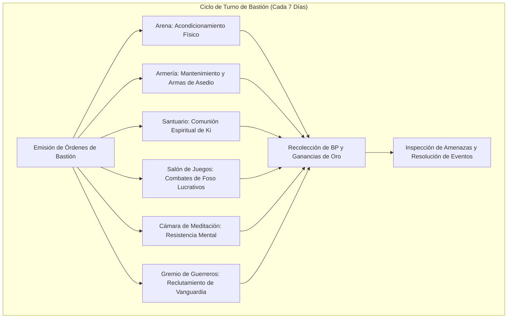

# 🏰 Bastión y Tiempo Muerto — BONK

## 🏰 Sistema de Bastiones (Reglas Oficiales DMG 2024 / D&D 5.5e)

*Estructura de gestión de la base de operaciones, economía de bastión y mecánicas de mando.*

* **Nombre del Bastión:** El Templo del Caparazón Sólido (Shell Shrine)
* **Nivel de Bastión (Bastion Level):** 20
* **Puntos de Bastión (Bastion Points - BP):** 115
* **Puntuación de Mando (Bastion Defender Stats):** +11 al ataque y salvaciones defensivas (STR 20 [+5], DEX 13 [+1], CON 16 [+3], INT 8 [-1], WIS 14 [+2], CHA 8 [-1]).

---

### Instalaciones Básicas (Basic Facilities)

1. **Dormitorio Principal (Bedchambers):** Nido de arena templada tallado en piedra volcánica para reposo reparador.
2. **Comedor Comunal (Dining Hall):** Fosa de asado circular y grandes mesas de piedra donde los acólitos y defensores comparten banquetes de carne curada y frutas silvestres.
3. **Patio Central (Common Area):** Foso abierto de arena gruesa diseñado para combates de prueba, lucha libre y meditación bajo la lluvia.

---

### Instalaciones Especiales (Special Facilities — Exactamente 6: 4 Roomy + 2 Vast)

#### 1. Arena de Entrenamiento (Training Area — Roomy, Desbloqueo Nivel 5)
* **Estado:** Activa (Mantener)
* **Tamaño:** Roomy (Espaciosa)
* **Orden de Bastión:** *Train (Entrenar)*
* **Sinergia con el Build:** 🔵 **Indispensable**. Acondicionamiento intensivo en llaves de agarre (*Grappling*), derribos y combate desarmado. Concede ventaja en pruebas de iniciativa o salvaciones de Fuerza/Constitución durante la siguiente incursión del personaje.

#### 2. Armería (Armory — Roomy, Desbloqueo Nivel 5)
* **Estado:** Activa (Mantener)
* **Tamaño:** Roomy (Espaciosa)
* **Orden de Bastión:** *Equip (Equipar)*
* **Sinergia con el Build:** 🟢 **Excelente**. Fabricación y mantenimiento de pertrechos de asedio, protecciones y armas para la guarnición del bastión, incrementando la defensa base del complejo en +4 contra asaltos hostiles.

#### 3. Santuario Meditativo (Sanctuary — Roomy, Desbloqueo Nivel 9)
* **Estado:** Activa (Mantener)
* **Tamaño:** Roomy (Espaciosa)
* **Orden de Bastión:** *Commune (Comulgar)*
* **Sinergia con el Build:** 🟢 **Excelente**. Fuente sagrada donde confluyen la serenidad monástica y el espíritu totémico de la bestia. Concede un vial de agua bendita o poción menor cada ciclo y ventaja en salvaciones contra maldiciones.

#### 4. Salón de Juegos y Apuestas (Gaming Hall — Roomy, Desbloqueo Nivel 9)
* **Estado:** Activa (Mantener)
* **Tamaño:** Roomy (Espaciosa)
* **Orden de Bastión:** *Trade (Generar Riqueza)*
* **Sinergia con el Build:** 🟢 **Excelente**. Organiza veladas de lucha en jaula y foso no letal donde BONK y sus campeones compiten. Genera un rendimiento de $1\text{d}10 \times 15$ po netos semanales y atrae informantes del bajo mundo.

#### 5. Cámara de Meditación Trascendental (Meditation Chamber — Vast, Desbloqueo Nivel 13)
* **Estado:** Activa (Mantener)
* **Tamaño:** Vast (Vasta)
* **Orden de Bastión:** *Focus (Enfoque Mental)*
* **Sinergia con el Build:** 🔵 **Indispensable**. Centro espiritual de quietud absoluta. Otorga al personaje inspiración heroica al completar un descanso largo y ventaja en las tiradas de salvación de Sabiduría y Carisma durante las primeras 24 horas tras abandonar el bastión.

#### 6. Gremio de Guerreros de Vanguardia (Guildhall — Vast, Desbloqueo Nivel 17)
* **Estado:** Activa (Mantener)
* **Tamaño:** Vast (Vasta)
* **Orden de Bastión:** *Recruit (Reclutar y Desplegar)*
* **Sinergia con el Build:** 🔵 **Indispensable**. Sede central que alberga una compañía de infantería pesada y luchadores curtidos. Permite despachar destacamentos para patrullar la región o defender el bastión con un bono marcial de +11 a las tiradas de resolución de eventos.

---

### Seguidores y Guarnición (Staff & Garrison)

* **Capataz General (Major Domo):** Maestro Oog (Anciano Tortle sabio de la Orden del Caparazón, versado en logística y filosofía defensiva).
* **Guarnición Activa:**
  * 12 Defensores Tortle pesados armados con mayales y escudos.
  * 8 Acólitos del Monasterio de la Muerte Larga entrenados en detección de intrusos.
  * 2 Sanadores de campo especialistas en masajes musculares, emplastos y reducción de traumatismos.

---

## ⏳ Actividades de Tiempo Muerto (Downtime Activities)

### Prioridad 1: Combates en el Foso (Pit Fighting)
* **Mecánica Oficial:** Xanathar's Guide to Everything (Downtime: Pit Fighting).
* **Bonificadores Aplicables:** Atletismo con ventaja (+11) + Acrobacias (+7) + Salvación de CON (+9).
* **Rendimiento Financiero:** $150 - 250$ po semanales limpios con una tasa de victoria del 98% debido a su capacidad de no caer inconsciente jamás vía *Mastery of Death*.

### Prioridad 2: Fabricación de Pociones Curativas y Elixires
* **Mecánica Oficial:** DMG 2024 / XGE (Crafting).
* **Objetivo:** Emplear las instalaciones del Santuario para destilar *Potions of Supreme Healing* y *Potions of Speed* con los fondos obtenidos del foso.

---

## 🏃‍♂️ Modos de Movimiento, Logística y Viaje

* **Caminar (Walk):** 55 ft. (30 ft. base Tortle + 25 ft. por Movimiento sin Armadura Monje 17).
* **Nadar (Swim):** 30 ft. nativo de Tortle (capacidad pulmonar de retener el aliento durante 1 hora completa).
* **Correr por Muros y Líquidos (Monk 9):** Puede desplazarse verticalmente sobre muros o a través de superficies líquidas sin hundirse mientras mantenga su movimiento.
* **Ritmo de Viaje:** Rápido (30 millas por día a marcha forzada sin riesgo de fatiga).
* **Visión en la Oscuridad:** 60 ft.

---

## 🎭 Reputación y Facciones

1. **La Orden del Loto de Acero:** Rango de Gran Maestro de Foso. Acceso irrestricto a templos hermanos, hospitalidad y reabastecimiento en todo el continente.
2. **Círculo de Bestias del Pantano:** Aliados totémicos que proveen hierbas medicinales raras a cambio de protección fronteriza.