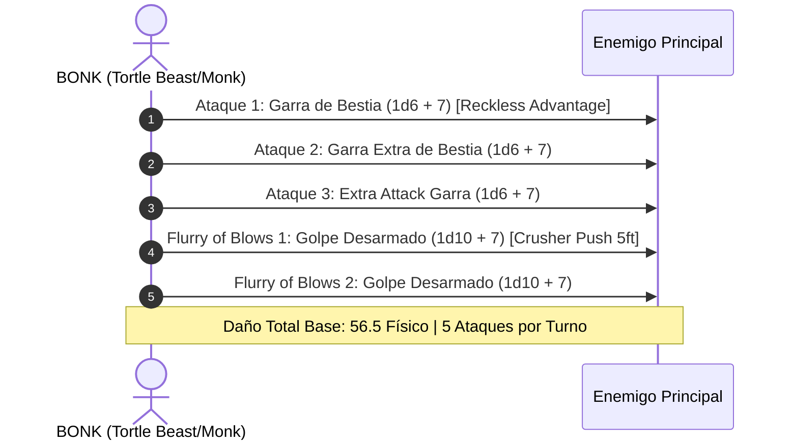

# Guía de Personaje — BONK (Edición 2024 / 5.5e Update)

## Datos Generales

* **System Standard:** D&D 5th Edition (2024 Ruleset - 5.5e Compatible)
* **Character Level:** 20 (Total)
* **Class Split:** Barbarian (Path of the Beast) 3 / Monk (Way of the Long Death) 17
* **Species:** Tortle (Natural Armor CA 17 fija, garras secundarias y nado de 30 ft)
* **Background:** Farmer / Outlander (Dote de Origen: *Tough* o *Tavern Brawler 2024*)
* **Stats (Point Buy 2024 / Background):**
  * **FUER (STR):** 20 (+5) *(15 Base + 2 Racial/Background + 1 Dote Crusher + 2 ASI Nivel 11)*
  * **DES (DEX):** 13 (+1) *(13 Base)*
  * **CON:** 16 (+3) *(16 Base)*
  * **INT:** 8 (-1) *(Standard Array)*
  * **SAB (WIS):** 14 (+2) *(13 Base + 1 Racial/Background)*
  * **CAR (CHA):** 8 (-1) *(Standard Array)*

* **Enlaces de Documentación:**
  * [Bastión y Tiempo Muerto](file:///d:/repo-vault/Proyectos/Rol/DnDbuilds/builds/the%20bonk/bastion%20and%20downtime.md)
  * [Lista de Recursos y Habilidades](file:///d:/repo-vault/Proyectos/Rol/DnDbuilds/builds/the%20bonk/spell%20list.md)
  * [Objetos a Obtener](file:///d:/repo-vault/Proyectos/Rol/DnDbuilds/builds/the%20bonk/item%20list%20to%20obtain.md)
  * [Hoja de Ruta 1-20](file:///d:/repo-vault/Proyectos/Rol/DnDbuilds/builds/the%20bonk/roadmap.md)
  * [Inventario Actual](file:///d:/repo-vault/Proyectos/Rol/DnDbuilds/builds/the%20bonk/actual%20inventory%20list.md)

---

## Combat Role: Unarmed Blender, Stun Striker & Undying Martial Tank

Bajo el marco de reglas 2024 (5.5e), los ataques desarmados se benefician de las opciones de derribo (*Prone*) y empuje (*Push*) automáticas sin penalización de daño. BONK capitaliza esto combinando la triple garra de la Bestia con los golpes desarmados potenciados por artes marciales a 1d10.

---

## 1. Gestión de Recursos y Reglas de Inventario (Reglas 2024)

* **Maestría de Golpes Desarmados (Unarmed Strike 2024):**
  * Al golpear con un ataque desarmado, puedes elegir infligir daño o aplicar un efecto de *Grapple* o *Shove* (CD basada en tu modificador de Fuerza y PB: $8 + 6 + 5 = \mathbf{19}$).
* **Economía de Puntos de Foco / Ki (2024):**
  * Recuperación de 1 punto de foco durante 1 minuto fuera de combate una vez por descanso largo si la reserva está vacía (*Uncanny Metabolism* / enfoque 2024).

---

## 2. Action Economy & Combat Loop (2024)

* **Preparación (Pre-Combate):**
  * Posicionamiento frontal sin armadura restrictiva.
* **Action:**
  * **Acción de Ataque:** 3 ataques con Garras de la Bestia usando Fuerza y *Reckless Attack* (ventaja). Uno de los ataques puede aplicar *Push* de 5 pies vía dote *Crusher*.
* **Bonus Action:**
  * **Turno 1:** *Rage* (Furia activa, resistencia al daño físico).
  * **Turnos 2+:** *Flurry of Blows* (1 punto de foco/Ki $\implies$ 2 ataques desarmados de 1d10 + STR + Rage con ventaja).
* **Reaction:**
  * *Mastery of Death:* Rehusarse a caer a 0 PG por 1 Ki.
  * *Deflect Attacks (2024):* Reducción de daño para ataques tanto a distancia como cuerpo a cuerpo.

---

## 3. The META Combo 2024: Beast Claws + Flurry of Blows + Touch of the Long Death

### 🧮 Motor Matemático (2024 Ruleset)

$$\text{DPR 5 Ataques por Turno} = 3 \times (1\text{d}6 + 5_{\text{STR}} + 2_{\text{Rage}}) + 2 \times (1\text{d}10 + 5_{\text{STR}} + 2_{\text{Rage}}) = \mathbf{56.5 \text{ daño medio}}$$

Con *Belt of Cloud Giant Strength* (STR 27, mod +8):

$$\text{DPR Optimizado} = 3 \times (1\text{d}6 + 10) + 2 \times (1\text{d}10 + 10) = 3 \times 13.5 + 2 \times 15.5 = \mathbf{71.5 \text{ daño medio/turno}}$$