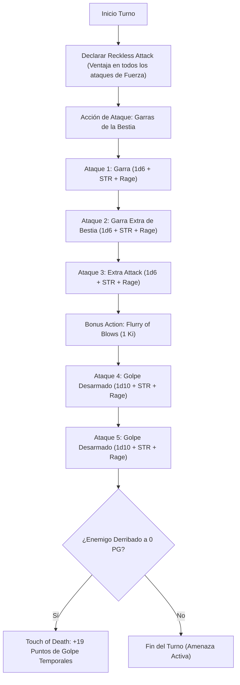

# Guía de Personaje — BONK (The Undying Blender)

## Datos Generales

* **System Standard:** D&D 5th Edition (2024 / 5.5e Update & 2014 Compatibility)
* **Character Level:** 20 (Barbarian [Path of the Beast] 3 / Monk [Way of the Long Death] 17)
* **Species:** Tortle (Caparazón Natural, CA base 17 fija)
* **Background:** Outlander / Hermit (Atributos: Fuerza +2, Sabiduría +1)
* **Stats (Point Buy + Racial + ASIs):**
  * **FUER (STR):** 20 (+5) *(15 Base + 2 Racial + 1 Dote Crusher + 2 ASI Nivel 11)*
  * **DES (DEX):** 13 (+1) *(13 Base — Requisito multiclase de Monje)*
  * **CON:** 16 (+3) *(16 Base — Puntos de golpe y aguante)*
  * **INT:** 8 (-1) *(Standard Array)*
  * **SAB (WIS):** 14 (+2) *(13 Base + 1 Racial — Requisito multiclase y CD de Ki 16)*
  * **CAR (CHA):** 8 (-1) *(Standard Array)*

* **Enlaces de Documentación:**
  * [Bastión y Tiempo Muerto](file:///d:/repo-vault/Proyectos/Rol/DnDbuilds/builds/the%20bonk/bastion%20and%20downtime.md)
  * [Lista de Recursos y Habilidades](file:///d:/repo-vault/Proyectos/Rol/DnDbuilds/builds/the%20bonk/spell%20list.md)
  * [Objetos a Obtener](file:///d:/repo-vault/Proyectos/Rol/DnDbuilds/builds/the%20bonk/item%20list%20to%20obtain.md)
  * [Hoja de Ruta 1-20](file:///d:/repo-vault/Proyectos/Rol/DnDbuilds/builds/the%20bonk/roadmap.md)
  * [Inventario Actual](file:///d:/repo-vault/Proyectos/Rol/DnDbuilds/builds/the%20bonk/actual%20inventory%20list.md)
  * [Guía de Personaje 2024](file:///d:/repo-vault/Proyectos/Rol/DnDbuilds/builds/the%20bonk/character%20guide%202024.md)

---

## Combat Role: Frontline Immortal Bruiser, Claw Blender & Grapple Controller

**BONK** es la encarnación definitiva del tanque inmortal y la licuadora de ataques cuerpo a cuerpo. Gracias a la fisiología Tortle, descarta la necesidad de invertir en Destreza o armaduras tradicionales para mantener una CA de 17 (19 con *Bracers of Defense*), permitiendo volcar todo el potencial en Fuerza bruta.

La combinación de **Path of the Beast** (Garras que conceden un ataque extra por acción de ataque) con **Way of the Long Death** (golpes desarmados que escalan a 1d10, supervivencia infinita con 1 Ki y absorción de PG temporales al matar) genera una máquina implacable de 5 ataques por turno con ventaja constante (*Reckless Attack*).

---

## 1. Gestión de Recursos y Reglas de Inventario

* **Economía de Manos y Armas Naturales:**
  * **Garras de la Bestia y Golpes Desarmados:** Ambas manos están libres para interactuar con el entorno, agarrar (*Grapple*) o empujar (*Shove*). Las garras se manifiestan al enfurecerse y cuentan como armas simples cuerpo a cuerpo de Monje.
  * **Foco y Objetos:** No requiere foco de conjuros. Emplea *Bracers of Defense* en las muñecas, *Insignia of Claws* colgando de su cuello y *Belt of Cloud Giant Strength* en la cintura sin estorbar su caparazón natural.
* **Economía de Puntos de Ki y Furia:**
  * **Puntos de Ki (17 por Descanso Corto):** Combina defensas reactivas (*Mastery of Death* por 1 Ki para no caer a 0 PG), ataques adicionales (*Flurry of Blows*) y stuns (*Stunning Strike*).
  * **Usos de Furia (3 por Descanso Largo):** Proporciona resistencia a daño contundente, cortante y perforante, ventaja en pruebas de Fuerza y +2 al daño plano por cada impacto.

---

## 2. Action Economy & Combat Loop

* **Preparación (Pre-Combate / Turno 0):**
  * Posicionamiento táctico en vanguardia. Sintonización pasiva de *Bracers of Defense* (+2 CA) e *Insignia of Claws* (+1 ataque y daño).
* **Action:**
  * **Acción de Ataque (3 Ataques de Garra con Fuerza y Ventaja):**
    * **Ataque 1:** Garra de la Bestia (Fuerza) con *Reckless Attack* (Ventaja).
    * **Ataque 2 (Garra Extra de Bestia):** Segundo ataque de garra concedido por el rasgo de subclase sin consumir acciones adicionales.
    * **Ataque 3 (Extra Attack Monje Nivel 5):** Tercer ataque de garra con Fuerza y ventaja.
    * *Nota Táctica:* Cualquiera de estos ataques puede sustituirse por un intento de derribo (*Shove*) o agarre (*Grapple*) con ventaja por Furia y atletismo de +11.
* **Bonus Action:**
  * **Turno 1:** Activar **Furia (*Rage*)**. Obtiene resistencia al daño físico y bono plano de daño.
  * **Turnos 2+:** **Ráfaga de Golpes (*Flurry of Blows*)** (1 Ki) $\implies$ 2 ataques desarmados adicionales usando el dado de Artes Marciales (1d10 + STR + Rage) con ventaja constante.
  * **Alternativas Tácticas:** *Patient Defense* (1 Ki, acción de Esquivar) o *Step of the Wind* (1 Ki, Dash/Disengage).
* **Reaction:**
  * 🔵 **Mastery of Death (Monje 11):** Si cae a 0 PG, gasta 1 punto de Ki para quedarse en 1 PG en su lugar. No tiene límite de veces por turno mientras conserve puntos de Ki (hasta 17 veces por descanso corto).
  * 🟢 **Deflect Missiles (Monje 3):** Reduce el daño de proyectiles a distancia en $1\text{d}10 + \text{DEX} (1) + \text{Monk Level} (17)$. Si reduce el daño a 0, gasta 1 Ki para devolver el proyectil.
  * 🟡 **Slow Fall (Monje 4):** Reduce daño de caída en $5 \times \text{Monk Level} = 85$ puntos.

---

## 3. The META Combo: La Licuadora Inmortal de 5 Ataques

El combo principal de **BONK** se basa en saturar el objetivo con 5 ataques por turno con ventaja, empujarlo con *Crusher*, y mantener una presencia indestructible en el centro del combate:

### 🧮 Motor Matemático (Mathematical Engine)

#### 1. Cálculo de Daño por Asalto (DPR con STR 20 Base)

$$\text{Daño Garra} = 1\text{d}6 + 5 (\text{STR}) + 2 (\text{Furia}) = 3.5 + 7 = 10.5$$

$$\text{Daño Golpe Desarmado (Monk 17)} = 1\text{d}10 + 5 (\text{STR}) + 2 (\text{Furia}) = 5.5 + 7 = 12.5$$

$$\text{DPR Base (5 Impactos)} = 3 \times 10.5 + 2 \times 12.5 = 31.5 + 25.0 = \mathbf{56.5 \text{ daño medio/turno}}$$

#### 2. Cálculo de Daño con Objetos Mágicos (Belt of Cloud Giant STR 27 + Insignia of Claws +1)

Con Fuerza 27 (+8) e Insignia of Claws (+1):

$$\text{Daño Garra Optimizado} = 1\text{d}6 + 8 (\text{STR}) + 2 (\text{Furia}) + 1 (\text{Magia}) = 3.5 + 11 = 14.5$$

$$\text{Daño Golpe Desarmado Optimizado} = 1\text{d}10 + 8 (\text{STR}) + 2 (\text{Furia}) + 1 (\text{Magia}) = 5.5 + 11 = 16.5$$

$$\text{DPR Optimizado (5 Impactos)} = 3 \times 14.5 + 2 \times 16.5 = 43.5 + 33.0 = \mathbf{76.5 \text{ daño físico por asalto}}$$

*Con ventaja por Reckless Attack ($P(\text{impacto}) \approx 0.88$ contra CA 18), el DPR efectivo esperado es $\mathbf{70.8 \text{ DPR}}$.*

#### 3. Supervivencia y Puntos de Golpe Efectivos (EHP)

$$\text{HP Máximos} = 12 + (2 \times 7) + (17 \times 5) + (20 \times 3) + 40 (\text{Tough}) = 211 \text{ HP}$$

Bajo resistencia de Furia frente a daño físico:

$$\text{EHP Físico Base} = \frac{211}{0.5} = \mathbf{422 \text{ EHP}}$$

Al matar un esbirro vía *Touch of Death*:

$$\text{THP Ganados} = 2 (\text{WIS}) + 17 (\text{Monk}) = 19 \text{ THP} \implies \mathbf{38 \text{ EHP Físico por baja}}$$

Con *Mastery of Death*, cada uso de 1 Ki cancela una caída a 0 PG, otorgando hasta 17 vidas adicionales por descanso corto.

---

## 4. Tabla de Clasificación Táctica de Habilidades

| Habilidad / Recurso | Tipo | Coste | Evaluación | Justificación Táctica |
| :--- | :---: | :---: | :---: | :--- |
| **Garras de la Bestia** | Ofensiva | 0 Ki / Furia | 🔵 | Otorga un tercer ataque en la acción principal de forma totalmente gratuita. |
| **Reckless Attack** | Ofensiva | 0 Ki | 🔵 | Otorga ventaja en los 5 ataques de Fuerza de cada turno. Crucial para activar críticos de Crusher. |
| **Mastery of Death** | Defensiva | 1 Ki | 🔵 | Te mantiene con 1 PG en lugar de caer inconsciente. Sin límite de usos por turno. |
| **Touch of Death** | Defensiva | Pasivo | 🟢 | +19 THP al matar un enemigo; se duplican virtualmente a 38 con la Furia. |
| **Flurry of Blows** | Ofensiva | 1 Ki | 🔵 | Añade 2 ataques de 1d10 usando Fuerza como acción adicional. |
| **Touch of Long Death** | Nova | 1-10 Ki | 🟢 | Inflige hasta $20\text{d}10$ de daño necrótico en un solo impacto. |
| **Diamond Soul** | Defensiva | Pasivo / 1 Ki | 🔵 | Competencia en todas las salvaciones y reroll de fallos por 1 Ki. |
| **Hour of Reap** | Control | 0 Ki | 🟡 | Miedo en área de 30 ft sin coste de recursos; útil contra hordas. |

---

## 5. Reglas de la Casa (Home Rules)

1. **Garras como Armas de Monje:** Las garras naturales de la Bestia se consideran armas sencillas cuerpo a cuerpo y armas de Monje elegibles para interactuar con Artes Marciales y Ráfaga de Golpes.
2. **Caparazón Tortle Inalterable:** La CA 17 de caparazón natural no interfiere con el Movimiento sin Armadura ni las dotes marciales del Monje.
3. **Crusher + Garras:** El impacto de las garras y golpes desarmados aplica los efectos de empuje y ventaja por crítico de la dote Crusher.