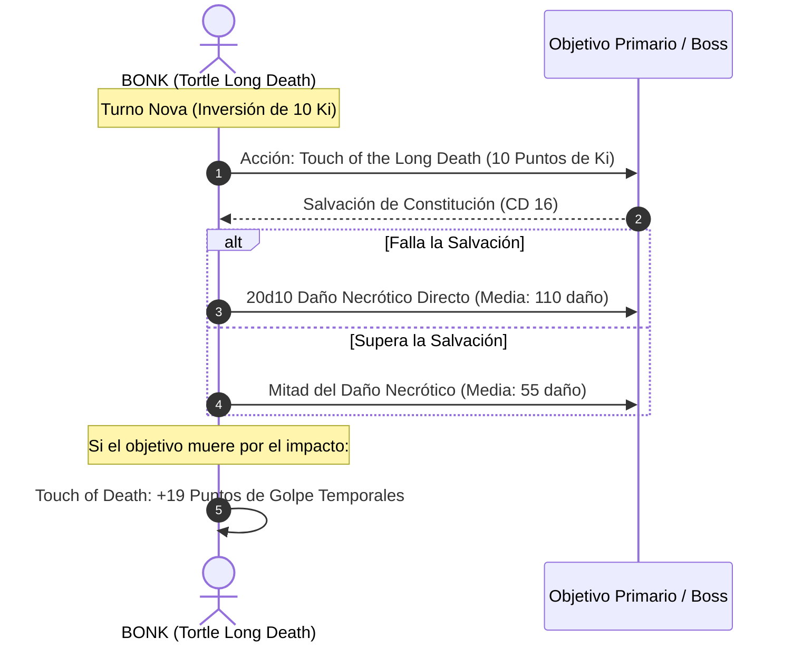

# 🌟 Lista de Recursos y Habilidades de Combate — BONK

Este personaje prescinde del lanzamiento de conjuros mágicos tradicionales para canalizar un motor cinético de artes marciales y furia primigenia impulsado por **Puntos de Ki** y **Usos de Furia**.

---

## 🔮 Matriz de Recursos y Salvaciones

* **Puntos de Ki:** 17 por Descanso Corto (Recuperación completa tras 1 hora de meditación).
* **Usos de Furia (*Rage*):** 3 por Descanso Largo (+2 al daño por ataque de Fuerza, resistencia a daño contundente, cortante y perforante).
* **CD de Salvación de Ki:** $8 + \text{PB (6)} + \text{WIS (2)} = \mathbf{16}$.
* **Turno 0 Pre-Buffs:**
  * Postura Marcial Tortle (CA 17 base + 2 por *Bracers of Defense* = CA 19).
  * Canalización espiritual pasiva de *Insignia of Claws* (+1 a todas las armas naturales y desarmadas).

---

## 🥋 Habilidades de Coste 0 Ki (At-Will y Pasivas)

| Habilidad / Rasgo | Tipo | Clasificación | Efecto Mecánico y Justificación Táctica |
| :--- | :---: | :---: | :--- |
| **Garras de la Bestia (*Beast Claws*)** | Ofensiva | 🔵 | Al entrar en Furia, tus manos se transforman en garras. Si atacas con una garra en tu acción de ataque, realizas un ataque de garra adicional sin coste de acción. |
| **Ataque Temerario (*Reckless Attack*)** | Ofensiva | 🔵 | Otorga ventaja en todas las tiradas de ataque cuerpo a cuerpo de Fuerza durante el asalto, multiplicando la probabilidad de impacto y críticos con *Crusher*. |
| **Artes Marciales (*Martial Arts 1d10*)** | Pasiva | 🔵 | Escala los ataques desarmados a 1d10 y permite un golpe desarmado como acción adicional gratuita si no se gasta Ki en Flurry. |
| **Toque de la Muerte (*Touch of Death*)** | Pasiva | 🟢 | Cada vez que reduces a un enemigo a 0 PG, absorbes su energía vital ganando $\text{WIS (2)} + \text{Monk Level (17)} = \mathbf{19 \text{ PG Temporales}}$. Con Furia, actúan como 38 EHP físicos. |
| **Hora de la Cosecha (*Hour of Reap*)** | Control | 🟡 | Acción at-will sin consumo de Ki. Todas las criaturas a 30 pies deben superar una salvación de Sabiduría (CD 16) o quedar asustadas hasta el final de tu siguiente turno. |
| **Evasión (*Evasion*)** | Defensiva | 🟢 | Si sufres un efecto de área que requiera salvación de Destreza, no recibes daño al superarla y solo la mitad si fallas. |
| **Sentido del Peligro (*Danger Sense*)** | Pasiva | 🟢 | Ventaja en tiradas de salvación de Destreza contra efectos que puedas ver (trampas, conjuros de área). Sinergiza de forma impecable con *Evasion*. |

---

## ⚡ Habilidades de Coste 1 Ki

| Habilidad / Rasgo | Coste | Clasificación | Efecto Mecánico y Justificación Táctica |
| :--- | :---: | :---: | :--- |
| **Ráfaga de Golpes (*Flurry of Blows*)** | 1 Ki | 🔵 | Acción adicional: Realiza dos ataques desarmados consecutivos con Fuerza y el dado de artes marciales (1d10 + STR + Rage cada uno). |
| **Maestría de la Muerte (*Mastery of Death*)** | 1 Ki | 🔵 | Reacción: Cuando caes a 0 PG, gastas 1 punto de Ki para caer a 1 PG en su lugar. No tiene límite por turno mientras tengas Ki disponible (hasta 17 veces consecutivas). |
| **Golpe Aturdidor (*Stunning Strike*)** | 1 Ki | 🟢 | Al impactar con un ataque cuerpo a cuerpo, la criatura debe superar una salvación de Constitución (CD 16) o quedar aturdida (*Stunned*) hasta el final de tu siguiente turno. |
| **Defensa Paciente (*Patient Defense*)** | 1 Ki | 🟢 | Acción adicional: Realiza la acción de Esquivar (*Dodge*), imponiendo desventaja en todos los ataques enemigos que recibas. |
| **Paso del Viento (*Step of the Wind*)** | 1 Ki | 🟡 | Acción adicional: Duplica la distancia de salto y ejecuta *Disengage* o *Dash*. |
| **Desvío de Proyectiles (*Deflect Missiles*)** | 1 Ki | 🟢 | Si reduces a 0 el daño de un proyectil físico con tu reacción, gastas 1 Ki para arrojarlo de vuelta al atacante con alcance de 20/60 pies. |
| **Alma de Diamante (*Diamond Soul - Reroll*)** | 1 Ki | 🔵 | Tienes competencia en todas las salvaciones. Si fallas una tirada de salvación, gastas 1 Ki para repetirla de inmediato. |

---

## 💥 Habilidades de Coste 2+ Ki y Secuencia Nova

### Toque de la Muerte Larga (*Touch of the Long Death*)
* **Coste:** 1 a 10 puntos de Ki (como una acción completa).
* **Mecánica:** Tocas a una criatura a tu alcance. Debe realizar una salvación de Constitución (CD 16).
* **Daño:** Sufre $2\text{d}10$ de daño necrótico por cada punto de Ki invertido si falla, o la mitad si supera la tirada.
* **Potencial Máximo (10 Ki):** $\mathbf{20\text{d}10 \text{ de daño necrótico}} \implies \text{Media: } \mathbf{110 \text{ puntos de daño}}$ ($55$ en caso de éxito).

---

## 🩺 Curación en Segundo Plano y Supervivencia Pasiva

Aunque BONK no posee conjuros curativos como *Healing Word*, su motor de mantenimiento y regeneración en combate y tiempo muerto opera de forma pasiva y automática:

1. **Curación Acelerada de Monje (*Quickened Healing* - Opcional Tasha):**
   * Por 2 puntos de Ki, tira tu dado de Artes Marciales (1d10) + PB (+6) y recupera esa cantidad de puntos de golpe como acción.
   * Promedio de curación: $5.5 + 6 = \mathbf{11.5 \text{ PG por cada 2 Ki}}$.
2. **Escudo de Vida Infinito (*Mastery of Death Survival Loop*):**
   * En lugar de recibir curaciones externas urgentes en combate, BONK simplemente se niega a morir. Al caer a 0 PG, activa *Mastery of Death* (1 Ki) $\implies$ vuelve a tener 1 PG. Cualquier daño masivo subsiguiente vuelve a ser anulado por 1 Ki.
3. **Cosecha de Vitalidad (*Touch of Death*):**
   * El derribo continuo de esbirros de bajo nivel o criaturas invocadas le otorga un flujo constante de +19 PG temporales, renovando su reserva sin consumir turnos de los sanadores aliados.
4. **Suministros de Bastión y Descanso Corto:**
   * Gracias al **Santuario Meditativo** de su Bastión, BONK porta 2 *Potions of Supreme Healing* ($10\text{d}4 + 20 \text{ PG}$) destiladas durante el tiempo muerto para emergencias extremas.