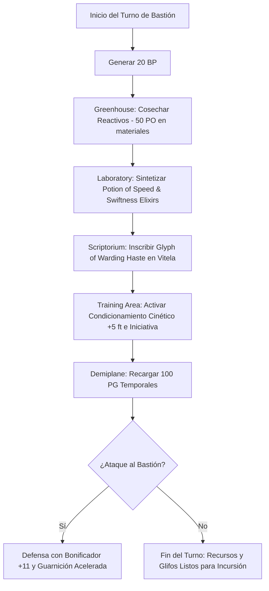

# 🏰 Bastión y Tiempo Muerto — The Bullet

**Build:** The Bullet (El Proyectil Viviente)  
**Sistema:** D&D 2024 / 5.5e DMG Bastion Rules  
**Nivel de Bastión:** 20  
**Nombre del Bastión:** *The Chrono-Kinetic Foundry* (La Fundición Crono-Cinética)  
**Documentos Relacionados:**
* [Guía de Personaje](file:///d:/repo-vault/Proyectos/Rol/DnDbuilds/builds/the%20bullet/character%20guide.md)
* [Guía 2024](file:///d:/repo-vault/Proyectos/Rol/DnDbuilds/builds/the%20bullet/character%20guide%202024.md)
* [Lista de Conjuros](file:///d:/repo-vault/Proyectos/Rol/DnDbuilds/builds/the%20bullet/spell%20list.md)
* [Objetos a Obtener](file:///d:/repo-vault/Proyectos/Rol/DnDbuilds/builds/the%20bullet/item%20list%20to%20obtain.md)
* [Hoja de Ruta](file:///d:/repo-vault/Proyectos/Rol/DnDbuilds/builds/the%20bullet/roadmap.md)
* [Inventario Equipado](file:///d:/repo-vault/Proyectos/Rol/DnDbuilds/builds/the%20bullet/actual%20inventory%20list.md)

---

## 🏛️ Estadísticas Defensivas del Bastión

* **Bonificador de Mando y Defensa:** $\mathbf{+11}$ ($\text{PB } +6 + \text{INT } +5$).
* **Puntos de Bastión (BP):** 20 BP por Turno de Bastión (regeneración según nivel 20).
* **Guarnición Activa:**
  * 12 Mensajeros / Corredores de Vanguardia (Monjes y Pícaros adiestrados).
  * 8 Ingenieros Mecánicos y Alquimistas de Precisión.
  * 1 Autómata Guardián Crono-Acelerado.

---

## 🏗️ Instalaciones Básicas (Basic Facilities)

1. **Dormitorio Principal (Bedchambers):** Diseño aerodinámico y libre de fricción. Mobiliario ergonómico de recarga rápida que reduce la fatiga metabólica.
2. **Comedor Hipercalórico (Dining Hall):** Cocina equipada con raciones de absorción acelerada para sostener el consumo biológico extremo del sprint Tabaxi.
3. **Cámara de Operaciones y Cartografía (Common Room):** Mapas topográficos tridimensionales de todos los reinos y planos conocidos con rutas cinéticas óptimas.
4. **Almacén Seguro de Reactivos (Storage):** Cajas ignífugas y selladas al vacío para componentes alquímicos volátiles.

---

## 🧪 Instalaciones Especiales (Special Facilities: 4 Roomy + 2 Vast)

Conforme a las reglas del DMG 2024 a nivel 20, la fortaleza dispone exactamente de 6 Instalaciones Especiales (4 Roomy y 2 Vast):

### 1. [Roomy] Laboratory (Laboratorio Alquímico)
* **Función:** Destilación masiva de *Potions of Speed*, *Swiftness Elixirs* y antídotos contra la fatiga.
* **Orden de Bastión:** *Research / Craft*. Permite sintetizar consumibles de aceleración a la mitad del coste de oro y en un tercio del tiempo estándar.
* **Sinergia:** Abastecimiento inagotable de consumibles de velocidad para todo el grupo de aventureros.

### 2. [Roomy] Workshop (Taller Mecánico de Precisión)
* **Función:** Diseño y calibración de mecanismos de fricción cero, arneses de absorción de impacto y componentes para armaduras y botas mágicas.
* **Orden de Bastión:** *Craft*. Fabricación de repuestos para *Boots of Speed* y dispositivos mecánicos portátiles.

### 3. [Roomy] Greenhouse (Invernadero Botánico)
* **Función:** Cultivo hidropónico de plantas raras y hongos aceleradores metabólicos.
* **Orden de Bastión:** *Harvest*. Genera 50 PO semanales en materias primas alquímicas, cubriendo por completo los costes de reactivos del Laboratorio.

### 4. [Roomy] Scriptorium (Scriptorium de Glifos)
* **Función:** Mesa de copiado arcano equipada con tintas de diamante para la inscripción masiva de *Glyphs of Warding*.
* **Orden de Bastión:** *Scribe*. Inscribe glifos con conjuros de *Haste*, *Longstrider* y *Fly* en las hojas de vitela del *Libro de Glifos* dentro de la *Bag of Holding*.

### 5. [Vast] Training Area (Pista de Aceleración Cinética)
* **Función:** Circuito cerrado de 1 milla con amortiguadores de impacto para pruebas de velocidad hipersónica.
* **Orden de Bastión:** *Train*. Concede a los defensores del Bastión y al personaje un bonificador pasivo de $+5\text{ pies}$ a la velocidad de movimiento y $+2$ a la iniciativa durante 7 días.

### 6. [Vast] Demiplane (Demiplano Crono-Estabilizado)
* **Función:** Espacio extradimensional donde el tiempo y la inercia pueden ser manipulados artificialmente.
* **Orden de Bastión:** *Sanctuary*. Otorga al personaje $100\text{ PG}$ temporales tras completar un descanso largo en su interior y sirve como almacén central inexpugnable para los libros de glifos.

---

## 🔄 Flujograma de Turno de Bastión (Weekly Bastion Turn)

---

## ⏳ Actividades de Tiempo Muerto (Downtime Priorities)

### Prioridad 1: Recarga del Libro de Glifos en la Bag of Holding
* **Inversión:** 200 PO en polvo de diamante por cada glifo de nivel 3 (*Glyph of Warding*).
* **Objetivo:** Mantener 5 páginas activas con *Haste*, 3 con *Longstrider* y 2 con *Fly*.
* **Efecto en Combate:** Detonación simultánea al abrir la bolsa, otorgando todos los buffs sin gastar turnos ni concentración.

### Prioridad 2: Elaboración de Pociones de Velocidad y Sanación
* **Uso del Laboratorio:** Reducción de tiempo a 1 día por cada poción inusual. Creación de lotes de *Potion of Speed* para el equipo.
