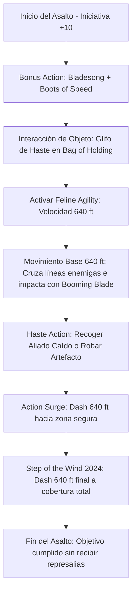

# ⚡ Guía de Personaje — The Bullet (Edición 2024 / 5.5e)

**Arquetipo:** Hyper-Speed Kinetic Infiltrator / Battlefield Courier  
**Clase:** Artificer (Alchemist) 14 / Fighter 2 / Wizard (Bladesinger) 2 / Monk 2  
**Especie:** Tabaxi (Reglas 2024)  
**Trasfondo:** Wayfarer / Artisan (Dote de Origen: *Alert*)  
**Sistema:** D&D 5th Edition (Reglas 2024 / 5.5e)  
**Documentos Relacionados:**
* [Guía Principal](file:///d:/repo-vault/Proyectos/Rol/DnDbuilds/builds/the%20bullet/character%20guide.md)
* [Bastión y Tiempo Muerto](file:///d:/repo-vault/Proyectos/Rol/DnDbuilds/builds/the%20bullet/bastion%20and%20downtime.md)
* [Lista de Conjuros](file:///d:/repo-vault/Proyectos/Rol/DnDbuilds/builds/the%20bullet/spell%20list.md)
* [Objetos a Obtener](file:///d:/repo-vault/Proyectos/Rol/DnDbuilds/builds/the%20bullet/item%20list%20to%20obtain.md)
* [Hoja de Ruta](file:///d:/repo-vault/Proyectos/Rol/DnDbuilds/builds/the%20bullet/roadmap.md)
* [Inventario Equipado](file:///d:/repo-vault/Proyectos/Rol/DnDbuilds/builds/the%20bullet/actual%20inventory%20list.md)

---

## 📊 Atributos y Estadísticas (Nivel 20)

| Atributo | Puntuación | Modificador | Salvación Base | Con Flash of Genius (+5) |
| :--- | :---: | :---: | :---: | :---: |
| **Fuerza (STR)** | 8 | -1 | -1 | +4 |
| **Destreza (DEX)** | 16 | +3 | +3 | +8 |
| **Constitución (CON)** | 12 | +1 | +7 (Competente) | +12 (Ventaja Bladesong) |
| **Inteligencia (INT)** | 20 | +5 | +11 (Competente) | +16 |
| **Sabiduría (WIS)** | 14 | +2 | +2 | +7 |
| **Carisma (CHA)** | 10 | 0 | 0 | +5 |

* **Puntos de Golpe (PG):** 124 ($14 \text{d}8 + 2 \text{d}10 + 4 \text{d}6 + 20 \text{ CON}$).
* **Clase de Armadura (CA):**
  * Sin armadura pasiva: 18 ($10 + 3 \text{ DEX} + 2 \text{ WIS} + 2 \text{ Bracers} + 1 \text{ Luck Blade}$).
  * Con *Bladesong* activa: 23 ($18 + 5 \text{ INT}$).
  * Con *Haste* activa: 25.
  * Con Reacción (*Shield*): $\mathbf{30}$.
* **Iniciativa 2024:** $+3 (\text{DEX}) + 5 (\text{Alert}) + 2 (\text{Training Area Bastion}) = \mathbf{+10}$.

---

## 🏷️ Matriz de Evaluación Táctica

| Categoría | Nivel | Justificación Mecánica |
| :--- | :---: | :--- |
| **Movilidad / Velocidad** | 🔵 S | $3{,}840\text{ pies}$ en un solo asalto ($702.25\text{ km/h}$). Velocidad hipersónica sin rival en el juego. |
| **Infiltración / Rescate** | 🔵 S | Extrae aliados, desactiva mecanismos o roba objetos clave cruzando campos de batalla enteros sin provocar ataques de oportunidad (*Mobile*). |
| **Economía de Acciones** | 🔵 S | Monje 2024 permite *Step of the Wind* con coste reducido; *Action Surge* otorga un Dash extra y *Haste* concede una acción adicional completa. |
| **Supervivencia / EHP** | 🟢 A | CA 25/30, desventaja permanente en ataques enemigos (*Cloak of Displacement*), $+17$ a tiradas de concentración con *Bladesong* y *Flash of Genius*. |
| **Apoyo y Sanación** | 🟢 A | 10 cargas de *Vortex Warp* o *Cure Wounds* en el *Spell-Storing Item*, elixires de alquimista con PG temporales automáticos. |
| **Daño Sostenido (DPR)** | 🟡 B | $18.5$ DPR con *Booming Blade* escalado; el build no busca infligir daño por fuerza bruta sino por control cinético y reposicionamiento absoluto. |

---

## 🧮 Motor Matemático de Cinemática (2024 Ruleset)

### 1. Velocidad Lineal por Movimiento
$$\text{Vel}_{\text{Base}} = 30 (\text{Tabaxi}) + 10 (\text{Monk 2024}) + 10 (\text{Bladesong}) + 10 (\text{Swiftness}) + 10 (\text{Mobile}) + 10 (\text{Longstrider}) = \mathbf{80 \text{ ft.}}$$
$$\text{Multiplicadores} = 2 (\text{Haste}) \times 2 (\text{Boots of Speed}) \times 2 (\text{Feline Agility}) = \mathbf{8\times}$$
$$\text{Velocidad por Instancia} = 80 \times 8 = \mathbf{640 \text{ ft.}}$$

### 2. Distancia Total Recorrida en Asalto de Nova Sprint
$$\text{Distancia Total} = 6 \text{ instancias} \times 640\text{ ft.} = \mathbf{3{,}840 \text{ ft.}} \quad (1{,}170.4 \text{ metros})$$
$$\text{Velocidad} = \frac{1{,}170.4 \text{ m}}{6 \text{ s}} \approx 195.07 \text{ m/s} = \mathbf{702.25 \text{ km/h}} \quad (\mathbf{Mach \ 0.57})$$

### 3. Supervivencia Efectiva con Desventaja Forzada
Con CA 25 base y *Shield* alcanzando CA 30, sumado a la desventaja obligatoria de la *Cloak of Displacement*:
Para un atacante con bono $+12$ contra CA 30 (necesita 18 natural, probabilidad base $P = 0.15$):
$$P_{\text{desventaja}} = P^2 = (0.15)^2 = 0.0225 \quad (2.25\%)$$
$$\text{EHP} = \frac{124 + 100 (\text{Demiplane THP})}{0.0225} = \frac{224}{0.0225} \approx \mathbf{9{,}955.5 \text{ EHP}}$$

---

## 🔄 Bucle Táctico de Combate (Action Loop)

---

## ⚔️ Integración de Weapon Masteries 2024

* **Scimitar (Nick):** Permite realizar un corte rápido como parte de la Acción de Ataque sin consumir la Bonus Action. Crucial para aplicar el efecto de *Mobile* (anular ataques de oportunidad) sobre un centinela enemigo sin perder la Bonus Action necesaria para *Step of the Wind*.
* **Dagger (Nick):** Arma arrojadiza ligera para impactar a distancia y desacoplarse antes de acelerar.
