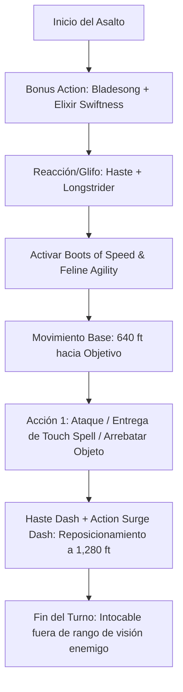

# 🐆 Guía de Personaje — The Bullet

**Build:** The Bullet (El Proyectil Viviente)  
**Clase:** Artificer (Alchemist) 14 / Fighter 2 / Wizard (Bladesinger) 2 / Monk 2  
**Especie:** Tabaxi  
**Trasfondo:** Urchin / Hermit  
**Sistema:** D&D 5th Edition (Reglas 2014 & 2024)  
**Rol:** Hyper-Speed Kinetic Infiltrator / Battlefield Courier / Touch Spell Sniper  
**Documentos Relacionados:**
* [Guía 2024](file:///d:/repo-vault/Proyectos/Rol/DnDbuilds/builds/the%20bullet/character%20guide%202024.md)
* [Bastión y Tiempo Muerto](file:///d:/repo-vault/Proyectos/Rol/DnDbuilds/builds/the%20bullet/bastion%20and%20downtime.md)
* [Lista de Conjuros](file:///d:/repo-vault/Proyectos/Rol/DnDbuilds/builds/the%20bullet/spell%20list.md)
* [Objetos a Obtener](file:///d:/repo-vault/Proyectos/Rol/DnDbuilds/builds/the%20bullet/item%20list%20to%20obtain.md)
* [Hoja de Ruta](file:///d:/repo-vault/Proyectos/Rol/DnDbuilds/builds/the%20bullet/roadmap.md)
* [Inventario Equipado](file:///d:/repo-vault/Proyectos/Rol/DnDbuilds/builds/the%20bullet/actual%20inventory%20list.md)

---

## 📊 Atributos y Estadísticas (Nivel 20)

| Atributo | Puntuación | Modificador | Salvación Base | Con Flash of Genius (+5) |
| :--- | :---: | :---: | :---: | :---: |
| **Fuerza (STR)** | 8 | -1 | -1 | +4 |
| **Destreza (DEX)** | 16 | +3 | +3 | +8 |
| **Constitución (CON)** | 12 | +1 | +7 (Competente) | +12 (Ventaja Bladesong) |
| **Inteligencia (INT)** | 20 | +5 | +11 (Competente) | +16 |
| **Sabiduría (WIS)** | 14 | +2 | +2 | +7 |
| **Carisma (CHA)** | 10 | 0 | 0 | +5 |

* **Puntos de Golpe (PG):** 124 ($14 \text{d}8 + 2 \text{d}10 + 4 \text{d}6 + 20 \text{ CON}$).
* **Clase de Armadura (CA):**
  * Base sin armadura: $10 + 3 (\text{DEX}) + 2 (\text{WIS - Unarmored Defense}) = 15$.
  * Durante *Bladesong*: $15 + 5 (\text{INT}) = 20$.
  * Con *Haste*: $20 + 2 = 22$.
  * Con *Bracers of Defense* y *Ring/Cloak of Protection*: $22 + 2 + 2 = 26$.
  * Con Reacción (*Shield*): $\mathbf{31}$.

---

## 🏷️ Matriz de Evaluación Táctica

| Categoría | Nivel | Justificación Mecánica |
| :--- | :---: | :--- |
| **Movilidad y Velocidad** | 🔵 S | $3{,}840\text{ pies}$ en 6 segundos ($702\text{ km/h}$ / Mach 0.6). Cobertura absoluta de cualquier campo de batalla o plano dimensional. |
| **Infiltración y Recuperación** | 🔵 S | Capaz de entrar en fortalezas enemigas, arrebatar un artefacto u objetivo, y salir a medio kilómetro de distancia en un solo asalto sin provocar ataques de oportunidad (*Mobile*). |
| **Economía de Acciones** | 🟢 A | *Action Surge* (Fighter), Dash adicional vía *Haste*, Dash como Bonus Action (*Step of the Wind*), reacción forzada vía glifo. |
| **Supervivencia / EHP** | 🟢 A | CA 26/31, bonificador a concentración de $+17$ (*Bladesong* + *Flash of Genius*), inmunidad a terreno difícil e imposible de fijar en combate cuerpo a cuerpo. |
| **Versatilidad de Apoyo** | 🟢 A | Elixires de alquimista instantáneos, *Spell-Storing Item* con 10 usos de *Vortex Warp* o *Cure Wounds*, entrega inmediata de pociones a aliados caídos a cientos de pies. |
| **Daño Sostenido (DPR)** | 🟡 B | Daño directo moderado; su fortaleza radica en golpear con cantrips/armas imbuidas, entregar daño cinético o liberar glifos ofensivos. |

---

## 🧮 Motor Matemático de Cinemática y Velocidad

### 1. Desglose de Velocidad Base por Turno
$$\text{Vel}_{\text{Base}} = \text{Tabaxi}_{30} + \text{Monk}_{10} + \text{Bladesong}_{10} + \text{Swiftness Elixir}_{10} + \text{Mobile}_{10} + \text{Longstrider}_{10} = \mathbf{80 \text{ ft.}}$$

### 2. Multiplicadores Acumulativos
$$\text{Multiplicador} = 2 (\text{Haste}) \times 2 (\text{Boots of Speed}) \times 2 (\text{Feline Agility}) = \mathbf{8\times}$$
$$\text{Velocidad por Instancia de Movimiento} = 80 \times 8 = \mathbf{640 \text{ ft.}}$$

### 3. Asalto de Sprint Máximo (Nova Run)
El personaje ejecuta 6 instancias completas de movimiento en el asalto:
1. Movimiento Ordinario: $640\text{ ft.}$
2. Acción Ordinaria (Dash): $640\text{ ft.}$
3. Acción de *Haste* (Dash): $640\text{ ft.}$
4. *Action Surge* (Dash): $640\text{ ft.}$
5. Bonus Action (*Step of the Wind* — Dash): $640\text{ ft.}$
6. Reacción (*Dissonant Whispers* activado por Glifo en *Bag of Holding*): $640\text{ ft.}$

$$\text{Distancia Total en 1 Asalto (6 s)} = 640 \times 6 = \mathbf{3{,}840 \text{ ft.}} \approx 1{,}170.4 \text{ metros}$$

$$\text{Velocidad Lineal} = \frac{1{,}170.4 \text{ m}}{6 \text{ s}} \approx 195.07 \text{ m/s} = \mathbf{702.25 \text{ km/h}} \quad (\mathbf{436.36 \text{ mph}})$$

### 4. Energía Cinética y Masa en Impacto
$$\text{Masa Total (Tabaxi + Equipo)} \approx 75 \text{ kg}$$
$$E_k = \frac{1}{2} m v^2 = \frac{1}{2} \times 75 \times (195.07)^2 \approx \mathbf{1{,}427{,}000 \text{ Joules}} \quad (1.43 \text{ MJ})$$
*(Equivalente al impacto frontal de una camioneta de 2 toneladas a $135\text{ km/h}$). Cualquier regla de colisión o daño por caída aplicado horizontalmente aniquila objetivos no protegidos.*

---

## 🔄 Bucle Táctico de Combate (Action Loop)

### Turno 0 (Preparación previa al asalto)
* Ingerir *Swiftness Elixir* (+10 ft por 1 hora).
* Activar *Longstrider* (+10 ft por 1 hora, sin concentración).
* Equipar *Boots of Speed*.

### Turno 1 (Aceleración Supersónica)
1. **Bonus Action:** Activar *Bladesong* (+10 ft velocidad, +5 CA, +5 a concentración).
2. **Objeto/Interacción:** Abrir el *Libro de Glifos* dentro de la *Bag of Holding* para activar *Haste* sin perder concentración ni gastar acción en el asalto principal.
3. **Movement:** Activar *Feline Agility* y *Boots of Speed*. Velocidad instantánea de 640 pies por movimiento.
4. **Action:** Realizar misión crítica (eliminar a un mago enemigo, aplicar *Vortex Warp* para rescatar a un aliado, desactivar un artefacto o descargar un ataque cinético).
5. **Action Surge:** Dash para alejarse $640\text{ ft.}$ fuera del alcance efectivo de conjuros enemigos.
6. **Haste Action:** Dash adicional para situarse tras cobertura total.

---

## ⚖️ Explotación de Reglas de la Casa y Física RAW

* **Bag of Holding + Glyph of Warding:**
  * La *Bag of Holding* conecta a un espacio extradimensional no ligado a las coordenadas del plano material. El libro permanece inmóvil dentro de su microplano respecto a su marco de referencia inercial. Al abrir la solapa y tocar la página, los glifos detonan sin haber violado la regla de no moverse más de 10 pies del lugar donde fueron inscritos.
* **Mobile Feat Anti-Opportunity:**
  * Al hacer un ataque contra un objetivo (incluso si falla), dicho objetivo no puede realizar ataques de oportunidad contra ti por el resto del turno. Puedes cruzar una línea enemiga entera golpeando superficialmente a cada enemigo sin recibir un solo castigo.
