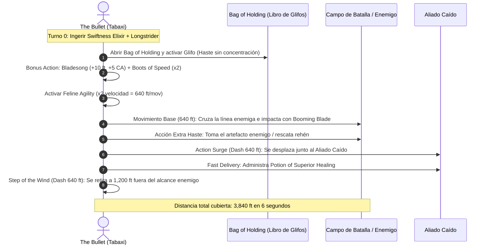

# 📜 Lista de Conjuros y Alquimia — The Bullet

**Build:** The Bullet (El Proyectil Viviente)  
**Clase:** Artificer (Alchemist) 14 / Fighter 2 / Wizard (Bladesinger) 2 / Monk 2  
**Nivel de Lanzador Combinado:** Nivel 9 de Ranuras (Artificer 14 / 2 = 7 + Wizard 2 = 9)  
**Ranuras Disponibles:** 4 de Nivel 1, 3 de Nivel 2, 3 de Nivel 3, 3 de Nivel 4, 1 de Nivel 5  
**Documentos Relacionados:**
* [Guía de Personaje](file:///d:/repo-vault/Proyectos/Rol/DnDbuilds/builds/the%20bullet/character%20guide.md)
* [Guía 2024](file:///d:/repo-vault/Proyectos/Rol/DnDbuilds/builds/the%20bullet/character%20guide%202024.md)
* [Bastión y Tiempo Muerto](file:///d:/repo-vault/Proyectos/Rol/DnDbuilds/builds/the%20bullet/bastion%20and%20downtime.md)
* [Objetos a Obtener](file:///d:/repo-vault/Proyectos/Rol/DnDbuilds/builds/the%20bullet/item%20list%20to%20obtain.md)
* [Hoja de Ruta](file:///d:/repo-vault/Proyectos/Rol/DnDbuilds/builds/the%20bullet/roadmap.md)
* [Inventario Equipado](file:///d:/repo-vault/Proyectos/Rol/DnDbuilds/builds/the%20bullet/actual%20inventory%20list.md)

---

## ⚡ Efectos Activos y Buffs Previos (Turn 0)

| Efecto / Conjuro | Duración | Concentración | Beneficio Mecánico |
| :--- | :---: | :---: | :--- |
| **Swiftness Elixir** | 1 hora | No | $+10\text{ ft.}$ a la velocidad de movimiento base. |
| **Longstrider** | 1 hora | No | $+10\text{ ft.}$ a la velocidad de movimiento base. |
| **Aid (Nivel 4)** | 8 horas | No | $+15\text{ PG}$ máximos y actuales a 3 objetivos. |
| **Death Ward** | 8 horas | No | Inmunidad al primer golpe que reduciría los PG a 0 (vital para no morir por colisión). |
| **Glyph of Warding: Haste** | 1 minuto | No (Vía Glifo) | $\times 2$ velocidad, $+2$ CA, 1 acción adicional por turno. |
| **Boots of Speed** | 10 minutos | No | $\times 2$ velocidad de movimiento (activable con Bonus Action). |

---

## 📊 Matriz de Conjuros Preparados (Artífice y Mago)

### Trucos (Cantrips)
* **Booming Blade (Wizard):** 🔵 S. Si golpeas a toda velocidad y te retiras a $640\text{ pies}$, el enemigo está obligado a moverse para alcanzarte, detonando el daño secundario ($3\text{d}8$ trueno).
* **Mage Hand (Wizard):** 🟢 A. Manipulación remota de objetos a distancia.
* **Guidance (Artificer):** 🟢 A. $+1\text{d}4$ a cualquier prueba de habilidad o iniciativa.
* **Fire Bolt (Artificer):** 🟡 B. Ataque a distancia estándar si el cuerpo a cuerpo no es viable.

### Nivel 1
* **Shield (Wizard):** 🔵 S. Reacción indispensable que eleva la CA a 31.
* **Absorb Elements (Artificer / Wizard):** 🔵 S. Mitiga a la mitad el daño elemental entrante y añade daño a tu próximo impacto.
* **Longstrider (Artificer / Wizard):** 🔵 S. Bonificador de velocidad sin requerir concentración.
* **Healing Word (Artificer):** 🟢 A. Sanación de emergencia a distancia con Bonus Action.
* **Silvery Barbs (Wizard):** 🔵 S. Anula críticos enemigos e impone desventaja con ventaja para un aliado.

### Nivel 2
* **Vortex Warp (Artificer / Wizard):** 🔵 S. Teletransporta a un aliado o enemigo a 90 pies (o a 180 si escalas la ranura).
* **Web (Artificer / Wizard):** 🟢 A. Control de masas en área para atrapar hordas mientras pasas a toda velocidad.
* **Mirror Image (Wizard):** 🟢 A. Defensa pasiva que no requiere concentración.
* **Lesser Restoration (Artificer):** 🟢 A. Cura parálisis, ceguera, sordera y venenos.

### Nivel 3
* **Haste (Wizard):** 🔵 S. El motor de aceleración definitivo del build.
* **Glyph of Warding (Wizard / Artificer):** 🔵 S. Inscripción en el *Libro de Glifos* para pre-cargar buffs sin concentración.
* **Dispel Magic (Artificer / Wizard):** 🟢 A. Neutraliza barreras mágicas y campos de fuerza que impidan el paso.
* **Revivify (Artificer):** 🟢 A. Resurrección inmediata dentro del minuto de muerte de un aliado.

### Nivel 4 y 5
* **Freedom of Movement (Artificer):** 🔵 S. Inmunidad a terreno difícil, parálisis e impedimentos de agarre.
* **Dimension Door (Wizard):** 🟢 A. Escape dimensional instantáneo a 500 pies si el terreno físico es infranqueable.
* **Greater Restoration (Artificer):** 🟢 A. Cura agotamiento, petrificación y reducciones de atributos máximos.

---

## 🔄 Diagrama de Secuencia: Nova Speed Run & Kinetic Delivery

---

## 💖 Curación en Segundo Plano (Background Healing)

El build cuenta con múltiples motores de sanación pasiva y de baja demanda de recursos:
1. **Experimental Elixirs (Healing):** Alchemist 14 genera elixires diarios de forma gratuita. Cada elixir de curación restaura $2\text{d}4 + 5 (\text{INT}) = \mathbf{10 \text{ PG}}$ sin gastar espacios altos.
2. **Spell-Storing Item (Cure Wounds):** 10 cargas diarias de *Cure Wounds* de nivel 2. Cada uso restaura $2\text{d}8 + 5 = \mathbf{14 \text{ PG}}$, proporcionando un total de **140 PG de curación de bolsillo** transferible a cualquier miembro del grupo o familiar homúnculo.
3. **Restorative Reagents (Artificer 9):** Cada vez que una criatura bebe un elixir experimental o recibe un conjuro que restaura PG, recibe además **PG temporales iguales a $2\text{d}6 + 5$** ($12 \text{ PG temporales}$).
